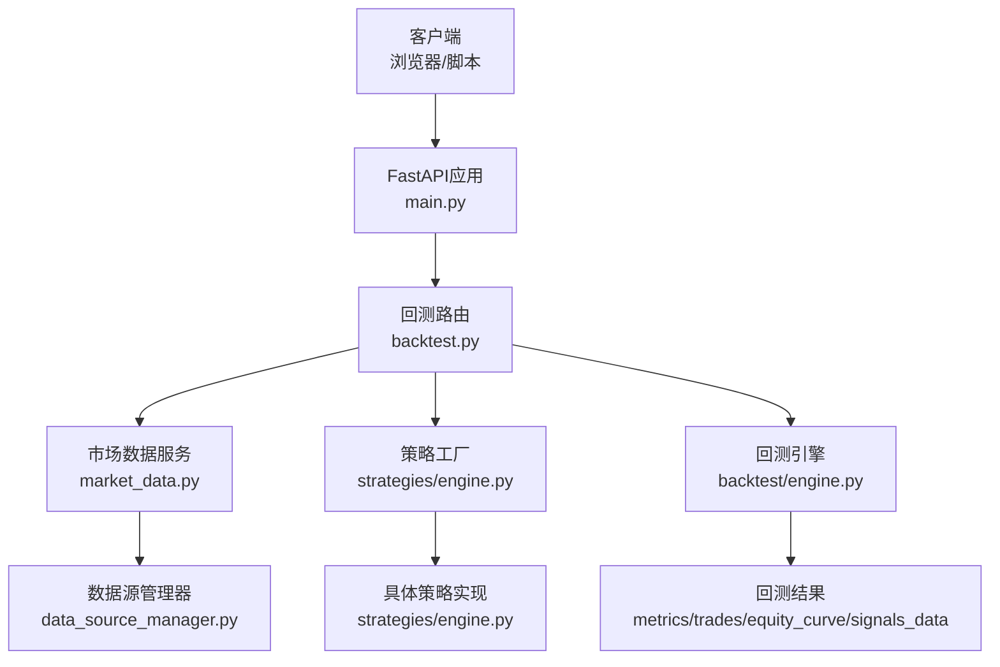
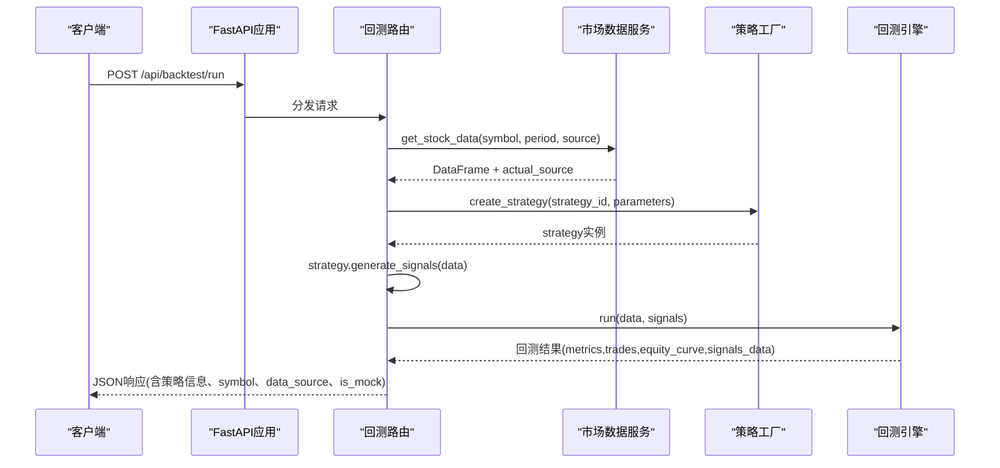
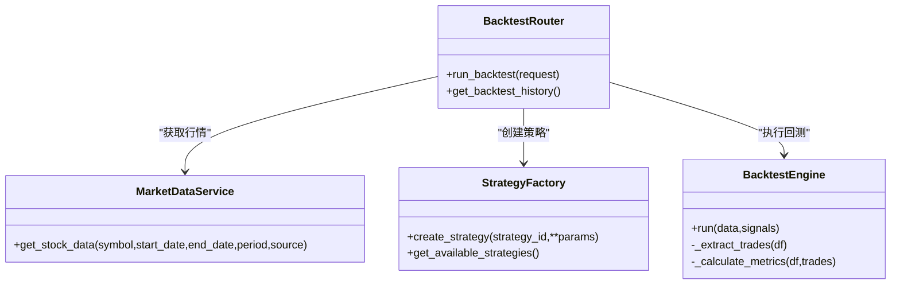

# 回测API

<cite>
**本文引用的文件**   
- [backend/main.py](../../../backend/main.py)
- [backend/app/api/backtest.py](../../../backend/app/api/backtest.py)
- [backend/app/backtest/engine.py](../../../backend/app/backtest/engine.py)
- [backend/app/strategies/engine.py](../../../backend/app/strategies/engine.py)
- [backend/app/services/market_data.py](../../../backend/app/services/market_data.py)
- [frontend/src/components/BacktestForm.tsx](../../../frontend/src/components/BacktestForm.tsx)
- [frontend/src/components/BacktestResult.tsx](../../../frontend/src/components/BacktestResult.tsx)
</cite>

## 目录
1. [简介](#简介)
2. [项目结构](#项目结构)
3. [核心组件](#核心组件)
4. [架构总览](#架构总览)
5. [详细组件分析](#详细组件分析)
6. [依赖关系分析](#依赖关系分析)
7. [性能与扩展性](#性能与扩展性)
8. [故障排查指南](#故障排查指南)
9. [结论](#结论)
10. [附录：接口规范与示例](#附录接口规范与示例)

## 简介
本文件面向使用“量化策略查看系统”的开发者与量化研究员，提供“回测API”的完整技术文档。内容涵盖：
- HTTP方法、URL路径、请求参数与响应字段定义
- 错误码与处理建议
- curl命令与JavaScript客户端调用示例
- 回测数据结构与字段含义说明
- 批量回测与异步处理的实现思路与最佳实践

该系统后端基于FastAPI，前端为React+TypeScript；回测流程包括：获取行情数据、生成交易信号、执行回测引擎计算绩效指标与资金曲线，并返回结构化结果供前端可视化展示。

## 项目结构
与回测API直接相关的代码分布如下：
- 路由层：定义HTTP接口与入参校验
- 业务层：策略工厂与策略信号生成
- 数据层：多数据源行情获取
- 引擎层：回测引擎计算收益、回撤、夏普等指标
- 前端：表单提交与结果渲染

图表来源
- [backend/main.py:9-27](../../../backend/main.py#L9-L27)
- [backend/app/api/backtest.py:13-66](../../../backend/app/api/backtest.py#L13-L66)
- [backend/app/services/market_data.py:11-41](../../../backend/app/services/market_data.py#L11-L41)
- [backend/app/strategies/engine.py:506-655](../../../backend/app/strategies/engine.py#L506-L655)
- [backend/app/backtest/engine.py:10-70](../../../backend/app/backtest/engine.py#L10-L70)

章节来源
- [backend/main.py:1-36](../../../backend/main.py#L1-L36)

## 核心组件
- FastAPI应用与CORS配置：注册跨域、挂载路由前缀
- 回测路由：接收请求、组装参数、调用数据服务与策略工厂、运行回测引擎
- 策略工厂：根据strategy_id创建不同策略实例，支持多种经典与深度学习策略
- 市场数据服务：统一封装多数据源的股票数据获取
- 回测引擎：合并数据与信号，计算收益曲线、交易记录、绩效指标

章节来源
- [backend/main.py:9-27](../../../backend/main.py#L9-L27)
- [backend/app/api/backtest.py:16-66](../../../backend/app/api/backtest.py#L16-L66)
- [backend/app/strategies/engine.py:506-655](../../../backend/app/strategies/engine.py#L506-L655)
- [backend/app/services/market_data.py:11-41](../../../backend/app/services/market_data.py#L11-L41)
- [backend/app/backtest/engine.py:10-70](../../../backend/app/backtest/engine.py#L10-L70)

## 架构总览
下图展示了从客户端发起回测到返回结果的完整时序。

图表来源
- [backend/main.py:24-27](../../../backend/main.py#L24-L27)
- [backend/app/api/backtest.py:28-66](../../../backend/app/api/backtest.py#L28-L66)
- [backend/app/services/market_data.py:14-41](../../../backend/app/services/market_data.py#L14-L41)
- [backend/app/strategies/engine.py:600-655](../../../backend/app/strategies/engine.py#L600-L655)
- [backend/app/backtest/engine.py:15-70](../../../backend/app/backtest/engine.py#L15-L70)

## 详细组件分析

### 回测路由（/api/backtest）
- 路由前缀：/api/backtest
- 端点：
  - POST /run：执行一次回测
  - GET /history：查询历史回测（当前未实现）

请求体（POST /run）
- strategy_id：字符串，必填
- symbol：字符串，必填
- start_date：可选，日期字符串
- end_date：可选，日期字符串
- period：字符串，默认"1y"
- initial_capital：浮点数，默认100000.0
- source：字符串，默认"auto"，支持auto/tencent/yfinance/akshare/baostock/mock
- parameters：对象，键值对，随策略而定

响应体（POST /run）
- metrics：对象，包含初始资金、最终价值、总收益率、年化收益率、最大回撤、夏普比率、胜率、总交易次数、盈利次数、亏损次数、盈亏比
- trades：数组，每笔交易的入场/出场日期、价格、盈亏与百分比、方向
- equity_curve：数组，按日期的资金曲线与收盘价、信号列
- signals_data：数组，按日期的收盘价、信号、仓位变化
- strategy：对象，包含id、name、parameters
- symbol：字符串
- data_source：字符串，实际使用的数据源
- is_mock：布尔，是否使用模拟数据

错误处理
- 任何异常将返回HTTP 400，detail为异常消息文本

章节来源
- [backend/app/api/backtest.py:16-76](../../../backend/app/api/backtest.py#L16-L76)

### 回测引擎（BacktestEngine）
职责
- 合并行情数据与交易信号
- 计算策略收益、累计收益、资金曲线
- 提取交易记录
- 计算绩效指标（总收益、年化收益、最大回撤、夏普比率、胜率、盈亏比等）
- 输出JSON可序列化的结果

关键流程
- 输入：DataFrame（Open/High/Low/Close/Volume）、DataFrame（signal/position）
- 输出：字典（metrics/trades/equity_curve/signals_data）

复杂度与健壮性
- 时间复杂度主要取决于数据行数N，整体O(N)
- 对NaN/Inf进行清理，保证JSON序列化安全

章节来源
- [backend/app/backtest/engine.py:10-163](../../../backend/app/backtest/engine.py#L10-L163)

### 策略工厂与策略实现
- 工厂函数create_strategy根据strategy_id动态创建策略实例
- 支持的策略类型包括均线交叉、动量、均值回归、RSI、布林带、多因子、Transformer预测、Transformer深度学习等
- 每个策略实现generate_signals(data)，返回包含signal与position的DataFrame

章节来源
- [backend/app/strategies/engine.py:17-503](../../../backend/app/strategies/engine.py#L17-L503)
- [backend/app/strategies/engine.py:506-655](../../../backend/app/strategies/engine.py#L506-L655)

### 市场数据服务
- 统一入口MarketDataService.get_stock_data，委托给DataSourceManager
- 支持自动选择数据源或指定特定数据源
- 返回(DataFrame, actual_source)

章节来源
- [backend/app/services/market_data.py:11-41](../../../backend/app/services/market_data.py#L11-L41)

### 前端交互（参考）
- BacktestForm负责收集用户输入并提交到后端
- BacktestResult负责渲染metrics、trades、equity_curve等

章节来源
- [frontend/src/components/BacktestForm.tsx:21-44](../../../frontend/src/components/BacktestForm.tsx#L21-L44)
- [frontend/src/components/BacktestResult.tsx:9-41](../../../frontend/src/components/BacktestResult.tsx#L9-L41)

## 依赖关系分析
- 路由层依赖：策略工厂、回测引擎、市场数据服务
- 策略层依赖：pandas/numpy用于信号计算
- 数据层依赖：数据源管理器（外部库如yfinance/akshare/baostock等）
- 引擎层依赖：pandas/numpy用于指标计算

图表来源
- [backend/app/api/backtest.py:13-66](../../../backend/app/api/backtest.py#L13-L66)
- [backend/app/services/market_data.py:11-41](../../../backend/app/services/market_data.py#L11-L41)
- [backend/app/strategies/engine.py:506-655](../../../backend/app/strategies/engine.py#L506-L655)
- [backend/app/backtest/engine.py:10-70](../../../backend/app/backtest/engine.py#L10-L70)

## 性能与扩展性
- 单请求同步执行：适合小规模回测与交互式探索
- 大数据集优化建议：
  - 向量化计算优先，避免逐行迭代
  - 缓存常用指标（如移动平均、波动率）
  - 限制回测区间长度或使用增量计算
- 并发与批处理：
  - 可通过任务队列（Celery/RQ）实现异步批量回测
  - 前端轮询任务状态，完成后拉取结果
- 存储与持久化：
  - 将历史回测结果写入数据库，便于检索与对比
  - 对高频访问的数据（如热门标的）做短期缓存

[本节为通用指导，不直接分析具体文件]

## 故障排查指南
常见问题与建议
- 400错误：通常由参数错误或策略初始化失败引起，检查strategy_id与parameters是否与策略定义一致
- 数据源不可用：当source=auto时可能回退到mock，注意is_mock字段提示
- 深度学习策略缺失依赖：transformer_dl需要PyTorch等依赖，安装后重试
- 空交易记录：可能是信号过于稀疏或阈值设置不当，调整策略参数

章节来源
- [backend/app/api/backtest.py:68-69](../../../backend/app/api/backtest.py#L68-L69)
- [backend/app/strategies/engine.py:647-655](../../../backend/app/strategies/engine.py#L647-L655)

## 结论
本回测API提供了端到端的策略回测能力，覆盖从数据获取、信号生成到绩效评估的全链路。通过清晰的请求/响应结构与可扩展的策略体系，既满足快速验证需求，也为后续异步化与批量化扩展预留了空间。

[本节为总结性内容，不直接分析具体文件]

## 附录：接口规范与示例

### 接口定义
- 基础地址：http://localhost:8000（开发环境默认端口）
- 路由前缀：/api/backtest

#### 执行回测
- 方法：POST
- URL：/api/backtest/run
- Content-Type：application/json
- 请求体字段：
  - strategy_id：字符串，必填
  - symbol：字符串，必填
  - start_date：可选，日期字符串
  - end_date：可选，日期字符串
  - period：字符串，默认"1y"
  - initial_capital：浮点数，默认100000.0
  - source：字符串，默认"auto"
  - parameters：对象，键值对，随策略而定

- 成功响应（200）：
  - metrics：对象
    - initial_capital：浮点数
    - final_value：浮点数
    - total_return：浮点数（百分比）
    - annual_return：浮点数（百分比）
    - max_drawdown：浮点数（百分比）
    - sharpe_ratio：浮点数
    - win_rate：浮点数（百分比）
    - total_trades：整数
    - winning_trades：整数
    - losing_trades：整数
    - profit_loss_ratio：浮点数
  - trades：数组，每项包含：
    - entry_date：字符串（日期）
    - exit_date：字符串（日期）
    - entry_price：浮点数
    - exit_price：浮点数
    - pnl：浮点数
    - pnl_pct：浮点数（百分比）
    - direction：字符串（long）
  - equity_curve：数组，每项包含：
    - Date：字符串（日期）
    - equity：浮点数
    - Close：浮点数
    - signal：浮点数
  - signals_data：数组，每项包含：
    - Date：字符串（日期）
    - Close：浮点数
    - signal：浮点数
    - position_change：浮点数
  - strategy：对象
    - id：字符串
    - name：字符串
    - parameters：对象
  - symbol：字符串
  - data_source：字符串
  - is_mock：布尔

- 错误响应（400）：
  - detail：字符串，错误描述

章节来源
- [backend/app/api/backtest.py:16-66](../../../backend/app/api/backtest.py#L16-L66)
- [backend/app/backtest/engine.py:63-70](../../../backend/app/backtest/engine.py#L63-L70)
- [backend/app/backtest/engine.py:105-162](../../../backend/app/backtest/engine.py#L105-L162)

### curl命令示例
- 基本回测（均线交叉策略）
  - curl -X POST http://localhost:8000/api/backtest/run \
    -H "Content-Type: application/json" \
    -d '{
      "strategy_id": "ma_cross",
      "symbol": "600519.SS",
      "period": "1y",
      "initial_capital": 100000,
      "source": "auto",
      "parameters": {
        "short_window": 5,
        "long_window": 20
      }
    }'

- 动量策略
  - curl -X POST http://localhost:8000/api/backtest/run \
    -H "Content-Type: application/json" \
    -d '{
      "strategy_id": "momentum",
      "symbol": "AAPL",
      "period": "6mo",
      "initial_capital": 200000,
      "source": "yfinance",
      "parameters": {
        "lookback_period": 20,
        "threshold": 0.05
      }
    }'

- 布林带策略
  - curl -X POST http://localhost:8000/api/backtest/run \
    -H "Content-Type: application/json" \
    -d '{
      "strategy_id": "bollinger_bands",
      "symbol": "GOOGL",
      "period": "1y",
      "initial_capital": 150000,
      "source": "auto",
      "parameters": {
        "window": 20,
        "num_std": 2.0,
        "buy_threshold": 0.05,
        "sell_threshold": 0.95
      }
    }'

章节来源
- [backend/app/api/backtest.py:28-66](../../../backend/app/api/backtest.py#L28-L66)

### JavaScript客户端调用示例
- 使用fetch发起请求
  - 构造请求体，包含strategy_id、symbol、period、initial_capital、source、parameters
  - 处理成功响应，读取metrics、trades、equity_curve、signals_data、strategy、symbol、data_source、is_mock
  - 错误处理：捕获网络异常与HTTP错误，显示detail信息

- 推荐实践
  - 在提交前校验必填字段与参数范围
  - 对is_mock为true时给出提示
  - 对large数据集增加超时与进度提示

章节来源
- [frontend/src/components/BacktestForm.tsx:28-44](../../../frontend/src/components/BacktestForm.tsx#L28-L44)
- [frontend/src/components/BacktestResult.tsx:9-41](../../../frontend/src/components/BacktestResult.tsx#L9-L41)

### 错误码与处理建议
- 400 Bad Request：参数错误或内部异常
  - 检查strategy_id是否存在
  - 检查parameters是否符合策略定义
  - 检查网络连接与数据源可用性
- 其他HTTP错误：根据状态码处理并重试或提示用户

章节来源
- [backend/app/api/backtest.py:68-69](../../../backend/app/api/backtest.py#L68-L69)

### 高级功能：批量回测与异步处理
- 批量回测
  - 设计批量请求体：包含多个回测任务（strategy_id、symbol、parameters等）
  - 服务端并行执行（线程池或进程池），聚合结果返回
  - 前端分页展示结果，支持导出CSV/Excel

- 异步处理
  - 引入任务队列（如Celery/RQ）
  - 提交任务后返回task_id，前端轮询任务状态
  - 任务完成后将结果持久化至数据库，并提供查询接口

[本节为概念性扩展，不直接分析具体文件]