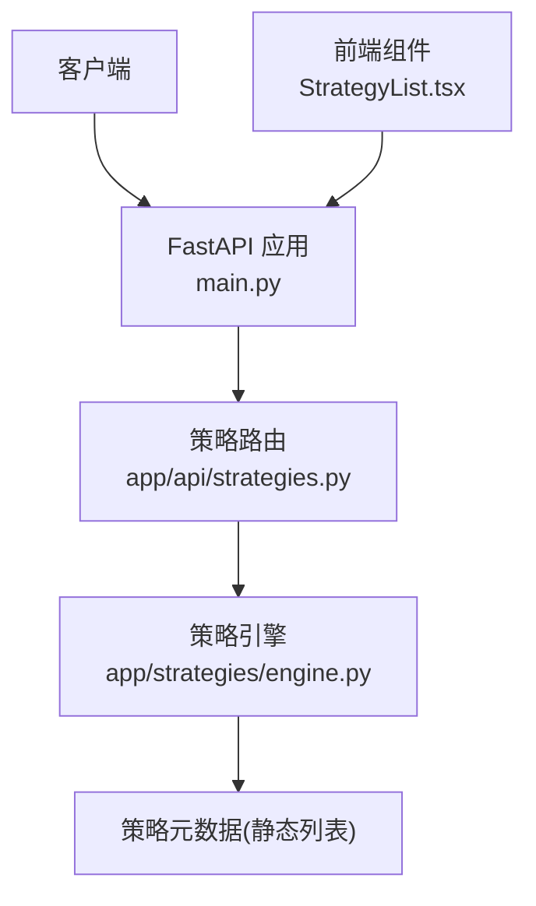
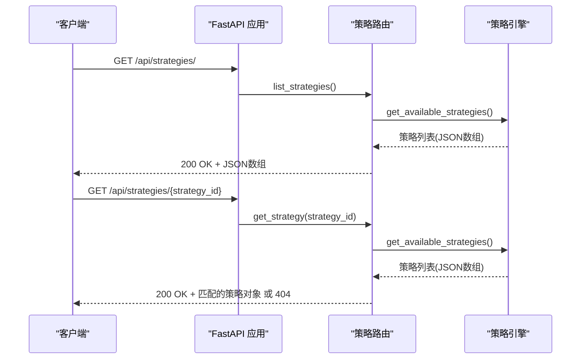
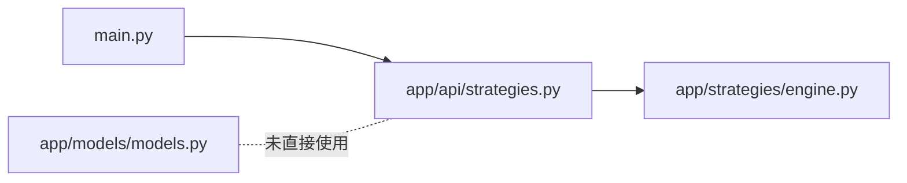

# 策略管理API

<cite>
**本文引用的文件**   
- [backend/app/api/strategies.py](../../../backend/app/api/strategies.py)
- [backend/app/strategies/engine.py](../../../backend/app/strategies/engine.py)
- [backend/main.py](../../../backend/main.py)
- [backend/app/models/models.py](../../../backend/app/models/models.py)
- [frontend/src/components/StrategyList.tsx](../../../frontend/src/components/StrategyList.tsx)
</cite>

## 目录
1. [简介](#简介)
2. [项目结构](#项目结构)
3. [核心组件](#核心组件)
4. [架构总览](#架构总览)
5. [详细接口规范](#详细接口规范)
6. [依赖关系分析](#依赖关系分析)
7. [性能与可用性考虑](#性能与可用性考虑)
8. [故障排查指南](#故障排查指南)
9. [结论](#结论)
10. [附录：常见使用场景与集成示例](#附录常见使用场景与集成示例)

## 简介
本文件为“策略管理API”的完整技术文档，聚焦以下两个接口：
- 获取策略列表：GET /api/strategies/
- 获取策略详情：GET /api/strategies/{strategy_id}

文档涵盖HTTP方法、URL路径、请求参数、响应格式、错误码、处理示例（curl与JavaScript）、数据结构说明、字段含义、使用模式、常见问题与最佳实践。

## 项目结构
后端采用FastAPI框架，策略相关路由位于app/api/strategies.py，策略元数据由app/strategies/engine.py提供；应用入口在main.py中注册路由前缀。前端通过React组件调用策略列表接口以展示并选择策略。

图表来源
- [backend/main.py:24-27](../../../backend/main.py#L24-L27)
- [backend/app/api/strategies.py:8-24](../../../backend/app/api/strategies.py#L8-L24)
- [backend/app/strategies/engine.py:506-597](../../../backend/app/strategies/engine.py#L506-L597)
- [frontend/src/components/StrategyList.tsx:31-41](../../../frontend/src/components/StrategyList.tsx#L31-L41)

章节来源
- [backend/main.py:1-36](../../../backend/main.py#L1-L36)
- [backend/app/api/strategies.py:1-25](../../../backend/app/api/strategies.py#L1-L25)
- [backend/app/strategies/engine.py:506-597](../../../backend/app/strategies/engine.py#L506-L597)
- [frontend/src/components/StrategyList.tsx:1-45](../../../frontend/src/components/StrategyList.tsx#L1-L45)

## 核心组件
- FastAPI应用与CORS配置：定义应用标题、版本，启用跨域，注册各模块路由前缀。
- 策略路由：暴露策略列表与详情接口，内部调用策略引擎提供的可用策略集合。
- 策略引擎：维护可用策略的静态元数据，并提供创建实例的方法（与本文无关但供其他模块复用）。
- 前端组件：调用策略列表接口，默认选中首个策略。

章节来源
- [backend/main.py:9-27](../../../backend/main.py#L9-L27)
- [backend/app/api/strategies.py:11-24](../../../backend/app/api/strategies.py#L11-L24)
- [backend/app/strategies/engine.py:506-597](../../../backend/app/strategies/engine.py#L506-L597)
- [frontend/src/components/StrategyList.tsx:31-41](../../../frontend/src/components/StrategyList.tsx#L31-L41)

## 架构总览
策略管理API的请求流程如下：
- 客户端发起GET请求到/api/strategies或/api/strategies/{id}
- FastAPI将请求分发至策略路由
- 路由调用策略引擎获取策略元数据
- 返回JSON响应；若未找到指定策略则返回404

图表来源
- [backend/main.py:24-27](../../../backend/main.py#L24-L27)
- [backend/app/api/strategies.py:11-24](../../../backend/app/api/strategies.py#L11-L24)
- [backend/app/strategies/engine.py:506-597](../../../backend/app/strategies/engine.py#L506-L597)

## 详细接口规范

### 获取策略列表
- HTTP方法：GET
- URL路径：/api/strategies/
- 请求参数：无
- 成功响应：200 OK，Body为策略数组
- 错误响应：
  - 500 Internal Server Error：服务端异常（如依赖导入失败）
- 响应体字段说明：
  - id：策略唯一标识（字符串）
  - name：策略名称（字符串）
  - description：策略描述（字符串）
  - parameters：策略参数定义（对象），每个参数包含type、default、min、max等约束信息
- 内容类型：application/json

示例响应（结构示意）
- 数组元素包含：id、name、description、parameters

章节来源
- [backend/app/api/strategies.py:11-14](../../../backend/app/api/strategies.py#L11-L14)
- [backend/app/strategies/engine.py:506-597](../../../backend/app/strategies/engine.py#L506-L597)

### 获取策略详情
- HTTP方法：GET
- URL路径：/api/strategies/{strategy_id}
- 路径参数：
  - strategy_id：字符串，必填，用于匹配策略ID
- 成功响应：200 OK，Body为单个策略对象
- 错误响应：
  - 404 Not Found：当strategy_id不存在时，返回detail="Strategy not found"
- 响应体字段：同策略列表中的单条记录

示例响应（结构示意）
- 对象包含：id、name、description、parameters

章节来源
- [backend/app/api/strategies.py:17-24](../../../backend/app/api/strategies.py#L17-L24)
- [backend/app/strategies/engine.py:506-597](../../../backend/app/strategies/engine.py#L506-L597)

### curl命令示例
- 获取策略列表
  - curl -sS http://localhost:8000/api/strategies/
- 获取策略详情（例如ID为ma_cross）
  - curl -sS http://localhost:8000/api/strategies/ma_cross

注意：请根据实际部署地址替换主机名与端口。

### JavaScript客户端调用示例
- 获取策略列表
  - fetch('/api/strategies/')
    .then(res => res.json())
    .then(data => console.log('策略列表:', data))
    .catch(err => console.error('请求失败:', err));
- 获取策略详情
  - const strategyId = 'momentum';
  - fetch(`/api/strategies/${strategyId}`)
    .then(res => {
      if (!res.ok) throw new Error(`HTTP ${res.status}`);
      return res.json();
    })
    .then(data => console.log('策略详情:', data))
    .catch(err => console.error('请求失败:', err));

章节来源
- [frontend/src/components/StrategyList.tsx:31-41](../../../frontend/src/components/StrategyList.tsx#L31-L41)

### 错误处理最佳实践
- 对404的处理：
  - 前端捕获HTTP状态码，提示用户“策略不存在”，并可回退到策略列表页。
- 网络异常处理：
  - 捕获fetch异常，显示重试按钮或降级UI。
- 幂等性与缓存：
  - 策略列表为只读且变化不频繁，可结合浏览器缓存或Service Worker进行短期缓存，减少重复请求。
- 参数校验：
  - 前端在构造URL前校验strategy_id非空且符合预期格式（仅字母、数字、下划线）。

章节来源
- [backend/app/api/strategies.py:17-24](../../../backend/app/api/strategies.py#L17-L24)

## 依赖关系分析
- main.py注册路由前缀：/api/strategies
- strategies.py定义路由函数，调用engine.get_available_strategies
- engine.py提供策略元数据列表与工厂方法
- models.py定义了数据库模型（当前API未直接访问数据库）

图表来源
- [backend/main.py:24-27](../../../backend/main.py#L24-L27)
- [backend/app/api/strategies.py:6-24](../../../backend/app/api/strategies.py#L6-L24)
- [backend/app/strategies/engine.py:506-597](../../../backend/app/strategies/engine.py#L506-L597)
- [backend/app/models/models.py:11-22](../../../backend/app/models/models.py#L11-L22)

章节来源
- [backend/main.py:24-27](../../../backend/main.py#L24-L27)
- [backend/app/api/strategies.py:6-24](../../../backend/app/api/strategies.py#L6-L24)
- [backend/app/strategies/engine.py:506-597](../../../backend/app/strategies/engine.py#L506-L597)
- [backend/app/models/models.py:11-22](../../../backend/app/models/models.py#L11-L22)

## 性能与可用性考虑
- 策略元数据为静态列表，查询复杂度O(n)，n为策略数量（当前约8个），性能开销极低。
- 建议在前端对策略列表做短期缓存，避免频繁刷新。
- CORS已开启允许所有来源，便于本地开发；生产环境建议限制允许的origin。
- 健康检查接口可用于服务存活探测：/api/health。

章节来源
- [backend/main.py:15-22](../../../backend/main.py#L15-L22)
- [backend/main.py:33-35](../../../backend/main.py#L33-L35)
- [backend/app/strategies/engine.py:506-597](../../../backend/app/strategies/engine.py#L506-L597)

## 故障排查指南
- 404 Not Found：
  - 现象：请求详情接口返回404，detail为“Strategy not found”。
  - 原因：传入的strategy_id不在可用策略列表中。
  - 处理：核对策略ID，或先调用列表接口确认可用ID。
- 500 Internal Server Error：
  - 现象：请求失败，可能因深度学习依赖缺失导致导入异常。
  - 原因：Transformer深度学习策略需要PyTorch等依赖，未安装时会抛出ImportError。
  - 处理：安装所需依赖或禁用该策略；查看日志定位具体异常。
- 前端报错：
  - 现象：console输出“获取策略列表失败”。
  - 原因：网络不可达、跨域受限或后端未启动。
  - 处理：检查后端服务状态、CORS配置与网络连通性。

章节来源
- [backend/app/api/strategies.py:17-24](../../../backend/app/api/strategies.py#L17-L24)
- [backend/app/strategies/engine.py:647-655](../../../backend/app/strategies/engine.py#L647-L655)
- [frontend/src/components/StrategyList.tsx:31-41](../../../frontend/src/components/StrategyList.tsx#L31-L41)

## 结论
策略管理API提供了简洁稳定的策略元数据查询能力，适合用于前端展示与策略选择。接口设计简单直观，易于集成；建议在客户端做好缓存与错误处理，以提升用户体验与系统鲁棒性。

## 附录：常见使用场景与集成示例

### 场景一：初始化页面加载策略列表并默认选中第一个
- 步骤：
  - 调用GET /api/strategies/
  - 渲染策略列表
  - 自动选择第一个策略ID
- 参考实现位置：
  - 前端组件在加载后默认选中首个策略

章节来源
- [frontend/src/components/StrategyList.tsx:20-29](../../../frontend/src/components/StrategyList.tsx#L20-L29)

### 场景二：用户选择策略后查看详情
- 步骤：
  - 用户点击某策略项
  - 调用GET /api/strategies/{strategy_id}
  - 展示策略名称、描述与参数定义
- 注意事项：
  - 处理404情况，提示用户重新选择

章节来源
- [backend/app/api/strategies.py:17-24](../../../backend/app/api/strategies.py#L17-L24)

### 场景三：参数校验与动态表单生成
- 思路：
  - 读取parameters中每个字段的type、default、min、max
  - 动态生成表单控件并进行范围校验
- 价值：
  - 保证提交给后续回测或执行模块的参数合法

章节来源
- [backend/app/strategies/engine.py:506-597](../../../backend/app/strategies/engine.py#L506-L597)