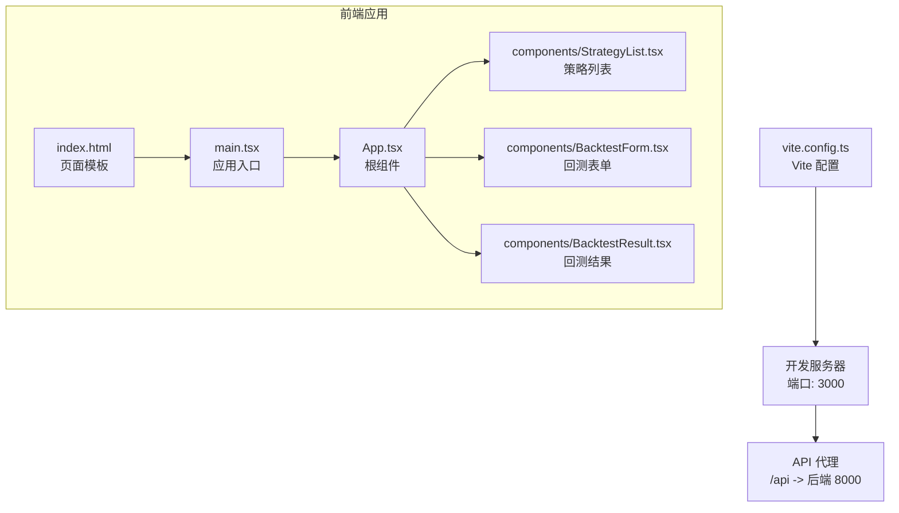
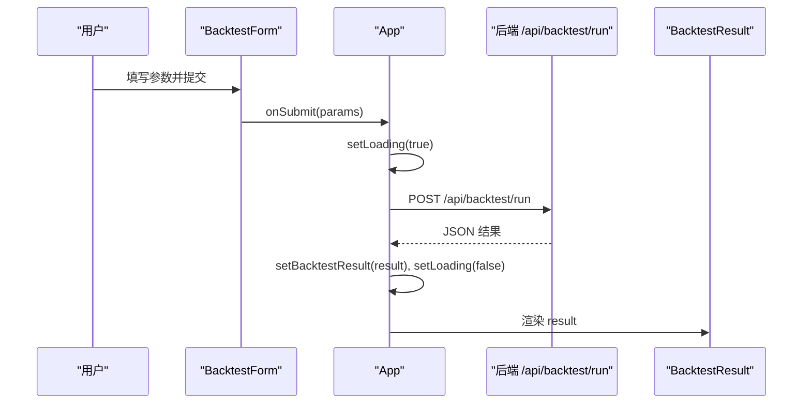
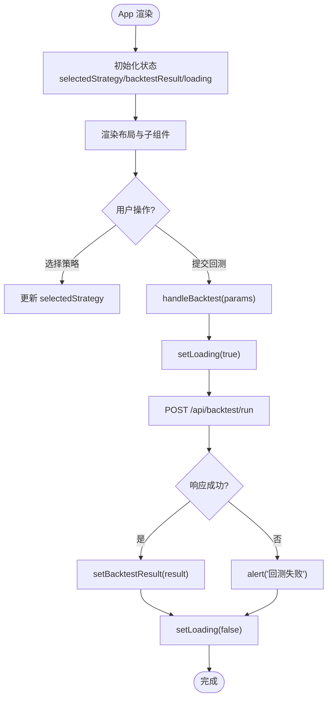
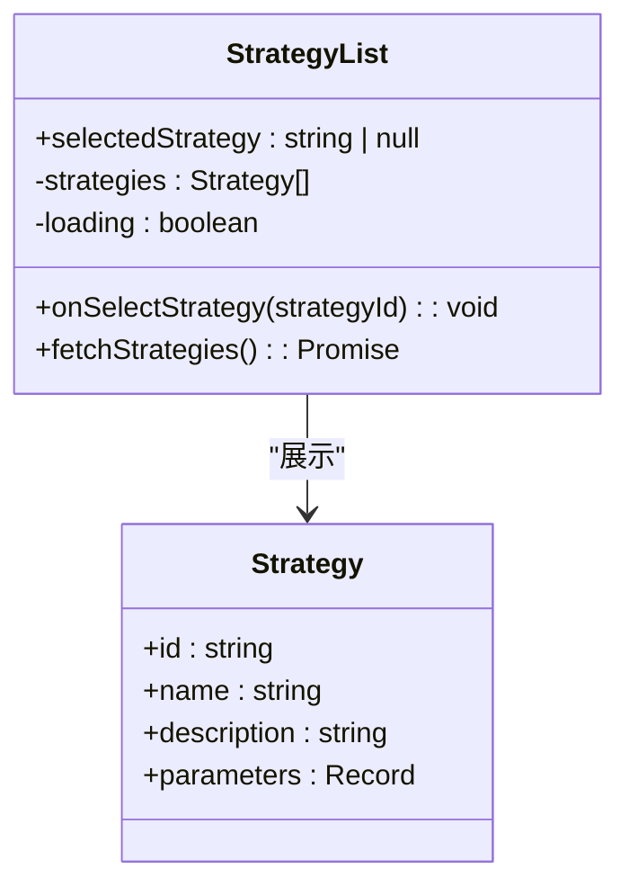
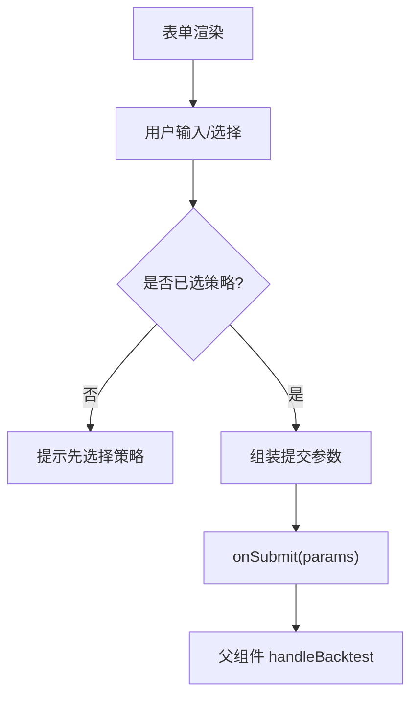
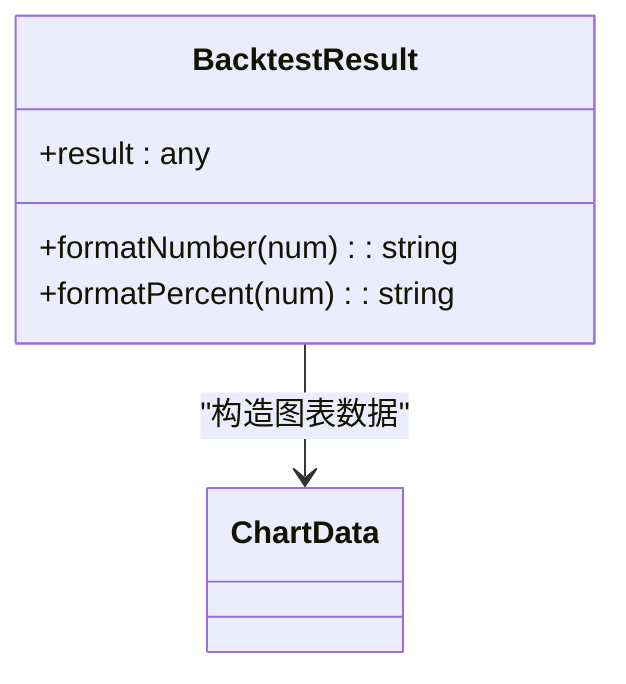
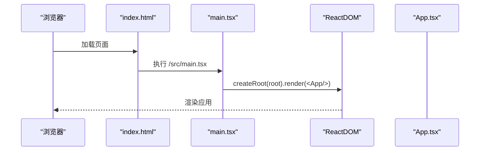
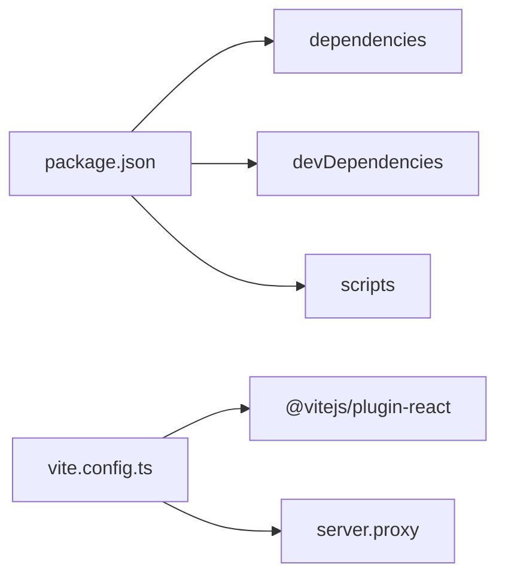

# React应用架构

<cite>
**本文引用的文件**   
- [frontend/src/main.tsx](../../../frontend/src/main.tsx)
- [frontend/index.html](../../../frontend/index.html)
- [frontend/src/App.tsx](../../../frontend/src/App.tsx)
- [frontend/src/components/StrategyList.tsx](../../../frontend/src/components/StrategyList.tsx)
- [frontend/src/components/BacktestForm.tsx](../../../frontend/src/components/BacktestForm.tsx)
- [frontend/src/components/BacktestResult.tsx](../../../frontend/src/components/BacktestResult.tsx)
- [frontend/vite.config.ts](../../../frontend/vite.config.ts)
- [frontend/package.json](../../../frontend/package.json)
- [frontend/src/App.css](../../../frontend/src/App.css)
- [frontend/src/index.css](../../../frontend/src/index.css)
</cite>

## 更新摘要
**变更内容**   
- 更新了React应用架构的详细说明，包括组件设计模式和状态管理
- 增强了前端技术栈说明，涵盖Vite构建配置和开发环境设置
- 完善了组件间通信机制和数据流设计
- 添加了性能优化和最佳实践指导

## 目录
1. [简介](#简介)
2. [项目结构](#项目结构)
3. [核心组件](#核心组件)
4. [架构总览](#架构总览)
5. [详细组件分析](#详细组件分析)
6. [依赖关系分析](#依赖关系分析)
7. [性能与构建优化](#性能与构建优化)
8. [故障排查指南](#故障排查指南)
9. [结论](#结论)

## 简介
本项目是一个全栈股票量化策略回测系统的现代化React前端应用。应用采用函数式组件、React Hooks（useState/useEffect）进行状态管理，通过父组件提升状态实现子组件通信；使用原生 fetch 调用后端 API，并在开发环境通过 Vite 代理转发到后端服务。整体结构清晰、职责明确，便于扩展与维护。

本仓库的前端部分是一个基于 Vite + React + TypeScript 的现代化前端应用，用于量化策略查看与回测。应用提供了完整的用户界面，包括策略列表展示、参数配置表单、回测结果可视化等功能模块。

## 项目结构
项目采用清晰的模块化架构：
- **入口文件**：`main.tsx` 负责应用初始化和挂载
- **根组件**：`App.tsx` 作为应用容器，管理全局状态和业务逻辑
- **业务组件**：位于 `components/` 目录，按功能模块组织
- **样式文件**：每个组件对应独立的CSS文件，支持模块化样式管理

**图表来源**
- [frontend/index.html:9-12](../../../frontend/index.html#L9-L12)
- [frontend/src/main.tsx:6-10](../../../frontend/src/main.tsx#L6-L10)
- [frontend/src/App.tsx:8-96](../../../frontend/src/App.tsx#L8-L96)
- [frontend/vite.config.ts:6-14](../../../frontend/vite.config.ts#L6-L14)

章节来源
- [frontend/index.html:1-14](../../../frontend/index.html#L1-L14)
- [frontend/src/main.tsx:1-11](../../../frontend/src/main.tsx#L1-L11)
- [frontend/vite.config.ts:1-16](../../../frontend/vite.config.ts#L1-L16)
- [frontend/package.json:1-28](../../../frontend/package.json#L1-L28)

## 核心组件
- **main.tsx**：应用初始化与挂载，启用 StrictMode，渲染 App 根组件。
- **App.tsx**：根容器组件，集中管理"选中策略""回测结果""加载状态"，负责事件处理与数据请求，并通过 props 向子组件传递状态与回调。
- **StrategyList.tsx**：策略列表展示与选择，内部维护本地策略数据与加载状态，默认选中第一个策略并通知父组件。
- **BacktestForm.tsx**：回测表单，聚合用户输入与策略参数，提交给父组件处理。
- **BacktestResult.tsx**：回测结果可视化，包含指标卡片、资金曲线与交易明细表格。

章节来源
- [frontend/src/main.tsx:1-11](../../../frontend/src/main.tsx#L1-L11)
- [frontend/src/App.tsx:1-100](../../../frontend/src/App.tsx#L1-L100)
- [frontend/src/components/StrategyList.tsx:1-69](../../../frontend/src/components/StrategyList.tsx#L1-L69)
- [frontend/src/components/BacktestForm.tsx:1-522](../../../frontend/src/components/BacktestForm.tsx#L1-L522)
- [frontend/src/components/BacktestResult.tsx:1-221](../../../frontend/src/components/BacktestResult.tsx#L1-L221)

## 架构总览
应用采用"父组件提升状态"的模式：App 作为状态中心，持有全局 UI 状态与业务数据，子组件仅负责展示与局部交互。网络请求集中在 App 中统一处理，保证错误处理与加载态一致。

**图表来源**
- [frontend/src/components/BacktestForm.tsx:28-44](../../../frontend/src/components/BacktestForm.tsx#L28-L44)
- [frontend/src/App.tsx:13-36](../../../frontend/src/App.tsx#L13-L36)
- [frontend/src/components/BacktestResult.tsx:43-94](../../../frontend/src/components/BacktestResult.tsx#L43-L94)

## 详细组件分析

### App 主组件设计模式
- **状态管理**：使用 useState 管理 selectedStrategy、backtestResult、loading。
- **事件处理**：handleBacktest 封装了异步请求、错误捕获与 loading 控制。
- **组件通信**：通过 props 将 selectedStrategy 与 onSelectStrategy 传递给 StrategyList；将 selectedStrategy、onSubmit、loading 传递给 BacktestForm；将 backtestResult 传递给 BacktestResult。
- **布局组织**：header/main/content-grid/sideBar/contentArea/resultSection 等语义化区块，便于样式与可维护性。

**图表来源**
- [frontend/src/App.tsx:8-36](../../../frontend/src/App.tsx#L8-L36)

章节来源
- [frontend/src/App.tsx:1-100](../../../frontend/src/App.tsx#L1-L100)

### StrategyList 组件
- **职责**：获取策略列表、展示策略卡片、处理选中逻辑。
- **状态**：本地 strategies 与 loading；默认选中首个策略后通过 onSelectStrategy 通知父组件。
- **副作用**：useEffect 在首次渲染时拉取数据；当 strategies 变化且未选中策略时自动选中第一个。

**图表来源**
- [frontend/src/components/StrategyList.tsx:4-14](../../../frontend/src/components/StrategyList.tsx#L4-L14)
- [frontend/src/components/StrategyList.tsx:16-41](../../../frontend/src/components/StrategyList.tsx#L16-L41)

章节来源
- [frontend/src/components/StrategyList.tsx:1-69](../../../frontend/src/components/StrategyList.tsx#L1-L69)

### BacktestForm 组件
- **职责**：收集股票代码、周期、初始资金、数据源与策略参数，校验并触发父组件的回测流程。
- **交互**：根据 selectedStrategy 动态渲染不同策略的参数表单；提供统一的 handleSubmit 组装参数并调用 onSubmit。
- **状态**：本地表单字段与 parameters 对象，支持增量更新。

**图表来源**
- [frontend/src/components/BacktestForm.tsx:21-44](../../../frontend/src/components/BacktestForm.tsx#L21-L44)

章节来源
- [frontend/src/components/BacktestForm.tsx:1-522](../../../frontend/src/components/BacktestForm.tsx#L1-L522)

### BacktestResult 组件
- **职责**：展示回测指标、资金曲线、股价走势与交易明细。
- **数据处理**：对数据进行格式化（数字、百分比），映射数据源名称，构造图表所需数据格式。
- **可视化**：使用 recharts 绘制面积图与折线图，并提供工具提示与图例。

**图表来源**
- [frontend/src/components/BacktestResult.tsx:9-41](../../../frontend/src/components/BacktestResult.tsx#L9-L41)

章节来源
- [frontend/src/components/BacktestResult.tsx:1-221](../../../frontend/src/components/BacktestResult.tsx#L1-L221)

### 入口与初始化流程
- **index.html**：提供根节点 root 与模块脚本入口。
- **main.tsx**：创建 React 根实例，启用 StrictMode，挂载 App 组件，并引入全局样式。

**图表来源**
- [frontend/index.html:9-12](../../../frontend/index.html#L9-L12)
- [frontend/src/main.tsx:6-10](../../../frontend/src/main.tsx#L6-L10)

章节来源
- [frontend/index.html:1-14](../../../frontend/index.html#L1-L14)
- [frontend/src/main.tsx:1-11](../../../frontend/src/main.tsx#L1-L11)

## 依赖关系分析
- **运行时依赖**：react、react-dom、axios、recharts、lucide-react。
- **开发依赖**：@types/react、@types/react-dom、@vitejs/plugin-react、typescript、vite。
- **构建与脚本**：dev/build/preview/typecheck/check 等命令，build 会先执行 tsc 类型检查再打包。

**图表来源**
- [frontend/package.json:13-26](../../../frontend/package.json#L13-L26)
- [frontend/vite.config.ts:1-16](../../../frontend/vite.config.ts#L1-L16)

章节来源
- [frontend/package.json:1-28](../../../frontend/package.json#L1-L28)
- [frontend/vite.config.ts:1-16](../../../frontend/vite.config.ts#L1-L16)

## 性能与构建优化
- **开发服务器**
  - 端口：3000
  - API 代理：/api 转发至 http://localhost:8000，changeOrigin 开启以适配跨域
- **构建产物**
  - 使用 Vite 构建，TypeScript 预编译（tsc）后再打包
  - 生产预览可通过 vite preview
- **建议优化方向**
  - 按需引入图标库与图表库以减少体积
  - 对大组件或重计算逻辑进行懒加载与缓存
  - 合理拆分路由与页面级组件，减少首屏资源
  - 针对静态资源启用 CDN 与缓存策略

章节来源
- [frontend/vite.config.ts:4-15](../../../frontend/vite.config.ts#L4-L15)
- [frontend/package.json:6-11](../../../frontend/package.json#L6-L11)

## 故障排查指南
- **无法连接后端**
  - 确认后端服务运行在 8000 端口
  - 检查 Vite 代理配置是否正确，确保 /api 路径被代理
- **回测报错**
  - 检查请求头 Content-Type 是否为 application/json
  - 检查必填参数是否完整（如 strategy_id、symbol、period、initial_capital、source、parameters）
  - 查看控制台错误日志与后端返回码
- **策略列表为空**
  - 检查 /api/strategies/ 接口可用性
  - 确认首次加载 useEffect 是否触发
- **图表不显示**
  - 检查 equity_curve 数据结构是否符合预期
  - 确认日期字段可被正确解析

**章节来源**
- [frontend/src/App.tsx:13-36](../../../frontend/src/App.tsx#L13-L36)
- [frontend/src/components/StrategyList.tsx:20-41](../../../frontend/src/components/StrategyList.tsx#L20-L41)
- [frontend/src/components/BacktestResult.tsx:35-41](../../../frontend/src/components/BacktestResult.tsx#L35-L41)

## 结论
该前端应用采用清晰的组件分层与"父组件提升状态"的状态管理模式，结合 Vite 的开发体验与构建能力，快速实现了量化策略查看与回测的核心功能。当前实现简洁直观，易于扩展；后续可在路由、状态管理、数据层抽象与性能优化方面进一步演进。

应用的模块化设计使得各个组件职责明确，便于维护和测试。通过合理的状态管理和组件通信机制，保证了数据的单向流动和状态的一致性。同时，现代化的构建工具和开发环境为项目的持续迭代提供了有力支持。