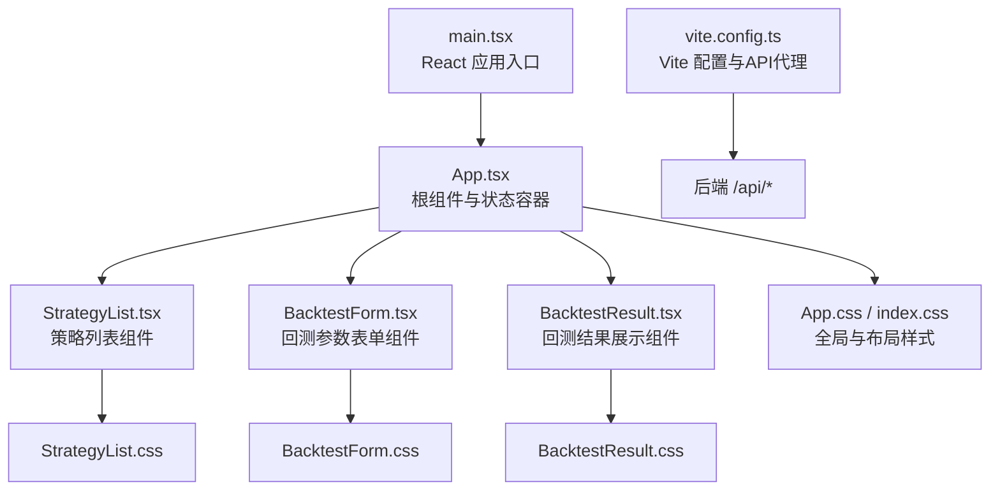
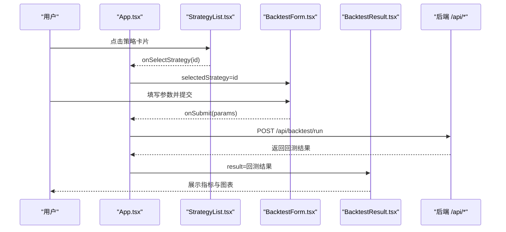
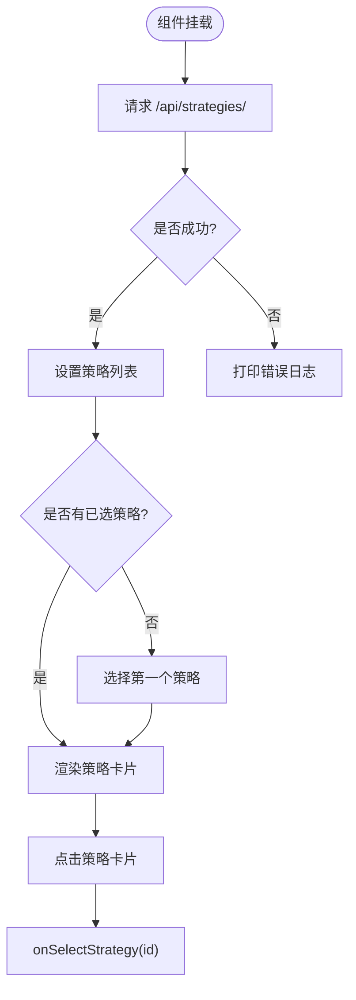
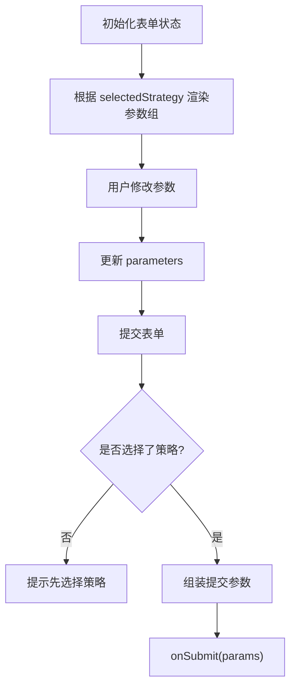
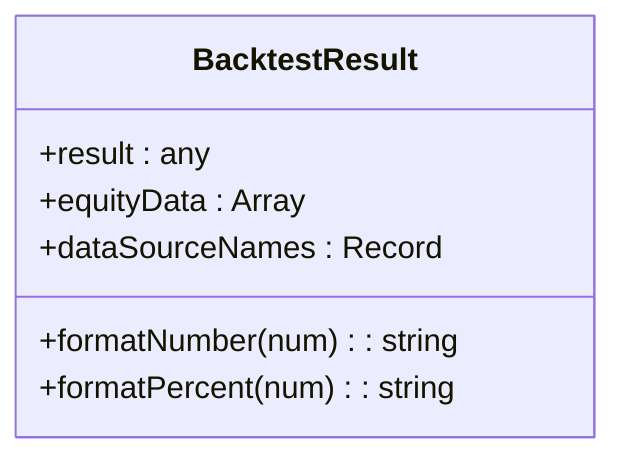
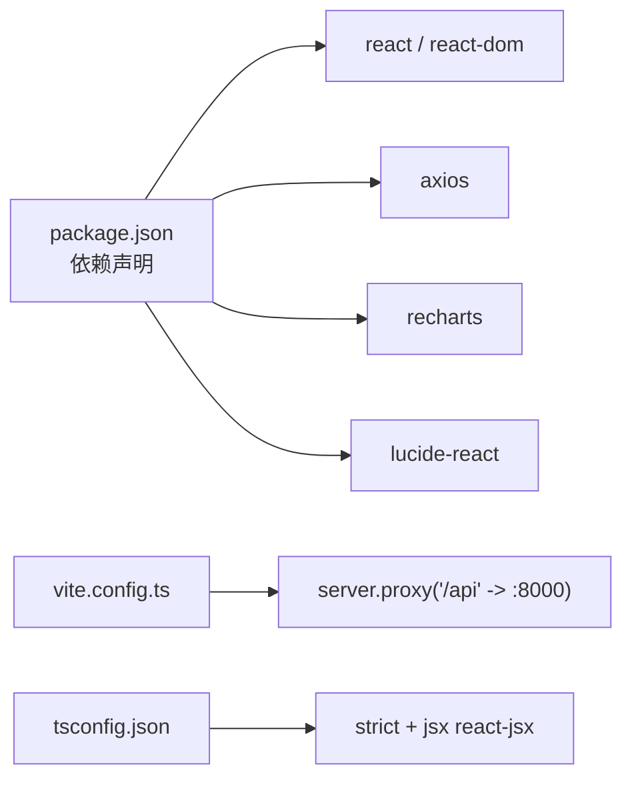
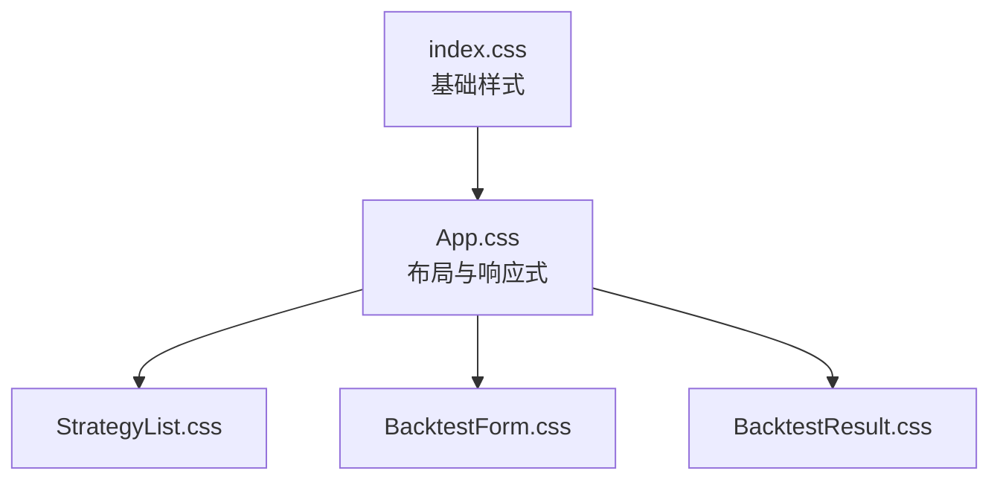
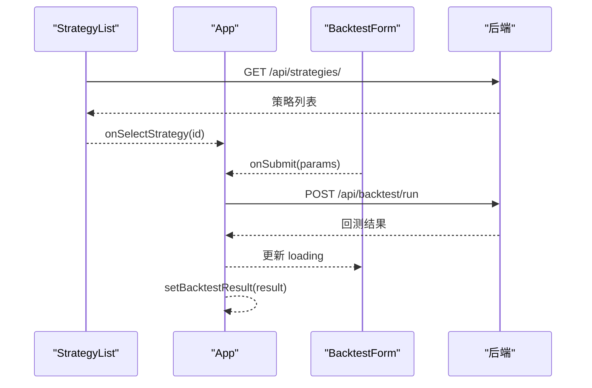

# 前端开发

<cite>
**本文引用的文件**   
- [frontend/src/main.tsx](../../../frontend/src/main.tsx)
- [frontend/src/App.tsx](../../../frontend/src/App.tsx)
- [frontend/src/components/StrategyList.tsx](../../../frontend/src/components/StrategyList.tsx)
- [frontend/src/components/BacktestForm.tsx](../../../frontend/src/components/BacktestForm.tsx)
- [frontend/src/components/BacktestResult.tsx](../../../frontend/src/components/BacktestResult.tsx)
- [frontend/src/App.css](../../../frontend/src/App.css)
- [frontend/src/index.css](../../../frontend/src/index.css)
- [frontend/src/components/StrategyList.css](../../../frontend/src/components/StrategyList.css)
- [frontend/src/components/BacktestForm.css](../../../frontend/src/components/BacktestForm.css)
- [frontend/src/components/BacktestResult.css](../../../frontend/src/components/BacktestResult.css)
- [frontend/package.json](../../../frontend/package.json)
- [frontend/vite.config.ts](../../../frontend/vite.config.ts)
- [frontend/tsconfig.json](../../../frontend/tsconfig.json)
</cite>

## 目录
1. [简介](#简介)
2. [项目结构](#项目结构)
3. [核心组件](#核心组件)
4. [架构总览](#架构总览)
5. [详细组件分析](#详细组件分析)
6. [依赖关系分析](#依赖关系分析)
7. [性能与优化](#性能与优化)
8. [样式系统与主题](#样式系统与主题)
9. [数据流与API集成](#数据流与api集成)
10. [故障排查指南](#故障排查指南)
11. [结论](#结论)

## 简介
本文件面向基于 React 与 TypeScript 的前端应用，系统性说明整体架构、组件树、状态管理、路由（当前为单页无路由）、页面组织方式，以及三个核心 UI 组件：策略列表、回测参数表单、回测结果展示。文档还涵盖数据获取流程、API 调用封装、错误处理与用户反馈机制、样式系统、响应式布局、主题定制方案，以及 Recharts 图表集成与交互实现，并提供组件复用模式、事件处理最佳实践和性能优化建议。

## 项目结构
前端采用 Vite + React + TypeScript 的工程化方案，入口为 main.tsx，根组件 App.tsx 负责组合三大业务组件；样式采用 CSS Modules 风格（每个组件独立 CSS），并通过全局 index.css 提供基础样式。构建与开发服务器由 vite.config.ts 配置，包含 API 代理到后端服务。

**图示来源**
- [frontend/src/main.tsx:1-11](../../../frontend/src/main.tsx#L1-L11)
- [frontend/src/App.tsx:1-100](../../../frontend/src/App.tsx#L1-L100)
- [frontend/vite.config.ts:1-16](../../../frontend/vite.config.ts#L1-L16)

**章节来源**
- [frontend/src/main.tsx:1-11](../../../frontend/src/main.tsx#L1-L11)
- [frontend/src/App.tsx:1-100](../../../frontend/src/App.tsx#L1-L100)
- [frontend/vite.config.ts:1-16](../../../frontend/vite.config.ts#L1-L16)

## 核心组件
- StrategyList：从后端加载策略列表，支持选中态切换，并在首次加载后自动选择第一个策略。
- BacktestForm：根据所选策略动态渲染参数表单，聚合通用回测参数并提交给父组件。
- BacktestResult：将回测指标、资金曲线、股价走势与交易记录进行可视化展示，并标注数据来源与模拟数据提示。

**章节来源**
- [frontend/src/components/StrategyList.tsx:1-69](../../../frontend/src/components/StrategyList.tsx#L1-L69)
- [frontend/src/components/BacktestForm.tsx:1-522](../../../frontend/src/components/BacktestForm.tsx#L1-L522)
- [frontend/src/components/BacktestResult.tsx:1-221](../../../frontend/src/components/BacktestResult.tsx#L1-L221)

## 架构总览
应用采用“状态提升”的轻量状态管理模式：所有关键状态（选中策略、回测结果、加载状态）集中在 App 中，通过 props 向下传递，子组件仅负责展示与触发回调。未引入第三方状态库或路由库，保持简单可维护。

**图示来源**
- [frontend/src/App.tsx:8-96](../../../frontend/src/App.tsx#L8-L96)
- [frontend/src/components/StrategyList.tsx:16-69](../../../frontend/src/components/StrategyList.tsx#L16-L69)
- [frontend/src/components/BacktestForm.tsx:21-522](../../../frontend/src/components/BacktestForm.tsx#L21-L522)
- [frontend/src/components/BacktestResult.tsx:9-221](../../../frontend/src/components/BacktestResult.tsx#L9-L221)

## 详细组件分析

### StrategyList 策略列表组件
- 职责：拉取策略元数据、渲染策略卡片、处理选中态、默认选中首个策略。
- 数据模型：Strategy（id、name、description、parameters）。
- 副作用：useEffect 在挂载时请求 /api/strategies/，并在策略列表就绪后自动选择第一个。
- 交互：点击卡片触发 onSelectStrategy，向父组件上报选中策略 id。
- 错误处理：捕获网络异常并打印日志，loading 状态用于显示加载中提示。

**图示来源**
- [frontend/src/components/StrategyList.tsx:20-41](../../../frontend/src/components/StrategyList.tsx#L20-L41)
- [frontend/src/components/StrategyList.tsx:47-67](../../../frontend/src/components/StrategyList.tsx#L47-L67)

**章节来源**
- [frontend/src/components/StrategyList.tsx:1-69](../../../frontend/src/components/StrategyList.tsx#L1-L69)

### BacktestForm 参数表单组件
- 职责：收集通用回测参数（股票代码、周期、初始资金、数据源）与策略特定参数，提交给父组件。
- 动态参数：根据 selectedStrategy 渲染不同参数组（如均线交叉、动量、均值回归、RSI、布林带、多因子、Transformer 预测、Transformer DL）。
- 交互：表单校验（必须选择策略）、输入变更更新本地 state、提交时组装 payload 并调用 onSubmit。
- 用户体验：提交按钮在 loading 时禁用并显示旋转图标；数据源下拉框附带描述信息。

**图示来源**
- [frontend/src/components/BacktestForm.tsx:21-48](../../../frontend/src/components/BacktestForm.tsx#L21-L48)
- [frontend/src/components/BacktestForm.tsx:111-504](../../../frontend/src/components/BacktestForm.tsx#L111-L504)
- [frontend/src/components/BacktestForm.tsx:506-518](../../../frontend/src/components/BacktestForm.tsx#L506-L518)

**章节来源**
- [frontend/src/components/BacktestForm.tsx:1-522](../../../frontend/src/components/BacktestForm.tsx#L1-L522)

### BacktestResult 结果展示组件
- 职责：展示回测指标摘要、资金曲线、股价走势、交易明细表，并根据 is_mock 显示模拟数据提示。
- 数据处理：格式化数字与百分比，映射数据源名称，准备 Recharts 所需的数据结构。
- 可视化：使用 AreaChart 展示资金曲线，LineChart 展示股价走势，Tooltip 与 Legend 增强交互。
- 表格：渲染交易记录，盈亏与收益率按正负着色。

**图示来源**
- [frontend/src/components/BacktestResult.tsx:9-41](../../../frontend/src/components/BacktestResult.tsx#L9-L41)
- [frontend/src/components/BacktestResult.tsx:123-181](../../../frontend/src/components/BacktestResult.tsx#L123-L181)
- [frontend/src/components/BacktestResult.tsx:183-217](../../../frontend/src/components/BacktestResult.tsx#L183-L217)

**章节来源**
- [frontend/src/components/BacktestResult.tsx:1-221](../../../frontend/src/components/BacktestResult.tsx#L1-L221)

## 依赖关系分析
- 运行时依赖：react、react-dom、axios、recharts、lucide-react。
- 开发依赖：@vitejs/plugin-react、typescript、vite。
- 构建工具：Vite 插件 react，TypeScript 编译选项启用 strict 模式与 JSX transform。
- API 代理：开发服务器将 /api 请求代理至 http://localhost:8000。

**图示来源**
- [frontend/package.json:1-28](../../../frontend/package.json#L1-L28)
- [frontend/vite.config.ts:1-16](../../../frontend/vite.config.ts#L1-L16)
- [frontend/tsconfig.json:1-26](../../../frontend/tsconfig.json#L1-L26)

**章节来源**
- [frontend/package.json:1-28](../../../frontend/package.json#L1-L28)
- [frontend/vite.config.ts:1-16](../../../frontend/vite.config.ts#L1-L16)
- [frontend/tsconfig.json:1-26](../../../frontend/tsconfig.json#L1-L26)

## 性能与优化
- 状态最小化：仅在 App 层持有少量必要状态，避免深层组件重复计算。
- 条件渲染：BacktestResult 仅在存在结果时渲染，减少无效 DOM。
- 列表渲染：StrategyList 使用稳定 key（strategy.id），提高 diff 效率。
- 图表性能：Recharts 使用 ResponsiveContainer 自适应尺寸，避免频繁重绘。
- 构建优化：Vite 按需打包，TS strict 模式提前发现类型问题，减少运行时错误。
- 建议：
  - 对长列表考虑虚拟滚动（若策略数量增长）。
  - 对图表大数据集考虑采样或分页。
  - 将 fetch 逻辑抽取为自定义 Hook 或 API 模块，便于缓存与重试。

[本节为通用指导，不直接分析具体文件]

## 样式系统与主题
- 全局样式：index.css 定义基础重置、字体栈、背景色与根节点高度。
- 布局样式：App.css 定义头部、主内容区、侧边栏与网格布局，并提供 1024px/768px 断点的响应式适配。
- 组件样式：每个组件拥有独立 CSS 文件，类名语义化，局部作用域清晰。
- 主题定制：
  - 主色调：渐变紫色系（#667eea 到 #764ba2），应用于头部、按钮、选中态等。
  - 卡片与阴影：统一圆角与柔和阴影，提升层次。
  - 可维护性：通过 CSS 变量或主题文件集中管理颜色与间距，便于扩展深色模式。

**图示来源**
- [frontend/src/index.css:1-24](../../../frontend/src/index.css#L1-L24)
- [frontend/src/App.css:1-142](../../../frontend/src/App.css#L1-L142)
- [frontend/src/components/StrategyList.css:1-87](../../../frontend/src/components/StrategyList.css#L1-L87)
- [frontend/src/components/BacktestForm.css:1-162](../../../frontend/src/components/BacktestForm.css#L1-L162)
- [frontend/src/components/BacktestResult.css:1-250](../../../frontend/src/components/BacktestResult.css#L1-L250)

**章节来源**
- [frontend/src/index.css:1-24](../../../frontend/src/index.css#L1-L24)
- [frontend/src/App.css:1-142](../../../frontend/src/App.css#L1-L142)
- [frontend/src/components/StrategyList.css:1-87](../../../frontend/src/components/StrategyList.css#L1-L87)
- [frontend/src/components/BacktestForm.css:1-162](../../../frontend/src/components/BacktestForm.css#L1-L162)
- [frontend/src/components/BacktestResult.css:1-250](../../../frontend/src/components/BacktestResult.css#L1-L250)

## 数据流与API集成
- 策略列表：StrategyList 在挂载时请求 /api/strategies/，成功后设置策略数组并默认选中第一个。
- 回测执行：App 接收 BacktestForm 提交的参数，POST 到 /api/backtest/run，成功后设置 backtestResult。
- 错误处理：
  - 网络或后端错误：App 层抛出错误并 alert 提示；StrategyList 层打印错误日志。
  - 缺少必填项：BacktestForm 在提交前检查是否选择了策略。
- 数据源与模拟数据：
  - BacktestForm 支持多种数据源（自动、腾讯财经、YFinance、AKShare、BaoStock、模拟数据）。
  - BacktestResult 根据 is_mock 字段显示模拟数据横幅提示。

**图示来源**
- [frontend/src/components/StrategyList.tsx:31-41](../../../frontend/src/components/StrategyList.tsx#L31-L41)
- [frontend/src/App.tsx:13-36](../../../frontend/src/App.tsx#L13-L36)
- [frontend/src/components/BacktestForm.tsx:28-44](../../../frontend/src/components/BacktestForm.tsx#L28-L44)

**章节来源**
- [frontend/src/components/StrategyList.tsx:31-41](../../../frontend/src/components/StrategyList.tsx#L31-L41)
- [frontend/src/App.tsx:13-36](../../../frontend/src/App.tsx#L13-L36)
- [frontend/src/components/BacktestForm.tsx:28-44](../../../frontend/src/components/BacktestForm.tsx#L28-L44)

## 故障排查指南
- 无法加载策略列表：
  - 检查后端 /api/strategies/ 是否可达，浏览器控制台查看错误日志。
  - 确认 Vite 代理配置正确，开发端口为 3000，代理目标为 8000。
- 回测失败：
  - 确认已选择策略且参数完整。
  - 检查 /api/backtest/run 返回状态码与响应体，必要时在后端增加更详细的错误信息。
- 图表不显示：
  - 确认 equity_curve 数据结构包含 Date、equity、Close、signal 字段。
  - 检查 Recharts 版本与 React 版本兼容性。
- 样式错乱：
  - 检查 CSS 文件是否被正确引入，类名未被覆盖。
  - 在移动端断点下验证布局是否正确折叠。

**章节来源**
- [frontend/vite.config.ts:6-14](../../../frontend/vite.config.ts#L6-L14)
- [frontend/src/App.tsx:24-35](../../../frontend/src/App.tsx#L24-L35)
- [frontend/src/components/BacktestResult.tsx:35-41](../../../frontend/src/components/BacktestResult.tsx#L35-L41)

## 结论
该前端应用以简洁的状态提升模式组织代码，围绕三个核心组件完成策略选择、参数配置与结果可视化的闭环。样式系统模块化且具备响应式能力，Recharts 提供了直观的交互式图表。建议在后续迭代中引入统一的 API 层与错误边界、类型化接口定义、主题变量与单元测试，进一步提升可维护性与健壮性。