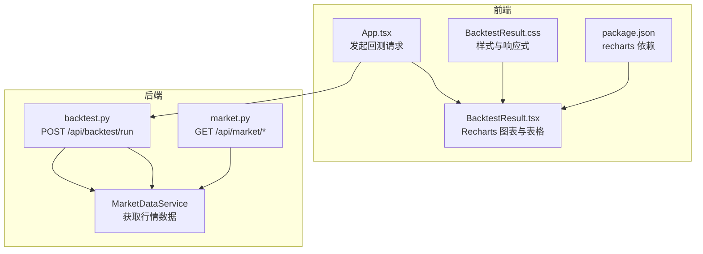
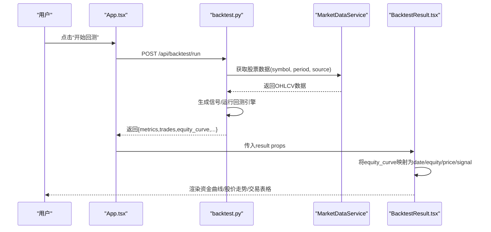
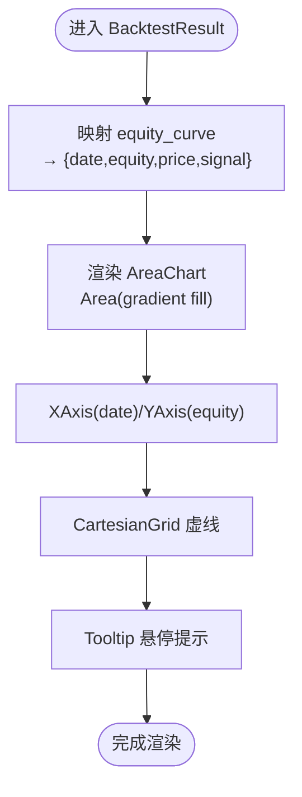
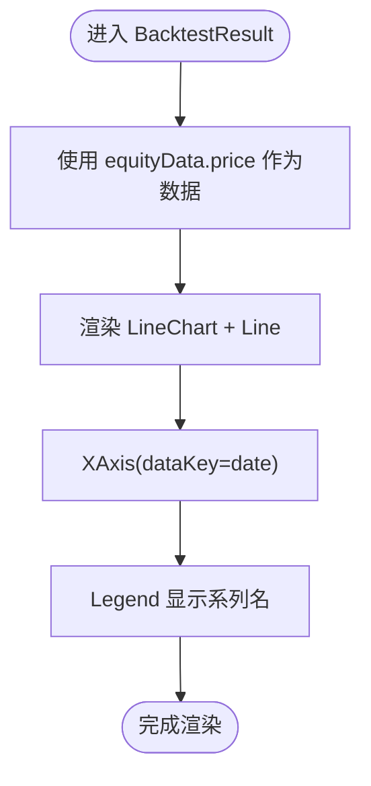
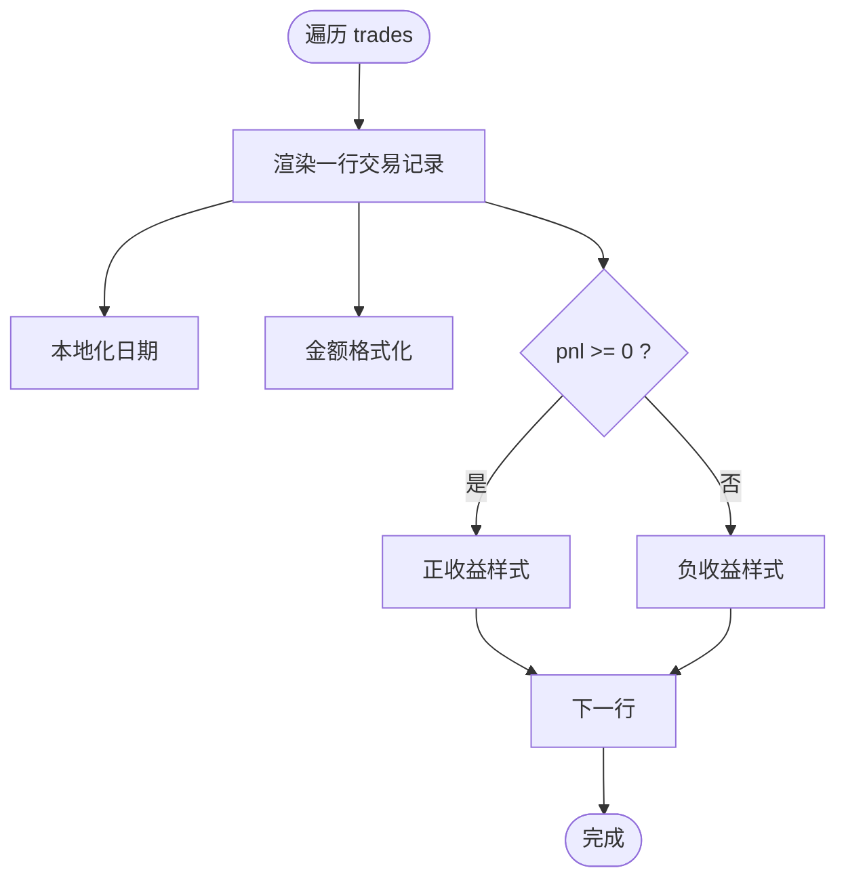
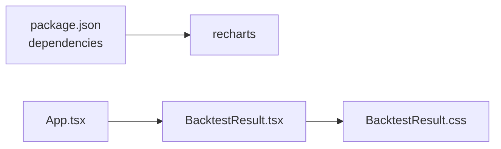

# 数据可视化集成

<cite>
**本文引用的文件**   
- [frontend/src/components/BacktestResult.tsx](../../../frontend/src/components/BacktestResult.tsx)
- [frontend/src/components/BacktestResult.css](../../../frontend/src/components/BacktestResult.css)
- [frontend/src/App.tsx](../../../frontend/src/App.tsx)
- [backend/app/api/backtest.py](../../../backend/app/api/backtest.py)
- [backend/app/api/market.py](../../../backend/app/api/market.py)
- [frontend/package.json](../../../frontend/package.json)
</cite>

## 目录
1. [简介](#简介)
2. [项目结构](#项目结构)
3. [核心组件](#核心组件)
4. [架构总览](#架构总览)
5. [详细组件分析](#详细组件分析)
6. [依赖关系分析](#依赖关系分析)
7. [性能与优化](#性能与优化)
8. [故障排查指南](#故障排查指南)
9. [结论](#结论)
10. [附录：配置与扩展清单](#附录配置与扩展清单)

## 简介
本文件面向量化策略回测系统的前端数据可视化集成，重点说明基于 Recharts 的资金曲线、股价走势图表实现，以及交易记录表格的展示方式。文档覆盖以下要点：
- 资金曲线图表：折线/面积图配置、数据格式化、交互（Tooltip）
- 股价走势图表：折线图展示、时间轴处理、可扩展缩放能力
- 交易记录表格：基础排序、筛选、分页扩展建议
- 响应式适配与自定义样式
- 事件处理与动画效果
- 从 API 到图表渲染的完整数据流

## 项目结构
前端采用 React + Vite + TypeScript，使用 Recharts 进行图表渲染；后端为 FastAPI，提供回测与市场数据接口。关键文件如下：
- 前端
  - App.tsx：页面编排、发起回测请求、状态管理
  - BacktestResult.tsx：回测结果可视化（Recharts 图表与交易表格）
  - BacktestResult.css：图表容器与表格样式
  - package.json：声明 recharts 等依赖
- 后端
  - backtest.py：回测运行接口，组装指标、交易、资金曲线并返回
  - market.py：市场数据查询接口（供扩展或独立使用）

图示来源
- [frontend/src/App.tsx:13-36](../../../frontend/src/App.tsx#L13-L36)
- [frontend/src/components/BacktestResult.tsx:1-41](../../../frontend/src/components/BacktestResult.tsx#L1-L41)
- [backend/app/api/backtest.py:28-69](../../../backend/app/api/backtest.py#L28-L69)
- [backend/app/api/market.py:11-27](../../../backend/app/api/market.py#L11-L27)
- [frontend/package.json:13-18](../../../frontend/package.json#L13-L18)

章节来源
- [frontend/src/App.tsx:1-100](../../../frontend/src/App.tsx#L1-L100)
- [frontend/src/components/BacktestResult.tsx:1-221](../../../frontend/src/components/BacktestResult.tsx#L1-L221)
- [backend/app/api/backtest.py:1-76](../../../backend/app/api/backtest.py#L1-L76)
- [backend/app/api/market.py:1-46](../../../backend/app/api/market.py#L1-L46)
- [frontend/package.json:1-28](../../../frontend/package.json#L1-L28)

## 核心组件
- 回测结果可视化组件 BacktestResult.tsx
  - 使用 Recharts 的 AreaChart 绘制资金曲线
  - 使用 LineChart 绘制股价走势
  - 通过 ResponsiveContainer 实现响应式布局
  - 使用 Tooltip 提供悬停交互
  - 渲染交易记录表格（基础展示）
- 应用入口 App.tsx
  - 负责表单提交、调用后端接口、保存回测结果
- 样式 BacktestResult.css
  - 定义图表容器、网格、卡片、表格样式与媒体查询

章节来源
- [frontend/src/components/BacktestResult.tsx:1-221](../../../frontend/src/components/BacktestResult.tsx#L1-L221)
- [frontend/src/App.tsx:13-36](../../../frontend/src/App.tsx#L13-L36)
- [frontend/src/components/BacktestResult.css:150-249](../../../frontend/src/components/BacktestResult.css#L150-L249)

## 架构总览
下图展示了从用户操作到图表渲染的端到端流程：用户在 App.tsx 中提交回测参数，前端调用后端 /api/backtest/run，后端聚合行情数据、生成信号、执行回测，最终返回包含 metrics、trades、equity_curve 等字段的结果；前端在 BacktestResult.tsx 中将 equity_curve 映射为 Recharts 所需的数据格式并渲染图表。

图示来源
- [frontend/src/App.tsx:13-36](../../../frontend/src/App.tsx#L13-L36)
- [backend/app/api/backtest.py:28-69](../../../backend/app/api/backtest.py#L28-L69)
- [frontend/src/components/BacktestResult.tsx:35-41](../../../frontend/src/components/BacktestResult.tsx#L35-L41)

## 详细组件分析

### 资金曲线图表（AreaChart）
- 数据准备
  - 将后端 equity_curve 映射为 Recharts 数据项，包含 date、equity、price、signal
  - date 使用本地化日期字符串作为 X 轴数据键
- 图表配置
  - 使用 AreaChart + Area 绘制面积图
  - 使用线性渐变填充区域
  - CartesianGrid 设置虚线网格
  - XAxis/YAxis 设置刻度颜色与字号
  - Tooltip 自定义背景色、边框与圆角
- 交互
  - 默认 Tooltip 悬停显示当日权益值
  - 可结合 signal 字段扩展买卖点标记（见“扩展建议”）

图示来源
- [frontend/src/components/BacktestResult.tsx:35-41](../../../frontend/src/components/BacktestResult.tsx#L35-L41)
- [frontend/src/components/BacktestResult.tsx:123-153](../../../frontend/src/components/BacktestResult.tsx#L123-L153)

章节来源
- [frontend/src/components/BacktestResult.tsx:35-41](../../../frontend/src/components/BacktestResult.tsx#L35-L41)
- [frontend/src/components/BacktestResult.tsx:123-153](../../../frontend/src/components/BacktestResult.tsx#L123-L153)

### 股价走势图表（LineChart）
- 数据源
  - 复用 equityData 中的 price 字段
- 图表配置
  - 使用 LineChart + Line 绘制折线
  - 启用 Legend 显示系列名称
  - 关闭 dot 以减少视觉噪声
- 时间轴处理
  - XAxis.dataKey 使用已格式化的 date 字符串
- 缩放功能
  - 当前未启用缩放；可通过引入 Recharts 的 ScatterChart/Brush 或外部库实现区间选择与缩放（见“扩展建议”）

图示来源
- [frontend/src/components/BacktestResult.tsx:155-180](../../../frontend/src/components/BacktestResult.tsx#L155-L180)

章节来源
- [frontend/src/components/BacktestResult.tsx:155-180](../../../frontend/src/components/BacktestResult.tsx#L155-L180)

### 交易记录表格
- 数据结构
  - trades 数组包含 entry_date、exit_date、entry_price、exit_price、pnl、pnl_pct 等字段
- 展示逻辑
  - 按行渲染买入/卖出日期、价格、盈亏与收益率
  - pnl/pnl_pct 正负值以不同颜色区分
- 排序/筛选/分页
  - 当前为静态列表；可扩展为受控表格，支持列头排序、关键词筛选、分页控件（见“扩展建议”）

图示来源
- [frontend/src/components/BacktestResult.tsx:183-217](../../../frontend/src/components/BacktestResult.tsx#L183-L217)

章节来源
- [frontend/src/components/BacktestResult.tsx:183-217](../../../frontend/src/components/BacktestResult.tsx#L183-L217)

### 响应式适配与自定义样式
- 响应式
  - 图表外层使用 ResponsiveContainer 自适应宽度与高度
  - CSS 中使用 grid 与媒体查询适配不同屏幕尺寸
- 样式
  - 图表容器、卡片、表格均有统一风格
  - 通过 CSS 变量或主题类可进一步扩展品牌色

章节来源
- [frontend/src/components/BacktestResult.tsx:123-180](../../../frontend/src/components/BacktestResult.tsx#L123-L180)
- [frontend/src/components/BacktestResult.css:150-249](../../../frontend/src/components/BacktestResult.css#L150-L249)

### 事件处理与动画效果
- 事件
  - 当前未绑定 onAnimationEnd、onClick 等事件；可在 Area/Line 上添加 onClick 实现点击钻取详情
- 动画
  - Recharts 默认带入场动画；可通过 animationDuration 控制动画时长
  - 大数据量场景建议关闭动画以提升性能（见“性能与优化”）

章节来源
- [frontend/src/components/BacktestResult.tsx:123-180](../../../frontend/src/components/BacktestResult.tsx#L123-L180)

## 依赖关系分析
- 前端依赖
  - react、react-dom、axios、recharts、lucide-react
- 组件耦合
  - App.tsx 仅负责状态与网络请求，不直接渲染图表
  - BacktestResult.tsx 专注数据到图表的映射与渲染
  - CSS 与组件解耦，便于主题替换

图示来源
- [frontend/package.json:13-18](../../../frontend/package.json#L13-L18)
- [frontend/src/App.tsx:1-100](../../../frontend/src/App.tsx#L1-L100)
- [frontend/src/components/BacktestResult.tsx:1-221](../../../frontend/src/components/BacktestResult.tsx#L1-L221)
- [frontend/src/components/BacktestResult.css:150-249](../../../frontend/src/components/BacktestResult.css#L150-L249)

章节来源
- [frontend/package.json:1-28](../../../frontend/package.json#L1-L28)
- [frontend/src/App.tsx:1-100](../../../frontend/src/App.tsx#L1-L100)
- [frontend/src/components/BacktestResult.tsx:1-221](../../../frontend/src/components/BacktestResult.tsx#L1-L221)
- [frontend/src/components/BacktestResult.css:150-249](../../../frontend/src/components/BacktestResult.css#L150-L249)

## 性能与优化
- 数据量控制
  - 对 equity_curve 做采样或降采样（如每 N 天取一点），减少渲染点数
- 动画与重绘
  - 大数据集时关闭动画（animationEnabled=false 或 animationDuration=0）
  - 避免频繁更新导致重绘，必要时使用 memo 或虚拟滚动
- 图表交互
  - 仅在需要时启用 Tooltip/Legend，减少 DOM 节点
- 样式与布局
  - 使用 CSS Grid/Flex 减少复杂嵌套，提升渲染性能
- 缓存
  - 对相同 symbol+period 的请求做前端缓存，避免重复计算

[本节为通用指导，无需代码引用]

## 故障排查指南
- 图表无数据
  - 检查后端返回的 equity_curve 是否为空或字段缺失
  - 确认前端映射逻辑是否成功生成 date/equity/price
- 时间轴异常
  - 确认 Date 解析是否正确，必要时使用标准 ISO 字符串
- 样式错乱
  - 检查 ResponsiveContainer 父容器是否有明确宽高
  - 核对 CSS 媒体查询是否与屏幕尺寸匹配
- 接口错误
  - 查看 App.tsx 的错误分支与后端 HTTPException 信息

章节来源
- [frontend/src/App.tsx:24-35](../../../frontend/src/App.tsx#L24-L35)
- [backend/app/api/backtest.py:68-69](../../../backend/app/api/backtest.py#L68-L69)

## 结论
本项目在前端使用 Recharts 实现了资金曲线与股价走势的可视化，并通过 ResponsiveContainer 与 CSS 媒体查询完成响应式适配。后端 FastAPI 提供回测接口，返回标准化的指标、交易与资金曲线数据。整体架构清晰、职责分离，具备良好的扩展性。后续可在图表交互（缩放、钻取）、表格功能（排序、筛选、分页）与性能优化（采样、缓存、动画控制）方面进一步增强。

[本节为总结性内容，无需代码引用]

## 附录：配置与扩展清单

### 图表配置选项速查
- AreaChart/Area（资金曲线）
  - dataKey: equity
  - type: monotone
  - stroke/fill: 主题色与渐变
  - defs: linearGradient 区域填充
  - Tooltip: 自定义样式
- LineChart/Line（股价走势）
  - dataKey: price
  - name: 系列名称
  - strokeWidth/dot: 线条粗细与点显示
- 坐标轴与网格
  - XAxis/YAxis: dataKey、stroke、fontSize
  - CartesianGrid: strokeDasharray、stroke

章节来源
- [frontend/src/components/BacktestResult.tsx:123-180](../../../frontend/src/components/BacktestResult.tsx#L123-L180)

### 事件与动画扩展建议
- 事件
  - 在 Area/Line 上添加 onClick/onMouseEnter 实现点击高亮或联动 Tooltip
- 动画
  - 通过 animationDuration 控制入场动画时长
  - 大数据集建议关闭动画

章节来源
- [frontend/src/components/BacktestResult.tsx:123-180](../../../frontend/src/components/BacktestResult.tsx#L123-L180)

### 数据流与接口契约
- 前端请求
  - URL: /api/backtest/run
  - Method: POST
  - Body: strategy_id, symbol, period, initial_capital, source, parameters
- 后端返回
  - fields: metrics, trades, equity_curve, strategy, symbol, data_source, is_mock
- 市场数据接口（可选）
  - GET /api/market/stock/{symbol}
  - 返回 symbol 与 OHLCV 数据数组

章节来源
- [frontend/src/App.tsx:13-36](../../../frontend/src/App.tsx#L13-L36)
- [backend/app/api/backtest.py:16-69](../../../backend/app/api/backtest.py#L16-L69)
- [backend/app/api/market.py:11-27](../../../backend/app/api/market.py#L11-L27)

### 交易表格扩展建议
- 排序：按买入/卖出日期、收益率、盈亏排序
- 筛选：按股票代码、时间段、盈亏方向筛选
- 分页：固定页大小，支持上一页/下一页与跳转
- 导出：CSV/Excel 导出交易明细

[本节为概念性扩展建议，无需代码引用]