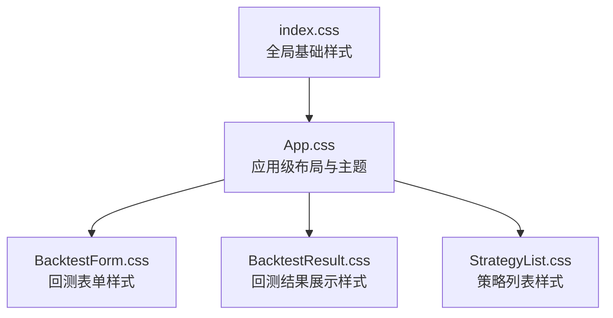
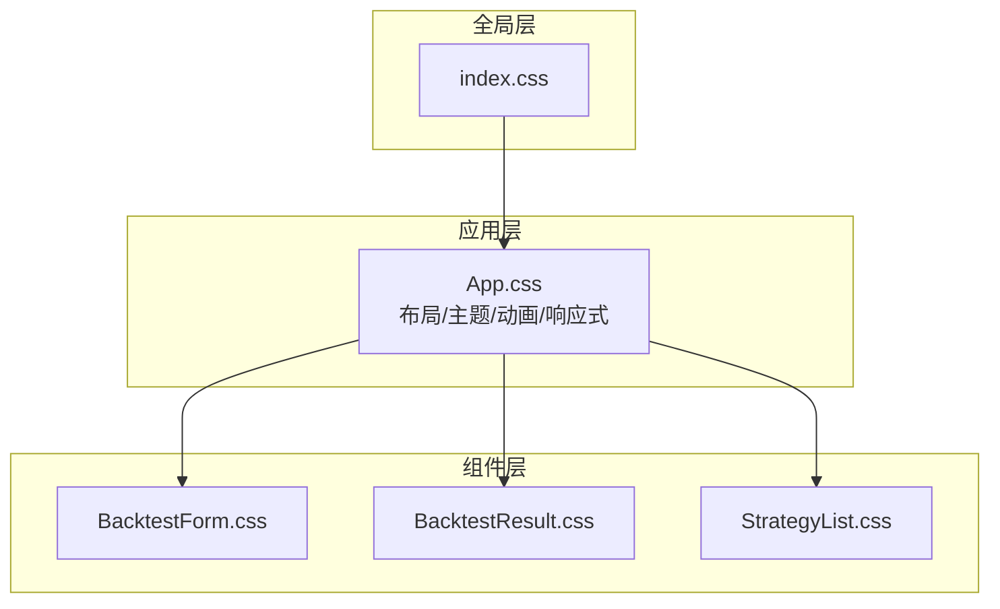
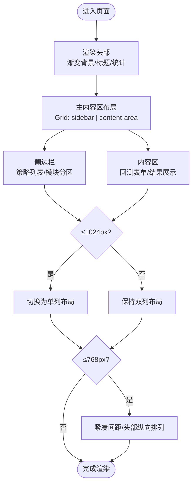
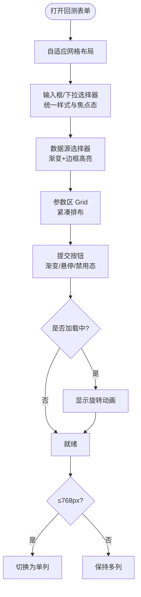
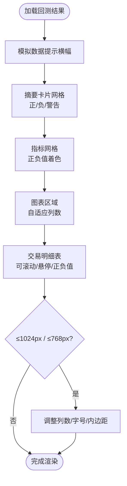
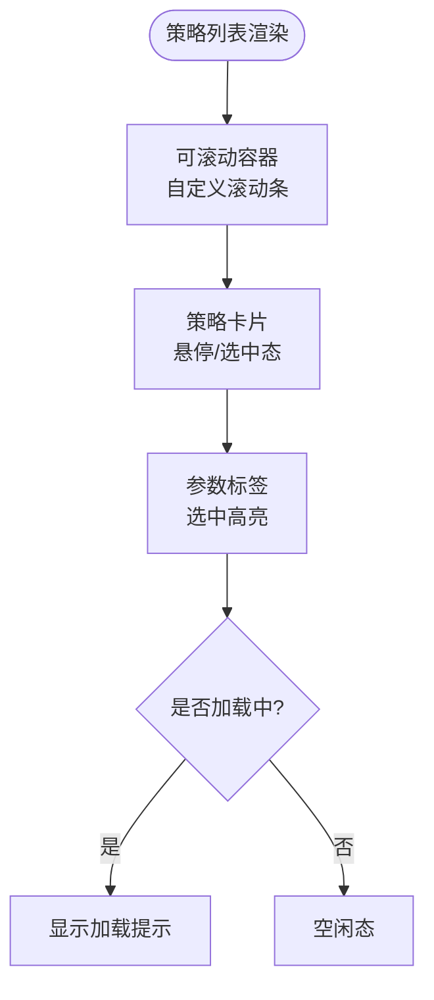
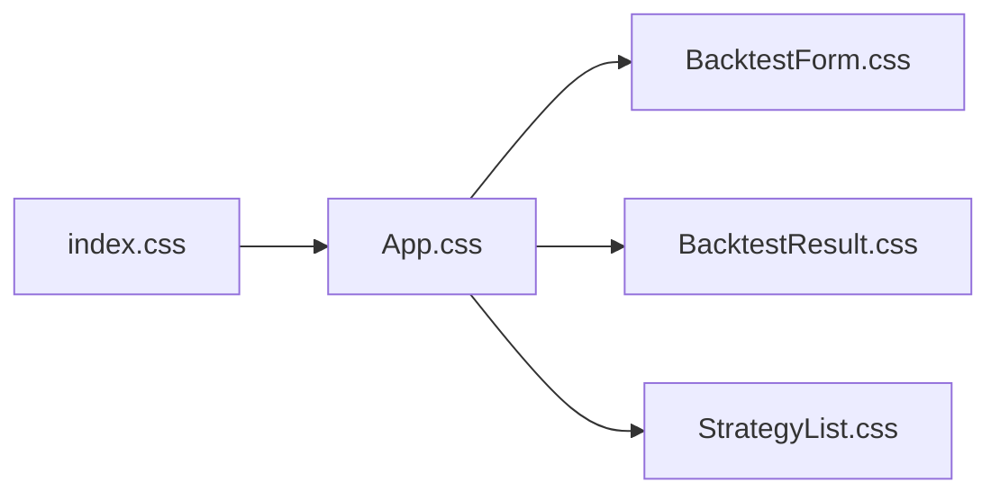

# 样式与主题系统

<cite>
**本文引用的文件**   
- [frontend/src/index.css](../../../frontend/src/index.css)
- [frontend/src/App.css](../../../frontend/src/App.css)
- [frontend/src/components/BacktestForm.css](../../../frontend/src/components/BacktestForm.css)
- [frontend/src/components/BacktestResult.css](../../../frontend/src/components/BacktestResult.css)
- [frontend/src/components/StrategyList.css](../../../frontend/src/components/StrategyList.css)
</cite>

## 目录
1. [简介](#简介)
2. [项目结构](#项目结构)
3. [核心组件](#核心组件)
4. [架构总览](#架构总览)
5. [详细组件分析](#详细组件分析)
6. [依赖关系分析](#依赖关系分析)
7. [性能考量](#性能考量)
8. [故障排查指南](#故障排查指南)
9. [结论](#结论)
10. [附录：主题定制与扩展指南](#附录主题定制与扩展指南)

## 简介
本文件面向前端样式与主题系统，系统性梳理全局样式、应用级布局、组件级样式以及响应式与移动端适配策略。文档重点覆盖：
- 全局基础样式与通用类（index.css）
- 应用级布局与主题配色（App.css）
- 组件独立样式模块化设计（BacktestForm、BacktestResult、StrategyList）
- CSS 模块化最佳实践、响应式设计原则、移动端适配方案与浏览器兼容性处理
- 主题定制指南与样式扩展方法

## 项目结构
样式文件采用“全局 + 应用级 + 组件级”的分层组织方式：
- 全局基础样式：frontend/src/index.css
- 应用级布局与主题：frontend/src/App.css
- 组件独立样式：
  - frontend/src/components/BacktestForm.css
  - frontend/src/components/BacktestResult.css
  - frontend/src/components/StrategyList.css

图表来源
- [frontend/src/index.css:1-24](../../../frontend/src/index.css#L1-L24)
- [frontend/src/App.css:1-142](../../../frontend/src/App.css#L1-L142)
- [frontend/src/components/BacktestForm.css:1-162](../../../frontend/src/components/BacktestForm.css#L1-L162)
- [frontend/src/components/BacktestResult.css:1-250](../../../frontend/src/components/BacktestResult.css#L1-L250)
- [frontend/src/components/StrategyList.css:1-87](../../../frontend/src/components/StrategyList.css#L1-L87)

章节来源
- [frontend/src/index.css:1-24](../../../frontend/src/index.css#L1-L24)
- [frontend/src/App.css:1-142](../../../frontend/src/App.css#L1-L142)

## 核心组件
本节概述各样式文件的职责与关键特性：
- index.css：重置默认样式、设置全局字体与背景、为根容器提供最小高度等基础能力。
- App.css：定义应用整体布局（头部、主内容区、侧边栏）、网格布局、卡片风格、动画与响应式断点。
- BacktestForm.css：回测表单的栅格化输入、数据源选择器高亮、提交按钮渐变与禁用态、加载旋转动画与移动端适配。
- BacktestResult.css：结果概览卡片、指标网格、图表区域、交易明细表格、状态色与移动端适配。
- StrategyList.css：策略列表滚动条美化、卡片选中态、参数标签与加载提示。

章节来源
- [frontend/src/index.css:1-24](../../../frontend/src/index.css#L1-L24)
- [frontend/src/App.css:1-142](../../../frontend/src/App.css#L1-L142)
- [frontend/src/components/BacktestForm.css:1-162](../../../frontend/src/components/BacktestForm.css#L1-L162)
- [frontend/src/components/BacktestResult.css:1-250](../../../frontend/src/components/BacktestResult.css#L1-L250)
- [frontend/src/components/StrategyList.css:1-87](../../../frontend/src/components/StrategyList.css#L1-L87)

## 架构总览
样式架构遵循“由全局到局部”的层次化组织，确保样式可维护性与可扩展性：
- 全局层（index.css）：统一重置、字体栈、背景色、根容器尺寸。
- 应用层（App.css）：页面骨架（header/main-content）、两列网格（sidebar/content-area）、卡片容器、动画与响应式断点。
- 组件层（各组件 .css）：组件内部结构与交互样式，包含各自的小规模响应式适配。

图表来源
- [frontend/src/index.css:1-24](../../../frontend/src/index.css#L1-L24)
- [frontend/src/App.css:1-142](../../../frontend/src/App.css#L1-L142)
- [frontend/src/components/BacktestForm.css:1-162](../../../frontend/src/components/BacktestForm.css#L1-L162)
- [frontend/src/components/BacktestResult.css:1-250](../../../frontend/src/components/BacktestResult.css#L1-L250)
- [frontend/src/components/StrategyList.css:1-87](../../../frontend/src/components/StrategyList.css#L1-L87)

## 详细组件分析

### 全局样式（index.css）
- 基础重置：清除默认外边距与内边距，启用 border-box 盒模型，保证布局一致性。
- 字体与渲染：使用系统字体栈，开启抗锯齿以提升文本可读性。
- 背景与根容器：浅色背景提升视觉舒适度；#root 最小高度保证页面撑满视口。

章节来源
- [frontend/src/index.css:1-24](../../../frontend/src/index.css#L1-L24)

### 应用级样式（App.css）
- 布局结构
  - 应用容器：垂直 Flex 布局，确保 header 与 main-content 合理分配空间。
  - 头部：渐变背景、阴影、居中标题与统计信息行。
  - 主内容区：最大宽度限制、居中、内边距控制。
  - 双列网格：左侧 sidebar（策略列表等），右侧 content-area（表单与结果）。
  - 卡片容器：统一的圆角、内边距与阴影，用于 section 区块。
- 主题配色
  - 头部与按钮使用蓝紫渐变，形成品牌主色调。
  - 卡片与区块使用浅灰背景与白色卡片体，强调层级与对比。
- 动画与交互
  - Logo 图标呼吸动画，增强品牌识别。
  - 悬停与焦点态通过阴影与边框色变化提升可访问性。
- 响应式断点
  - ≤1024px：网格切换为单列，侧边栏上移，内容区下移。
  - ≤768px：头部纵向排列，主内容区与区块内边距缩小，提升小屏可用性。

图表来源
- [frontend/src/App.css:1-142](../../../frontend/src/App.css#L1-L142)

章节来源
- [frontend/src/App.css:1-142](../../../frontend/src/App.css#L1-L142)

### 回测表单（BacktestForm.css）
- 表单布局
  - 使用 Grid 自适应列数，自动填充并保证最小列宽，提升不同屏幕下的可用性。
  - 参数区采用更细粒度的 Grid，便于密集参数的整齐排布。
- 数据源选择器
  - 渐变背景与边框高亮，hover/focus 态强化交互反馈。
- 输入控件
  - 统一的内边距、边框与圆角，focus 时边框与阴影突出。
- 提交按钮
  - 渐变背景、悬停上浮与阴影增强点击欲望；disabled 态降低透明度。
- 加载动画
  - 旋转动画指示异步操作进行中。
- 移动端适配
  - ≤768px：表单与参数区均切换为单列，避免横向溢出。

图表来源
- [frontend/src/components/BacktestForm.css:1-162](../../../frontend/src/components/BacktestForm.css#L1-L162)

章节来源
- [frontend/src/components/BacktestForm.css:1-162](../../../frontend/src/components/BacktestForm.css#L1-L162)

### 回测结果（BacktestResult.css）
- 结果概览
  - 顶部 Banner 提示模拟数据，使用暖色系边框与文字颜色。
  - 摘要卡片网格：正/负/警告三类卡片，分别以不同渐变背景区分语义。
- 指标网格
  - 指标项白底卡片，正负值使用绿色/红色强调。
- 图表区域
  - 图表容器白底边框，标题清晰，网格自适应列数。
- 交易明细表
  - 可横向滚动的表格，悬停行高亮，正负值着色。
- 移动端适配
  - ≤1024px：图表区域切换为单列。
  - ≤768px：摘要卡片与指标网格改为更少列，表格字号与内边距缩小。

图表来源
- [frontend/src/components/BacktestResult.css:1-250](../../../frontend/src/components/BacktestResult.css#L1-L250)

章节来源
- [frontend/src/components/BacktestResult.css:1-250](../../../frontend/src/components/BacktestResult.css#L1-L250)

### 策略列表（StrategyList.css）
- 列表容器
  - 固定最大高度并允许纵向滚动，右侧保留窄滚动条。
  - 自定义 WebKit 滚动条样式，渐变色滑块与轨道。
- 策略卡片
  - 悬停边框变色与轻微上浮阴影；选中态背景渐变与边框强调。
- 参数标签
  - 小尺寸标签，选中态高亮。
- 加载提示
  - 居中灰色提示文案。

图表来源
- [frontend/src/components/StrategyList.css:1-87](../../../frontend/src/components/StrategyList.css#L1-L87)

章节来源
- [frontend/src/components/StrategyList.css:1-87](../../../frontend/src/components/StrategyList.css#L1-L87)

## 依赖关系分析
样式之间的依赖关系主要体现在“应用层对组件层的组合”：
- App.css 定义了页面骨架与主题基调，组件样式在此基础上进行局部细化。
- 组件样式之间相互独立，无直接耦合，便于复用与维护。

图表来源
- [frontend/src/index.css:1-24](../../../frontend/src/index.css#L1-L24)
- [frontend/src/App.css:1-142](../../../frontend/src/App.css#L1-L142)
- [frontend/src/components/BacktestForm.css:1-162](../../../frontend/src/components/BacktestForm.css#L1-L162)
- [frontend/src/components/BacktestResult.css:1-250](../../../frontend/src/components/BacktestResult.css#L1-L250)
- [frontend/src/components/StrategyList.css:1-87](../../../frontend/src/components/StrategyList.css#L1-L87)

章节来源
- [frontend/src/index.css:1-24](../../../frontend/src/index.css#L1-L24)
- [frontend/src/App.css:1-142](../../../frontend/src/App.css#L1-L142)
- [frontend/src/components/BacktestForm.css:1-162](../../../frontend/src/components/BacktestForm.css#L1-L162)
- [frontend/src/components/BacktestResult.css:1-250](../../../frontend/src/components/BacktestResult.css#L1-L250)
- [frontend/src/components/StrategyList.css:1-87](../../../frontend/src/components/StrategyList.css#L1-L87)

## 性能考量
- 布局性能
  - 大量使用 Flex/Grid 布局，减少复杂嵌套，提高渲染效率。
  - 使用 max-width 与 margin: auto 控制内容宽度，避免过度重排。
- 动画与过渡
  - 仅对必要元素添加 transform/opacity 动画，避免触发昂贵重绘。
  - 按钮与卡片的 hover/focus 使用轻量阴影与边框变化。
- 滚动优化
  - 列表容器使用固定高度与滚动，避免长列表导致整页重排。
  - 自定义滚动条仅在 WebKit 内核生效，其他浏览器回退到默认滚动条。
- 资源体积
  - 样式文件按组件拆分，按需引入，减小首屏样式体积。

[本节为通用指导，不直接分析具体文件]

## 故障排查指南
- 布局错乱或重叠
  - 检查是否误用绝对定位或负边距；优先使用 Flex/Grid 对齐。
  - 确认 #root 最小高度与 body 背景是否正确设置。
- 移动端显示异常
  - 核对媒体查询断点是否与设备宽度匹配；检查 grid-template-columns 在断点内的切换逻辑。
- 滚动条不可见或样式不生效
  - 自定义滚动条仅支持 WebKit 内核；在非 WebKit 浏览器中会回退到默认样式。
- 交互反馈不明显
  - 检查 focus/hover 态的边框与阴影是否被第三方样式覆盖；必要时提高选择器优先级或使用 !important 谨慎修复。
- 渐变与阴影不一致
  - 确认渐变方向与颜色值一致；注意在不同主题或深色模式下可能需要调整对比度。

章节来源
- [frontend/src/components/StrategyList.css:10-27](../../../frontend/src/components/StrategyList.css#L10-L27)
- [frontend/src/App.css:112-142](../../../frontend/src/App.css#L112-L142)

## 结论
本样式与主题系统通过分层组织与模块化设计，实现了清晰的职责划分与良好的可维护性。全局层提供基础能力，应用层定义布局与主题基调，组件层专注局部交互与细节。响应式断点与移动端适配保证了跨设备的可用体验。后续可通过变量化主题与组件 Token 进一步降低耦合，提升扩展性。

[本节为总结性内容，不直接分析具体文件]

## 附录：主题定制与扩展指南
- 主题色与渐变
  - 当前主色为蓝紫渐变，应用于头部与按钮；可在 App.css 中统一替换渐变起止色，实现品牌换肤。
- 卡片与区块
  - 统一圆角、内边距与阴影；如需加深层级感，可增加阴影强度或调整背景明暗。
- 色彩语义
  - 正/负/警告色已在结果展示中使用；建议在新增组件时沿用相同语义色，保持一致性。
- 字体与排版
  - 全局字体栈已配置；如需引入新字体，请在 index.css 中扩展字体栈，并确保回退字体链完整。
- 响应式策略
  - 建议以 1024px 与 768px 作为主要断点；新增组件时应考虑在小屏下的列数与间距调整。
- 滚动条与动效
  - 滚动条样式基于 WebKit；如需兼容更多浏览器，可提供降级方案或改用原生滚动条。
- 扩展建议
  - 将常用颜色、字号、间距抽象为变量（如 CSS 自定义属性），集中管理于 index.css 或 App.css 顶层，便于全局替换与主题切换。
  - 组件样式尽量保持自包含，避免引用外部无关样式；必要时通过命名空间前缀隔离冲突。

[本节为通用指导，不直接分析具体文件]