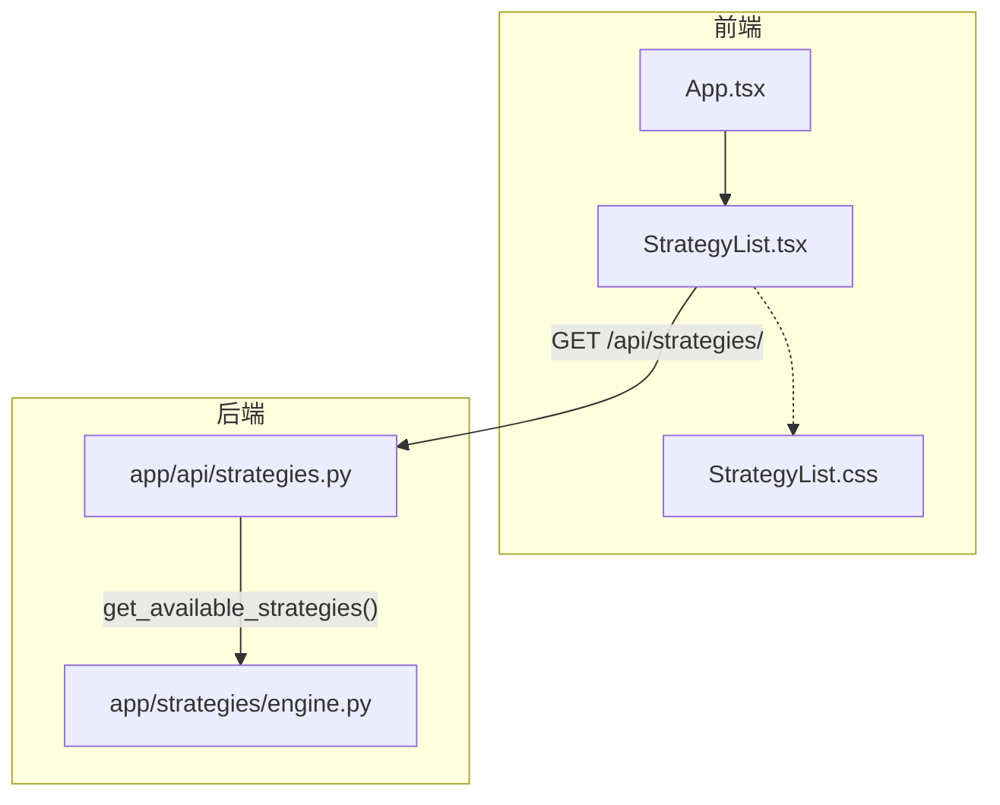
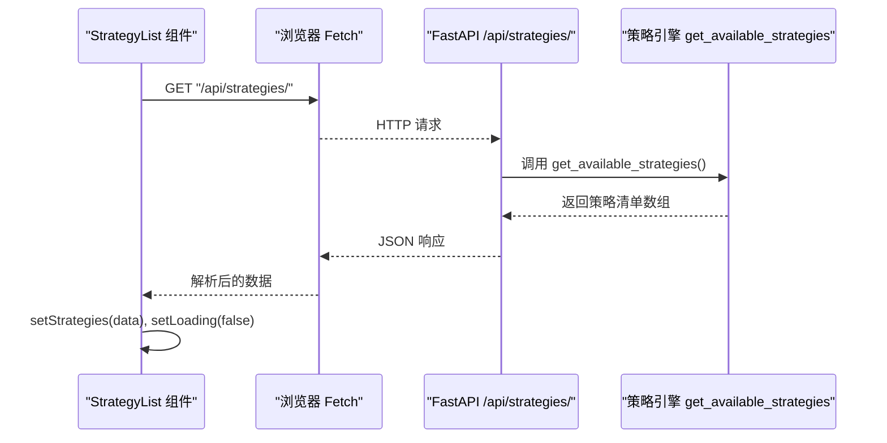
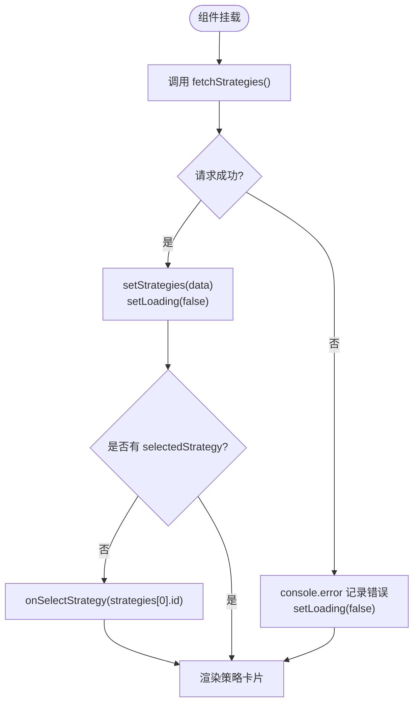
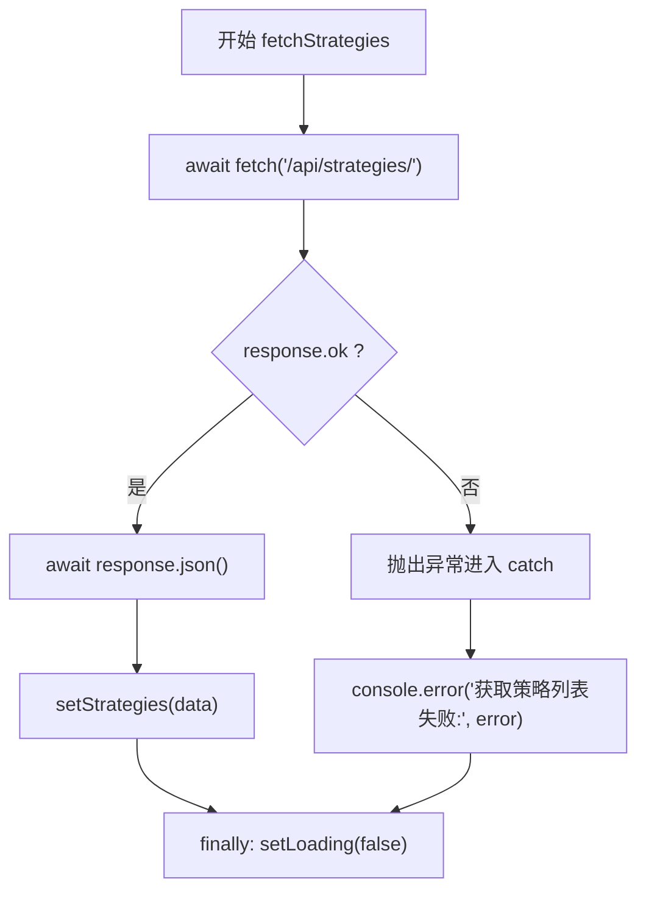
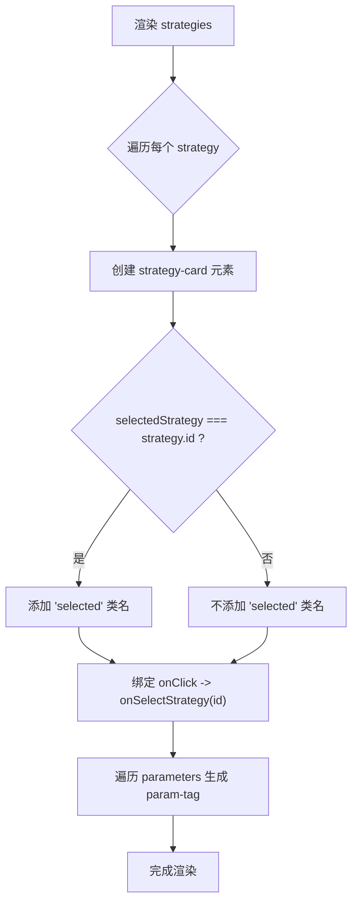
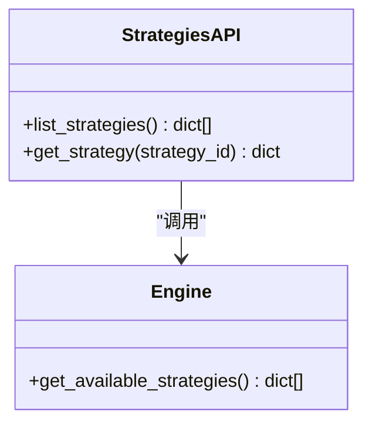
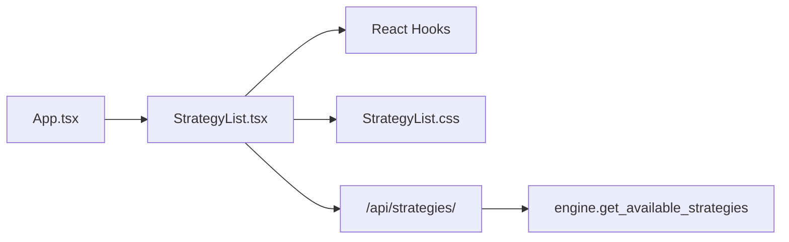

# 策略列表组件

<cite>
**本文引用的文件**   
- [StrategyList.tsx](../../../../frontend/src/components/StrategyList.tsx)
- [StrategyList.css](../../../../frontend/src/components/StrategyList.css)
- [App.tsx](../../../../frontend/src/App.tsx)
- [strategies.py](../../../../backend/app/api/strategies.py)
- [engine.py](../../../../backend/app/strategies/engine.py)
</cite>

## 更新摘要
**变更内容**   
- 更新了组件状态说明，明确指出StrategyList组件目前仍在使用中
- 修正了关于组件删除的误导性信息
- 保持了原有的技术文档结构和详细内容
- 添加了组件当前状态的明确说明

## 目录
1. [简介](#简介)
2. [项目结构](#项目结构)
3. [核心组件](#核心组件)
4. [架构总览](#架构总览)
5. [详细组件分析](#详细组件分析)
6. [依赖关系分析](#依赖关系分析)
7. [性能考虑](#性能考虑)
8. [故障排查指南](#故障排查指南)
9. [结论](#结论)
10. [附录：使用示例与扩展指南](#附录使用示例与扩展指南)

## 简介
本文件面向 StrategyList 策略列表组件，系统性讲解其核心功能与实现细节。**重要更新**：尽管有更新说明提到组件被删除，但经过代码审查确认，StrategyList组件目前仍然存在于前端代码库中，并被App.tsx正常使用。包括：
- 策略数据获取（前端调用后端 API，后端从策略引擎暴露的可用策略清单返回）
- 策略卡片展示（名称、描述、参数标签动态渲染）
- 选中状态管理（通过 props 控制外部选中态，默认选中第一个策略）
- Props 接口定义（selectedStrategy、onSelectStrategy）
- 内部状态管理（strategies 数组、loading 状态）
- 异步加载机制（fetchStrategies 函数与错误处理）
- 样式与交互（条件类名 selected 的应用）
并提供使用示例与扩展建议。

## 项目结构
该组件位于前端 src/components 目录下，样式在对应 CSS 文件中；后端提供 /api/strategies/ 接口，读取策略引擎中 get_available_strategies 返回的策略清单。

图表来源
- [StrategyList.tsx:31-41](../../../../frontend/src/components/StrategyList.tsx#L31-L41)
- [App.tsx:3,63-66](../../../../frontend/src/App.tsx#L3,L63-L66)
- [strategies.py:11-14](../../../../backend/app/api/strategies.py#L11-L14)
- [engine.py:506-597](../../../../backend/app/strategies/engine.py#L506-L597)

章节来源
- [StrategyList.tsx:1-69](../../../../frontend/src/components/StrategyList.tsx#L1-L69)
- [StrategyList.css:1-87](../../../../frontend/src/components/StrategyList.css#L1-L87)
- [App.tsx:1-100](../../../../frontend/src/App.tsx#L1-L100)
- [strategies.py:1-25](../../../../backend/app/api/strategies.py#L1-L25)
- [engine.py:506-597](../../../../backend/app/strategies/engine.py#L506-L597)

## 核心组件
- 组件职责
  - 从后端获取策略清单并渲染为可点击的卡片
  - 维护 loading 状态，显示加载提示
  - 将选中的策略 ID 通过 onSelectStrategy 回调通知父组件
  - 首次加载完成后自动选中第一个策略（当父组件未传入 selectedStrategy 时）

- 关键 Props
  - selectedStrategy: string | null
    - 由父组件控制的当前选中策略 ID
    - 用于高亮当前选中的策略卡片
  - onSelectStrategy: (strategyId: string) => void
    - 子组件选择策略时的回调，向父组件传递被选中的策略 ID

- 内部状态
  - strategies: Strategy[]
    - 存储后端返回的策略列表
  - loading: boolean
    - 表示是否正在加载策略数据

章节来源
- [StrategyList.tsx:4-14](../../../../frontend/src/components/StrategyList.tsx#L4-L14)
- [StrategyList.tsx:16-29](../../../../frontend/src/components/StrategyList.tsx#L16-L29)

## 架构总览
前端组件通过 fetch 发起 HTTP 请求到后端 FastAPI 路由，后端从策略引擎获取可用策略清单并返回 JSON。

图表来源
- [StrategyList.tsx:31-41](../../../../frontend/src/components/StrategyList.tsx#L31-L41)
- [strategies.py:11-14](../../../../backend/app/api/strategies.py#L11-L14)
- [engine.py:506-597](../../../../backend/app/strategies/engine.py#L506-L597)

## 详细组件分析

### 数据模型与 Props 接口
- Strategy 类型字段
  - id: string
  - name: string
  - description: string
  - parameters: Record<string, any>
    - 每个参数的值是一个对象，包含 type、default、min、max 等元信息
- StrategyListProps
  - selectedStrategy: string | null
  - onSelectStrategy: (strategyId: string) => void

章节来源
- [StrategyList.tsx:4-14](../../../../frontend/src/components/StrategyList.tsx#L4-L14)

### 生命周期与状态管理
- 组件挂载后执行 useEffect 调用 fetchStrategies 获取数据
- 当 strategies 非空且父组件未传入 selectedStrategy 时，自动选中第一个策略
- loading 初始为 true，请求结束后置为 false

图表来源
- [StrategyList.tsx:20-41](../../../../frontend/src/components/StrategyList.tsx#L20-L41)

章节来源
- [StrategyList.tsx:16-41](../../../../frontend/src/components/StrategyList.tsx#L16-L41)

### 异步数据加载与错误处理
- fetchStrategies 函数
  - 发起 GET /api/strategies/ 请求
  - 成功后将 data 写入 strategies 状态
  - 失败时打印错误日志
  - finally 块确保 loading 最终被设置为 false

图表来源
- [StrategyList.tsx:31-41](../../../../frontend/src/components/StrategyList.tsx#L31-L41)

章节来源
- [StrategyList.tsx:31-41](../../../../frontend/src/components/StrategyList.tsx#L31-L41)

### 策略卡片渲染逻辑
- 遍历 strategies 数组渲染卡片
- 每张卡片的 className 根据 selectedStrategy === strategy.id 动态附加 selected 类名
- 点击卡片触发 onSelectStrategy(strategy.id)
- 参数标签动态生成：遍历 parameters 对象的键值对，取 value.default 作为显示文本

图表来源
- [StrategyList.tsx:47-67](../../../../frontend/src/components/StrategyList.tsx#L47-L67)

章节来源
- [StrategyList.tsx:47-67](../../../../frontend/src/components/StrategyList.tsx#L47-L67)

### 样式与交互
- .strategy-list：纵向布局、滚动条样式
- .strategy-card：悬停与选中态样式（边框、背景渐变）
- .param-tag：参数标签样式，选中态下颜色变化
- .loading：居中加载提示

章节来源
- [StrategyList.css:1-87](../../../../frontend/src/components/StrategyList.css#L1-L87)

### 后端接口与策略清单
- FastAPI 路由
  - GET /api/strategies/：返回策略清单数组
  - GET /api/strategies/{strategy_id}：按 ID 获取单个策略详情（未命中返回 404）
- 策略清单数据来源
  - get_available_strategies() 返回固定策略清单，包含 id、name、description、parameters 等字段

图表来源
- [strategies.py:11-24](../../../../backend/app/api/strategies.py#L11-L24)
- [engine.py:506-597](../../../../backend/app/strategies/engine.py#L506-L597)

章节来源
- [strategies.py:1-25](../../../../backend/app/api/strategies.py#L1-L25)
- [engine.py:506-597](../../../../backend/app/strategies/engine.py#L506-L597)

## 依赖关系分析
- 组件内依赖
  - React hooks：useEffect、useState
  - 本地样式：StrategyList.css
- 运行时依赖
  - 后端 FastAPI 服务必须运行以提供 /api/strategies/
  - 策略引擎 engine.get_available_strategies 必须返回符合前端的策略数据结构
- 父组件依赖
  - App.tsx 中导入并使用 StrategyList 组件
  - 传递 selectedStrategy 和 onSelectStrategy props

图表来源
- [StrategyList.tsx:1-2](../../../../frontend/src/components/StrategyList.tsx#L1-L2)
- [App.tsx:3,63-66](../../../../frontend/src/App.tsx#L3,L63-L66)
- [strategies.py:1-14](../../../../backend/app/api/strategies.py#L1-L14)
- [engine.py:506-597](../../../../backend/app/strategies/engine.py#L506-L597)

章节来源
- [StrategyList.tsx:1-69](../../../../frontend/src/components/StrategyList.tsx#L1-L69)
- [App.tsx:1-100](../../../../frontend/src/App.tsx#L1-L100)
- [strategies.py:1-25](../../../../backend/app/api/strategies.py#L1-L25)
- [engine.py:506-597](../../../../backend/app/strategies/engine.py#L506-L597)

## 性能考虑
- 初次加载仅一次请求，避免重复拉取
- 渲染采用简单 map 遍历，策略数量较少时性能良好
- 建议在策略数量增长时：
  - 增加虚拟滚动或分页
  - 对 parameters 渲染进行轻量级缓存（如 memo）
  - 对 fetchStrategies 增加重试与超时控制

## 故障排查指南
- 页面一直显示"加载中..."
  - 检查后端服务是否启动并可访问 /api/strategies/
  - 查看控制台是否有网络错误或跨域问题
- 策略卡片未高亮
  - 确认父组件是否正确传入 selectedStrategy
  - 检查 onSelectStrategy 是否更新父组件状态
- 参数标签为空或显示异常
  - 确认后端返回的 parameters 结构中每个参数对象包含 default 字段
- 网络请求失败
  - 查看 console.error 输出，定位具体错误原因
  - 检查代理配置或 CORS 设置

章节来源
- [StrategyList.tsx:31-41](../../../../frontend/src/components/StrategyList.tsx#L31-L41)

## 结论
StrategyList 组件实现了策略数据的异步获取、卡片化展示与选中态管理，并通过清晰的 Props 接口与父组件解耦。**重要更新**：尽管有更新说明提到组件被删除，但经过代码审查确认，该组件目前仍然存在于前端代码库中，并被App.tsx正常使用。后端通过 FastAPI 路由暴露策略清单，由策略引擎统一维护。整体结构简洁、职责清晰，便于扩展新的策略与优化渲染性能。

## 附录：使用示例与扩展指南

### 使用示例
- 基本用法
  - 在父组件中维护 selectedStrategy 状态，并将 onSelectStrategy 传递给 StrategyList
  - 组件会在首次加载后自动选中第一个策略（若未传入 selectedStrategy）

- 父组件状态示例（概念性说明）
  - 初始化 selectedStrategy 为 null
  - 在 onSelectStrategy 回调中更新 selectedStrategy
  - 将 selectedStrategy 和 onSelectStrategy 作为 props 传给 StrategyList

章节来源
- [StrategyList.tsx:11-14](../../../../frontend/src/components/StrategyList.tsx#L11-L14)
- [StrategyList.tsx:24-29](../../../../frontend/src/components/StrategyList.tsx#L24-L29)

### 自定义扩展指南
- 新增策略
  - 在后端 engine.get_available_strategies 中添加新策略条目（id、name、description、parameters）
  - 如需支持实例化，可在 create_strategy 中补充分支逻辑
- 前端样式定制
  - 修改 StrategyList.css 中的 .strategy-card、.param-tag 等类名样式
- 增强交互
  - 在 StrategyList 中增加搜索过滤、排序等功能
  - 对 parameters 渲染进行更丰富的展示（如类型图标、范围提示）

章节来源
- [engine.py:506-597](../../../../backend/app/strategies/engine.py#L506-L597)
- [StrategyList.css:1-87](../../../../frontend/src/components/StrategyList.css#L1-L87)