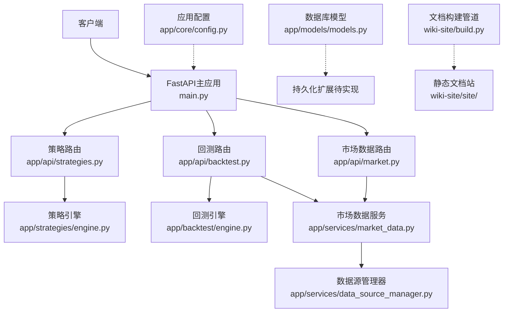
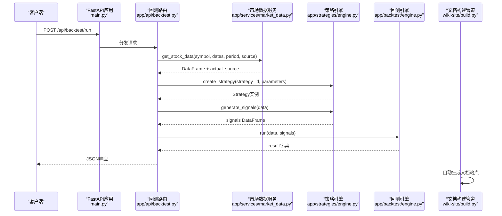
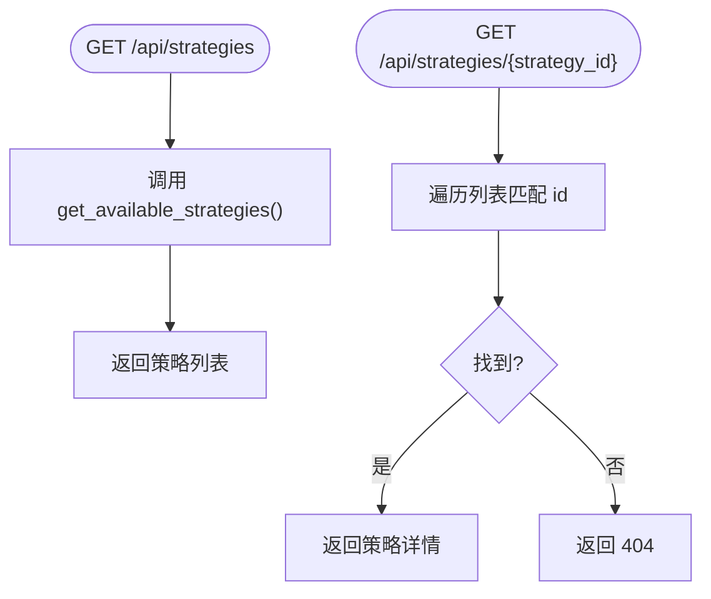
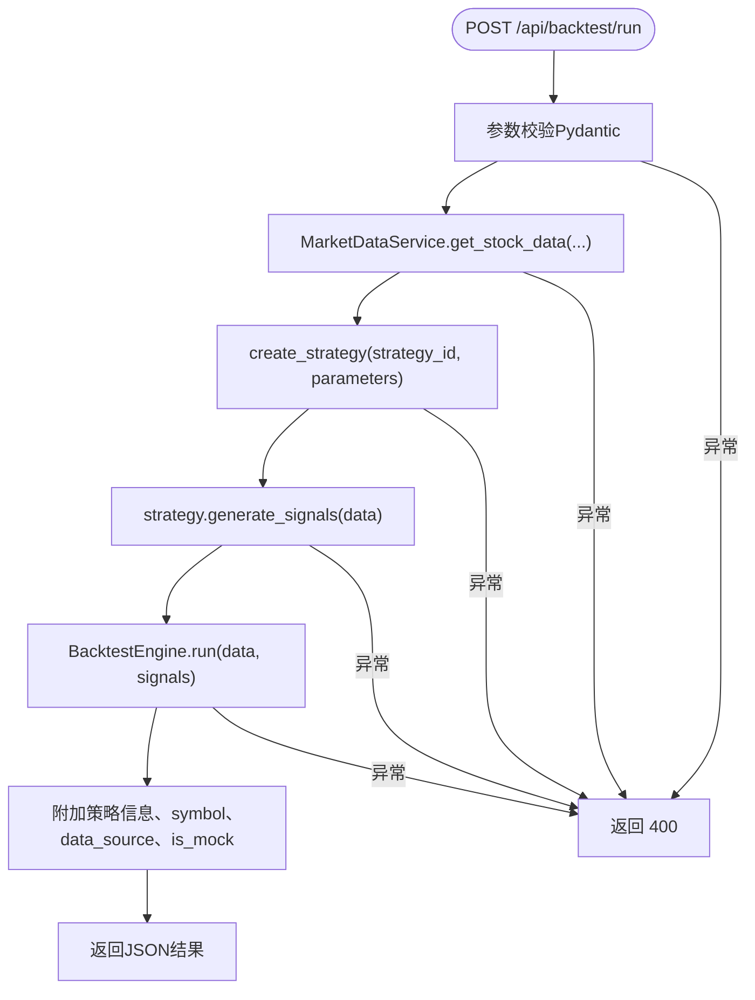
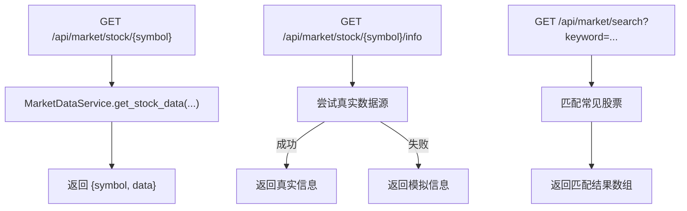
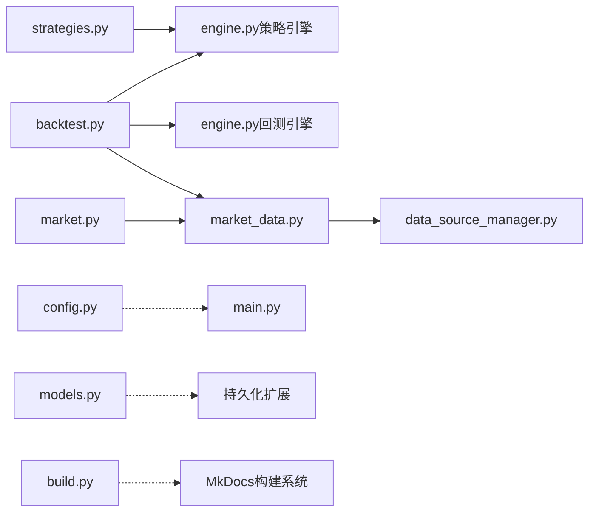

# API路由设计

<cite>
**本文引用的文件**   
- [main.py](../../../../backend/main.py)
- [strategies.py](../../../../backend/app/api/strategies.py)
- [backtest.py](../../../../backend/app/api/backtest.py)
- [market.py](../../../../backend/app/api/market.py)
- [engine.py（策略引擎）](../../../../backend/app/strategies/engine.py)
- [engine.py（回测引擎）](../../../../backend/app/backtest/engine.py)
- [market_data.py](../../../../backend/app/services/market_data.py)
- [models.py](../../../../backend/app/models/models.py)
- [config.py](../../../../backend/app/core/config.py)
- [build.py](../../../build.py)
</cite>

## 更新摘要
**变更内容**   
- 更新了文档构建管道相关内容，确保与新的MkDocs静态文档站构建流程兼容
- 优化了内部链接结构，支持从file://协议到相对路径的自动转换
- 增强了文档站点基础设施说明，包括源码链接重写功能
- 保持了现有的API路由设计文档结构和核心内容完整性

## 目录
1. [引言](#引言)
2. [项目结构](#项目结构)
3. [核心组件](#核心组件)
4. [架构总览](#架构总览)
5. [详细组件分析](#详细组件分析)
6. [依赖关系分析](#依赖关系分析)
7. [性能与可扩展性](#性能与可扩展性)
8. [故障排查指南](#故障排查指南)
9. [结论](#结论)
10. [附录：API规范与示例](#附录api规范与示例)

## 引言
本文件面向量化策略查看与回测系统的后端API，目标是提供一套清晰、可维护且向后兼容的RESTful接口文档。内容覆盖：
- RESTful设计规范：URL命名约定、HTTP方法使用、状态码规范
- 策略管理API：获取策略列表、策略详情查询
- 回测执行API：参数验证、同步处理流程、结果返回格式
- 市场数据API：股票数据获取、搜索功能、基本信息查询
- 请求响应示例：JSON数据结构定义、错误处理机制、参数验证规则
- API版本管理与向后兼容性考虑
- 文档构建管道：MkDocs静态文档站生成流程

系统采用FastAPI构建，按领域划分路由模块，并通过统一前缀组织API路径。同时集成了完整的文档构建管道，支持自动化文档生成和源码链接重写。

## 项目结构
后端采用模块化分层结构：
- API层：按业务域拆分路由模块（策略、回测、市场数据）
- 服务层：封装外部数据源访问逻辑
- 引擎层：策略信号生成与回测计算
- 模型层：数据库表结构定义（当前用于持久化扩展）
- 配置层：应用与环境变量配置
- 文档构建层：MkDocs静态文档站生成管道

**图表来源**
- [main.py:9-27](../../../../backend/main.py#L9-L27)
- [strategies.py:8-24](../../../../backend/app/api/strategies.py#L8-L24)
- [backtest.py:13-76](../../../../backend/app/api/backtest.py#L13-L76)
- [market.py:8-46](../../../../backend/app/api/market.py#L8-L46)
- [engine.py（策略引擎）:506-655](../../../../backend/app/strategies/engine.py#L506-L655)
- [engine.py（回测引擎）:10-70](../../../../backend/app/backtest/engine.py#L10-L70)
- [market_data.py:11-41](../../../../backend/app/services/market_data.py#L11-L41)
- [models.py:11-44](../../../../backend/app/models/models.py#L11-L44)
- [config.py:8-24](../../../../backend/app/core/config.py#L8-L24)
- [build.py:24-31](../../../build.py#L24-L31)

**章节来源**
- [main.py:1-36](../../../../backend/main.py#L1-L36)

## 核心组件
- FastAPI主应用：注册CORS中间件、挂载各业务路由、提供健康检查与根路径
- 策略路由：暴露策略列表与详情查询
- 回测路由：接收回测请求，调用市场数据服务与策略引擎，运行回测引擎并返回结果
- 市场数据路由：提供股票历史数据、股票信息、代码搜索
- 策略引擎：内置多种策略实现与工厂函数，支持动态创建策略实例
- 回测引擎：根据信号与价格序列计算收益曲线、交易记录与绩效指标
- 市场数据服务：统一封装多数据源访问，自动选择最佳数据源
- 数据库模型：定义策略与回测结果的持久化结构（当前未接入）
- 配置中心：集中管理应用名称、版本、调试开关、数据库URL、默认市场等
- 文档构建管道：自动化MkDocs文档站生成，支持源码链接重写

**章节来源**
- [main.py:9-35](../../../../backend/main.py#L9-L35)
- [strategies.py:11-24](../../../../backend/app/api/strategies.py#L11-L24)
- [backtest.py:16-76](../../../../backend/app/api/backtest.py#L16-L76)
- [market.py:11-46](../../../../backend/app/api/market.py#L11-L46)
- [engine.py（策略引擎）:17-655](../../../../backend/app/strategies/engine.py#L17-L655)
- [engine.py（回测引擎）:10-163](../../../../backend/app/backtest/engine.py#L10-L163)
- [market_data.py:11-106](../../../../backend/app/services/market_data.py#L11-L106)
- [models.py:11-44](../../../../backend/app/models/models.py#L11-L44)
- [config.py:8-24](../../../../backend/app/core/config.py#L8-L24)
- [build.py:53-287](../../../build.py#L53-L287)

## 架构总览
下图展示一次回测请求从客户端到引擎计算的完整调用链，以及文档构建管道的集成。

**图表来源**
- [backtest.py:28-69](../../../../backend/app/api/backtest.py#L28-L69)
- [market_data.py:14-41](../../../../backend/app/services/market_data.py#L14-L41)
- [engine.py（策略引擎）:600-655](../../../../backend/app/strategies/engine.py#L600-L655)
- [engine.py（回测引擎）:15-70](../../../../backend/app/backtest/engine.py#L15-L70)
- [build.py:191-198](../../../build.py#L191-L198)

## 详细组件分析

### 策略管理API
- 获取策略列表
  - URL: GET /api/strategies/
  - 行为：返回所有可用策略的元数据（id、name、description、parameters）
  - 数据来源：策略引擎的get_available_strategies
- 获取策略详情
  - URL: GET /api/strategies/{strategy_id}
  - 行为：根据id匹配策略元数据；不存在时返回404

**图表来源**
- [strategies.py:11-24](../../../../backend/app/api/strategies.py#L11-L24)
- [engine.py（策略引擎）:506-597](../../../../backend/app/strategies/engine.py#L506-L597)

**章节来源**
- [strategies.py:11-24](../../../../backend/app/api/strategies.py#L11-L24)
- [engine.py（策略引擎）:506-597](../../../../backend/app/strategies/engine.py#L506-L597)

### 回测执行API
- 运行回测
  - URL: POST /api/backtest/run
  - 请求体字段：
    - strategy_id: 字符串，必填
    - symbol: 字符串，必填
    - start_date: 可选字符串
    - end_date: 可选字符串
    - period: 字符串，默认"1y"
    - initial_capital: 浮点数，默认100000.0
    - source: 字符串，默认"auto"，允许值包括 auto、tencent、yfinance、akshare、baostock、mock
    - parameters: 对象，键值对，具体取决于所选策略
  - 处理流程：
    1) 通过市场数据服务拉取股票数据，并返回实际使用的数据源
    2) 根据strategy_id与parameters创建策略实例
    3) 调用策略generate_signals生成信号
    4) 使用回测引擎计算收益曲线、交易记录与绩效指标
    5) 在结果中附加策略信息与数据源标识
  - 响应结构：
    - metrics: 绩效指标对象
    - trades: 交易记录数组
    - equity_curve: 资金曲线数组
    - signals_data: 信号数据数组
    - strategy: {id, name, parameters}
    - symbol: 股票代码
    - data_source: 实际数据源
    - is_mock: 是否模拟数据
  - 错误处理：
    - 参数或运行时异常统一返回400，detail为错误消息

**图表来源**
- [backtest.py:16-69](../../../../backend/app/api/backtest.py#L16-L69)
- [engine.py（回测引擎）:15-70](../../../../backend/app/backtest/engine.py#L15-L70)
- [engine.py（策略引擎）:600-655](../../../../backend/app/strategies/engine.py#L600-L655)
- [market_data.py:14-41](../../../../backend/app/services/market_data.py#L14-L41)

**章节来源**
- [backtest.py:16-76](../../../../backend/app/api/backtest.py#L16-L76)
- [engine.py（回测引擎）:15-163](../../../../backend/app/backtest/engine.py#L15-L163)
- [engine.py（策略引擎）:600-655](../../../../backend/app/strategies/engine.py#L600-L655)
- [market_data.py:14-41](../../../../backend/app/services/market_data.py#L14-L41)

### 市场数据API
- 获取股票数据
  - URL: GET /api/market/stock/{symbol}?start_date=&end_date=&period=1y
  - 行为：返回指定时间窗口的OHLCV数据（DataFrame转records）
  - 错误处理：捕获异常返回400
- 获取股票信息
  - URL: GET /api/market/stock/{symbol}/info
  - 行为：优先尝试真实数据源获取公司信息，失败则返回模拟信息
- 搜索股票代码
  - URL: GET /api/market/search?keyword=...
  - 行为：基于关键词匹配常见股票代码与名称，返回匹配结果数组

**图表来源**
- [market.py:11-46](../../../../backend/app/api/market.py#L11-L46)
- [market_data.py:14-106](../../../../backend/app/services/market_data.py#L14-L106)

**章节来源**
- [market.py:11-46](../../../../backend/app/api/market.py#L11-L46)
- [market_data.py:14-106](../../../../backend/app/services/market_data.py#L14-L106)

## 依赖关系分析
- 路由层依赖：
  - strategies.py依赖engine.py（策略引擎）
  - backtest.py依赖engine.py（策略引擎）、engine.py（回测引擎）、market_data.py
  - market.py依赖market_data.py
- 服务层依赖：
  - market_data.py依赖DataSourceManager（未在已读文件中展开）
- 配置与模型：
  - config.py提供应用级配置
  - models.py定义数据库模型（当前未直接接入API）
- 文档构建依赖：
  - build.py依赖MkDocs和相关Python包进行文档生成

**图表来源**
- [strategies.py:6-24](../../../../backend/app/api/strategies.py#L6-L24)
- [backtest.py:9-76](../../../../backend/app/api/backtest.py#L9-L76)
- [market.py:6-46](../../../../backend/app/api/market.py#L6-L46)
- [market_data.py:8-41](../../../../backend/app/services/market_data.py#L8-L41)
- [main.py:24-27](../../../../backend/main.py#L24-L27)
- [models.py:11-44](../../../../backend/app/models/models.py#L11-L44)
- [config.py:8-24](../../../../backend/app/core/config.py#L8-L24)
- [build.py:191-198](../../../build.py#L191-L198)

**章节来源**
- [strategies.py:6-24](../../../../backend/app/api/strategies.py#L6-L24)
- [backtest.py:9-76](../../../../backend/app/api/backtest.py#L9-L76)
- [market.py:6-46](../../../../backend/app/api/market.py#L6-L46)
- [market_data.py:8-41](../../../../backend/app/services/market_data.py#L8-L41)
- [main.py:24-27](../../../../backend/main.py#L24-L27)
- [models.py:11-44](../../../../backend/app/models/models.py#L11-L44)
- [config.py:8-24](../../../../backend/app/core/config.py#L8-L24)
- [build.py:191-198](../../../build.py#L191-L198)

## 性能与可扩展性
- 同步处理现状：
  - 回测执行API为同步阻塞调用，适合短耗时场景；若数据量大或策略复杂，建议引入异步任务队列（如Celery/RQ）与任务状态轮询接口
- 数据源优化：
  - 市场数据服务支持多数据源自动选择，建议增加缓存层（本地文件或Redis）以减少重复请求
- 指标计算优化：
  - 回测引擎中对数值列进行NaN/Inf清理，避免序列化异常；可考虑向量化计算以提升性能
- 可扩展点：
  - 新增策略只需在策略引擎中实现BaseStrategy并在工厂函数中注册
  - 新增数据源需在DataSourceManager中适配并纳入自动选择逻辑
- 文档构建优化：
  - 使用MkDocs Material主题提供现代化文档界面
  - 自动化链接转换和源码引用重写功能

## 故障排查指南
- 400错误（参数或运行时异常）：
  - 回测执行与市场数据接口在异常分支抛出HTTPException(400)，detail包含异常消息
  - 排查要点：
    - 确认请求体字段类型与取值范围符合Pydantic模型定义
    - 检查symbol是否存在于数据源或搜索库
    - 检查日期格式与period是否合理
- 404错误（资源不存在）：
  - 策略详情查询在未匹配到strategy_id时返回404
  - 排查要点：确认strategy_id是否在策略列表中
- 数据源问题：
  - 当真实数据源不可用时，市场数据服务会回退到模拟数据；可通过返回的data_source与is_mock字段判断
- 日志与调试：
  - 建议在服务层与引擎层增加结构化日志，便于定位异常堆栈与输入数据快照
- 文档构建问题：
  - 检查wiki-site/build.py脚本执行权限和依赖安装情况
  - 验证MkDocs配置文件的语法正确性

**章节来源**
- [backtest.py:68-69](../../../../backend/app/api/backtest.py#L68-L69)
- [market.py:26-27](../../../../backend/app/api/market.py#L26-L27)
- [strategies.py:20-24](../../../../backend/app/api/strategies.py#L20-L24)
- [market_data.py:43-82](../../../../backend/app/services/market_data.py#L43-L82)
- [build.py:191-198](../../../build.py#L191-L198)

## 结论
本系统提供了清晰的RESTful API边界，涵盖策略管理、回测执行与市场数据三大能力域。当前实现以同步方式完成回测计算，具备良好扩展性，可在后续迭代中引入异步任务、缓存与更丰富的数据源。通过统一的错误处理与明确的响应结构，前端可稳定消费API并呈现可视化结果。同时，完善的文档构建管道确保了技术文档的及时更新和高质量输出。

## 附录：API规范与示例

### RESTful设计规范
- URL命名约定
  - 使用小写字母与连字符分隔资源名，例如 /api/strategies、/api/backtest、/api/market
  - 资源ID作为路径参数，例如 /api/strategies/{strategy_id}
- HTTP方法使用
  - GET：读取资源（策略列表、策略详情、股票数据、股票信息、搜索）
  - POST：提交数据（回测执行）
- 状态码规范
  - 200：成功
  - 400：请求参数错误或运行时异常
  - 404：资源不存在
  - 5xx：服务端内部错误（当前未显式抛出）

### 策略管理API
- GET /api/strategies/
  - 响应：策略数组，每项包含id、name、description、parameters
- GET /api/strategies/{strategy_id}
  - 响应：单个策略对象
  - 错误：404（未找到）

**章节来源**
- [strategies.py:11-24](../../../../backend/app/api/strategies.py#L11-L24)
- [engine.py（策略引擎）:506-597](../../../../backend/app/strategies/engine.py#L506-L597)

### 回测执行API
- POST /api/backtest/run
  - 请求体字段与默认值：
    - strategy_id: string（必填）
    - symbol: string（必填）
    - start_date: string（可选）
    - end_date: string（可选）
    - period: string（默认"1y"）
    - initial_capital: number（默认100000.0）
    - source: string（默认"auto"，允许值见上文）
    - parameters: object（键值对，随策略而定）
  - 响应字段：
    - metrics: object（initial_capital、final_value、total_return、annual_return、max_drawdown、sharpe_ratio、win_rate、total_trades、winning_trades、losing_trades、profit_loss_ratio）
    - trades: array（entry_date、exit_date、entry_price、exit_price、pnl、pnl_pct、direction）
    - equity_curve: array（Date、equity、Close、signal）
    - signals_data: array（Date、Close、signal、position_change）
    - strategy: object（id、name、parameters）
    - symbol: string
    - data_source: string
    - is_mock: boolean
  - 错误：400（参数或运行时异常）

**章节来源**
- [backtest.py:16-69](../../../../backend/app/api/backtest.py#L16-L69)
- [engine.py（回测引擎）:15-163](../../../../backend/app/backtest/engine.py#L15-L163)

### 市场数据API
- GET /api/market/stock/{symbol}?start_date=&end_date=&period=1y
  - 响应：{symbol, data: records[]}
  - 错误：400
- GET /api/market/stock/{symbol}/info
  - 响应：{symbol, name, sector, industry, market_cap, current_price, currency}
- GET /api/market/search?keyword=...
  - 响应：[{symbol, name}, ...]

**章节来源**
- [market.py:11-46](../../../../backend/app/api/market.py#L11-L46)
- [market_data.py:43-106](../../../../backend/app/services/market_data.py#L43-L106)

### 错误处理机制
- 统一抛出HTTPException，携带status_code与detail
- 客户端应依据状态码与detail进行提示与重试策略

**章节来源**
- [backtest.py:68-69](../../../../backend/app/api/backtest.py#L68-L69)
- [market.py:26-27](../../../../backend/app/api/market.py#L26-L27)
- [strategies.py:20-24](../../../../backend/app/api/strategies.py#L20-L24)

### 参数验证规则
- Pydantic模型BacktestRequest负责字段类型与默认值校验
- Query参数min_length约束（search接口）
- 建议在前端与后端共同实施二次校验，提升健壮性

**章节来源**
- [backtest.py:16-25](../../../../backend/app/api/backtest.py#L16-L25)
- [market.py:41-46](../../../../backend/app/api/market.py#L41-L46)

### API版本管理与向后兼容性
- 当前FastAPI应用版本为1.0.0，由main.py定义
- 建议：
  - 在URL中使用版本号前缀（如 /api/v1/...），便于平滑升级
  - 保持字段向后兼容：新增字段默认值，废弃字段保留但标记deprecated
  - 变更策略元数据或回测结果结构时，提供迁移指南与兼容层

**章节来源**
- [main.py:9-13](../../../../backend/main.py#L9-L13)

### 文档构建管道
- MkDocs配置：使用Material主题，支持Mermaid图表、代码高亮等功能
- 构建流程：
  1. 预处理：生成首页和样式文件
  2. 链接转换：将file://链接转换为相对路径
  3. 配置生成：自动生成mkdocs.yml导航结构
  4. 站点构建：调用mkdocs build生成静态HTML
  5. 后处理：重写源码链接为GitCode浏览地址
- 命令行选项：
  - python build.py：全流程构建
  - python build.py links：仅链接转换
  - python build.py config：仅配置生成
  - python build.py postprocess：仅后处理

**章节来源**
- [build.py:53-287](../../../build.py#L53-L287)