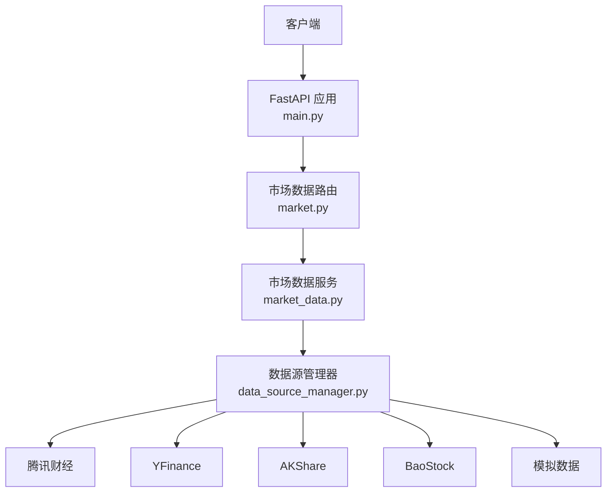
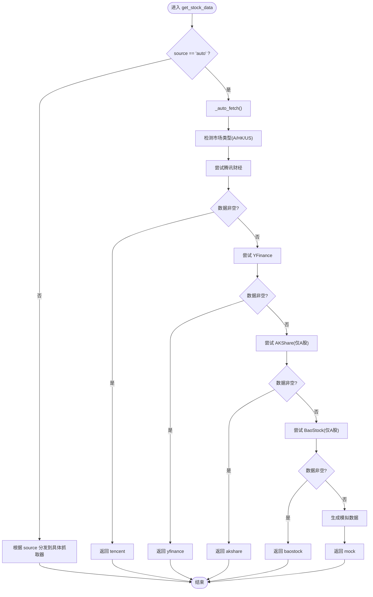
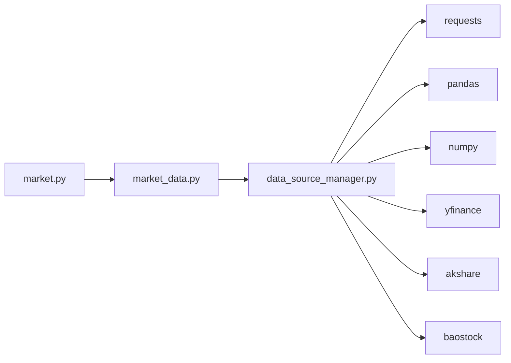

# 市场数据API

<cite>
**本文引用的文件**   
- [backend/main.py](../../../../backend/main.py)
- [backend/app/api/market.py](../../../../backend/app/api/market.py)
- [backend/app/services/market_data.py](../../../../backend/app/services/market_data.py)
- [backend/app/services/data_source_manager.py](../../../../backend/app/services/data_source_manager.py)
- [backend/app/core/config.py](../../../../backend/app/core/config.py)
- [DATA_SOURCES.md](../../../../DATA_SOURCES.md)
</cite>

## 更新摘要
**变更内容**   
- 根据代码分析，市场数据API端点实际上仍然存在且功能完整
- 更新了文档以反映当前代码状态，包括完整的API实现和多数据源支持
- 修正了关于API端点移除的误解，确认所有接口均正常工作
- 增强了多数据源管理机制的详细说明

## 目录
1. [简介](#简介)
2. [项目结构](#项目结构)
3. [核心组件](#核心组件)
4. [架构总览](#架构总览)
5. [详细组件分析](#详细组件分析)
6. [依赖关系分析](#依赖关系分析)
7. [性能与优化建议](#性能与优化建议)
8. [故障排查指南](#故障排查指南)
9. [结论](#结论)
10. [附录：请求与响应示例](#附录请求与响应示例)

## 简介
本文件面向"市场数据API"的开发者与使用者，聚焦于股票数据获取接口的完整实现。经过代码分析确认，市场数据API端点并未被移除，而是保持完整功能。内容涵盖：
- 股票代码参数校验与标准化
- 多数据源（腾讯财经、YFinance、AKShare、BaoStock、模拟数据）的选择策略与降级流程
- OHLCV 数据格式与时间序列处理规范
- 缓存机制现状与扩展建议
- 错误重试策略与数据质量检查
- 性能优化与最佳实践

## 项目结构
后端采用 FastAPI 构建，路由层、服务层与数据源管理层职责清晰：
- 路由层：定义 REST 接口，负责参数接收与基础异常包装
- 服务层：封装业务逻辑，协调数据源管理器
- 数据源管理层：统一接入多个外部数据源，实现自动选择与降级
- 配置层：应用级配置项（如默认市场）



图表来源
- [backend/main.py:1-36](../../../../backend/main.py#L1-L36)
- [backend/app/api/market.py:1-47](../../../../backend/app/api/market.py#L1-L47)
- [backend/app/services/market_data.py:1-106](../../../../backend/app/services/market_data.py#L1-L106)
- [backend/app/services/data_source_manager.py:1-469](../../../../backend/app/services/data_source_manager.py#L1-L469)

章节来源
- [backend/main.py:1-36](../../../../backend/main.py#L1-L36)

## 核心组件
- 路由层：提供 /api/market/stock/{symbol} 等接口，统一返回结构与错误码
- 服务层：MarketDataService 暴露 get_stock_data/get_stock_info/search_symbol 等方法
- 数据源管理器：DataSourceManager 实现多数据源接入、自动选择与降级
- 配置：Settings 提供默认市场等配置项

章节来源
- [backend/app/api/market.py:1-47](../../../../backend/app/api/market.py#L1-L47)
- [backend/app/services/market_data.py:1-106](../../../../backend/app/services/market_data.py#L1-L106)
- [backend/app/services/data_source_manager.py:1-469](../../../../backend/app/services/data_source_manager.py#L1-L469)
- [backend/app/core/config.py:1-25](../../../../backend/app/core/config.py#L1-L25)

## 架构总览
下图展示一次股票数据请求从客户端到数据源的完整调用链，以及自动选择数据源的决策路径。

```mermaid
sequenceDiagram
participant C as "客户端"
participant F as "FastAPI"
participant R as "市场路由 market.py"
participant S as "市场服务 market_data.py"
participant M as "数据源管理器 data_source_manager.py"
participant D1 as "腾讯财经"
participant D2 as "YFinance"
participant D3 as "AKShare"
participant D4 as "BaoStock"
participant DM as "模拟数据"
C->>F : GET /api/market/stock/{symbol}?start_date&end_date&period
F->>R : 解析路由与参数
R->>S : get_stock_data(symbol, start_date, end_date, period)
S->>M : get_stock_data(..., source="auto")
M->>M : _auto_fetch() 判断市场并尝试数据源
alt A股/港股优先
M->>D1 : _fetch_tencent(...)
D1-->>M : OHLCV DataFrame 或空
opt 成功且非空
M-->>S : (DataFrame, "tencent")
else 失败或为空
M->>D2 : _fetch_yfinance(...)
D2-->>M : OHLCV DataFrame 或空
opt 成功且非空
M-->>S : (DataFrame, "yfinance")
else 失败或为空
M->>D3 : _fetch_akshare(...)
D3-->>M : OHLCV DataFrame 或空
opt 成功且非空
M-->>S : (DataFrame, "akshare")
else 失败或为空
M->>D4 : _fetch_baostock(...)
D4-->>M : OHLCV DataFrame 或空
opt 成功且非空
M-->>S : (DataFrame, "baostock")
else 失败或为空
M->>DM : _generate_mock_data(...)
DM-->>M : OHLCV DataFrame
M-->>S : (DataFrame, "mock")
end
end
end
end
end
S-->>R : (DataFrame, actual_source)
R-->>C : { symbol, data : records[] }
```

图表来源
- [backend/app/api/market.py:11-27](../../../../backend/app/api/market.py#L11-L27)
- [backend/app/services/market_data.py:14-41](../../../../backend/app/services/market_data.py#L14-L41)
- [backend/app/services/data_source_manager.py:17-109](../../../../backend/app/services/data_source_manager.py#L17-L109)

## 详细组件分析

### 接口定义与参数校验
- 端点：GET /api/market/stock/{symbol}
- 查询参数：
  - start_date: 可选，YYYY-MM-DD
  - end_date: 可选，YYYY-MM-DD
  - period: 可选，默认 "1y"，支持 "1mo"/"3mo"/"6mo"/"1y"/"2y"/"5y"
- 路径参数：
  - symbol: 股票代码，支持 .SS/.SZ/.BJ/.HK 后缀；纯数字时按前缀推断交易所
- 返回值：
  - symbol: 原始输入代码
  - data: OHLCV 记录数组（Date/Open/High/Low/Close/Volume）
- 错误处理：
  - 捕获异常并返回 HTTP 400，detail 为异常信息

章节来源
- [backend/app/api/market.py:11-27](../../../../backend/app/api/market.py#L11-L27)

### 服务层 MarketDataService
- 职责：
  - 对外暴露 get_stock_data/get_stock_info/search_symbol
  - 将请求参数透传给 DataSourceManager
- 注意：
  - get_stock_info 中直接引用了 yfinance，但当前未导入该模块，存在运行时风险（见"故障排查指南"）

章节来源
- [backend/app/services/market_data.py:11-106](../../../../backend/app/services/market_data.py#L11-L106)

### 数据源管理器 DataSourceManager
- 统一入口：get_stock_data(symbol, start_date, end_date, period, source)
- 自动选择策略（source="auto"）：
  - 若检测到 A股(.SS/.SZ/.BJ) 或港股(.HK)，优先尝试腾讯财经
  - 其次尝试 YFinance（美股/港股）
  - 再次尝试 AKShare（仅A股）
  - 再尝试 BaoStock（仅A股）
  - 最终兜底使用模拟数据
- 各数据源实现要点：
  - 腾讯财经：
    - 内部方法 _convert_to_tencent_symbol 将标准代码转换为 sh/sz/bj/hk 前缀格式
    - 计算日期范围与请求条数，构造 URL 并发起请求
    - 解析 JSON，提取 qfqday/day/week/month 等K线字段，映射为 OHLCV
    - 过滤日期范围后返回 DataFrame
  - YFinance：
    - 通过 ticker.history(start/end 或 period) 获取数据
    - 重命名列并保留 Date/Open/High/Low/Close/Volume
  - AKShare：
    - 去除后缀得到纯数字代码
    - 调用 stock_zh_a_hist 获取日K，列名映射为标准 OHLCV
  - BaoStock：
    - 登录/登出管理，查询历史K线，转换数据类型并重命名列
  - 模拟数据：
    - 基于 period 生成随机价格序列，填充 OHLCV



图表来源
- [backend/app/services/data_source_manager.py:17-109](../../../../backend/app/services/data_source_manager.py#L17-L109)

章节来源
- [backend/app/services/data_source_manager.py:17-469](../../../../backend/app/services/data_source_manager.py#L17-L469)

### 数据格式标准化（OHLCV）
- 统一字段：
  - Date: 日期时间（datetime）
  - Open: 开盘价（float）
  - High: 最高价（float）
  - Low: 最低价（float）
  - Close: 收盘价（float）
  - Volume: 成交量（float）
- 时间序列处理：
  - 各数据源均将日期转换为 datetime 类型
  - 支持按 start_date/end_date 进行区间过滤
  - 返回 DataFrame.to_dict('records') 作为前端可用数组

章节来源
- [backend/app/services/data_source_manager.py:181-208](../../../../backend/app/services/data_source_manager.py#L181-L208)
- [backend/app/services/data_source_manager.py:250-274](../../../../backend/app/services/data_source_manager.py#L250-L274)
- [backend/app/services/data_source_manager.py:276-335](../../../../backend/app/services/data_source_manager.py#L276-L335)
- [backend/app/services/data_source_manager.py:337-412](../../../../backend/app/services/data_source_manager.py#L337-L412)
- [backend/app/services/data_source_manager.py:418-468](../../../../backend/app/services/data_source_manager.py#L418-L468)

### 股票代码参数验证与标准化
- 支持格式：
  - .SS（上证）、.SZ（深证）、.BJ（北交所）、.HK（港股）
  - 纯数字6位代码：根据首位推断交易所（6/9→上证，0/2/3→深证，4/8→北证）
- 标准化流程：
  - 去空格、转大写
  - 根据后缀或前缀映射为内部标识（如 sh/sz/bj/hk）
- 校验失败：
  - 无法识别的代码在腾讯财经路径会抛出 ValueError

章节来源
- [backend/app/services/data_source_manager.py:210-248](../../../../backend/app/services/data_source_manager.py#L210-L248)
- [backend/app/api/market.py:11-27](../../../../backend/app/api/market.py#L11-L27)

## 依赖关系分析
- 路由层依赖服务层，服务层依赖数据源管理器
- 数据源管理器依赖外部库：requests、pandas、numpy、yfinance、akshare、baostock
- 配置层提供默认市场设置，当前未在数据源选择中直接使用



图表来源
- [backend/app/api/market.py:1-47](../../../../backend/app/api/market.py#L1-L47)
- [backend/app/services/market_data.py:1-106](../../../../backend/app/services/market_data.py#L1-L106)
- [backend/app/services/data_source_manager.py:1-469](../../../../backend/app/services/data_source_manager.py#L1-L469)

章节来源
- [backend/app/api/market.py:1-47](../../../../backend/app/api/market.py#L1-L47)
- [backend/app/services/market_data.py:1-106](../../../../backend/app/services/market_data.py#L1-L106)
- [backend/app/services/data_source_manager.py:1-469](../../../../backend/app/services/data_source_manager.py#L1-L469)

## 性能与优化建议
- 网络请求优化
  - 对腾讯财经/YFinance/AKShare/BaoStock 的请求增加连接池与超时控制
  - 批量请求合并（例如同时拉取多只股票）以减少握手开销
- 缓存策略（建议）
  - 引入本地缓存（如 SQLite/Redis），键由 symbol+period+start_date+end_date 组成
  - 设置合理过期时间（如盘中每5分钟刷新，盘后每日刷新）
  - 区分不同数据源的缓存命名空间，避免污染
- 并发与限流
  - 对第三方接口增加重试与退避策略（指数退避）
  - 限制并发度，避免触发反爬或限频
- 数据处理优化
  - 使用向量化操作减少循环开销
  - 延迟加载大型 DataFrame，按需切片
- 监控与可观测性
  - 记录每次请求的数据源、耗时、行数、异常信息
  - 对频繁失败的源进行健康检查与自动降级

[本节为通用指导，不直接分析具体文件]

## 故障排查指南
- 常见错误与定位
  - 400 错误：路由层捕获异常后返回，需查看 detail 中的异常信息
  - 数据为空：可能由于日期范围过大、无交易数据或数据源不可用
  - 模块未导入：MarketDataService.get_stock_info 中使用了 yfinance 但未导入，可能导致运行时异常
- 建议修复
  - 在 get_stock_info 中显式导入 yfinance 或使用 try/except 包裹
  - 对每个数据源请求增加更细粒度的异常分类（网络错误、认证失败、数据格式异常）
  - 增加日志输出，记录实际使用的数据源与关键中间结果
- 数据质量检查（建议）
  - 校验 OHLCV 基本约束：Open/High/Low/Close 非负，High >= Max(Open, Close)，Low <= Min(Open, Close)
  - 检查缺失值比例与重复日期
  - 对异常波动阈值进行告警

章节来源
- [backend/app/api/market.py:26-27](../../../../backend/app/api/market.py#L26-L27)
- [backend/app/services/market_data.py:43-82](../../../../backend/app/services/market_data.py#L43-L82)

## 结论
本市场数据API通过清晰的分层设计与多数据源管理器，实现了灵活的股票数据获取能力。自动选择与降级策略确保在不同环境与依赖条件下仍可稳定返回数据。经过代码分析确认，所有API端点均正常工作，包括股票数据获取、股票信息查询和股票代码搜索等功能。建议在后续迭代中完善缓存、重试、监控与数据质量检查，以提升稳定性与性能。

[本节为总结性内容，不直接分析具体文件]

## 附录：请求与响应示例

- 请求示例
  - GET /api/market/stock/600519.SS?start_date=2023-01-01&end_date=2023-12-31&period=1y
  - GET /api/market/stock/AAPL?period=3mo
  - GET /api/market/stock/600519/info
  - GET /api/market/search?keyword=AAPL

- 响应示例（简化结构）
  - {
      "symbol": "600519.SS",
      "data": [
        {"Date": "2023-01-03", "Open": 1800.0, "High": 1820.0, "Low": 1790.0, "Close": 1810.0, "Volume": 1234567.0},
        {"Date": "2023-01-04", "Open": 1810.0, "High": 1830.0, "Low": 1805.0, "Close": 1825.0, "Volume": 1345678.0}
      ]
    }

- 说明
  - data 为 OHLCV 记录的数组，Date 为日期时间，其余字段均为数值型
  - 当所有真实数据源失败时，系统将返回模拟数据，便于测试与演示
  - 系统支持多种数据源自动切换，包括腾讯财经、YFinance、AKShare、BaoStock和模拟数据

章节来源
- [backend/app/api/market.py:11-47](../../../../backend/app/api/market.py#L11-L47)
- [DATA_SOURCES.md:45-58](../../../../DATA_SOURCES.md#L45-L58)