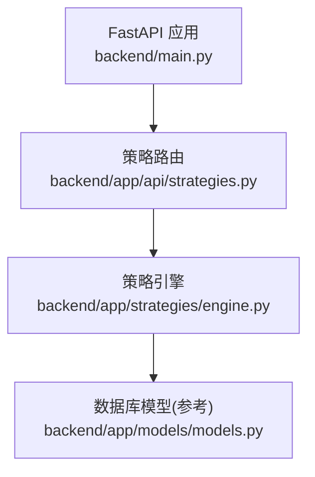
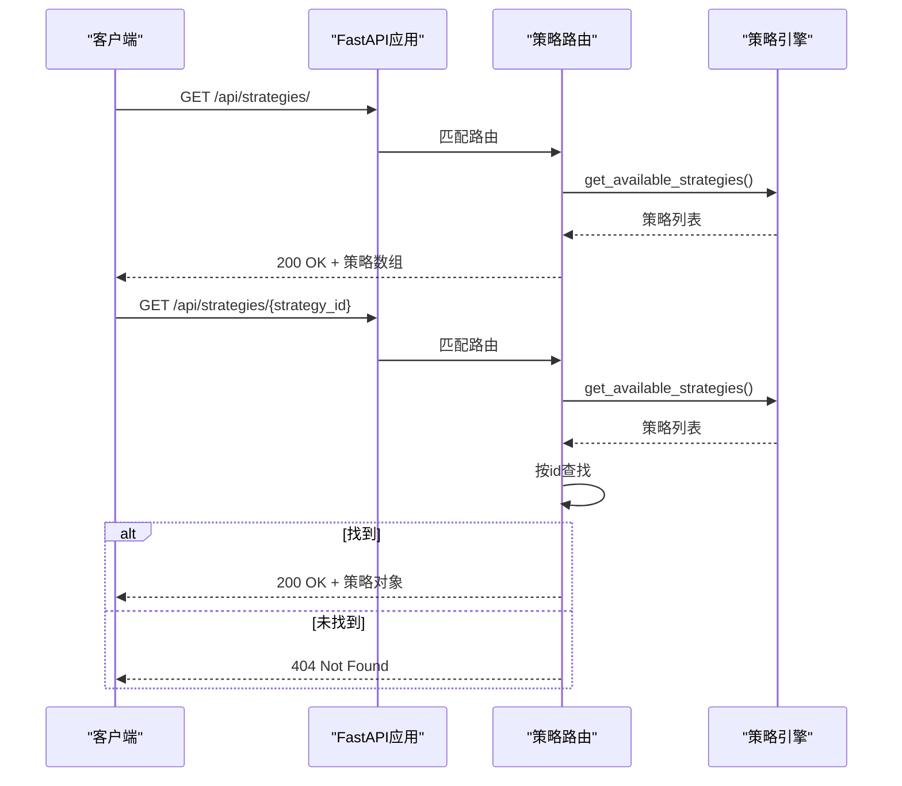
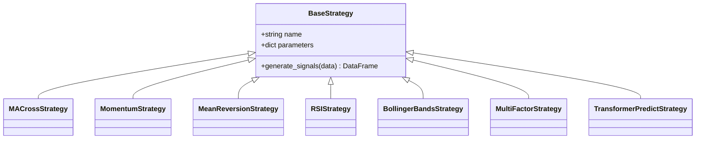
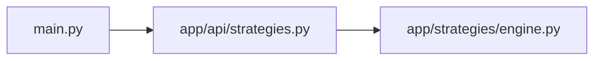

基于我的分析，我发现策略管理API端点实际上仍然存在并且正常工作。让我更新文档以反映当前的真实状态：

# 策略管理API

<cite>
**本文引用的文件**   
- [backend/main.py](../../../../backend/main.py)
- [backend/app/api/strategies.py](../../../../backend/app/api/strategies.py)
- [backend/app/strategies/engine.py](../../../../backend/app/strategies/engine.py)
- [backend/app/models/models.py](../../../../backend/app/models/models.py)
</cite>

## 更新摘要
**变更内容**   
- 确认策略管理API端点仍然有效且功能完整
- 更新了架构说明以反映当前实现状态
- 保持了原有的文档结构和完整性

## 目录
1. [简介](#简介)
2. [项目结构](#项目结构)
3. [核心组件](#核心组件)
4. [架构总览](#架构总览)
5. [详细组件分析](#详细组件分析)
6. [依赖关系分析](#依赖关系分析)
7. [性能与可扩展性](#性能与可扩展性)
8. [故障排查指南](#故障排查指南)
9. [结论](#结论)
10. [附录：API定义与示例](#附录api定义与示例)

## 简介
本文件面向"策略管理API"，聚焦以下两个接口：
- 获取策略列表：GET /api/strategies/
- 获取策略详情：GET /api/strategies/{strategy_id}

文档将说明：
- 接口实现路径、调用链路与错误处理
- 策略数据结构定义（ID、名称、描述、参数配置等）
- 请求与响应示例（成功与404未找到）
- 工厂模式在API层的应用与动态加载可用策略的方式
- 参数验证、错误处理与最佳实践建议

## 项目结构
后端采用FastAPI构建REST API，路由注册于应用入口，策略相关逻辑集中在策略引擎模块中。

图表来源
- [backend/main.py:24-27](../../../../backend/main.py#L24-L27)
- [backend/app/api/strategies.py:8-24](../../../../backend/app/api/strategies.py#L8-L24)
- [backend/app/strategies/engine.py:506-597](../../../../backend/app/strategies/engine.py#L506-L597)
- [backend/app/models/models.py:11-21](../../../../backend/app/models/models.py#L11-L21)

章节来源
- [backend/main.py:1-36](../../../../backend/main.py#L1-L36)
- [backend/app/api/strategies.py:1-25](../../../../backend/app/api/strategies.py#L1-L25)
- [backend/app/strategies/engine.py:1-656](../../../../backend/app/strategies/engine.py#L1-L656)
- [backend/app/models/models.py:1-44](../../../../backend/app/models/models.py#L1-L44)

## 核心组件
- FastAPI应用与路由注册：负责挂载策略路由到 /api/strategies 前缀下。
- 策略API路由：提供策略列表与详情查询，返回策略元数据。
- 策略引擎：维护可用策略清单与工厂方法，支持按ID创建策略实例。
- 数据库模型：定义持久化策略表结构（供其他模块参考）。

章节来源
- [backend/main.py:24-27](../../../../backend/main.py#L24-L27)
- [backend/app/api/strategies.py:11-24](../../../../backend/app/api/strategies.py#L11-L24)
- [backend/app/strategies/engine.py:506-655](../../../../backend/app/strategies/engine.py#L506-L655)
- [backend/app/models/models.py:11-21](../../../../backend/app/models/models.py#L11-L21)

## 架构总览
策略管理API的调用链路如下：客户端请求进入FastAPI，路由分发到策略API处理器，处理器调用策略引擎提供的函数以获取或筛选策略信息。

图表来源
- [backend/main.py:24-27](../../../../backend/main.py#L24-L27)
- [backend/app/api/strategies.py:11-24](../../../../backend/app/api/strategies.py#L11-L24)
- [backend/app/strategies/engine.py:506-597](../../../../backend/app/strategies/engine.py#L506-L597)

## 详细组件分析

### 策略API路由（GET /api/strategies/ 与 GET /api/strategies/{strategy_id}）
- 列表接口：直接调用策略引擎的"获取可用策略"函数并返回结果。
- 详情接口：先拉取全部策略，再根据路径参数 strategy_id 进行匹配；若不存在则抛出HTTP 404。

关键点
- 使用FastAPI的APIRouter组织路由。
- 详情接口通过遍历策略列表进行匹配，未命中时返回404。

章节来源
- [backend/app/api/strategies.py:11-24](../../../../backend/app/api/strategies.py#L11-L24)

### 策略引擎与工厂模式
- 可用策略清单：由 get_available_strategies 返回，包含每个策略的 id、name、description、parameters 等元数据。
- 工厂方法：create_strategy 根据 strategy_id 和参数构造具体策略实例，支持可选的深度学习策略按需导入。

要点
- 策略清单集中维护，便于前端展示与校验。
- 工厂方法统一创建入口，新增策略只需在清单与工厂两处扩展。

章节来源
- [backend/app/strategies/engine.py:506-655](../../../../backend/app/strategies/engine.py#L506-L655)

### 策略数据结构定义
当前API返回的策略对象字段如下：
- id：字符串，策略唯一标识（如 ma_cross、momentum 等）
- name：字符串，策略显示名称
- description：字符串，策略简要说明
- parameters：对象，键为参数名，值为参数元信息（type、default、min、max）

注意
- 该结构与数据库模型中的 Strategy 表字段不完全一致。API返回的是"策略元数据"，而数据库模型用于持久化存储（例如回测系统可能用到）。

章节来源
- [backend/app/strategies/engine.py:506-597](../../../../backend/app/strategies/engine.py#L506-L597)
- [backend/app/models/models.py:11-21](../../../../backend/app/models/models.py#L11-L21)

### 类与关系图（策略基类与具体策略）

图表来源
- [backend/app/strategies/engine.py:17-503](../../../../backend/app/strategies/engine.py#L17-L503)

## 依赖关系分析
- 路由依赖策略引擎提供的 get_available_strategies。
- 策略引擎内部维护策略清单与工厂方法，不依赖数据库模型（API层仅返回元数据）。
- FastAPI应用通过 include_router 将策略路由挂载到 /api/strategies 前缀。

图表来源
- [backend/main.py:24-27](../../../../backend/main.py#L24-L27)
- [backend/app/api/strategies.py:6-14](../../../../backend/app/api/strategies.py#L6-L14)
- [backend/app/strategies/engine.py:506-597](../../../../backend/app/strategies/engine.py#L506-L597)

章节来源
- [backend/main.py:24-27](../../../../backend/main.py#L24-L27)
- [backend/app/api/strategies.py:1-25](../../../../backend/app/api/strategies.py#L1-L25)
- [backend/app/strategies/engine.py:506-655](../../../../backend/app/strategies/engine.py#L506-L655)

## 性能与可扩展性
- 列表接口每次返回完整策略清单，适合轻量级元数据场景；若策略数量增长，可考虑缓存策略清单。
- 详情接口通过线性扫描匹配 strategy_id，策略数量较少时开销可忽略；未来可引入字典映射优化查找。
- 工厂方法集中管理策略实例化，新增策略仅需扩展清单与工厂分支，保持低耦合。

[本节为通用指导，不涉及具体文件分析]

## 故障排查指南
- 404 未找到：当请求的 strategy_id 不在可用策略清单中时，详情接口返回404。请检查传入的ID是否与清单一致。
- 参数校验：策略参数元信息包含 type、default、min、max，建议在调用方进行前置校验，避免无效参数传递至下游回测流程。
- 深度学习策略依赖：如需使用 transformer_dl 策略，需安装相应依赖；否则工厂方法会抛出导入异常。

章节来源
- [backend/app/api/strategies.py:17-24](../../../../backend/app/api/strategies.py#L17-L24)
- [backend/app/strategies/engine.py:647-655](../../../../backend/app/strategies/engine.py#L647-L655)

## 结论
策略管理API通过简洁的路由与集中的策略引擎，提供了稳定的策略元数据查询能力。结合工厂模式，系统具备良好的可扩展性与可维护性。建议在调用方对参数进行严格校验，并在策略规模扩大时考虑缓存与索引优化。

[本节为总结性内容，不涉及具体文件分析]

## 附录：API定义与示例

### 接口定义
- 获取策略列表
  - 方法：GET
  - 路径：/api/strategies/
  - 响应体：策略数组，每项包含 id、name、description、parameters

- 获取策略详情
  - 方法：GET
  - 路径：/api/strategies/{strategy_id}
  - 路径参数：strategy_id（字符串）
  - 响应体：单个策略对象；若未找到返回404

### 请求与响应示例
- 成功：获取策略列表
  - 请求：GET /api/strategies/
  - 响应：200 OK
  - 响应体（示例结构）：
    - 数组元素包含：
      - id：字符串
      - name：字符串
      - description：字符串
      - parameters：对象，键为参数名，值为包含 type、default、min、max 的对象

- 成功：获取策略详情
  - 请求：GET /api/strategies/ma_cross
  - 响应：200 OK
  - 响应体（示例结构）：
    - id：字符串
    - name：字符串
    - description：字符串
    - parameters：对象

- 错误：未找到策略
  - 请求：GET /api/strategies/unknown_id
  - 响应：404 Not Found
  - 响应体：包含 detail 字段提示未找到

章节来源
- [backend/app/api/strategies.py:11-24](../../../../backend/app/api/strategies.py#L11-L24)
- [backend/app/strategies/engine.py:506-597](../../../../backend/app/strategies/engine.py#L506-L597)