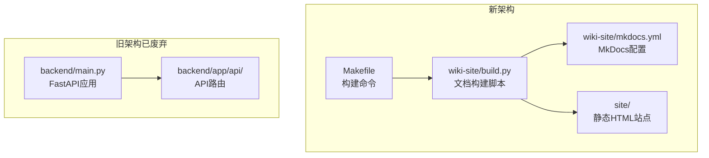
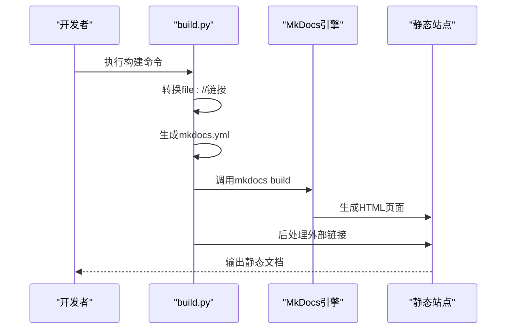
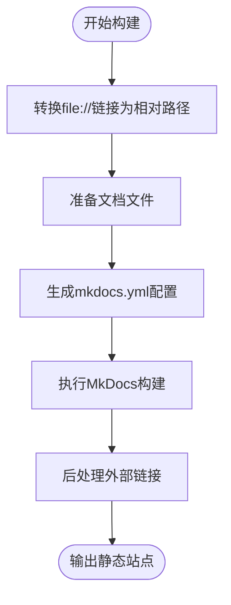
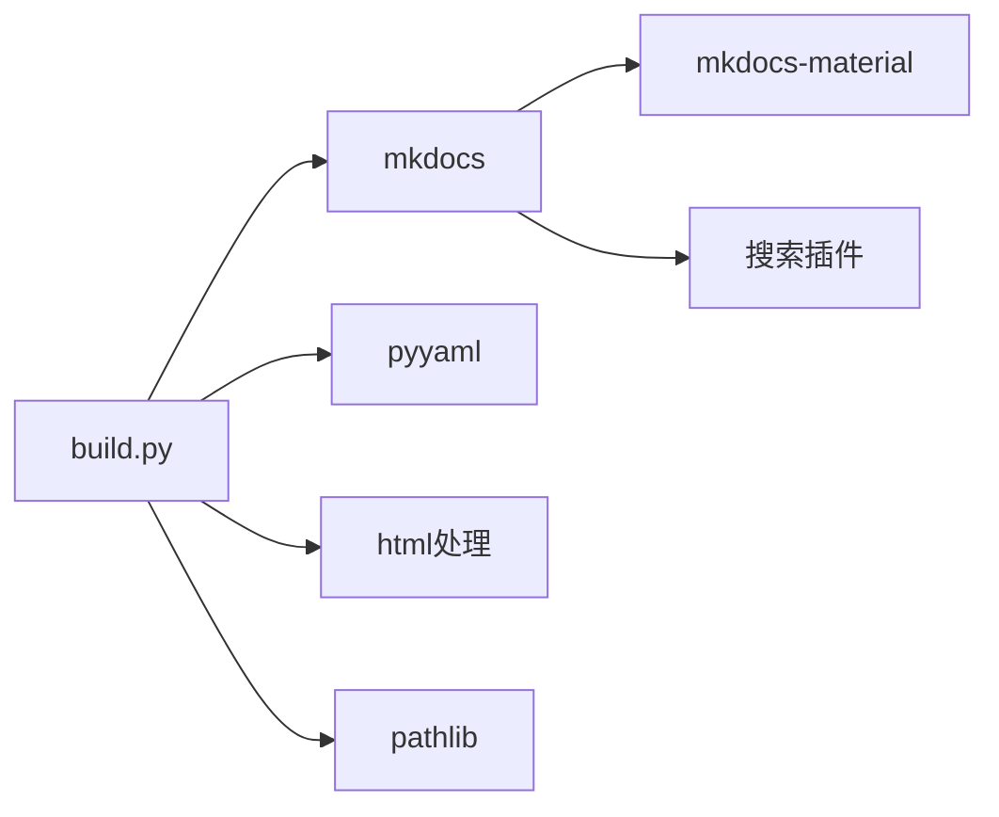

# FastAPI应用架构

<cite>
**本文引用的文件**   
- [backend/main.py](../../../backend/main.py)
- [wiki-site/build.py](../../build.py)
- [wiki-site/mkdocs.yml](../../mkdocs.yml)
- [Makefile](../../../Makefile)
</cite>

## 更新摘要
**变更内容**   
- 项目已从传统FastAPI应用架构迁移到静态文档生成系统
- 新增MkDocs静态文档站构建流程
- 移除了动态Web服务器，改为静态HTML站点
- 更新了文档生成和部署流程

## 目录
1. [简介](#简介)
2. [项目结构变更](#项目结构变更)
3. [静态文档生成架构](#静态文档生成架构)
4. [核心组件](#核心组件)
5. [架构总览](#架构总览)
6. [详细组件分析](#详细组件分析)
7. [依赖关系分析](#依赖关系分析)
8. [性能与可扩展性](#性能与可扩展性)
9. [故障排查指南](#故障排查指南)
10. [结论](#结论)

## 简介
本项目已完成从传统FastAPI动态Web应用到静态文档生成系统的架构迁移。新的架构采用MkDocs构建静态文档站点，提供更高效、更安全的文档展示方案。本文档详细说明这一架构变更及其实现细节。

## 项目结构变更
项目结构发生了重大变化：

**原架构（已废弃）**
- backend/main.py - FastAPI应用入口
- backend/app/api/ - API路由模块
- 动态Web服务器运行

**新架构（当前）**
- wiki-site/ - MkDocs静态文档站
- build.py - 文档构建脚本
- mkdocs.yml - 文档配置
- site/ - 生成的静态HTML站点

**图表来源**
- [wiki-site/build.py:1-287](../../build.py#L1-L287)
- [wiki-site/mkdocs.yml:1-153](../../mkdocs.yml#L1-L153)
- [backend/main.py:1-36](../../../backend/main.py#L1-L36)

## 静态文档生成架构
新的架构采用MkDocs + Material主题构建静态文档站点，支持Markdown语法、Mermaid图表和代码高亮。

**图表来源**
- [wiki-site/build.py:66-287](../../build.py#L66-L287)

## 核心组件
- **文档构建脚本**: build.py负责整个文档生成流程
- **MkDocs配置**: mkdocs.yml定义站点结构和主题设置
- **构建命令**: Makefile提供简化的构建和预览命令
- **静态站点**: site/目录包含生成的HTML文件

## 架构总览
下图展示静态文档生成的完整流程：

**图表来源**
- [wiki-site/build.py:66-287](../../build.py#L66-L287)

## 详细组件分析

### 文档构建脚本 (build.py)
构建脚本是整个静态文档系统的核心，包含以下主要功能：

#### 链接转换功能
将Markdown中的`file://`引用转换为相对路径，便于在GitCode等平台上直接访问源码。

#### 配置生成功能
根据`.qoder/repowiki/zh/content`目录结构自动生成`mkdocs.yml`配置文件。

#### 站点构建功能
调用MkDocs引擎生成静态HTML站点。

#### 后处理功能
将指向仓库文件的相对链接重写为GitCode的blob URL。

**章节来源**
- [wiki-site/build.py:66-90](../../build.py#L66-L90)
- [wiki-site/build.py:109-188](../../build.py#L109-L188)
- [wiki-site/build.py:191-267](../../build.py#L191-L267)

### MkDocs配置 (mkdocs.yml)
配置文件定义了文档站点的整体结构和样式：

- **站点信息**: 名称、描述、语言设置
- **主题配置**: Material主题，支持深色模式切换
- **扩展功能**: Mermaid图表、代码高亮、搜索功能
- **导航结构**: 自动生成的多级导航菜单

**章节来源**
- [wiki-site/mkdocs.yml:1-153](../../mkdocs.yml#L1-L153)

### 构建命令 (Makefile)
提供简化的构建和预览命令：

- `make wiki`: 构建完整的静态文档站点
- `make wiki-serve`: 启动本地预览服务器

**章节来源**
- [Makefile:22-28](../../../Makefile#L22-L28)

## 依赖关系分析
新的架构依赖关系更加简洁：

**图表来源**
- [wiki-site/build.py:10-23](../../build.py#L10-L23)
- [wiki-site/requirements.txt:1-3](../../requirements.txt#L1-L3)

**章节来源**
- [wiki-site/build.py:10-23](../../build.py#L10-L23)
- [wiki-site/requirements.txt:1-3](../../requirements.txt#L1-L3)

## 性能与可扩展性
### 性能优势
- **静态站点**: 无需服务器端处理，加载速度更快
- **CDN友好**: 静态文件可直接部署到CDN
- **缓存优化**: 浏览器缓存效率更高

### 可扩展性
- **模块化构建**: 支持增量构建和并行处理
- **主题定制**: Material主题支持深度定制
- **插件生态**: 丰富的MkDocs插件生态系统

## 故障排查指南
### 常见问题及解决方案

#### 构建失败
- **现象**: `mkdocs build`命令执行失败
- **排查**: 检查Python环境是否正确安装依赖
- **解决**: 重新安装依赖 `pip install -r wiki-site/requirements.txt`

#### 链接失效
- **现象**: 文档中源码链接无法访问
- **排查**: 检查file://链接转换是否正确
- **解决**: 确认目标文件路径存在且可访问

#### 样式异常
- **现象**: 文档显示样式不正确
- **排查**: 检查Material主题是否正确加载
- **解决**: 清理缓存并重新构建

**章节来源**
- [wiki-site/build.py:66-287](../../build.py#L66-L287)

## 结论
项目已成功从传统FastAPI动态Web应用迁移到基于MkDocs的静态文档生成系统。新架构具有以下优势：

1. **性能提升**: 静态站点加载速度更快，无需服务器端处理
2. **安全性增强**: 无服务器端漏洞风险，部署更安全
3. **维护简化**: 文档即代码，版本控制更方便
4. **成本降低**: 无需服务器资源，可直接托管到静态网站服务

建议继续使用此架构进行文档维护和更新，充分利用静态文档的优势。