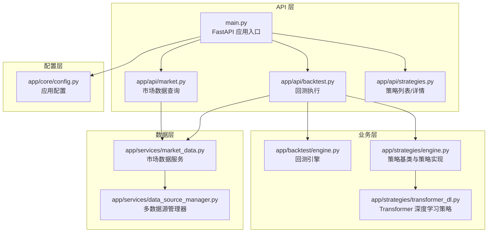
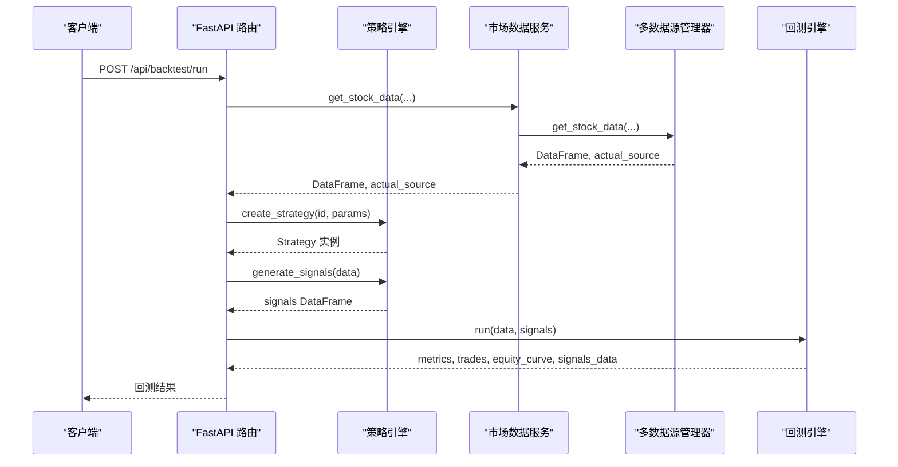
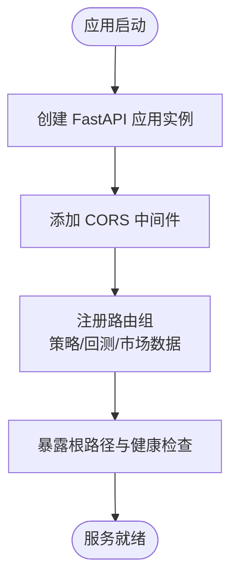
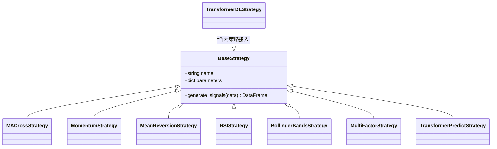
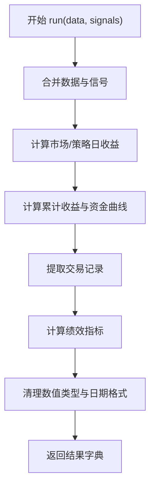
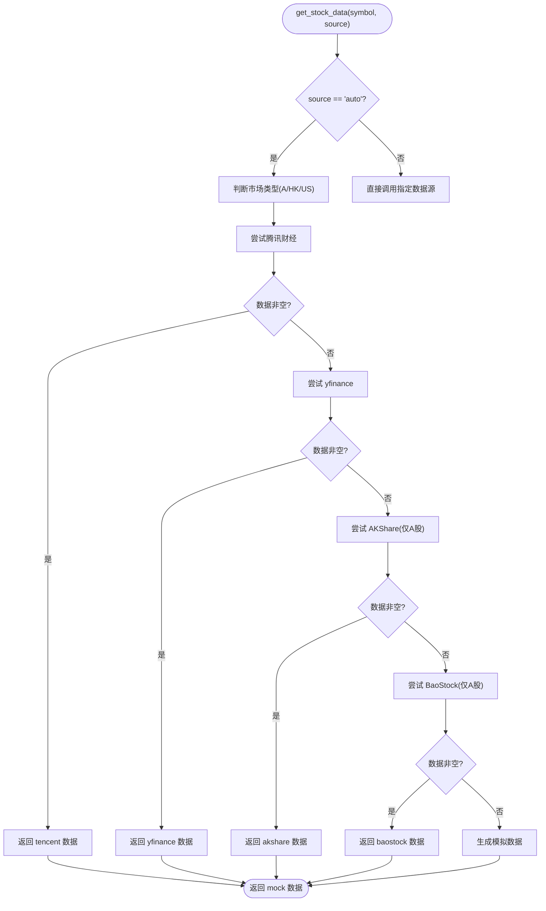
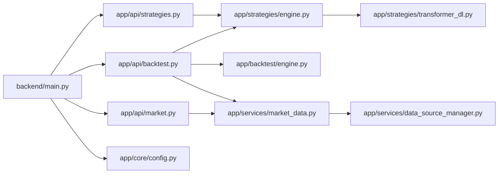

# 后端开发

<cite>
**本文引用的文件**   
- [main.py](../../../backend/main.py)
- [config.py](../../../backend/app/core/config.py)
- [backtest.py](../../../backend/app/api/backtest.py)
- [strategies.py](../../../backend/app/api/strategies.py)
- [market.py](../../../backend/app/api/market.py)
- [engine.py（策略引擎）](../../../backend/app/strategies/engine.py)
- [engine.py（回测引擎）](../../../backend/app/backtest/engine.py)
- [data_source_manager.py](../../../backend/app/services/data_source_manager.py)
- [market_data.py](../../../backend/app/services/market_data.py)
- [transformer_dl.py](../../../backend/app/strategies/transformer_dl.py)
</cite>

## 更新摘要
**变更内容**   
- 更新了所有文件路径引用，从相对路径改为项目根目录下的绝对路径
- 保持了原有的文档结构和内容完整性
- 确保所有代码示例和架构图表与实际代码实现保持一致

## 目录
1. [简介](#简介)
2. [项目结构](#项目结构)
3. [核心组件](#核心组件)
4. [架构总览](#架构总览)
5. [详细组件分析](#详细组件分析)
6. [依赖关系分析](#依赖关系分析)
7. [性能与可扩展性](#性能与可扩展性)
8. [故障排查指南](#故障排查指南)
9. [结论](#结论)

## 简介
本文件面向后端开发者，系统性梳理 FastAPI 量化策略查看与回测系统的架构设计与核心实现。内容覆盖：
- 应用初始化、CORS 跨域配置、路由注册机制
- API 接口规范、请求响应格式、错误处理策略
- 策略引擎设计：BaseStrategy 基类、7 种量化策略与 Transformer 深度学习策略的工厂模式与注册机制
- 回测引擎：信号处理、仓位管理、收益与绩效指标计算
- 数据服务层：多数据源抽象、智能降级与数据格式标准化
- 使用示例与扩展建议

## 项目结构
后端采用按功能分层组织：
- API 层：FastAPI 路由与请求校验
- 业务层：策略引擎、回测引擎
- 数据层：市场数据服务与多数据源管理器
- 配置层：应用配置与环境变量

图表来源
- [main.py:9-27](../../../backend/main.py#L9-L27)
- [strategies.py:8-24](../../../backend/app/api/strategies.py#L8-L24)
- [backtest.py:13-76](../../../backend/app/api/backtest.py#L13-L76)
- [market.py:8-46](../../../backend/app/api/market.py#L8-L46)
- [engine.py（策略引擎）:17-656](../../../backend/app/strategies/engine.py#L17-L656)
- [engine.py（回测引擎）:10-163](../../../backend/app/backtest/engine.py#L10-L163)
- [data_source_manager.py:14-469](../../../backend/app/services/data_source_manager.py#L14-L469)
- [market_data.py:11-106](../../../backend/app/services/market_data.py#L11-L106)
- [config.py:8-24](../../../backend/app/core/config.py#L8-L24)

章节来源
- [main.py:1-36](../../../backend/main.py#L1-L36)
- [config.py:1-25](../../../backend/app/core/config.py#L1-L25)

## 核心组件
- FastAPI 应用与中间件：统一创建应用实例、启用 CORS、挂载路由、健康检查
- 策略引擎：定义 BaseStrategy 基类，提供 7 种经典量化策略与 1 个 Transformer 深度学习策略；通过工厂函数 create_strategy 动态创建
- 回测引擎：接收 OHLCV 数据与交易信号，计算收益曲线、交易记录与绩效指标
- 数据服务层：MarketDataService 封装 DataSourceManager，支持腾讯财经、yfinance、AKShare、BaoStock、模拟数据，自动选择并降级
- API 路由：策略列表/详情、回测执行、市场数据查询

章节来源
- [main.py:9-35](../../../backend/main.py#L9-L35)
- [engine.py（策略引擎）:17-656](../../../backend/app/strategies/engine.py#L17-L656)
- [engine.py（回测引擎）:10-163](../../../backend/app/backtest/engine.py#L10-L163)
- [data_source_manager.py:14-469](../../../backend/app/services/data_source_manager.py#L14-L469)
- [market_data.py:11-106](../../../backend/app/services/market_data.py#L11-L106)

## 架构总览
系统以 FastAPI 为入口，API 层调用策略与回测引擎，数据由数据服务层统一获取并标准化。

图表来源
- [backtest.py:28-69](../../../backend/app/api/backtest.py#L28-L69)
- [engine.py（策略引擎）:600-656](../../../backend/app/strategies/engine.py#L600-L656)
- [engine.py（回测引擎）:15-70](../../../backend/app/backtest/engine.py#L15-L70)
- [data_source_manager.py:17-54](../../../backend/app/services/data_source_manager.py#L17-L54)

## 详细组件分析

### 应用初始化与路由注册
- 应用初始化：设置标题、描述、版本
- CORS：允许所有来源、方法、头，支持凭据
- 路由注册：策略、回测、市场数据三大模块
- 根路径与健康检查

图表来源
- [main.py:9-35](../../../backend/main.py#L9-L35)

章节来源
- [main.py:1-36](../../../backend/main.py#L1-L36)
- [config.py:8-24](../../../backend/app/core/config.py#L8-L24)

### API 接口设计规范与错误处理
- 策略接口
  - GET /api/strategies/：返回可用策略列表
  - GET /api/strategies/{strategy_id}：返回策略详情，未找到返回 404
- 回测接口
  - POST /api/backtest/run：执行回测，参数包含策略 ID、标的、时间范围、初始资金、数据源等
  - GET /api/backtest/history：预留历史查询接口（待实现）
- 市场数据接口
  - GET /api/market/stock/{symbol}：获取 OHLCV 数据
  - GET /api/market/stock/{symbol}/info：获取股票基本信息
  - GET /api/market/search：搜索股票代码

请求体与响应约定：
- 回测请求体字段：strategy_id、symbol、start_date、end_date、period、initial_capital、source、parameters
- 回测响应字段：metrics、trades、equity_curve、signals_data、strategy、symbol、data_source、is_mock
- 错误处理：统一抛出 HTTPException，状态码 400/404

章节来源
- [strategies.py:8-24](../../../backend/app/api/strategies.py#L8-L24)
- [backtest.py:16-76](../../../backend/app/api/backtest.py#L16-L76)
- [market.py:11-46](../../../backend/app/api/market.py#L11-L46)

### 策略引擎与工厂模式
- BaseStrategy 基类：定义 name、parameters 与 generate_signals 接口
- 7 种量化策略：
  - MACrossStrategy：均线交叉
  - MomentumStrategy：动量策略
  - MeanReversionStrategy：均值回归
  - RSIStrategy：RSI 超买超卖
  - BollingerBandsStrategy：布林带 %B 与带宽过滤
  - MultiFactorStrategy：多因子加权打分
  - TransformerPredictStrategy：简化版注意力预测
- Transformer 深度学习策略：基于 PyTorch 的完整 Transformer 架构（可选依赖）
- 工厂函数：
  - get_available_strategies：返回策略元信息与参数约束
  - create_strategy：根据 strategy_id 创建具体策略实例

图表来源
- [engine.py（策略引擎）:17-504](../../../backend/app/strategies/engine.py#L17-L504)
- [transformer_dl.py:324-487](../../../backend/app/strategies/transformer_dl.py#L324-L487)

章节来源
- [engine.py（策略引擎）:17-656](../../../backend/app/strategies/engine.py#L17-L656)
- [transformer_dl.py:1-516](../../../backend/app/strategies/transformer_dl.py#L1-L516)

### 回测引擎核心逻辑
- 输入：OHLCV 数据 DataFrame、信号 DataFrame（含 signal、position_change）
- 处理流程：
  - 合并数据与信号
  - 计算日收益率、策略收益率、累计收益与资金曲线
  - 提取交易记录（买入/卖出配对）
  - 计算绩效指标：总收益、年化收益、最大回撤、夏普比率、胜率、盈亏比等
- 输出：metrics、trades、equity_curve、signals_data

图表来源
- [engine.py（回测引擎）:15-70](../../../backend/app/backtest/engine.py#L15-L70)
- [engine.py（回测引擎）:72-163](../../../backend/app/backtest/engine.py#L72-L163)

章节来源
- [engine.py（回测引擎）:10-163](../../../backend/app/backtest/engine.py#L10-L163)

### 数据服务层与智能降级
- MarketDataService：对外暴露 get_stock_data/get_stock_info/search_symbol
- DataSourceManager：
  - 支持数据源：tencent、yfinance、akshare、baostock、mock
  - 自动选择：优先腾讯财经（A股/港股），其次 yfinance，再 AKShare/BaoStock，最后 mock
  - 数据标准化：统一列名为 Date/Open/High/Low/Close/Volume
  - 异常处理：各数据源失败时打印日志并继续尝试下一个

图表来源
- [data_source_manager.py:17-109](../../../backend/app/services/data_source_manager.py#L17-L109)
- [data_source_manager.py:112-469](../../../backend/app/services/data_source_manager.py#L112-L469)
- [market_data.py:14-41](../../../backend/app/services/market_data.py#L14-L41)

章节来源
- [data_source_manager.py:14-469](../../../backend/app/services/data_source_manager.py#L14-L469)
- [market_data.py:11-106](../../../backend/app/services/market_data.py#L11-L106)

### 使用示例与扩展模式
- 运行回测
  - 调用 POST /api/backtest/run，传入 strategy_id、symbol、initial_capital、parameters 等
  - 系统将自动拉取数据、生成信号、执行回测并返回绩效指标与资金曲线
- 查询策略
  - GET /api/strategies/：列出所有策略及其参数约束
  - GET /api/strategies/{id}：获取单个策略详情
- 查询市场数据
  - GET /api/market/stock/{symbol}?period=1y：获取 OHLCV 数据
  - GET /api/market/stock/{symbol}/info：获取股票基本信息
  - GET /api/market/search?keyword=AAPL：搜索股票代码

扩展建议：
- 新增策略：继承 BaseStrategy，实现 generate_signals，并在 get_available_strategies 与 create_strategy 中注册
- 新增数据源：在 DataSourceManager 中实现 _fetch_xxx 方法，并在 _auto_fetch 中增加降级逻辑
- 扩展回测指标：在 BacktestEngine._calculate_metrics 中添加自定义指标

章节来源
- [backtest.py:28-69](../../../backend/app/api/backtest.py#L28-L69)
- [strategies.py:11-24](../../../backend/app/api/strategies.py#L11-L24)
- [market.py:11-46](../../../backend/app/api/market.py#L11-L46)
- [engine.py（策略引擎）:506-656](../../../backend/app/strategies/engine.py#L506-L656)

## 依赖关系分析
- API 层依赖策略引擎与回测引擎
- 策略引擎依赖 Transformer 深度学习策略（可选）
- 数据服务层依赖多数据源管理器
- 配置层被应用入口引用

图表来源
- [main.py:6-27](../../../backend/main.py#L6-L27)
- [strategies.py:6-24](../../../backend/app/api/strategies.py#L6-L24)
- [backtest.py:9-11](../../../backend/app/api/backtest.py#L9-L11)
- [market.py:6-46](../../../backend/app/api/market.py#L6-L46)
- [engine.py（策略引擎）:9-14](../../../backend/app/strategies/engine.py#L9-L14)
- [engine.py（回测引擎）:4-7](../../../backend/app/backtest/engine.py#L4-L7)
- [data_source_manager.py:5-11](../../../backend/app/services/data_source_manager.py#L5-L11)
- [market_data.py:5-8](../../../backend/app/services/market_data.py#L5-L8)
- [config.py:4-24](../../../backend/app/core/config.py#L4-L24)

章节来源
- [main.py:1-36](../../../backend/main.py#L1-L36)
- [engine.py（策略引擎）:1-14](../../../backend/app/strategies/engine.py#L1-L14)
- [engine.py（回测引擎）:1-8](../../../backend/app/backtest/engine.py#L1-L8)
- [data_source_manager.py:1-11](../../../backend/app/services/data_source_manager.py#L1-L11)
- [market_data.py:1-8](../../../backend/app/services/market_data.py#L1-L8)
- [config.py:1-24](../../../backend/app/core/config.py#L1-L24)

## 性能与可扩展性
- 回测性能
  - 使用 pandas/numpy 向量化计算收益与指标，避免逐行循环
  - 对数值进行安全舍入与 NaN/Inf 清理，保证 JSON 序列化稳定
- 数据获取性能
  - 自动选择最优数据源，减少网络失败重试次数
  - 模拟数据用于快速验证与前端联调
- 可扩展性
  - 策略工厂模式便于新增策略
  - 数据源管理器支持新增数据源与降级策略
  - 可引入缓存层（如 Redis）缓存热门标的数据

[本节为通用指导，不直接分析具体文件]

## 故障排查指南
常见问题与定位要点：
- 数据源不可用或返回空数据
  - 检查 DataSourceManager 的自动选择流程与各数据源实现
  - 确认网络连通性与第三方库安装（yfinance、akshare、baostock）
- 策略参数无效
  - 核对 get_available_strategies 中的参数约束
  - 确保 create_strategy 的参数映射正确
- 回测结果为空或指标异常
  - 检查信号 DataFrame 是否包含 signal 与 position_change
  - 检查日期列是否为 datetime 类型
- 深度学习策略缺失依赖
  - 安装 PyTorch 相关依赖后重试

章节来源
- [data_source_manager.py:57-109](../../../backend/app/services/data_source_manager.py#L57-L109)
- [engine.py（策略引擎）:600-656](../../../backend/app/strategies/engine.py#L600-L656)
- [engine.py（回测引擎）:47-68](../../../backend/app/backtest/engine.py#L47-L68)
- [transformer_dl.py:18-25](../../../backend/app/strategies/transformer_dl.py#L18-L25)

## 结论
本后端系统以 FastAPI 为核心，构建了清晰的 API 层、策略与回测引擎、数据服务层与配置层。通过工厂模式与多数据源抽象，系统具备良好的可扩展性与鲁棒性。开发者可在此基础上快速扩展新策略与新数据源，并通过统一的 API 对外提供服务。