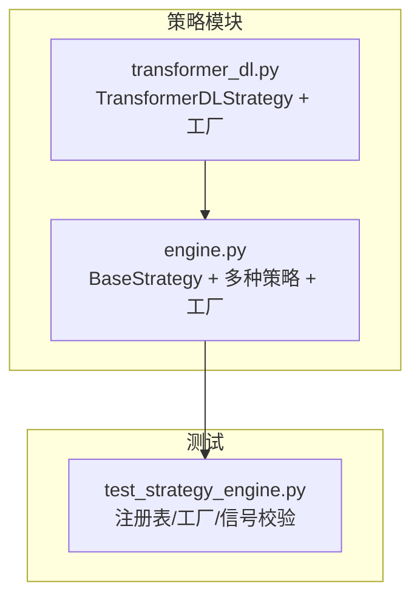
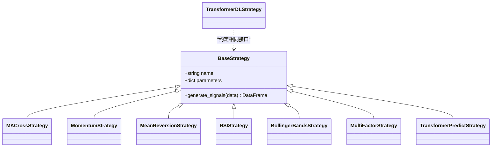
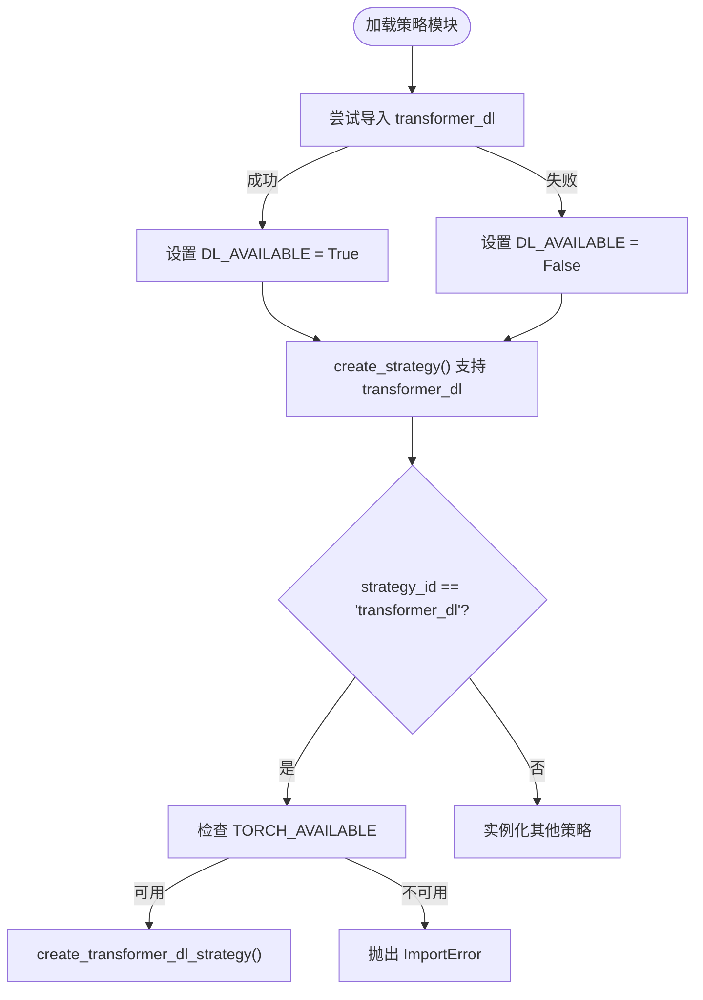
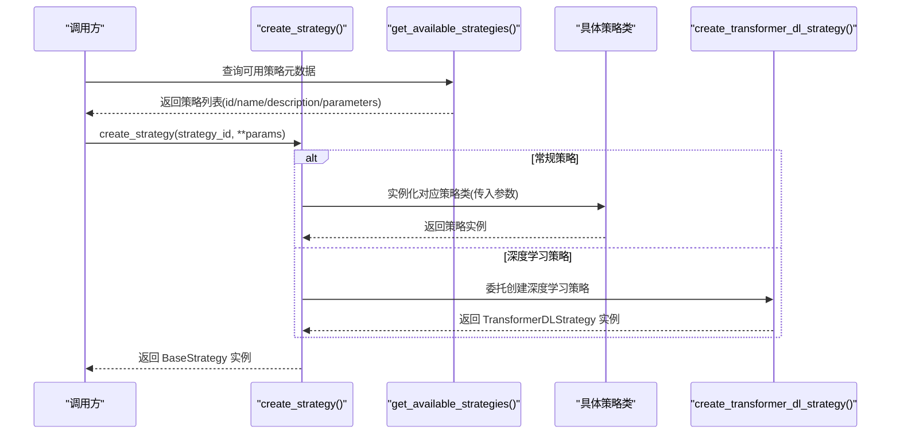

# BaseStrategy基类设计

<cite>
**本文引用的文件**   
- [backend/app/strategies/engine.py](../../../../backend/app/strategies/engine.py)
- [backend/app/strategies/transformer_dl.py](../../../../backend/app/strategies/transformer_dl.py)
- [backend/tests/test_strategy_engine.py](../../../../backend/tests/test_strategy_engine.py)
- [AGENTS.md](../../../../AGENTS.md)
</cite>

## 目录
1. [引言](#引言)
2. [项目结构](#项目结构)
3. [核心组件](#核心组件)
4. [架构总览](#架构总览)
5. [详细组件分析](#详细组件分析)
6. [依赖关系分析](#依赖关系分析)
7. [性能与复杂度](#性能与复杂度)
8. [策略接口规范](#策略接口规范)
9. [工厂模式与注册机制](#工厂模式与注册机制)
10. [继承开发新策略指南](#继承开发新策略指南)
11. [最佳实践与常见陷阱](#最佳实践与常见陷阱)
12. [故障排查](#故障排查)
13. [结论](#结论)

## 引言
本文围绕量化系统中的策略抽象层，深入解析 BaseStrategy 基类的设计思想、生命周期管理、策略接口规范以及工厂模式的实现原理。文档同时给出如何基于 BaseStrategy 扩展新策略的完整流程，并总结最佳实践与常见问题规避方法，帮助开发者快速构建稳定、可维护的策略体系。

## 项目结构
本项目的策略相关代码集中在 backend/app/strategies 目录下：
- engine.py：定义 BaseStrategy 抽象基类、多个具体策略实现、策略元数据注册表 get_available_strategies() 和工厂函数 create_strategy()。
- transformer_dl.py：提供深度学习 Transformer 策略（可选依赖 PyTorch），并通过 create_transformer_dl_strategy() 暴露工厂入口。
- tests/test_strategy_engine.py：对策略注册表、工厂创建、信号输出格式进行断言测试。

图表来源
- [backend/app/strategies/engine.py:17-656](../../../../backend/app/strategies/engine.py#L17-L656)
- [backend/app/strategies/transformer_dl.py:324-516](../../../../backend/app/strategies/transformer_dl.py#L324-L516)
- [backend/tests/test_strategy_engine.py:26-63](../../../../backend/tests/test_strategy_engine.py#L26-L63)

章节来源
- [backend/app/strategies/engine.py:17-656](../../../../backend/app/strategies/engine.py#L17-L656)
- [backend/app/strategies/transformer_dl.py:324-516](../../../../backend/app/strategies/transformer_dl.py#L324-L516)
- [backend/tests/test_strategy_engine.py:26-63](../../../../backend/tests/test_strategy_engine.py#L26-L63)

## 核心组件
- BaseStrategy：策略抽象基类，统一策略初始化与信号生成接口。
- 具体策略类：MACrossStrategy、MomentumStrategy、MeanReversionStrategy、RSIStrategy、BollingerBandsStrategy、MultiFactorStrategy、TransformerPredictStrategy。
- TransformerDLStrategy：深度学习 Transformer 策略（可选依赖）。
- 工厂与注册：get_available_strategies() 返回策略元数据；create_strategy() 根据 id 动态实例化策略；create_transformer_dl_strategy() 为深度学习策略提供独立工厂。

章节来源
- [backend/app/strategies/engine.py:17-656](../../../../backend/app/strategies/engine.py#L17-L656)
- [backend/app/strategies/transformer_dl.py:324-516](../../../../backend/app/strategies/transformer_dl.py#L324-L516)

## 架构总览
策略子系统采用“抽象基类 + 多实现 + 工厂”的模式：
- 抽象层：BaseStrategy 定义统一的 __init__ 与 generate_signals 接口。
- 实现层：各策略类继承 BaseStrategy，重写 generate_signals 以输出标准信号 DataFrame。
- 工厂层：create_strategy() 通过 strategy_id 分发到具体策略构造器；get_available_strategies() 提供前端可用的策略元数据（id、name、description、parameters）。

图表来源
- [backend/app/strategies/engine.py:17-504](../../../../backend/app/strategies/engine.py#L17-L504)
- [backend/app/strategies/transformer_dl.py:324-487](../../../../backend/app/strategies/transformer_dl.py#L324-L487)

## 详细组件分析

### BaseStrategy 抽象基类
- 职责
  - 统一策略名称与参数存储：__init__(name, parameters)。
  - 强制子类实现信号生成：generate_signals(data) -> DataFrame。
- 生命周期
  - 初始化阶段：保存 name 与 parameters，供后续日志、校验、序列化使用。
  - 信号生成阶段：由回测引擎调用，输入 OHLCV 数据，输出带 signal/position 列的 DataFrame。
- 错误处理
  - 未实现 generate_signals 时抛出 NotImplementedError，确保契约被遵守。

章节来源
- [backend/app/strategies/engine.py:17-25](../../../../backend/app/strategies/engine.py#L17-L25)

### 具体策略类概览
- MACrossStrategy：均线交叉，短均线上穿长均线买入，下穿卖出。
- MomentumStrategy：动量策略，涨幅超阈值买入，跌幅超阈值卖出。
- MeanReversionStrategy：均值回归，价格低于下轨买入，高于上轨卖出。
- RSIStrategy：RSI 指标，超卖买入，超买卖出。
- BollingerBandsStrategy：布林带 %B 指标，接近下轨买入，接近上轨卖出。
- MultiFactorStrategy：多因子打分，加权综合得分决定买卖。
- TransformerPredictStrategy：简化版注意力机制预测未来趋势，按阈值生成信号。

所有策略均遵循相同的输入输出约定：
- 输入：包含 Close（及可选 Volume）等列的 pandas.DataFrame。
- 输出：在输入基础上追加 signal（1/-1/0）、position（信号差分）列的 DataFrame。

章节来源
- [backend/app/strategies/engine.py:28-504](../../../../backend/app/strategies/engine.py#L28-L504)

### TransformerDLStrategy（深度学习策略）
- 特点
  - 可选依赖 PyTorch，若缺失则通过 ImportError 提示安装。
  - 提供完整的特征工程、模型训练、滚动窗口验证与预测流程。
  - 通过 create_transformer_dl_strategy(**params) 暴露工厂入口。
- 与 BaseStrategy 的关系
  - 虽不直接继承 BaseStrategy，但遵循相同的 generate_signals 接口约定，便于与回测引擎集成。

章节来源
- [backend/app/strategies/transformer_dl.py:324-516](../../../../backend/app/strategies/transformer_dl.py#L324-L516)

## 依赖关系分析
- 模块内依赖
  - engine.py 中 try/except 导入 transformer_dl，控制 DL_AVAILABLE 标志，避免无 PyTorch 环境报错。
  - create_strategy() 在识别到 "transformer_dl" 时调用 create_transformer_dl_strategy()。
- 外部依赖
  - pandas、numpy 用于数据处理与数值计算。
  - PyTorch（可选）用于深度学习策略。

图表来源
- [backend/app/strategies/engine.py:9-14](../../../../backend/app/strategies/engine.py#L9-L14)
- [backend/app/strategies/engine.py:647-653](../../../../backend/app/strategies/engine.py#L647-L653)
- [backend/app/strategies/transformer_dl.py:18-25](../../../../backend/app/strategies/transformer_dl.py#L18-L25)
- [backend/app/strategies/transformer_dl.py:492-515](../../../../backend/app/strategies/transformer_dl.py#L492-L515)

章节来源
- [backend/app/strategies/engine.py:9-14](../../../../backend/app/strategies/engine.py#L9-L14)
- [backend/app/strategies/engine.py:647-653](../../../../backend/app/strategies/engine.py#L647-L653)
- [backend/app/strategies/transformer_dl.py:18-25](../../../../backend/app/strategies/transformer_dl.py#L18-L25)
- [backend/app/strategies/transformer_dl.py:492-515](../../../../backend/app/strategies/transformer_dl.py#L492-L515)

## 性能与复杂度
- 时间复杂度
  - 传统技术指标策略（如均线、RSI、布林带）主要依赖 rolling/pct_change 等向量化操作，整体 O(n)。
  - 多因子策略涉及多个因子计算与归一化，仍为 O(n)，但常数项较大。
  - TransformerPredictStrategy 使用滚动窗口与注意力权重计算，复杂度随 seq_length 与 n_heads 增加而上升。
  - TransformerDLStrategy 包含模型训练与滚动重训，训练成本显著高于传统策略。
- 空间复杂度
  - 策略内部通常复制输入 DataFrame 或新增列，额外内存开销与数据规模线性相关。
  - 深度学习策略需存储特征矩阵与模型参数，内存占用更高。

[本节为通用性能讨论，不直接分析具体文件]

## 策略接口规范
- 输入数据格式
  - 必须包含 Close 列；Volume 列为可选。
  - 数据类型建议为数值型，索引为时间序列。
- 输出信号格式
  - 必须包含 signal 列，取值限定为 {-1, 0, 1}。
  - 必须包含 position 列，通常为 signal.diff()，表示交易动作变化。
- 错误处理机制
  - 未实现 generate_signals 将抛出 NotImplementedError。
  - 未知 strategy_id 将抛出 ValueError。
  - 缺少 PyTorch 依赖时将抛出 ImportError。

章节来源
- [backend/app/strategies/engine.py:23-25](../../../../backend/app/strategies/engine.py#L23-L25)
- [backend/app/strategies/engine.py:654-655](../../../../backend/app/strategies/engine.py#L654-L655)
- [backend/app/strategies/transformer_dl.py:492-498](../../../../backend/app/strategies/transformer_dl.py#L492-L498)
- [backend/tests/test_strategy_engine.py:57-63](../../../../backend/tests/test_strategy_engine.py#L57-L63)

## 工厂模式与注册机制
- 策略注册
  - get_available_strategies() 返回策略元数据列表，每个元素包含 id、name、description、parameters（含类型、默认值、范围）。
  - 该列表驱动前端动态表单渲染与参数校验。
- 动态实例化
  - create_strategy(strategy_id, **params) 根据 id 分支实例化对应策略类，参数通过 **params 传递，并提供默认值。
  - 对于深度学习策略，create_strategy() 委托给 create_transformer_dl_strategy()。
- 参数传递与验证
  - 参数默认值在各策略构造器中定义，工厂函数通过 params.get(key, default) 获取用户传入值。
  - 参数范围与类型由 get_available_strategies() 中的 metadata 描述，前端据此进行约束与展示。

图表来源
- [backend/app/strategies/engine.py:506-597](../../../../backend/app/strategies/engine.py#L506-L597)
- [backend/app/strategies/engine.py:600-656](../../../../backend/app/strategies/engine.py#L600-L656)
- [backend/app/strategies/transformer_dl.py:492-515](../../../../backend/app/strategies/transformer_dl.py#L492-L515)

章节来源
- [backend/app/strategies/engine.py:506-656](../../../../backend/app/strategies/engine.py#L506-L656)
- [backend/app/strategies/transformer_dl.py:492-515](../../../../backend/app/strategies/transformer_dl.py#L492-L515)

## 继承开发新策略指南
- 必要导入
  - 从 app.strategies.engine 导入 BaseStrategy。
- 类定义结构
  - 新建类 NewStrategy(BaseStrategy)。
  - __init__(self, ...): 调用 super().__init__("策略名称", {"参数键": 参数值})，并将关键参数赋值给 self。
  - generate_signals(self, data: pd.DataFrame) -> pd.DataFrame: 接收 OHLCV DataFrame，返回附加 signal/position 列的 DataFrame。
- 方法重写要点
  - 保持 signal 取值仅为 {-1, 0, 1}。
  - 计算 position = signal.diff() 以标识交易动作变化。
  - 对缺失值与除零情况进行稳健处理（例如填充 NaN、替换 0 分母）。
- 注册与工厂
  - 在 get_available_strategies() 中添加新策略的元数据（id、name、description、parameters）。
  - 在 create_strategy() 中添加对应分支，将 strategy_id 映射到新策略构造器。

章节来源
- [backend/app/strategies/engine.py:17-25](../../../../backend/app/strategies/engine.py#L17-L25)
- [backend/app/strategies/engine.py:506-656](../../../../backend/app/strategies/engine.py#L506-L656)
- [AGENTS.md:93-106](../../../../AGENTS.md#L93-L106)

## 最佳实践与常见陷阱
- 最佳实践
  - 始终在 generate_signals 中返回包含 signal 与 position 列的 DataFrame。
  - 使用向量化操作（rolling、pct_change、diff）提升性能。
  - 对异常值与除零风险进行防御性编程（fillna、replace(0, np.nan)、clip 等）。
  - 在 __init__ 中集中声明参数，并在 parameters 字典中保持一致。
  - 为新策略补充单元测试，覆盖信号值域与列存在性。
- 常见陷阱
  - 忘记实现 generate_signals 导致 NotImplementedError。
  - signal 出现非法值（非 {-1, 0, 1}），破坏回测逻辑。
  - 未在 get_available_strategies() 与 create_strategy() 同步注册新策略。
  - 深度学习策略在未安装 PyTorch 时直接运行，导致 ImportError。

章节来源
- [backend/app/strategies/engine.py:23-25](../../../../backend/app/strategies/engine.py#L23-L25)
- [backend/tests/test_strategy_engine.py:57-63](../../../../backend/tests/test_strategy_engine.py#L57-L63)
- [backend/app/strategies/transformer_dl.py:492-498](../../../../backend/app/strategies/transformer_dl.py#L492-L498)

## 故障排查
- 症状：create_strategy("unknown") 抛出 ValueError
  - 原因：strategy_id 不在已知列表中。
  - 解决：确认已在 get_available_strategies() 与 create_strategy() 中注册。
- 症状：generate_signals 抛出 NotImplementedError
  - 原因：子类未实现 generate_signals。
  - 解决：在子类中实现该方法并确保返回正确的 DataFrame。
- 症状：运行时抛出 ImportError（深度学习策略）
  - 原因：缺少 PyTorch 依赖。
  - 解决：安装 torch 及相关依赖后重试。
- 症状：信号列缺失或取值异常
  - 原因：策略未正确写入 signal/position 列或取值越界。
  - 解决：参考测试用例中的 _assert_signal_schema 断言进行自检。

章节来源
- [backend/app/strategies/engine.py:654-655](../../../../backend/app/strategies/engine.py#L654-L655)
- [backend/app/strategies/engine.py:23-25](../../../../backend/app/strategies/engine.py#L23-L25)
- [backend/app/strategies/transformer_dl.py:492-498](../../../../backend/app/strategies/transformer_dl.py#L492-L498)
- [backend/tests/test_strategy_engine.py:57-63](../../../../backend/tests/test_strategy_engine.py#L57-L63)

## 结论
BaseStrategy 通过抽象基类统一了策略的生命周期与接口契约，结合工厂模式实现了策略的动态注册与实例化。该设计使系统具备良好的可扩展性与可维护性：新增策略只需遵循接口规范，并在注册表与工厂中完成三处同步。配合严格的输入输出约定与测试断言，可有效降低接入成本与出错概率。对于深度学习策略，通过可选依赖与独立工厂进一步解耦了复杂依赖，提升了系统的鲁棒性。