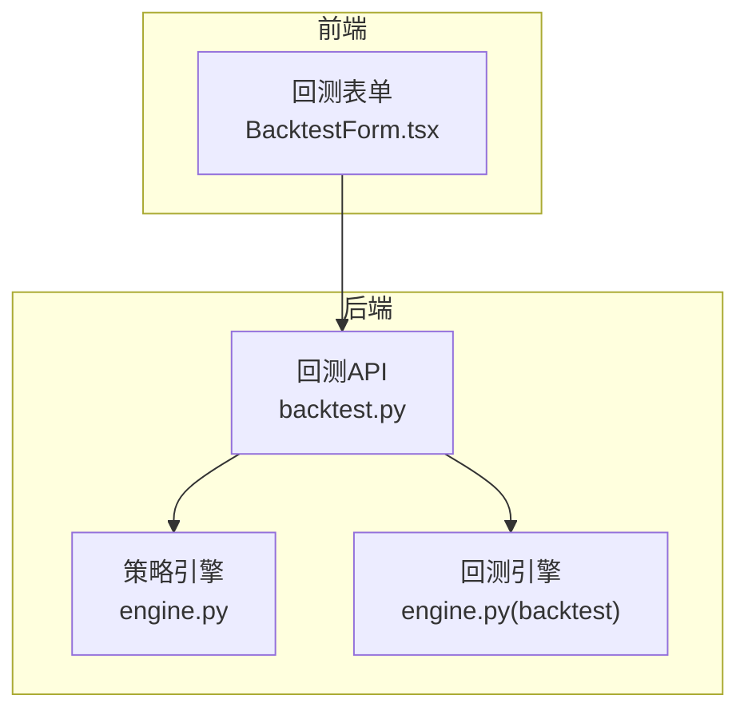
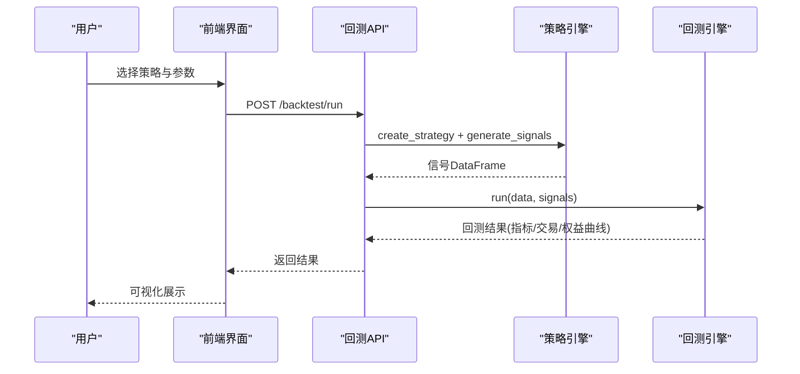
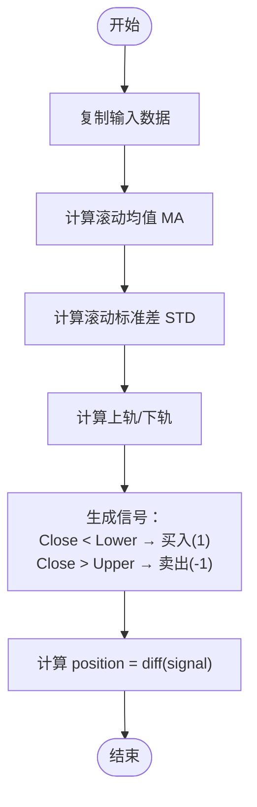
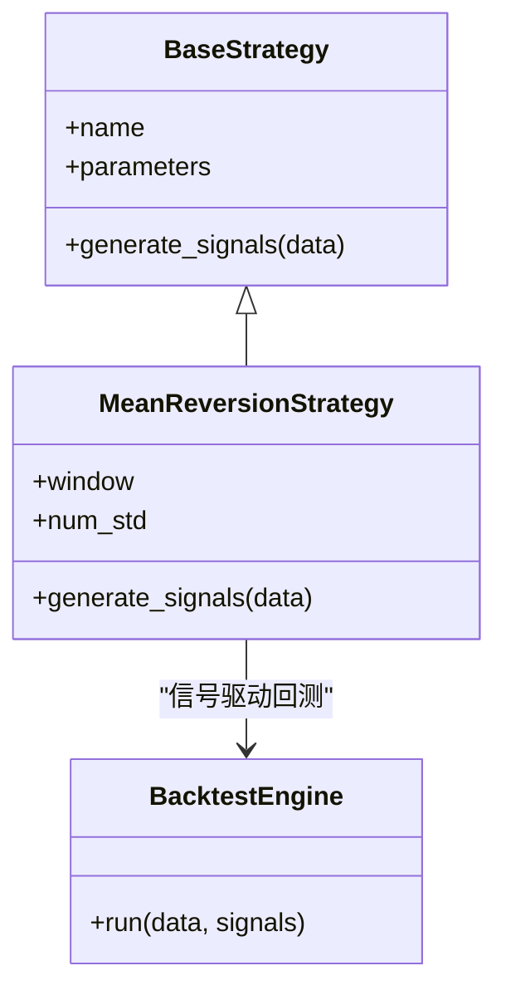

# 均值回归策略

<cite>
**本文引用的文件**   
- [backend/app/strategies/engine.py](../../../../../backend/app/strategies/engine.py)
- [backend/tests/test_strategy_engine.py](../../../../../backend/tests/test_strategy_engine.py)
- [backend/app/api/backtest.py](../../../../../backend/app/api/backtest.py)
- [backend/app/backtest/engine.py](../../../../../backend/app/backtest/engine.py)
- [frontend/src/components/BacktestForm.tsx](../../../../../frontend/src/components/BacktestForm.tsx)
</cite>

## 目录
1. [引言](#引言)
2. [项目结构](#项目结构)
3. [核心组件](#核心组件)
4. [架构总览](#架构总览)
5. [详细组件分析](#详细组件分析)
6. [依赖关系分析](#依赖关系分析)
7. [性能与适用性](#性能与适用性)
8. [参数调优指南](#参数调优指南)
9. [回测结果分析方法](#回测结果分析方法)
10. [故障排查](#故障排查)
11. [结论](#结论)

## 引言
本文件围绕“均值回归策略”在量化交易中的应用，系统讲解其理论基础、实现细节与回测方法。重点包括：
- 统计套利与配对交易的均值回归思想
- 移动平均线与标准差的计算，以及上下轨的构建逻辑
- num_std 参数的含义与作用
- MeanReversionStrategy 类的完整实现路径（滚动均值、滚动标准差、信号生成）
- 震荡市与趋势市的适用性与对比
- 参数调优与回测结果解读

## 项目结构
本项目采用前后端分离架构：
- 后端提供策略引擎、回测引擎与 API 接口
- 前端提供回测表单与结果展示

图表来源
- [backend/app/api/backtest.py:28-69](../../../../../backend/app/api/backtest.py#L28-L69)
- [backend/app/strategies/engine.py:84-111](../../../../../backend/app/strategies/engine.py#L84-L111)
- [backend/app/backtest/engine.py:10-...](../../../../../backend/app/backtest/engine.py#L10-L...)

章节来源
- [backend/app/api/backtest.py:28-69](../../../../../backend/app/api/backtest.py#L28-L69)
- [backend/app/strategies/engine.py:84-111](../../../../../backend/app/strategies/engine.py#L84-L111)

## 核心组件
- BaseStrategy：策略基类，定义统一的 generate_signals 接口
- MACrossStrategy：均线交叉策略
- MomentumStrategy：动量策略
- MeanReversionStrategy：均值回归策略（本文重点）
- RSIStrategy：RSI 策略
- BollingerBandsStrategy：布林带策略
- MultiFactorStrategy：多因子选股策略
- TransformerPredictStrategy：Transformer 预测策略
- BacktestEngine：回测引擎，负责根据信号执行交易并输出绩效指标

章节来源
- [backend/app/strategies/engine.py:17-111](../../../../../backend/app/strategies/engine.py#L17-L111)
- [backend/app/backtest/engine.py:10-...](../../../../../backend/app/backtest/engine.py#L10-L...)

## 架构总览
从用户发起回测到结果返回的整体流程如下：

图表来源
- [backend/app/api/backtest.py:28-69](../../../../../backend/app/api/backtest.py#L28-L69)
- [backend/app/strategies/engine.py:506-656](../../../../../backend/app/strategies/engine.py#L506-L656)
- [backend/app/backtest/engine.py:10-...](../../../../../backend/app/backtest/engine.py#L10-L...)

## 详细组件分析

### 均值回归理论在量化交易中的应用
- 核心思想：价格短期偏离均值后倾向于回归均值。通过识别“超买/超卖”区域进行反向交易。
- 统计套利与配对交易：利用资产间价差或相对价格的均值回归特性，做多低估资产、做空高估资产，赚取价差收敛收益。
- 在本项目中，均值回归以“价格与滚动均值及标准差构成的通道”作为判断依据：当价格跌破下轨时买入，突破上轨时卖出。

[本节为概念性说明，不直接分析具体代码文件]

### 移动平均线与标准差的计算，以及上下轨构建
- 滚动均值（MA）：对收盘价使用滚动窗口求均值，得到中心趋势线。
- 滚动标准差（STD）：对收盘价使用滚动窗口求标准差，衡量波动程度。
- 上轨 = MA + num_std × STD
- 下轨 = MA - num_std × STD
- num_std 控制通道宽度：越大越宽，触发信号越少；越小越窄，信号更频繁但假信号风险更高。

章节来源
- [backend/app/strategies/engine.py:94-111](../../../../../backend/app/strategies/engine.py#L94-L111)

### num_std 参数的作用
- 含义：标准差倍数，用于决定价格偏离均值的显著性阈值。
- 影响：
  - num_std 增大：通道变宽，减少噪音交易，适合趋势较强或波动较大的市场。
  - num_std 减小：通道变窄，提高交易频率，适合震荡行情。
- 在前端中，num_std 被暴露为可调参数，默认值通常为 2.0，范围限制在 1.0~3.0。

章节来源
- [backend/app/strategies/engine.py:84-92](../../../../../backend/app/strategies/engine.py#L84-L92)
- [frontend/src/components/BacktestForm.tsx:166-190](../../../../../frontend/src/components/BacktestForm.tsx#L166-L190)

### MeanReversionStrategy 类的完整实现
- 初始化参数：
  - window：滚动窗口长度，控制均值与标准差的平滑程度
  - num_std：标准差倍数，控制通道宽度
- 信号生成步骤：
  1) 复制输入数据，避免修改原始 DataFrame
  2) 计算滚动均值 ma
  3) 计算滚动标准差 std
  4) 计算上轨 upper_band 和下轨 lower_band
  5) 设置 signal：低于下轨为买入（1），高于上轨为卖出（-1），否则为持有（0）
  6) 计算 position = signal.diff()，仅在信号变化时产生实际交易指令
- 输出列：signal、position、ma、std、upper_band、lower_band

图表来源
- [backend/app/strategies/engine.py:94-111](../../../../../backend/app/strategies/engine.py#L94-L111)

章节来源
- [backend/app/strategies/engine.py:84-111](../../../../../backend/app/strategies/engine.py#L84-L111)

### 与其他相关策略的关系
- BollingerBandsStrategy：同样基于滚动均值与标准差构建通道，但引入 %B 与带宽过滤，信号更精细。
- MultiFactorStrategy：将“均线偏离因子”纳入综合打分，间接体现均值回归思想。

章节来源
- [backend/app/strategies/engine.py:153-205](../../../../../backend/app/strategies/engine.py#L153-L205)
- [backend/app/strategies/engine.py:208-324](../../../../../backend/app/strategies/engine.py#L208-L324)

## 依赖关系分析
- 策略层：MeanReversionStrategy 继承自 BaseStrategy，遵循统一接口
- 工厂函数：create_strategy 根据 strategy_id 创建对应策略实例
- API 层：run_backtest 调用 create_strategy 与 BacktestEngine.run
- 测试层：TestMeanReversionStrategy 验证信号结构与通道列存在

图表来源
- [backend/app/strategies/engine.py:17-111](../../../../../backend/app/strategies/engine.py#L17-L111)
- [backend/app/backtest/engine.py:10-...](../../../../../backend/app/backtest/engine.py#L10-L...)

章节来源
- [backend/app/strategies/engine.py:506-656](../../../../../backend/app/strategies/engine.py#L506-L656)
- [backend/tests/test_strategy_engine.py:98-107](../../../../../backend/tests/test_strategy_engine.py#L98-L107)

## 性能与适用性
- 震荡市：价格围绕均值波动，均值回归策略通常表现较好，能捕捉超买超卖反弹。
- 趋势市：价格持续单边运行，均值回归策略易出现逆势交易，导致回撤与胜率下降。
- 建议：
  - 在趋势明显时降低 num_std 或结合趋势过滤器（如均线方向、ATR）
  - 在震荡行情中适度提高 num_std 以减少假信号

[本节为通用指导，不直接分析具体代码文件]

## 参数调优指南
- window（滚动窗口）
  - 较小：更敏感，信号频繁，适合短线震荡
  - 较大：更平滑，信号较少，适合中长线
- num_std（标准差倍数）
  - 较小：通道窄，交易频繁，需警惕假信号
  - 较大：通道宽，交易稀疏，适合趋势环境
- 调参建议
  - 网格搜索 window ∈ [10, 100]，num_std ∈ [1.0, 3.0]
  - 评估指标：总收益率、最大回撤、夏普比率、胜率、交易次数
  - 样本外验证：划分训练集与测试集，避免过拟合

章节来源
- [backend/app/strategies/engine.py:84-92](../../../../../backend/app/strategies/engine.py#L84-L92)
- [frontend/src/components/BacktestForm.tsx:166-190](../../../../../frontend/src/components/BacktestForm.tsx#L166-L190)

## 回测结果分析方法
- 关键输出字段
  - metrics：包含总收益率、最终资金、胜率、最大回撤等
  - trades：逐笔交易记录（入场/出场价、盈亏、方向）
  - equity_curve：权益曲线时间序列
- 分析要点
  - 观察不同市场周期（震荡/趋势）下的收益与回撤差异
  - 检查交易频率与胜率是否合理
  - 关注极端行情中的止损与风控效果
- 数据来源与模拟标识
  - API 返回 data_source 与 is_mock，便于区分真实数据与模拟数据

章节来源
- [backend/app/api/backtest.py:28-69](../../../../../backend/app/api/backtest.py#L28-L69)
- [backend/tests/test_backtest_engine.py:16-30](../../../../../backend/tests/test_backtest_engine.py#L16-L30)

## 故障排查
- 常见问题
  - 未产生交易：可能是 num_std 过大或 window 不合适，导致信号稀少
  - 信号异常：检查输入数据是否包含 Close 列且时序连续
  - 回测报错：确认 create_strategy 传入的参数与策略定义一致
- 定位方法
  - 打印中间列：ma、std、upper_band、lower_band，检查通道是否合理
  - 查看 position 列：仅在信号变化时应有非零值
  - 使用单元测试断言：确保 signal 取值仅为 {-1, 0, 1}

章节来源
- [backend/tests/test_strategy_engine.py:98-107](../../../../../backend/tests/test_strategy_engine.py#L98-L107)
- [backend/tests/test_strategy_engine.py:174-187](../../../../../backend/tests/test_strategy_engine.py#L174-L187)

## 结论
均值回归策略通过滚动均值与标准差构建通道，利用价格偏离度进行反向交易。在震荡市中具备较好的收益潜力，但在趋势市中需谨慎使用。通过合理调整 window 与 num_std，并结合回测结果与市场环境分析，可提升策略稳健性。项目中 MeanReversionStrategy 的实现简洁清晰，易于扩展与集成至回测框架。