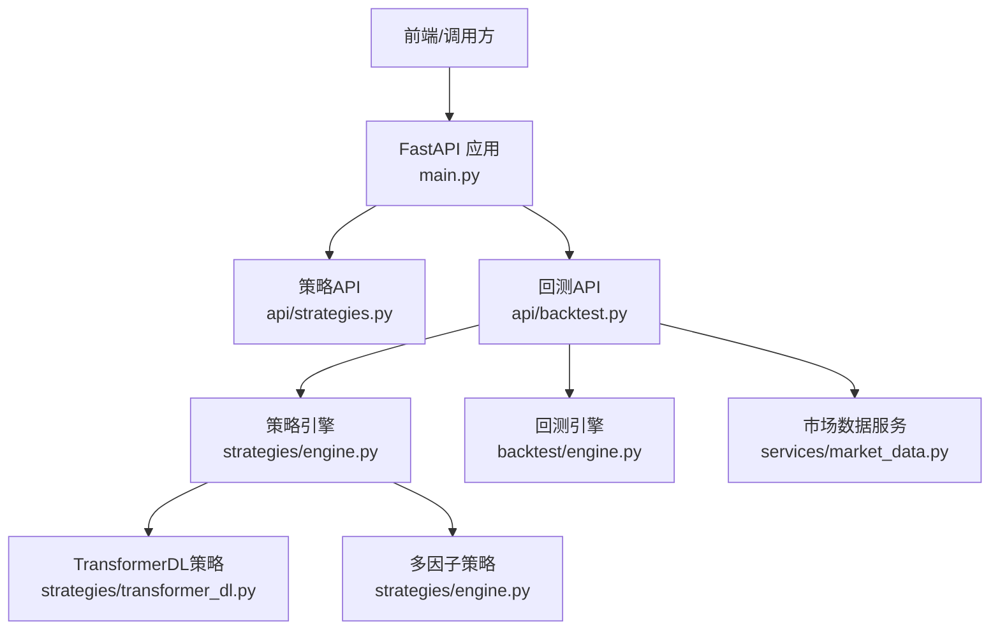
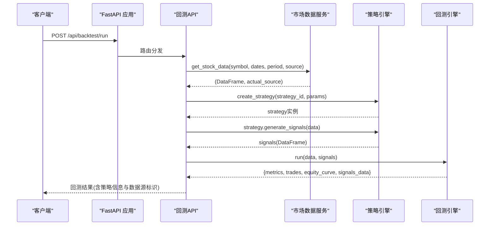
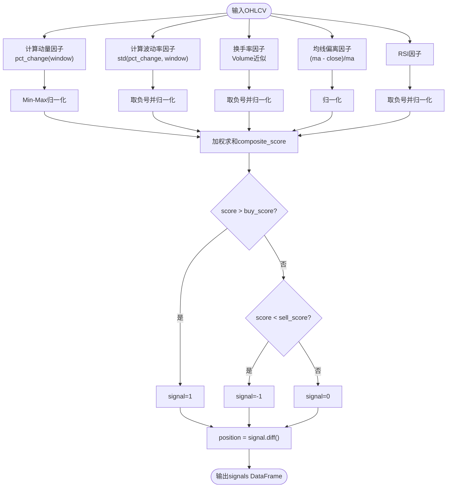
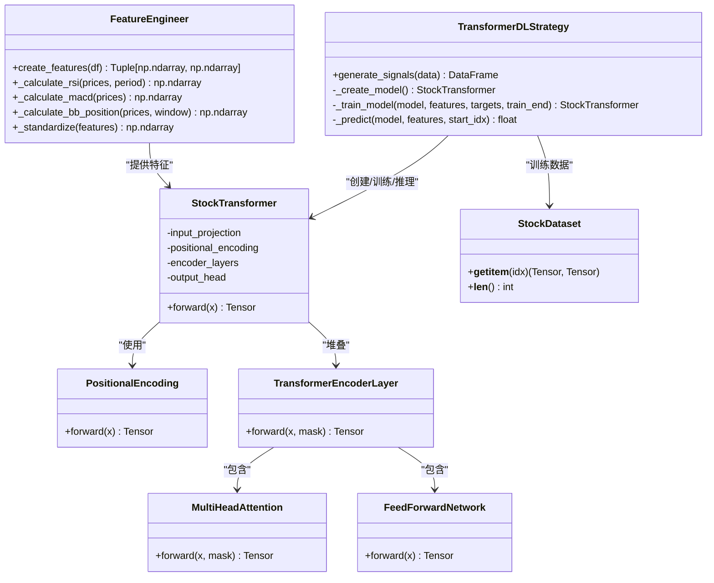
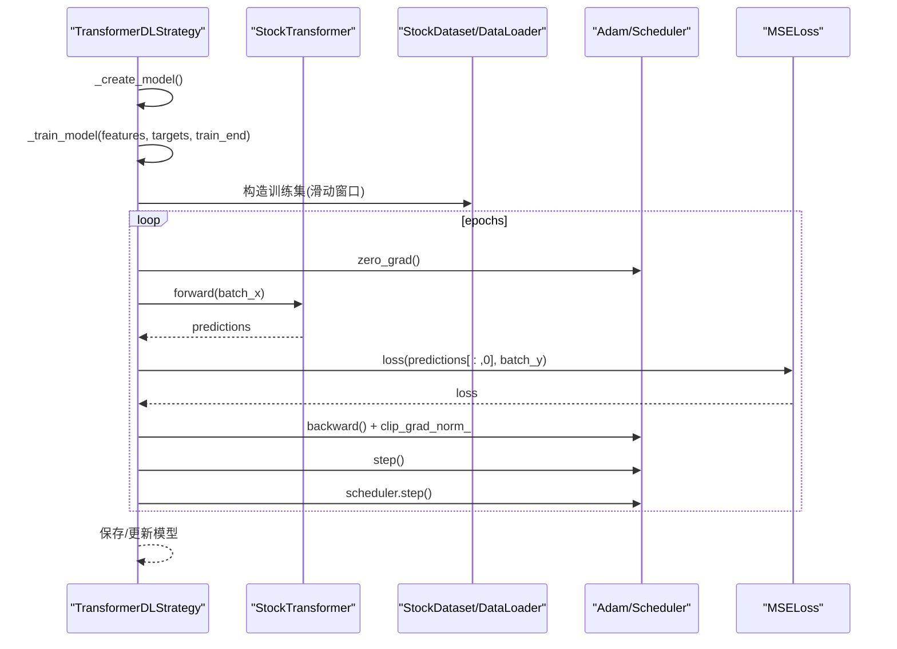
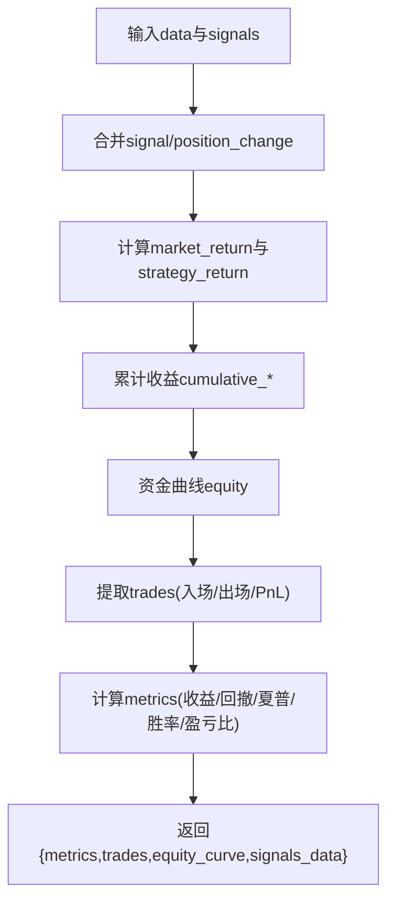
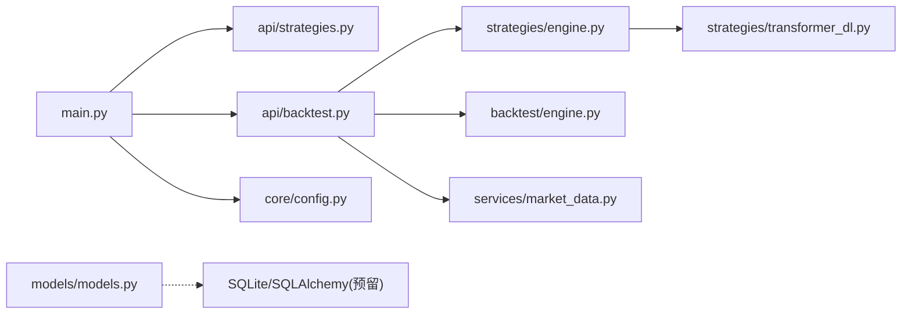

# 高级策略实现

<cite>
**本文引用的文件**   
- [backend/app/strategies/transformer_dl.py](../../../../../backend/app/strategies/transformer_dl.py)
- [backend/app/strategies/engine.py](../../../../../backend/app/strategies/engine.py)
- [backend/app/api/backtest.py](../../../../../backend/app/api/backtest.py)
- [backend/app/backtest/engine.py](../../../../../backend/app/backtest/engine.py)
- [backend/app/services/market_data.py](../../../../../backend/app/services/market_data.py)
- [backend/main.py](../../../../../backend/main.py)
- [backend/app/core/config.py](../../../../../backend/app/core/config.py)
- [backend/app/models/models.py](../../../../../backend/app/models/models.py)
</cite>

## 目录
1. [引言](#引言)
2. [项目结构](#项目结构)
3. [核心组件](#核心组件)
4. [架构总览](#架构总览)
5. [详细组件分析](#详细组件分析)
6. [依赖关系分析](#依赖关系分析)
7. [性能与训练最佳实践](#性能与训练最佳实践)
8. [与传统策略的对比](#与传统策略的对比)
9. [故障排查指南](#故障排查指南)
10. [结论](#结论)

## 引言
本文件面向量化交易与深度学习在策略中的应用，聚焦两类“高级策略”：
- 多因子选股策略：通过多因子打分、权重分配与阈值决策生成交易信号。
- Transformer 深度学习策略：基于 PyTorch 的完整 Transformer 架构，包含位置编码、多头自注意力、前馈网络、层归一化与滚动窗口训练，用于价格序列预测与信号生成。

文档将系统阐述因子选择与加权逻辑、Transformer 模型结构与训练流程、数据预处理与推理过程，并给出回测集成方式、性能优化建议与常见问题排查。

## 项目结构
后端采用 FastAPI 提供 REST API，策略引擎与回测引擎解耦，市场数据服务支持多源接入（自动选择）。关键路径如下：
- 策略定义与工厂：backend/app/strategies/engine.py
- Transformer 深度学习策略实现：backend/app/strategies/transformer_dl.py
- 回测引擎：backend/app/backtest/engine.py
- 回测 API：backend/app/api/backtest.py
- 市场数据服务：backend/app/services/market_data.py
- 应用入口与路由注册：backend/main.py
- 配置与数据库模型：backend/app/core/config.py, backend/app/models/models.py

图表来源
- [backend/main.py:1-36](../../../../../backend/main.py#L1-L36)
- [backend/app/api/backtest.py:1-77](../../../../../backend/app/api/backtest.py#L1-L77)
- [backend/app/strategies/engine.py:1-656](../../../../../backend/app/strategies/engine.py#L1-L656)
- [backend/app/strategies/transformer_dl.py:1-516](../../../../../backend/app/strategies/transformer_dl.py#L1-L516)
- [backend/app/backtest/engine.py:1-163](../../../../../backend/app/backtest/engine.py#L1-L163)
- [backend/app/services/market_data.py:1-106](../../../../../backend/app/services/market_data.py#L1-L106)

章节来源
- [backend/main.py:1-36](../../../../../backend/main.py#L1-L36)
- [backend/app/core/config.py:1-25](../../../../../backend/app/core/config.py#L1-L25)

## 核心组件
- 策略基类与多种传统策略：均线交叉、动量、均值回归、RSI、布林带等，统一接口 generate_signals(data) -> DataFrame。
- 多因子选股策略：综合动量、波动率、换手率、均线偏离、RSI 五个因子，归一化后加权求和，按阈值生成买卖信号。
- Transformer 深度学习策略：基于 PyTorch 的 StockTransformer 模型，包含 PositionalEncoding、MultiHeadAttention、FeedForwardNetwork、Encoder Layer，使用滚动窗口训练与周期性重训，输出未来收益率预测并转换为交易信号。
- 回测引擎：计算策略收益、资金曲线、夏普比率、最大回撤、胜率、盈亏比等指标，并提取交易记录。
- 市场数据服务：封装多数据源获取股票行情数据，返回标准化 DataFrame。

章节来源
- [backend/app/strategies/engine.py:17-324](../../../../../backend/app/strategies/engine.py#L17-L324)
- [backend/app/strategies/transformer_dl.py:30-516](../../../../../backend/app/strategies/transformer_dl.py#L30-L516)
- [backend/app/backtest/engine.py:10-163](../../../../../backend/app/backtest/engine.py#L10-L163)
- [backend/app/services/market_data.py:11-41](../../../../../backend/app/services/market_data.py#L11-L41)

## 架构总览
从请求到回测结果的端到端流程如下：

图表来源
- [backend/app/api/backtest.py:28-69](../../../../../backend/app/api/backtest.py#L28-L69)
- [backend/app/services/market_data.py:14-41](../../../../../backend/app/services/market_data.py#L14-L41)
- [backend/app/strategies/engine.py:600-656](../../../../../backend/app/strategies/engine.py#L600-L656)
- [backend/app/backtest/engine.py:15-70](../../../../../backend/app/backtest/engine.py#L15-L70)

## 详细组件分析

### 多因子选股策略
设计要点：
- 因子选择：动量（过去N日收益率）、波动率（低波偏好）、换手率（以成交量近似，低量偏好）、均线偏离（均值回归机会）、RSI（超卖反弹机会）。
- 权重分配：可配置的 w_momentum、w_volatility、w_turnover、w_ma_deviation、w_rsi，默认值体现不同因子的相对重要性。
- 组合优化：线性加权求和得到 composite_score；根据 buy_score/sell_score 阈值生成信号。
- 信号处理：signal 为 1/-1/0，position 为 signal.diff() 表示仓位变化。

图表来源
- [backend/app/strategies/engine.py:208-324](../../../../../backend/app/strategies/engine.py#L208-L324)

章节来源
- [backend/app/strategies/engine.py:208-324](../../../../../backend/app/strategies/engine.py#L208-L324)

### Transformer 深度学习策略（PyTorch）
模型与训练关键点：
- 特征工程：收益率、对数收益率、均线偏离度、波动率、成交量变化、RSI、MACD、布林带位置、价格动量，共9维特征，并进行 Z-score 标准化。
- 模型结构：StockTransformer 包含输入投影、PositionalEncoding、多层 TransformerEncoderLayer（每层含多头自注意力和前馈网络），输出头映射到 pred_horizon 维度的未来收益率。
- 数据集与训练：StockDataset 构建滑动窗口样本；训练循环使用 Adam、余弦退火学习率调度器、MSELoss、梯度裁剪；滚动窗口训练（train_window）并按固定间隔重训。
- 推理与信号：取最后一个时间步的输出，选择第一个维度作为未来第1日收益率预测；根据 buy_threshold/sell_threshold 生成信号。

图表来源
- [backend/app/strategies/transformer_dl.py:30-137](../../../../../backend/app/strategies/transformer_dl.py#L30-L137)
- [backend/app/strategies/transformer_dl.py:143-304](../../../../../backend/app/strategies/transformer_dl.py#L143-L304)
- [backend/app/strategies/transformer_dl.py:306-320](../../../../../backend/app/strategies/transformer_dl.py#L306-L320)
- [backend/app/strategies/transformer_dl.py:324-487](../../../../../backend/app/strategies/transformer_dl.py#L324-L487)

#### 训练流程时序图

图表来源
- [backend/app/strategies/transformer_dl.py:397-436](../../../../../backend/app/strategies/transformer_dl.py#L397-L436)

章节来源
- [backend/app/strategies/transformer_dl.py:30-137](../../../../../backend/app/strategies/transformer_dl.py#L30-L137)
- [backend/app/strategies/transformer_dl.py:143-304](../../../../../backend/app/strategies/transformer_dl.py#L143-L304)
- [backend/app/strategies/transformer_dl.py:306-487](../../../../../backend/app/strategies/transformer_dl.py#L306-L487)

### 回测引擎
功能要点：
- 合并策略信号与行情数据，计算每日策略收益（信号滞后一期以避免未来函数）。
- 累计收益与资金曲线计算。
- 提取交易记录（买入/卖出配对，计算PnL与百分比收益）。
- 计算绩效指标：总收益、年化收益、最大回撤、夏普比率、胜率、盈亏比等，并对异常值进行安全处理。

图表来源
- [backend/app/backtest/engine.py:15-70](../../../../../backend/app/backtest/engine.py#L15-L70)
- [backend/app/backtest/engine.py:72-163](../../../../../backend/app/backtest/engine.py#L72-L163)

章节来源
- [backend/app/backtest/engine.py:15-163](../../../../../backend/app/backtest/engine.py#L15-L163)

### 市场数据服务
- 提供 get_stock_data(symbol, start_date, end_date, period, source)，内部委托 DataSourceManager 自动选择数据源。
- 提供 get_stock_info 与 search_symbol 辅助方法，便于前端展示与搜索。

章节来源
- [backend/app/services/market_data.py:11-41](../../../../../backend/app/services/market_data.py#L11-L41)
- [backend/app/services/market_data.py:43-106](../../../../../backend/app/services/market_data.py#L43-L106)

## 依赖关系分析
- FastAPI 应用 main.py 注册策略与回测路由。
- 回测API backtest.py 依赖策略引擎 engine.py 与回测引擎 backtest/engine.py，以及市场数据服务 services/market_data.py。
- 策略引擎 engine.py 聚合多种策略，包括多因子与Transformer相关策略；当需要深度学习时，动态导入 transformer_dl.py。
- 配置文件 config.py 提供应用级设置；数据库模型 models.py 定义策略与回测结果表结构（当前未完全启用）。

图表来源
- [backend/main.py:1-36](../../../../../backend/main.py#L1-L36)
- [backend/app/api/backtest.py:1-77](../../../../../backend/app/api/backtest.py#L1-L77)
- [backend/app/strategies/engine.py:1-656](../../../../../backend/app/strategies/engine.py#L1-L656)
- [backend/app/strategies/transformer_dl.py:1-516](../../../../../backend/app/strategies/transformer_dl.py#L1-L516)
- [backend/app/backtest/engine.py:1-163](../../../../../backend/app/backtest/engine.py#L1-L163)
- [backend/app/services/market_data.py:1-106](../../../../../backend/app/services/market_data.py#L1-L106)
- [backend/app/core/config.py:1-25](../../../../../backend/app/core/config.py#L1-L25)
- [backend/app/models/models.py:1-44](../../../../../backend/app/models/models.py#L1-L44)

章节来源
- [backend/main.py:1-36](../../../../../backend/main.py#L1-L36)
- [backend/app/api/backtest.py:1-77](../../../../../backend/app/api/backtest.py#L1-L77)
- [backend/app/strategies/engine.py:1-656](../../../../../backend/app/strategies/engine.py#L1-L656)
- [backend/app/strategies/transformer_dl.py:1-516](../../../../../backend/app/strategies/transformer_dl.py#L1-L516)
- [backend/app/backtest/engine.py:1-163](../../../../../backend/app/backtest/engine.py#L1-L163)
- [backend/app/services/market_data.py:1-106](../../../../../backend/app/services/market_data.py#L1-L106)
- [backend/app/core/config.py:1-25](../../../../../backend/app/core/config.py#L1-L25)
- [backend/app/models/models.py:1-44](../../../../../backend/app/models/models.py#L1-L44)

## 性能与训练最佳实践
- 数据标准化
  - 特征层面：Z-score 标准化（FeatureEngineer._standardize），避免尺度差异影响注意力与梯度。
  - 目标变量：未来收益率通常较小，MSE 损失稳定；也可考虑 MAE 或 Huber Loss 提升鲁棒性。
- 损失函数选择
  - 回归任务常用 MSE；若存在极端值或噪声较大，可切换为 Huber Loss 或分位数损失。
- 过拟合防止技术
  - Dropout（模型中多处使用）。
  - 梯度裁剪（clip_grad_norm_）防止爆炸。
  - 正则化（Adam weight_decay）。
  - 早停（Early Stopping）：监控验证集损失，连续若干轮不下降则停止。
  - 数据增强：对时间序列进行随机缩放、加噪、滑动窗口扰动。
  - 交叉验证：滚动窗口交叉验证（Walk-forward）已在策略中实现。
- 训练效率
  - DataLoader 批训练与 shuffle。
  - 学习率调度：CosineAnnealingLR 平滑衰减。
  - GPU 加速：自动检测 CUDA 设备。
- 评估与稳健性
  - 结合回测指标（夏普、最大回撤、胜率、盈亏比）综合评估。
  - 参数敏感性分析：对 seq_length、pred_horizon、d_model、n_heads、dropout 等进行网格或贝叶斯优化。

[本节为通用指导，不直接分析具体代码文件]

## 与传统策略的对比
- 多因子选股策略
  - 优势：透明度高、可解释性强；因子权重可调；适合震荡与趋势转换期。
  - 局限：因子有效性依赖历史统计；易受市场 regime 变化影响；需定期再平衡。
- Transformer 深度学习策略
  - 优势：能捕捉长距离依赖与非线性模式；自适应学习复杂时序结构；在多因子基础上进一步建模非线性交互。
  - 局限：数据需求大、训练成本高；易过拟合；黑盒特性降低可解释性；对噪声敏感。
- 适用场景
  - 多因子：中低频、规则驱动、强调可解释性与稳定性。
  - Transformer：高频或中长周期、数据丰富、追求非线性模式挖掘与预测精度。
- 局限性
  - 多因子：因子失效风险、参数漂移。
  - Transformer：算力与数据要求高、部署与维护成本较高。

[本节为概念性对比，不直接分析具体代码文件]

## 故障排查指南
- PyTorch 缺失或不可用
  - 现象：创建深度学习策略时报 ImportError。
  - 处理：安装 torch；或在策略工厂中确保 DL_AVAILABLE 为 True。
  - 参考：[backend/app/strategies/transformer_dl.py:18-25](../../../../../backend/app/strategies/transformer_dl.py#L18-L25)、[backend/app/strategies/engine.py:9-14](../../../../../backend/app/strategies/engine.py#L9-L14)、[backend/app/strategies/engine.py:647-653](../../../../../backend/app/strategies/engine.py#L647-L653)
- 数据为空或格式不正确
  - 现象：回测结果为空或指标异常。
  - 处理：检查 MarketDataService 返回的 DataFrame 是否包含 OHLCV 列；确认日期列类型与范围。
  - 参考：[backend/app/services/market_data.py:14-41](../../../../../backend/app/services/market_data.py#L14-L41)、[backend/app/backtest/engine.py:47-55](../../../../../backend/app/backtest/engine.py#L47-L55)
- 训练不稳定或梯度爆炸
  - 现象：Loss 发散或 NaN。
  - 处理：启用梯度裁剪、降低学习率、增加 dropout 或减少模型复杂度。
  - 参考：[backend/app/strategies/transformer_dl.py:414-431](../../../../../backend/app/strategies/transformer_dl.py#L414-L431)
- 信号过多或过少
  - 现象：频繁交易或几乎无交易。
  - 处理：调整 buy_threshold/sell_threshold 或复合得分阈值；检查因子权重与归一化。
  - 参考：[backend/app/strategies/transformer_dl.py:479-480](../../../../../backend/app/strategies/transformer_dl.py#L479-L480)、[backend/app/strategies/engine.py:318-320](../../../../../backend/app/strategies/engine.py#L318-L320)
- 回测指标异常（NaN/Inf）
  - 现象：夏普比率为 NaN 或 Inf。
  - 处理：检查策略收益序列标准差是否为 0；使用安全四舍五入与异常值替换。
  - 参考：[backend/app/backtest/engine.py:120-131](../../../../../backend/app/backtest/engine.py#L120-L131)、[backend/app/backtest/engine.py:144-148](../../../../../backend/app/backtest/engine.py#L144-L148)

章节来源
- [backend/app/strategies/transformer_dl.py:18-25](../../../../../backend/app/strategies/transformer_dl.py#L18-L25)
- [backend/app/strategies/engine.py:9-14](../../../../../backend/app/strategies/engine.py#L9-L14)
- [backend/app/strategies/engine.py:647-653](../../../../../backend/app/strategies/engine.py#L647-L653)
- [backend/app/services/market_data.py:14-41](../../../../../backend/app/services/market_data.py#L14-L41)
- [backend/app/backtest/engine.py:47-55](../../../../../backend/app/backtest/engine.py#L47-L55)
- [backend/app/strategies/transformer_dl.py:414-431](../../../../../backend/app/strategies/transformer_dl.py#L414-L431)
- [backend/app/strategies/transformer_dl.py:479-480](../../../../../backend/app/strategies/transformer_dl.py#L479-L480)
- [backend/app/strategies/engine.py:318-320](../../../../../backend/app/strategies/engine.py#L318-L320)
- [backend/app/backtest/engine.py:120-131](../../../../../backend/app/backtest/engine.py#L120-L131)
- [backend/app/backtest/engine.py:144-148](../../../../../backend/app/backtest/engine.py#L144-L148)

## 结论
本项目提供了从传统多因子策略到深度学习 Transformer 策略的完整实现与回测框架。多因子策略强调可解释性与稳健性，适合规则驱动的量化投资；Transformer 深度学习策略通过自注意力机制捕捉复杂时序依赖，具备更强的非线性建模能力，但需要更多数据与算力支撑。在实际应用中，建议将两者结合：以多因子作为基准与风控约束，以深度学习作为增强预测模块，并通过滚动窗口训练与严格回测评估确保稳健性。

[本节为总结性内容，不直接分析具体代码文件]