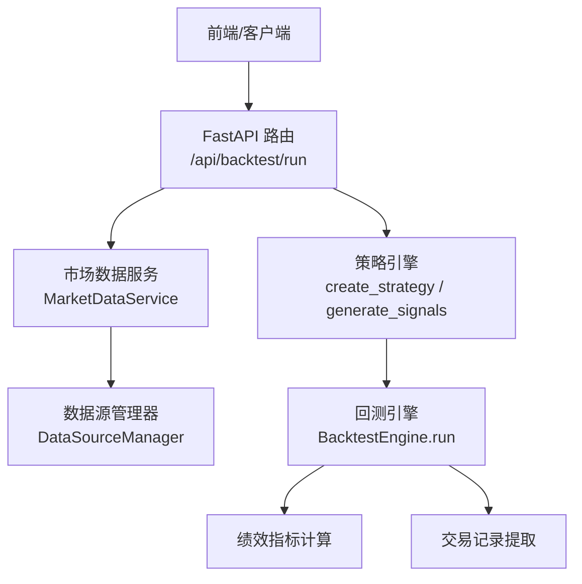
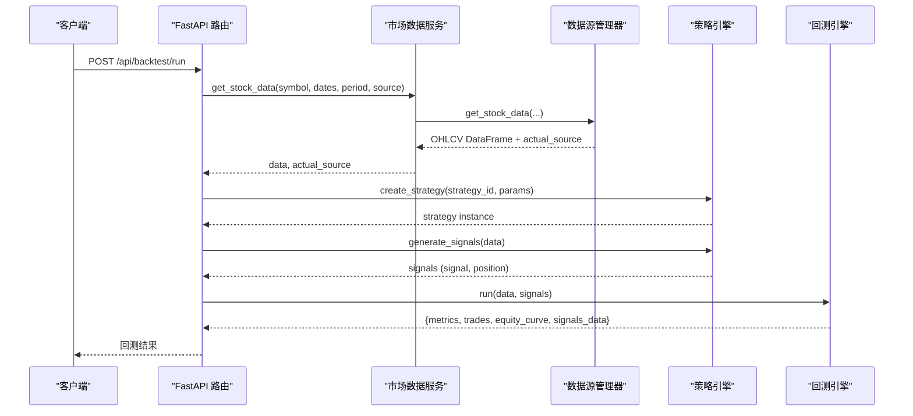
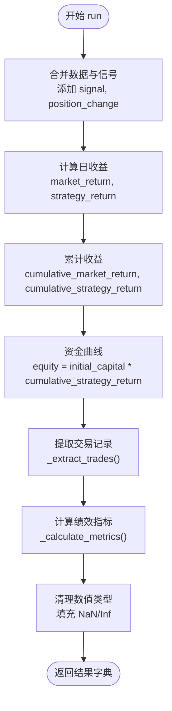
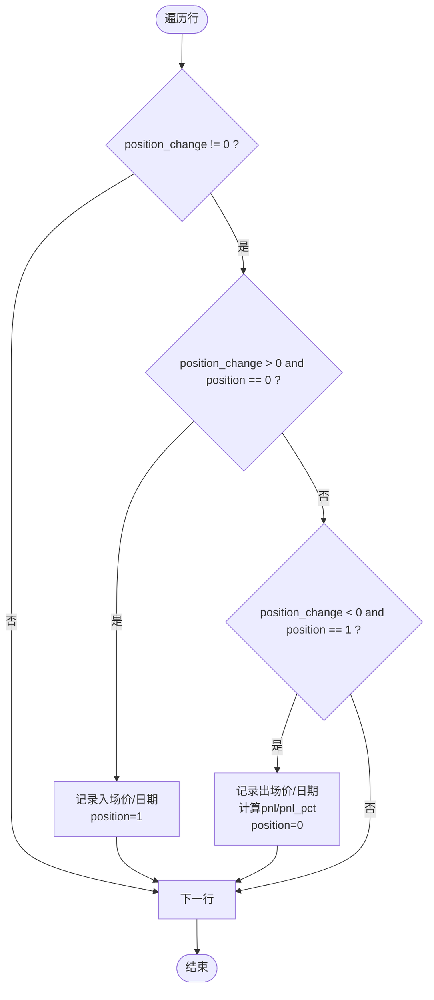
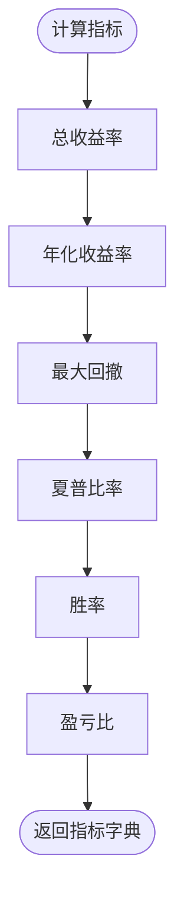
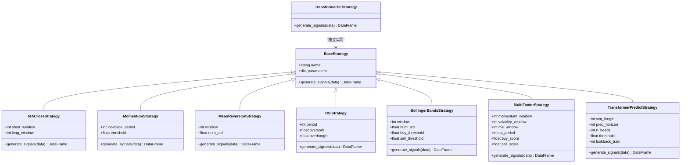
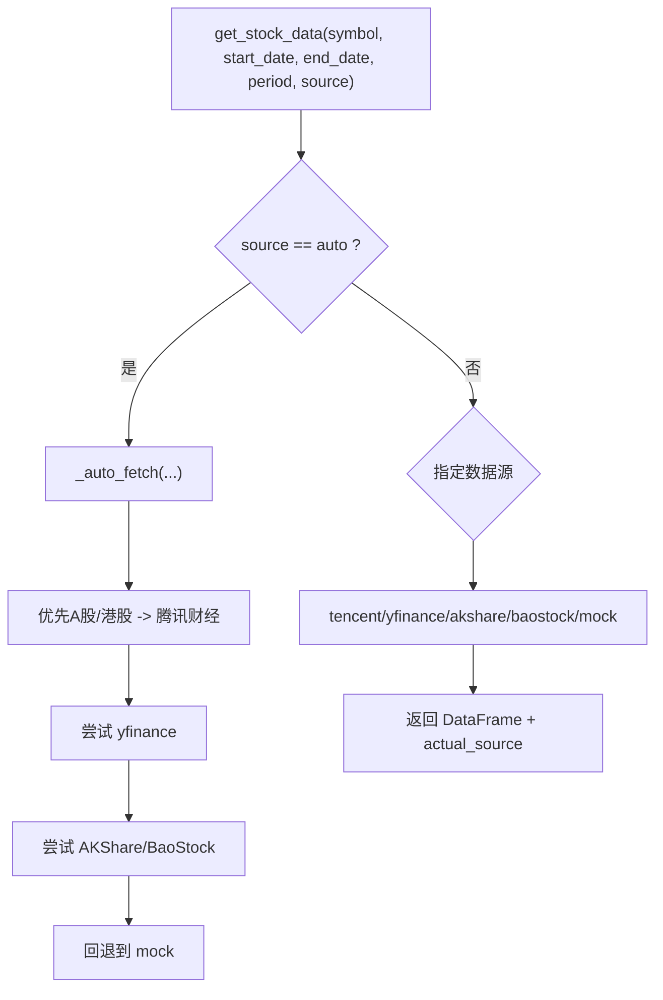
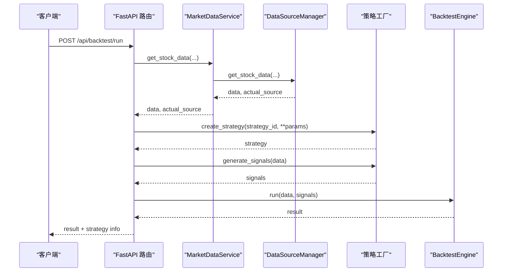
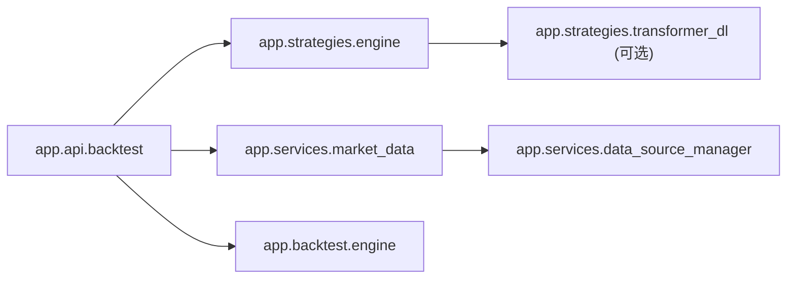

# 回测系统

<cite>
**本文引用的文件**   
- [backend/app/backtest/engine.py](../../backend/app/backtest/engine.py)
- [backend/app/strategies/engine.py](../../backend/app/strategies/engine.py)
- [backend/app/strategies/transformer_dl.py](../../backend/app/strategies/transformer_dl.py)
- [backend/app/api/backtest.py](../../backend/app/api/backtest.py)
- [backend/app/services/market_data.py](../../backend/app/services/market_data.py)
- [backend/app/services/data_source_manager.py](../../backend/app/services/data_source_manager.py)
- [backend/app/models/models.py](../../backend/app/models/models.py)
- [backend/tests/test_backtest_engine.py](../../backend/tests/test_backtest_engine.py)
- [backend/main.py](../../backend/main.py)
</cite>

## 目录
1. [简介](#简介)
2. [项目结构](#项目结构)
3. [核心组件](#核心组件)
4. [架构总览](#架构总览)
5. [详细组件分析](#详细组件分析)
6. [依赖关系分析](#依赖关系分析)
7. [性能与计算复杂度](#性能与计算复杂度)
8. [故障排查指南](#故障排查指南)
9. [结论](#结论)
10. [附录：指标公式与实现要点](#附录指标公式与实现要点)

## 简介
本回测系统提供从历史数据加载、策略信号生成、交易模拟执行到资金曲线与绩效指标计算的完整流程。系统支持多数据源自动选择（腾讯财经、yfinance、AKShare、BaoStock、模拟数据），内置多种经典与深度学习策略，并通过 FastAPI 暴露回测接口，便于前后端集成。

## 项目结构
后端采用分层设计：
- API 层：FastAPI 路由，接收请求并编排调用
- 服务层：市场数据获取与数据源管理
- 策略层：策略基类与多种具体策略实现
- 回测引擎：将策略信号转化为交易记录与绩效指标
- 模型层：数据库持久化模型（当前未完全接入）

**图表来源**
- [backend/main.py:24-27](../../backend/main.py#L24-L27)
- [backend/app/api/backtest.py:28-66](../../backend/app/api/backtest.py#L28-L66)
- [backend/app/services/market_data.py:14-41](../../backend/app/services/market_data.py#L14-L41)
- [backend/app/services/data_source_manager.py:17-54](../../backend/app/services/data_source_manager.py#L17-L54)
- [backend/app/strategies/engine.py:506-656](../../backend/app/strategies/engine.py#L506-L656)
- [backend/app/backtest/engine.py:10-70](../../backend/app/backtest/engine.py#L10-L70)

**章节来源**
- [backend/main.py:1-36](../../backend/main.py#L1-L36)
- [backend/app/api/backtest.py:1-77](../../backend/app/api/backtest.py#L1-L77)
- [backend/app/services/market_data.py:1-106](../../backend/app/services/market_data.py#L1-L106)
- [backend/app/services/data_source_manager.py:1-469](../../backend/app/services/data_source_manager.py#L1-L469)
- [backend/app/strategies/engine.py:1-656](../../backend/app/strategies/engine.py#L1-L656)
- [backend/app/backtest/engine.py:1-163](../../backend/app/backtest/engine.py#L1-L163)

## 核心组件
- 回测引擎：负责合并数据与信号、计算策略收益与资金曲线、提取交易记录、计算绩效指标。
- 策略引擎：定义策略基类与多种具体策略（均线交叉、动量、均值回归、RSI、布林带、多因子、Transformer预测、Transformer深度学习）。
- 市场数据服务：统一封装数据获取逻辑，支持多数据源自动选择。
- 数据源管理器：实现各数据源的拉取与格式标准化，并提供模拟数据生成。
- API 路由：对外暴露回测接口，串联数据获取、策略信号生成与回测执行。
- 模型层：定义策略与回测结果的数据库表结构（尚未完全接入）。

**章节来源**
- [backend/app/backtest/engine.py:10-163](../../backend/app/backtest/engine.py#L10-L163)
- [backend/app/strategies/engine.py:17-656](../../backend/app/strategies/engine.py#L17-L656)
- [backend/app/services/market_data.py:11-106](../../backend/app/services/market_data.py#L11-L106)
- [backend/app/services/data_source_manager.py:14-469](../../backend/app/services/data_source_manager.py#L14-L469)
- [backend/app/api/backtest.py:16-66](../../backend/app/api/backtest.py#L16-L66)
- [backend/app/models/models.py:11-44](../../backend/app/models/models.py#L11-L44)

## 架构总览
回测执行时序如下：

**图表来源**
- [backend/app/api/backtest.py:28-66](../../backend/app/api/backtest.py#L28-L66)
- [backend/app/services/market_data.py:14-41](../../backend/app/services/market_data.py#L14-L41)
- [backend/app/services/data_source_manager.py:17-54](../../backend/app/services/data_source_manager.py#L17-L54)
- [backend/app/strategies/engine.py:506-656](../../backend/app/strategies/engine.py#L506-L656)
- [backend/app/backtest/engine.py:15-70](../../backend/app/backtest/engine.py#L15-L70)

## 详细组件分析

### 回测引擎（BacktestEngine）
职责：
- 合并历史数据与策略信号，计算日度策略收益与累计收益
- 构建资金曲线
- 提取交易记录（买卖时机判断）
- 计算绩效指标（总收益率、年化收益率、最大回撤、夏普比率、胜率、盈亏比等）
- 输出可 JSON 序列化的结果

关键流程：
- 输入：OHLCV 数据 DataFrame 与信号 DataFrame（含 signal、position）
- 处理：
  - 计算 market_return 与 strategy_return（使用 shift(1) 避免未来函数）
  - 累计收益与资金曲线
  - 提取交易记录（基于 position_change 的符号变化）
  - 计算各项指标并进行数值安全处理（NaN/Inf）
- 输出：包含 metrics、trades、equity_curve、signals_data 的字典

**图表来源**
- [backend/app/backtest/engine.py:15-70](../../backend/app/backtest/engine.py#L15-L70)
- [backend/app/backtest/engine.py:72-103](../../backend/app/backtest/engine.py#L72-L103)
- [backend/app/backtest/engine.py:105-163](../../backend/app/backtest/engine.py#L105-L163)

**章节来源**
- [backend/app/backtest/engine.py:10-163](../../backend/app/backtest/engine.py#L10-L163)

#### 交易记录提取机制
- 买入时机：当 position_change > 0 且当前仓位为 0 时，记录入场价与日期
- 卖出时机：当 position_change < 0 且当前仓位为 1 时，记录出场价与日期，并计算 PnL 与百分比收益
- 方向：当前仅做多（direction="long"）
- 注意：未实现手续费与滑点扣除；PnL 基于收盘价差值计算

**图表来源**
- [backend/app/backtest/engine.py:72-103](../../backend/app/backtest/engine.py#L72-L103)

**章节来源**
- [backend/app/backtest/engine.py:72-103](../../backend/app/backtest/engine.py#L72-L103)

#### 绩效指标计算方法
- 总收益率：(最终资金 / 初始资金 - 1) × 100%
- 年化收益率：((最终资金 / 初始资金)^(1/年数) - 1) × 100%，年数按交易日跨度/365
- 最大回撤：滚动最高净值与当前净值的相对跌幅最小值（负值或0）
- 夏普比率：假设无风险利率 3%，以日频超额收益均值/标准差 × sqrt(252)
- 胜率：盈利交易笔数 / 总交易笔数 × 100%
- 盈亏比：平均盈利百分比 / 平均亏损百分比（绝对值）

**图表来源**
- [backend/app/backtest/engine.py:105-163](../../backend/app/backtest/engine.py#L105-L163)

**章节来源**
- [backend/app/backtest/engine.py:105-163](../../backend/app/backtest/engine.py#L105-L163)

### 策略引擎（BaseStrategy 与各策略）
职责：
- 定义策略基类 BaseStrategy，要求子类实现 generate_signals
- 提供多种经典与技术型策略：均线交叉、动量、均值回归、RSI、布林带、多因子选股、Transformer价格预测
- 提供 Transformer 深度学习策略（可选依赖 PyTorch）

**图表来源**
- [backend/app/strategies/engine.py:17-504](../../backend/app/strategies/engine.py#L17-L504)
- [backend/app/strategies/transformer_dl.py:324-487](../../backend/app/strategies/transformer_dl.py#L324-L487)

**章节来源**
- [backend/app/strategies/engine.py:17-656](../../backend/app/strategies/engine.py#L17-L656)
- [backend/app/strategies/transformer_dl.py:1-516](../../backend/app/strategies/transformer_dl.py#L1-L516)

### 市场数据服务与数据源管理器
职责：
- MarketDataService：统一入口，委托 DataSourceManager 获取数据
- DataSourceManager：根据 symbol 与市场类型自动选择最佳数据源，依次尝试腾讯财经、yfinance、AKShare、BaoStock，最后回退到模拟数据
- 所有数据源均返回标准化的 OHLCV DataFrame（Date, Open, High, Low, Close, Volume）

**图表来源**
- [backend/app/services/market_data.py:14-41](../../backend/app/services/market_data.py#L14-L41)
- [backend/app/services/data_source_manager.py:17-109](../../backend/app/services/data_source_manager.py#L17-L109)

**章节来源**
- [backend/app/services/market_data.py:11-106](../../backend/app/services/market_data.py#L11-L106)
- [backend/app/services/data_source_manager.py:14-469](../../backend/app/services/data_source_manager.py#L14-L469)

### API 路由（FastAPI）
职责：
- 接收回测请求参数（strategy_id、symbol、时间范围、周期、初始资金、数据源、策略参数）
- 调用 MarketDataService 获取数据
- 通过 create_strategy 创建策略实例并生成信号
- 调用 BacktestEngine.run 执行回测
- 附加策略信息与数据源标识后返回结果

**图表来源**
- [backend/app/api/backtest.py:28-66](../../backend/app/api/backtest.py#L28-L66)
- [backend/app/strategies/engine.py:600-656](../../backend/app/strategies/engine.py#L600-L656)
- [backend/app/backtest/engine.py:15-70](../../backend/app/backtest/engine.py#L15-L70)

**章节来源**
- [backend/app/api/backtest.py:1-77](../../backend/app/api/backtest.py#L1-L77)

## 依赖关系分析
- API 层依赖策略引擎、市场数据服务与回测引擎
- 市场数据服务依赖数据源管理器
- 策略引擎依赖 pandas/numpy，深度学习策略可选依赖 torch
- 回测引擎依赖 pandas/numpy，用于向量化计算与指标统计

**图表来源**
- [backend/main.py:24-27](../../backend/main.py#L24-L27)
- [backend/app/api/backtest.py:9-11](../../backend/app/api/backtest.py#L9-L11)
- [backend/app/services/market_data.py:8-8](../../backend/app/services/market_data.py#L8-L8)
- [backend/app/strategies/engine.py:9-14](../../backend/app/strategies/engine.py#L9-L14)

**章节来源**
- [backend/main.py:1-36](../../backend/main.py#L1-L36)
- [backend/app/api/backtest.py:1-77](../../backend/app/api/backtest.py#L1-L77)
- [backend/app/services/market_data.py:1-106](../../backend/app/services/market_data.py#L1-L106)
- [backend/app/services/data_source_manager.py:1-469](../../backend/app/services/data_source_manager.py#L1-L469)
- [backend/app/strategies/engine.py:1-656](../../backend/app/strategies/engine.py#L1-L656)
- [backend/app/strategies/transformer_dl.py:1-516](../../backend/app/strategies/transformer_dl.py#L1-L516)
- [backend/app/backtest/engine.py:1-163](../../backend/app/backtest/engine.py#L1-L163)

## 性能与计算复杂度
- 回测引擎主要计算为 O(n)，其中 n 为数据点数：
  - 日收益与累计收益：O(n)
  - 资金曲线：O(n)
  - 交易记录提取：O(n)
  - 绩效指标：O(n)（滚动最大值、标准差等）
- 策略引擎中：
  - 经典策略多为滑动窗口计算，整体 O(n)
  - Transformer 深度学习策略涉及训练与预测循环，复杂度取决于训练窗口、序列长度与批大小，通常显著高于 O(n)

优化建议：
- 对大数据集可使用向量化操作减少 Python 循环开销（当前 _extract_trades 使用 iterrows，可考虑向量化改进）
- 深度学习策略可通过调整 train_window、seq_length、batch_size 控制训练成本
- 数据源选择失败时的重试与缓存可降低网络延迟

[本节为通用性能讨论，不直接分析具体代码文件]

## 故障排查指南
常见问题与定位方法：
- 数据为空或异常：
  - 检查数据源是否可用（腾讯财经、yfinance、AKShare、BaoStock）
  - 确认股票代码格式是否正确（如 .SS/.SZ/.HK）
  - 若全部失败，系统将回退到模拟数据，可在结果中查看 is_mock 标志
- 指标出现 NaN/Inf：
  - 回测引擎已进行安全处理，但若输入数据存在极端值仍可能出现异常
  - 检查输入数据的数值列是否包含无穷大或缺失值
- 策略信号异常：
  - 检查策略参数是否在合理范围内
  - 对于深度学习策略，确保 PyTorch 已正确安装并可导入
- API 报错：
  - 检查请求参数是否完整（strategy_id、symbol、initial_capital 等）
  - 查看 HTTP 状态码与错误详情

测试覆盖：
- 单元测试验证了回测结果结构、指标字段完整性、交易记录结构与日期类型、JSON 序列化安全性等

**章节来源**
- [backend/app/services/data_source_manager.py:38-109](../../backend/app/services/data_source_manager.py#L38-L109)
- [backend/app/backtest/engine.py:130-163](../../backend/app/backtest/engine.py#L130-L163)
- [backend/tests/test_backtest_engine.py:25-179](../../backend/tests/test_backtest_engine.py#L25-L179)

## 结论
该回测系统提供了从数据获取到策略信号生成、交易模拟与绩效评估的完整闭环，具备多数据源支持与多种策略实现。当前实现简洁清晰，适合快速验证策略思路与初步评估收益风险特征。后续可扩展的方向包括：
- 引入手续费与滑点模型，提升回测真实性
- 完善仓位管理与资金管理规则（如固定比例、凯利公式、波动率目标）
- 增加风险控制模块（止损、止盈、最大持仓限制）
- 扩展数据库持久化与历史回测查询能力
- 增强过拟合检测与稳健性检验（样本外测试、交叉验证、参数稳定性分析）

[本节为总结性内容，不直接分析具体代码文件]

## 附录：指标公式与实现要点
- 总收益率：(final_equity / initial_capital - 1) × 100%
- 年化收益率：((final_equity / initial_capital)^(1/years) - 1) × 100%，years = (end_date - start_date).days / 365
- 最大回撤：min((equity_t / rolling_max_t - 1)) × 100%
- 夏普比率：sqrt(252) × mean(excess_daily_return) / std(excess_daily_return)，excess_daily_return = daily_return - risk_free_rate/252
- 胜率：winning_trades / total_trades × 100%
- 盈亏比：mean(pnl_pct of winning trades) / abs(mean(pnl_pct of losing trades))

实现要点：
- 所有指标在返回前进行 safe_round 处理，确保 JSON 序列化安全
- 最大回撤为非正数（≤0）
- 夏普比率在标准差为 0 或 NaN/Inf 时返回 0

**章节来源**
- [backend/app/backtest/engine.py:105-163](../../backend/app/backtest/engine.py#L105-L163)