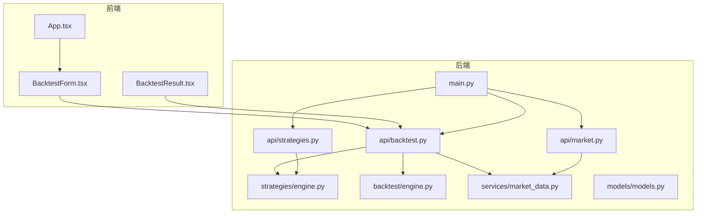
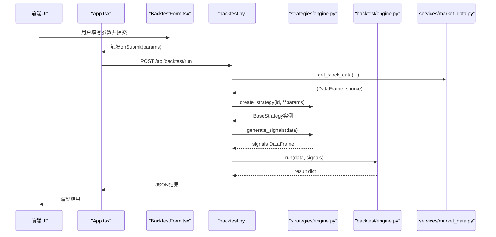
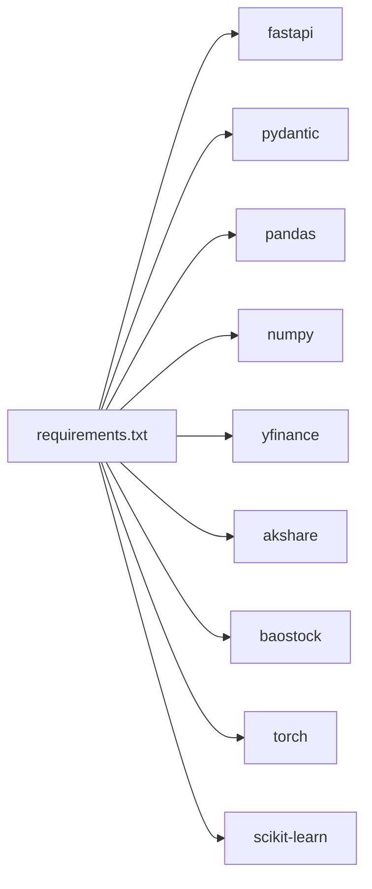

# 代码规范

<cite>
**本文引用的文件**   
- [backend/main.py](../../../backend/main.py)
- [backend/app/api/backtest.py](../../../backend/app/api/backtest.py)
- [backend/app/api/market.py](../../../backend/app/api/market.py)
- [backend/app/api/strategies.py](../../../backend/app/api/strategies.py)
- [backend/app/strategies/engine.py](../../../backend/app/strategies/engine.py)
- [backend/app/backtest/engine.py](../../../backend/app/backtest/engine.py)
- [backend/app/services/market_data.py](../../../backend/app/services/market_data.py)
- [backend/app/models/models.py](../../../backend/app/models/models.py)
- [frontend/src/App.tsx](../../../frontend/src/App.tsx)
- [frontend/src/components/BacktestForm.tsx](../../../frontend/src/components/BacktestForm.tsx)
- [frontend/src/components/BacktestResult.tsx](../../../frontend/src/components/BacktestResult.tsx)
- [frontend/tsconfig.json](../../../frontend/tsconfig.json)
- [backend/requirements.txt](../../../backend/requirements.txt)
</cite>

## 目录
1. [引言](#引言)
2. [项目结构](#项目结构)
3. [核心组件](#核心组件)
4. [架构总览](#架构总览)
5. [详细组件分析](#详细组件分析)
6. [依赖关系分析](#依赖关系分析)
7. [性能与可维护性建议](#性能与可维护性建议)
8. [代码审查清单](#代码审查清单)
9. [结论](#结论)

## 引言
本规范面向量化策略查看系统的前后端代码，统一Python与TypeScript的编码标准、命名约定、接口契约与数据格式约定。文档重点包括：
- Python编码规范（PEP8、命名约定、函数设计原则）
- TypeScript最佳实践（类型定义、组件设计模式）
- 项目特定约定（API路由前缀、OHLCV DataFrame列名、信号DataFrame结构、策略接口约定）
- 错误处理与健壮性要求
- 代码审查标准与质量检查工具配置建议

## 项目结构
本项目采用前后端分离架构：
- 后端使用FastAPI提供REST API，包含策略管理、回测执行与市场数据服务
- 前端使用React + TypeScript构建用户界面，调用后端API进行策略选择与回测

**图表来源**
- [backend/main.py:24-27](../../../backend/main.py#L24-L27)
- [backend/app/api/backtest.py:28-69](../../../backend/app/api/backtest.py#L28-L69)
- [backend/app/api/strategies.py:11-24](../../../backend/app/api/strategies.py#L11-L24)
- [backend/app/api/market.py:11-46](../../../backend/app/api/market.py#L11-L46)
- [backend/app/strategies/engine.py:17-25](../../../backend/app/strategies/engine.py#L17-L25)
- [backend/app/backtest/engine.py:10-70](../../../backend/app/backtest/engine.py#L10-L70)
- [backend/app/services/market_data.py:11-41](../../../backend/app/services/market_data.py#L11-L41)

**章节来源**
- [backend/main.py:1-36](../../../backend/main.py#L1-L36)
- [frontend/src/App.tsx:1-100](../../../frontend/src/App.tsx#L1-L100)

## 核心组件
- FastAPI应用入口与CORS、路由注册
- 策略API：列出策略与获取详情
- 回测API：运行回测并返回结果
- 市场数据API：获取行情数据与股票信息
- 策略引擎：BaseStrategy抽象类与各具体策略实现
- 回测引擎：计算收益曲线、交易记录与绩效指标
- 市场数据服务：多数据源适配与模拟数据
- 数据库模型：策略与回测结果的SQLAlchemy模型
- 前端应用：策略列表、回测表单与结果展示

**章节来源**
- [backend/main.py:9-27](../../../backend/main.py#L9-L27)
- [backend/app/api/strategies.py:11-24](../../../backend/app/api/strategies.py#L11-L24)
- [backend/app/api/backtest.py:16-69](../../../backend/app/api/backtest.py#L16-L69)
- [backend/app/api/market.py:11-46](../../../backend/app/api/market.py#L11-L46)
- [backend/app/strategies/engine.py:17-656](../../../backend/app/strategies/engine.py#L17-L656)
- [backend/app/backtest/engine.py:10-163](../../../backend/app/backtest/engine.py#L10-L163)
- [backend/app/services/market_data.py:11-106](../../../backend/app/services/market_data.py#L11-L106)
- [backend/app/models/models.py:11-44](../../../backend/app/models/models.py#L11-L44)
- [frontend/src/App.tsx:8-99](../../../frontend/src/App.tsx#L8-L99)
- [frontend/src/components/BacktestForm.tsx:21-522](../../../frontend/src/components/BacktestForm.tsx#L21-L522)
- [frontend/src/components/BacktestResult.tsx:9-221](../../../frontend/src/components/BacktestResult.tsx#L9-L221)

## 架构总览
后端通过FastAPI暴露三类API：
- /api/strategies：策略元数据查询
- /api/backtest：回测执行与结果返回
- /api/market：市场数据查询

前端通过React组件发起HTTP请求，解析JSON响应并渲染图表与表格。

**图表来源**
- [frontend/src/App.tsx:13-36](../../../frontend/src/App.tsx#L13-L36)
- [frontend/src/components/BacktestForm.tsx:28-44](../../../frontend/src/components/BacktestForm.tsx#L28-L44)
- [backend/app/api/backtest.py:28-69](../../../backend/app/api/backtest.py#L28-L69)
- [backend/app/strategies/engine.py:600-656](../../../backend/app/strategies/engine.py#L600-L656)
- [backend/app/backtest/engine.py:15-70](../../../backend/app/backtest/engine.py#L15-L70)
- [backend/app/services/market_data.py:14-41](../../../backend/app/services/market_data.py#L14-L41)

## 详细组件分析

### Python编码规范（PEP8与项目约定）
- 模块与包命名：全小写，下划线分隔；避免与内置库冲突
- 类与方法命名：类名使用大驼峰，方法与变量使用小写下划线分隔
- 常量与配置：使用大写常量，集中放在配置模块或环境变量
- 类型注解：函数签名与返回值必须添加类型注解，便于静态检查与IDE提示
- 异常处理：对外抛出明确的HTTPException或自定义业务异常，避免裸except
- 日志与调试：禁止在生产环境打印敏感信息，使用结构化日志

示例路径（不直接展示代码内容）：
- 策略基类与子类实现：[backend/app/strategies/engine.py:17-656](../../../backend/app/strategies/engine.py#L17-L656)
- 回测引擎方法签名与返回类型：[backend/app/backtest/engine.py:10-70](../../../backend/app/backtest/engine.py#L10-L70)
- 市场数据服务方法签名与返回类型：[backend/app/services/market_data.py:14-41](../../../backend/app/services/market_data.py#L14-L41)

**章节来源**
- [backend/app/strategies/engine.py:17-656](../../../backend/app/strategies/engine.py#L17-L656)
- [backend/app/backtest/engine.py:10-163](../../../backend/app/backtest/engine.py#L10-L163)
- [backend/app/services/market_data.py:11-106](../../../backend/app/services/market_data.py#L11-L106)

### TypeScript最佳实践（类型定义与组件设计）
- 严格模式：启用strict、noUnusedLocals、noUnusedParameters等选项
- 组件Props：为每个组件定义明确接口，避免any类型滥用
- 状态管理：useState泛型化，确保状态类型安全
- API调用：封装统一的请求函数，统一错误处理与重试逻辑
- 样式与主题：CSS Modules或Tailwind，避免内联样式

示例路径：
- 应用主组件与状态类型：[frontend/src/App.tsx:8-36](../../../frontend/src/App.tsx#L8-L36)
- 回测表单组件Props与参数映射：[frontend/src/components/BacktestForm.tsx:5-44](../../../frontend/src/components/BacktestForm.tsx#L5-L44)
- 结果展示组件Props与数据映射：[frontend/src/components/BacktestResult.tsx:5-41](../../../frontend/src/components/BacktestResult.tsx#L5-L41)
- TypeScript编译选项：[frontend/tsconfig.json:1-26](../../../frontend/tsconfig.json#L1-L26)

**章节来源**
- [frontend/src/App.tsx:8-99](../../../frontend/src/App.tsx#L8-L99)
- [frontend/src/components/BacktestForm.tsx:5-522](../../../frontend/src/components/BacktestForm.tsx#L5-L522)
- [frontend/src/components/BacktestResult.tsx:5-221](../../../frontend/src/components/BacktestResult.tsx#L5-L221)
- [frontend/tsconfig.json:1-26](../../../frontend/tsconfig.json#L1-L26)

### 项目特定约定

#### API路由前缀规范
- 所有业务API以/api开头，按领域划分子路径：
  - /api/strategies：策略元数据
  - /api/backtest：回测执行
  - /api/market：市场数据
- 健康检查与根路径保留在应用层，便于监控

示例路径：
- 路由注册与标签：[backend/main.py:24-27](../../../backend/main.py#L24-L27)
- 策略路由：[backend/app/api/strategies.py:11-24](../../../backend/app/api/strategies.py#L11-L24)
- 回测路由：[backend/app/api/backtest.py:28-76](../../../backend/app/api/backtest.py#L28-L76)
- 市场数据路由：[backend/app/api/market.py:11-46](../../../backend/app/api/market.py#L11-L46)

**章节来源**
- [backend/main.py:24-27](../../../backend/main.py#L24-L27)
- [backend/app/api/strategies.py:11-24](../../../backend/app/api/strategies.py#L11-L24)
- [backend/app/api/backtest.py:28-76](../../../backend/app/api/backtest.py#L28-L76)
- [backend/app/api/market.py:11-46](../../../backend/app/api/market.py#L11-L46)

#### 数据格式约定（OHLCV DataFrame列名）
- OHLCV列名固定为：Date, Open, High, Low, Close, Volume
- 日期列需为datetime类型，序列化时转为字符串格式“YYYY-MM-DD”
- 数值列需清理NaN与Inf，保证JSON序列化安全

示例路径：
- 回测引擎对Date列的处理与数值清理：[backend/app/backtest/engine.py:47-68](../../../backend/app/backtest/engine.py#L47-L68)

**章节来源**
- [backend/app/backtest/engine.py:47-68](../../../backend/app/backtest/engine.py#L47-L68)

#### 信号DataFrame结构
- 信号列：signal（1买入，-1卖出，0持有）、position（信号变化）
- 策略generate_signals返回DataFrame，包含上述列及必要技术指标列

示例路径：
- 均线交叉策略信号生成：[backend/app/strategies/engine.py:38-54](../../../backend/app/strategies/engine.py#L38-L54)
- 动量策略信号生成：[backend/app/strategies/engine.py:67-81](../../../backend/app/strategies/engine.py#L67-L81)
- RSI策略信号生成：[backend/app/strategies/engine.py:135-150](../../../backend/app/strategies/engine.py#L135-L150)
- 布林带策略信号生成：[backend/app/strategies/engine.py:174-205](../../../backend/app/strategies/engine.py#L174-L205)
- 多因子策略信号生成：[backend/app/strategies/engine.py:267-324](../../../backend/app/strategies/engine.py#L267-L324)
- Transformer预测策略信号生成：[backend/app/strategies/engine.py:442-503](../../../backend/app/strategies/engine.py#L442-L503)

**章节来源**
- [backend/app/strategies/engine.py:38-503](../../../backend/app/strategies/engine.py#L38-L503)

#### 策略接口约定（BaseStrategy继承规范）
- 所有策略必须继承BaseStrategy
- 必须实现generate_signals(self, data: pd.DataFrame) -> pd.DataFrame
- 构造函数中设置name与parameters，便于API返回策略元数据

示例路径：
- BaseStrategy定义：[backend/app/strategies/engine.py:17-25](../../../backend/app/strategies/engine.py#L17-L25)
- 策略工厂create_strategy：[backend/app/strategies/engine.py:600-656](../../../backend/app/strategies/engine.py#L600-L656)

**章节来源**
- [backend/app/strategies/engine.py:17-25](../../../backend/app/strategies/engine.py#L17-L25)
- [backend/app/strategies/engine.py:600-656](../../../backend/app/strategies/engine.py#L600-L656)

### 错误处理与健壮性
- API层统一捕获异常并返回HTTPException，状态码与detail清晰
- 回测引擎对数值列进行fillna与替换Inf，防止JSON序列化失败
- 前端对网络错误进行提示，避免崩溃

示例路径：
- 回测API异常处理：[backend/app/api/backtest.py:68-69](../../../backend/app/api/backtest.py#L68-L69)
- 市场数据API异常处理：[backend/app/api/market.py:26-27](../../../backend/app/api/market.py#L26-L27)
- 回测引擎数值清理：[backend/app/backtest/engine.py:57-68](../../../backend/app/backtest/engine.py#L57-L68)
- 前端错误提示：[frontend/src/App.tsx:24-35](../../../frontend/src/App.tsx#L24-L35)

**章节来源**
- [backend/app/api/backtest.py:68-69](../../../backend/app/api/backtest.py#L68-L69)
- [backend/app/api/market.py:26-27](../../../backend/app/api/market.py#L26-L27)
- [backend/app/backtest/engine.py:57-68](../../../backend/app/backtest/engine.py#L57-L68)
- [frontend/src/App.tsx:24-35](../../../frontend/src/App.tsx#L24-L35)

## 依赖关系分析
后端依赖FastAPI、Pydantic、pandas、numpy、yfinance、akshare、baostock、torch、scikit-learn等；前端依赖React、Recharts、Lucide图标库。

**图表来源**
- [backend/requirements.txt:1-16](../../../backend/requirements.txt#L1-L16)

**章节来源**
- [backend/requirements.txt:1-16](../../../backend/requirements.txt#L1-L16)

## 性能与可维护性建议
- 向量化计算：优先使用pandas/numpy向量化操作，避免逐行循环
- 缓存与复用：对重复计算的技术指标进行缓存，减少重复计算开销
- 异步I/O：对外部数据源请求使用异步方式，提升并发能力
- 配置外置：将阈值、窗口长度等参数抽离到配置文件或环境变量
- 单元测试：为核心策略与回测引擎编写单元测试，覆盖边界条件

[本节为通用建议，不直接分析具体文件]

## 代码审查清单
- Python
  - 是否遵循PEP8命名与格式
  - 是否添加类型注解与文档字符串
  - 是否合理拆分函数与类，避免过长方法
  - 是否使用异常处理与日志记录
  - 是否避免全局状态与硬编码
- TypeScript
  - 是否启用严格模式与无未使用变量/参数
  - 是否定义明确的Props与State类型
  - 是否避免any类型，使用联合类型或字面量类型
  - 是否封装API调用与错误处理
  - 是否使用受控组件与表单校验
- 数据契约
  - OHLCV列名是否符合约定
  - 信号DataFrame是否包含signal与position列
  - 返回JSON是否可序列化（无NaN/Inf）
- 测试与质量
  - 是否编写单元测试与集成测试
  - 是否配置lint与格式化规则（如black、isort、eslint、prettier）

[本节为通用审查要点，不直接分析具体文件]

## 结论
本规范明确了Python与TypeScript的编码标准、项目特定的API与数据格式约定，以及策略接口的设计约束。通过严格的类型定义、清晰的错误处理与可复用的组件设计，系统具备良好的可维护性与可扩展性。建议在后续迭代中持续完善单元测试、配置管理与性能优化，确保代码质量与稳定性。