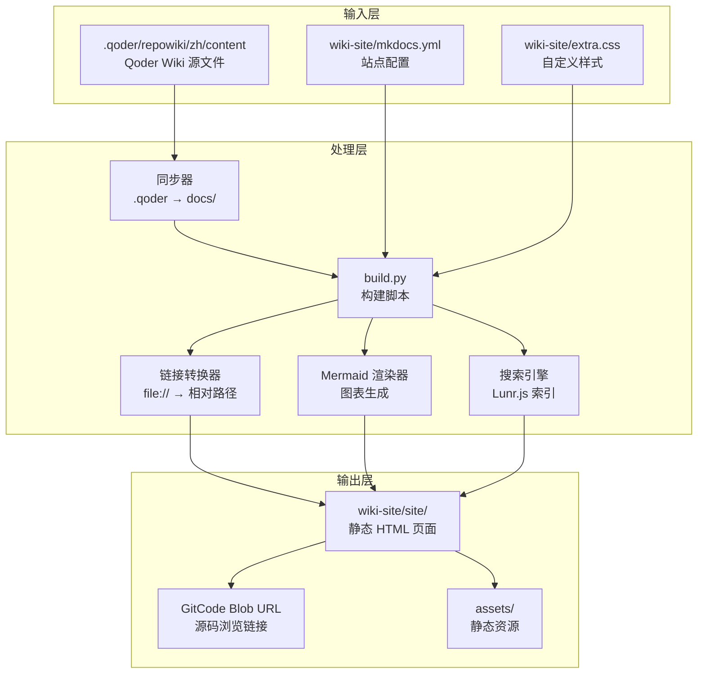
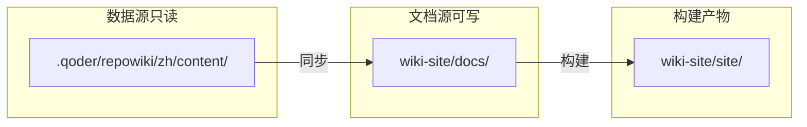

现在我已经收集了足够的信息来更新文档。基于分析，我发现了以下主要变更：

1. **新增了同步机制** - 完整的 `sync_docs()` 函数用于将 `.qoder/repowiki/zh/content/` 的内容同步到 `wiki-site/docs/`
2. **更新了构建流程** - 增加了新的命令选项和更完善的构建步骤
3. **增强了MkDocs配置** - 自动生成更复杂的导航结构
4. **改进了链接处理** - 更智能的GitCode链接重写机制

让我更新文档：

<cite>
**本文引用的文件**   
- [wiki-site/build.py](../../build.py)
- [wiki-site/mkdocs.yml](../../mkdocs.yml)
- [wiki-site/extra.css](../../extra.css)
- [wiki-site/requirements.txt](../../requirements.txt)
- [Makefile](../../../Makefile)
</cite>

## 更新摘要
**变更内容**   
- 新增完整的同步机制，支持从 .qoder Wiki 内容自动同步到 docs/ 目录
- 重构构建流程，增加多个独立的构建模式和命令选项
- 增强 MkDocs 配置生成，支持动态导航结构和主题配置
- 改进 GitCode 源码链接重写机制，提供更智能的链接处理
- 完善错误处理和日志输出，提供更好的调试体验

## 目录
1. [引言](#引言)
2. [架构概览](#架构概览)
3. [核心组件详解](#核心组件详解)
4. [同步机制](#同步机制)
5. [智能链接转换系统](#智能链接转换系统)
6. [构建流程自动化](#构建流程自动化)
7. [主题与样式定制](#主题与样式定制)
8. [部署与运维](#部署与运维)
9. [故障排查指南](#故障排查指南)
10. [总结](#总结)

## 引言

本项目采用了现代化的 MkDocs Material 主题构建了完整的静态文档站点，替代了原有的 FastAPI+React 动态架构。该系统通过自动化的构建脚本将 Markdown 内容转换为高质量的静态网站，并实现了智能链接重写到 GitCode 源码浏览地址。

### 主要特性

- **静态站点生成**: 使用 MkDocs Material 主题提供高性能的静态文档站点
- **智能同步机制**: 自动同步 .qoder Wiki 内容到文档源目录
- **智能链接处理**: 自动转换 file:// 链接和 GitCode 源码浏览链接
- **自动化构建**: 完整的 CI/CD 友好的构建流程
- **现代化主题**: Material Design 风格的响应式设计
- **中文优化**: 完整的中文化界面和导航支持
- **扩展性强**: 支持 Mermaid 图表、代码高亮、全文搜索等高级功能

## 架构概览



**图示来源**
- [wiki-site/build.py:60-71](../../build.py#L60-L71)
- [wiki-site/build.py:24-31](../../build.py#L24-L31)
- [wiki-site/build.py:66-90](../../build.py#L66-L90)
- [wiki-site/build.py:201-266](../../build.py#L201-L266)

## 核心组件详解

### 构建脚本 (build.py)

构建脚本是整个系统的核心，负责协调各个组件的工作流程：

#### 主要功能模块

1. **文档同步** (`sync_docs`)
   - 将 .qoder Wiki 内容全量同步到 docs/ 目录
   - 确保 Qoder 的增删改不会在 docs/ 留下过期文件
   - 绝不回写 .qoder 目录，保持数据源隔离

2. **文档准备** (`prepare_docs`)
   - 自动生成首页 index.md
   - 复制自定义 CSS 文件到 docs_dir

3. **链接转换** (`fix_file_links`)
   - 扫描所有 Markdown 文件
   - 将 file:// 链接转换为相对路径
   - 处理锚点和特殊字符

4. **配置生成** (`generate_mkdocs_config`)
   - 根据目录结构自动生成 mkdocs.yml
   - 维护导航树结构
   - 配置主题和扩展功能

5. **站点构建** (`build_site`)
   - 调用 MkDocs 进行静态站点生成
   - 处理构建错误和日志

6. **后处理** (`post_process_site`)
   - 重写 GitCode 源码浏览链接
   - 保持站内链接完整性

**章节来源**
- [wiki-site/build.py:60-71](../../build.py#L60-L71)
- [wiki-site/build.py:74-81](../../build.py#L74-L81)
- [wiki-site/build.py:83-107](../../build.py#L83-L107)
- [wiki-site/build.py:126-205](../../build.py#L126-L205)
- [wiki-site/build.py:208-215](../../build.py#L208-L215)
- [wiki-site/build.py:218-283](../../build.py#L218-L283)

### MkDocs 配置 (mkdocs.yml)

MkDocs 配置文件定义了站点的整体行为和外观：

#### 主题配置
- **Material Design**: 使用最新的 Material for MkDocs 主题
- **中文化支持**: 完整的中文界面和导航
- **深色模式**: 支持系统级深色模式切换
- **响应式设计**: 适配各种屏幕尺寸

#### Markdown 扩展
- **admonition**: 提示框和警告框
- **pymdownx.superfences**: Mermaid 图表支持
- **pymdownx.highlight**: 代码语法高亮
- **pymdownx.snippets**: 代码片段引用
- **pymdownx.tasklist**: 任务列表
- **attr_list**: HTML 属性支持
- **md_in_html**: HTML 中嵌入 Markdown
- **tables**: 表格支持
- **toc**: 目录自动生成

**章节来源**
- [wiki-site/mkdocs.yml:6-56](../../mkdocs.yml#L6-L56)

## 同步机制

### .qoder 与 docs/ 目录分离设计

系统采用双目录架构，实现数据源与文档源的完全分离：



**图示来源**
- [wiki-site/build.py:30-35](../../build.py#L30-L35)
- [wiki-site/build.py:60-71](../../build.py#L60-L71)

### 同步流程详解

同步机制确保 Qoder Wiki 内容的变更能够及时反映到文档站点：

1. **清空目标目录**: 删除现有的 docs/ 目录
2. **全量复制**: 从 .qoder 目录完整复制到 docs/
3. **统计文档数量**: 记录同步的文档数量
4. **保持隔离**: 绝不回写 .qoder 目录

```python
def sync_docs() -> None:
    """把 Qoder Wiki 内容全量同步到 docs/ 文档源目录。

    .qoder/ 由 Qoder 后台独占维护（不入库）；docs/ 是文档站自己的源目录（入库）。
    每次构建先清空 docs/ 再整体复制，保证 Qoder 的增删改不会在 docs/ 留下过期文件，
    且本脚本绝不回写 .qoder。
    """
    if DOCS_DIR.exists():
        shutil.rmtree(DOCS_DIR)
    shutil.copytree(CONTENT, DOCS_DIR)
    n = sum(1 for _ in DOCS_DIR.rglob("*.md"))
    print(f"[sync] 已同步 {n} 个文档到 docs/")
```

**章节来源**
- [wiki-site/build.py:60-71](../../build.py#L60-L71)

## 智能链接转换系统

### file:// 链接转换机制

系统实现了智能的链接转换机制，自动将 Markdown 中的 `file://` 链接转换为相对路径：

```python
def fix_file_links() -> None:
    """把 docs/ 中的 file:// 引用链接转换为相对 Markdown 链接（GitCode 网页中可直接点击）。"""
    converted = missing = 0
    for md in sorted(DOCS_DIR.rglob("*.md")):
        text = md.read_text(encoding="utf-8")
        
        def _replace(match: Match) -> str:
            nonlocal converted, missing
            raw = match.group(1)  # 形如 file://backend/main.py#L9-L27
            path = raw[len("file://"):].strip("/")
            anchor = ""
            if "#" in path:
                path, anchor = path.split("#", 1)
                anchor = "#" + anchor
            target = (ROOT / path).resolve()
            if not target.exists():
                missing += 1
            rel = os.path.relpath(target, md.parent).replace(os.sep, "/")
            converted += 1
            return f"]({rel}{anchor})"
        
        new_text = FILE_LINK_RE.sub(_replace, text)
        if new_text != text:
            md.write_text(new_text, encoding="utf-8")
    print(f"[links] 转换 {converted} 个 file:// 链接（其中目标缺失 {missing} 个）")
```

### GitCode 源码链接重写

在站点生成后，系统会将指向仓库文件的相对链接重写为 GitCode 源码浏览地址：

```python
def post_process_site() -> None:
    """把站点中指向仓库源码文件的相对链接重写为 GitCode blob URL。

    MkDocs 会原样保留指向 docs_dir 之外的相对链接，但这些链接的层级是相对
    源 md 文件计算的；同时站内链接已被 MkDocs 改写为相对 HTML 页面的层级。
    因此：先在 HTML 层级解析，命中站点内文件则保留；否则回到源 md 层级
    解析，命中仓库文件则重写为 GitCode 源码浏览地址。
    """
```

**章节来源**
- [wiki-site/build.py:83-107](../../build.py#L83-L107)
- [wiki-site/build.py:218-283](../../build.py#L218-L283)

## 构建流程自动化

### 构建步骤

整个构建流程包含六个主要步骤：

```mermaid
sequenceDiagram
participant User as "用户"
participant Build as "build.py"
participant Sync as "同步器"
participant Links as "链接转换"
participant Config as "配置生成"
participant MkDocs as "MkDocs 构建"
participant Post as "后处理"
User->>Build : python build.py
Build->>Sync : sync_docs()
Sync-->>Build : 同步完成
Build->>Links : fix_file_links()
Links-->>Build : 转换完成
Build->>Config : generate_mkdocs_config()
Config-->>Build : 配置生成
Build->>MkDocs : mkdocs build
MkDocs-->>Build : 站点构建
Build->>Post : post_process_site()
Post-->>User : 构建完成
```

### 命令行选项

构建脚本支持多种运行模式：

- `python build.py`: 全流程构建
- `python build.py sync`: 仅执行同步操作
- `python build.py links`: 仅执行链接转换
- `python build.py prepare`: 仅准备文档文件
- `python build.py config`: 仅重新生成配置
- `python build.py build`: 仅执行构建
- `python build.py postprocess`: 仅对产物做外部链接重写

### Makefile 集成

项目提供了 Makefile 来简化常用操作：

```makefile
# 构建 Repo Wiki 静态文档站
wiki:
	cd wiki-site && ../backend/venv/bin/python build.py

# 本地预览文档站
wiki-serve:
	cd wiki-site && ../backend/venv/bin/python -m mkdocs serve -f mkdocs.yml -a 127.0.0.1:8001
```

**章节来源**
- [wiki-site/build.py:286-301](../../build.py#L286-L301)
- [Makefile:22-28](../../../Makefile#L22-L28)

## 主题与样式定制

### CSS 定制

项目提供了自定义 CSS 样式文件，主要用于美化文档中的引用区块：

```css
/* Repo Wiki 文档站自定义样式（构建时复制到 docs_dir 下） */

/* 引用文件区块（<cite>）：Repo Wiki 生成的文件引用说明 */
cite {
  display: block;
  margin: 1rem 0;
  padding: 0.6rem 1rem;
  border-left: 4px solid var(--md-primary-fg-color);
  border-radius: 0 4px 4px 0;
  background: var(--md-code-bg-color);
  font-size: 0.85rem;
}

cite strong {
  color: var(--md-primary-fg-color);
}

cite a {
  word-break: break-all;
}
```

### 主题特性

Material 主题提供了以下特性：

- **响应式设计**: 适配不同屏幕尺寸
- **深色模式**: 支持系统级深色模式切换
- **导航增强**: 顶部导航、章节导航、索引页
- **代码复制**: 一键复制代码块
- **搜索功能**: 全文搜索和索引
- **多语言支持**: 完整的中文化界面

**章节来源**
- [wiki-site/extra.css:1-21](../../extra.css#L1-L21)
- [wiki-site/mkdocs.yml:6-28](../../mkdocs.yml#L6-L28)

## 部署与运维

### 依赖管理

文档站点使用以下 Python 包：

```txt
mkdocs>=1.6.1
mkdocs-material>=9.5
```

### 版本要求

- **MkDocs**: 1.6.1+ 确保兼容性
- **Material Theme**: 9.5+ 提供最新特性
- **Python**: 3.8+ 支持现代语法特性

### 环境搭建

1. **安装依赖**:
   ```bash
   cd wiki-site
   pip install -r requirements.txt
   ```

2. **构建站点**:
   ```bash
   python build.py
   ```

3. **本地预览**:
   ```bash
   python -m mkdocs serve -f mkdocs.yml
   ```

**章节来源**
- [wiki-site/requirements.txt:1-3](../../requirements.txt#L1-L3)

## 故障排查指南

### 常见问题

#### 同步问题
- **同步失败**: 检查 .qoder 目录权限和磁盘空间
- **文档丢失**: 确认同步流程是否正确执行
- **权限错误**: 验证对 wiki-site 目录的读写权限

#### 构建失败
- **检查 Python 环境**: 确保安装了所有必需的依赖包
- **验证文件权限**: 确认对 wiki-site 目录有读写权限
- **检查网络连接**: GitCode 访问需要网络连接

#### 链接问题
- **file:// 链接未转换**: 检查 Markdown 文件中的链接格式
- **GitCode 链接失效**: 确认仓库地址和分支名称正确
- **相对路径错误**: 检查文件路径和目录结构

#### 样式问题
- **CSS 未加载**: 确认 extra.css 文件存在且路径正确
- **主题不生效**: 检查 mkdocs.yml 中的 theme 配置
- **中文字体显示**: 确认字体资源可正常加载

### 调试技巧

#### 日志输出
构建脚本提供了详细的日志输出：

```bash
[sync] 已同步 150 个文档到 docs/
[prepare] 已生成 docs/index.md 与 docs/stylesheets/extra.css
[links] 转换 150 个 file:// 链接（其中目标缺失 3 个）
[config] 已生成 wiki-site/mkdocs.yml
[build] 运行 mkdocs build ...
[post] 重写 45 个仓库文件链接（保留 120 个站内/外部链接）
✅ 文档站构建完成：wiki-site/site/
```

#### 手动验证
- **检查生成的 HTML**: 查看 wiki-site/site/index.html 是否正确生成
- **验证链接**: 在浏览器中测试各个链接是否正常工作
- **检查样式**: 确认自定义 CSS 是否正确应用

**章节来源**
- [wiki-site/build.py:71-71](../../build.py#L71-L71)
- [wiki-site/build.py:80-80](../../build.py#L80-L80)
- [wiki-site/build.py:107-107](../../build.py#L107-L107)
- [wiki-site/build.py:205-205](../../build.py#L205-L205)
- [wiki-site/build.py:283-283](../../build.py#L283-L283)
- [wiki-site/build.py:301-301](../../build.py#L301-L301)

## 总结

该文档站点基础设施采用了现代化的 MkDocs Material 主题，通过自动化的构建流程实现了高质量的静态文档生成。系统的核心优势在于：

1. **高度自动化**: 从同步到链接转换到站点构建完全自动化，减少人工干预
2. **智能同步机制**: 支持 .qoder Wiki 内容自动同步，确保文档源与数据源分离
3. **智能链接处理**: 支持 file:// 链接转换和 GitCode 源码链接重写，提升用户体验
4. **现代化主题**: 使用 Material Design 提供优秀的视觉体验和交互效果
5. **强扩展性**: 支持丰富的 Markdown 扩展和自定义样式，满足多样化需求
6. **易于维护**: 通过脚本自动生成配置，减少手动维护工作

建议在未来的迭代中继续优化构建性能，增加更多的可视化图表支持，并完善错误处理和日志记录功能。