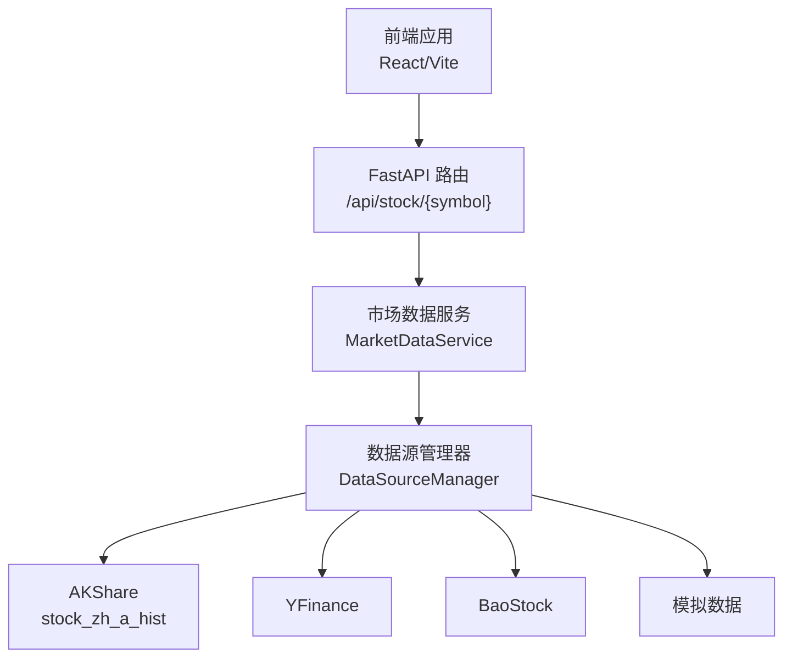
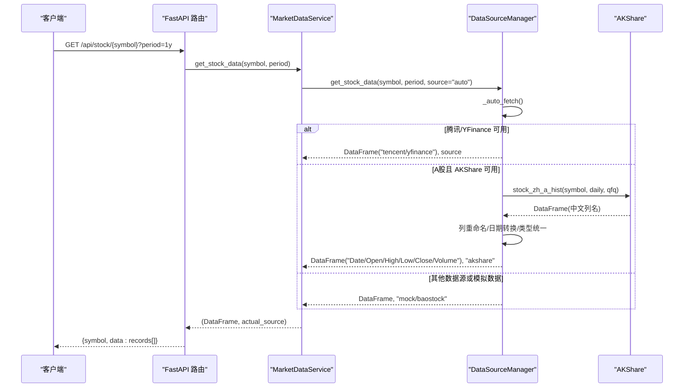
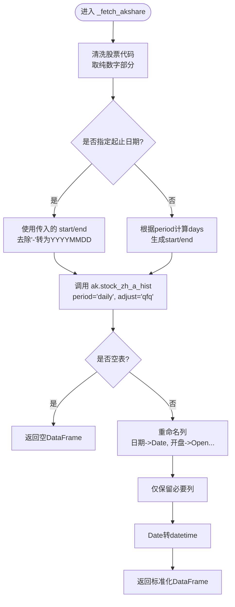
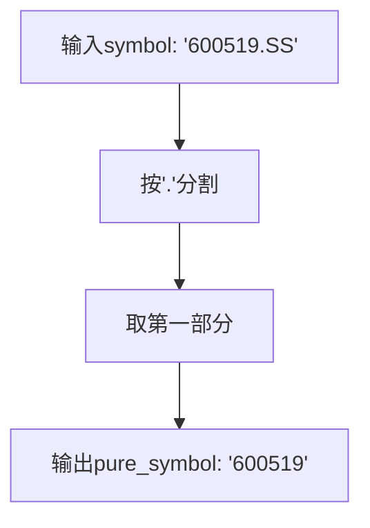
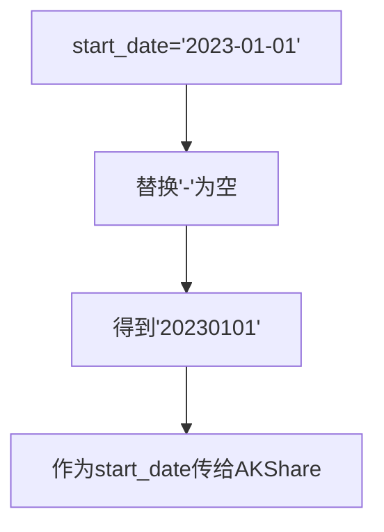
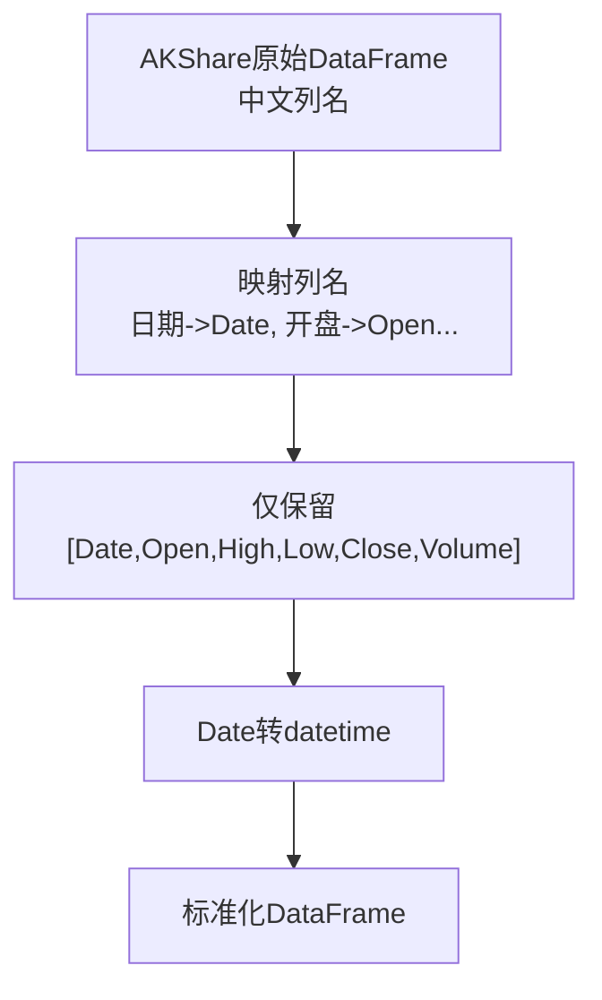
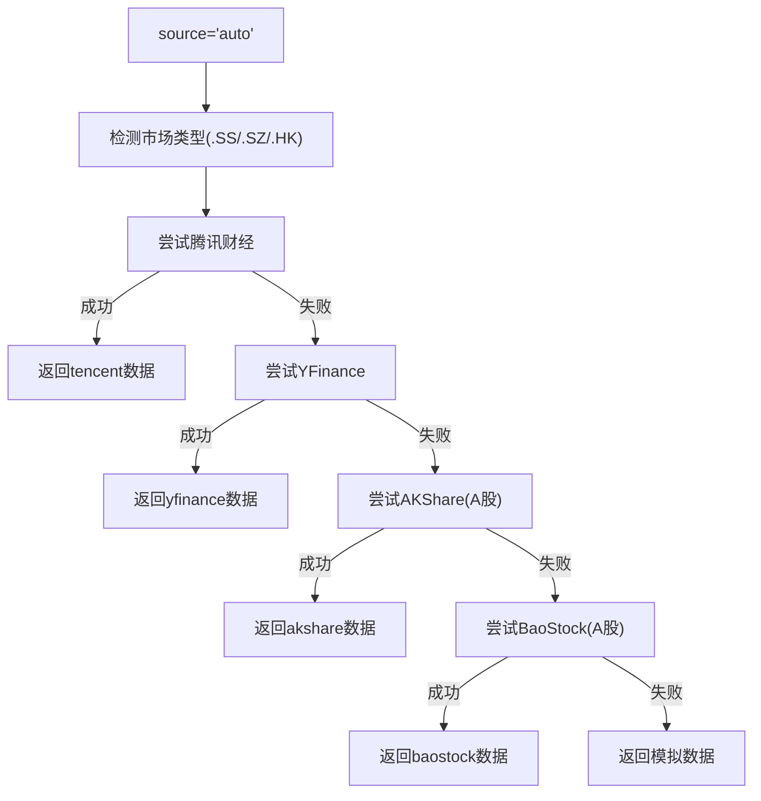
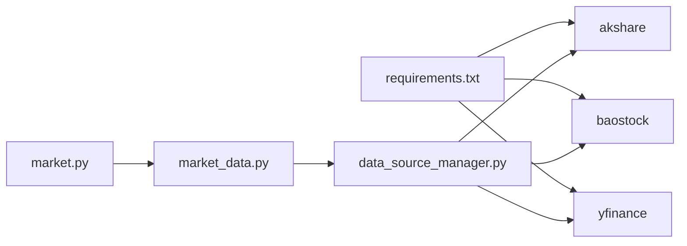

# AKShare数据源

<cite>
**本文引用的文件**   
- [DATA_SOURCES.md](../../../DATA_SOURCES.md)
- [data_source_manager.py](../../../backend/app/services/data_source_manager.py)
- [market_data.py](../../../backend/app/services/market_data.py)
- [market.py](../../../backend/app/api/market.py)
- [requirements.txt](../../../backend/requirements.txt)
</cite>

## 目录
1. [简介](#简介)
2. [项目结构](#项目结构)
3. [核心组件](#核心组件)
4. [架构总览](#架构总览)
5. [详细组件分析](#详细组件分析)
6. [依赖关系分析](#依赖关系分析)
7. [性能与稳定性](#性能与稳定性)
8. [故障排查指南](#故障排查指南)
9. [结论](#结论)
10. [附录：使用示例与安装说明](#附录使用示例与安装说明)

## 简介
本文件聚焦于项目中基于 AKShare 的 A 股数据获取实现，重点围绕 stock_zh_a_hist 函数的调用链路、股票代码格式转换、前复权处理、日期格式转换、列重命名与类型统一等关键环节进行系统化说明。同时给出该数据源的优势、完整的使用示例、依赖安装指南与常见错误解决方案，帮助读者快速上手并稳定集成。

AKShare 在本系统中的定位是“面向 A 股的免费开源数据源”，在自动选择策略中作为备选数据源之一，当腾讯财经或 YFinance 不可用时，系统会尝试 AKShare，再失败则回退至 BaoStock，最终兜底为模拟数据。

## 项目结构
本项目采用前后端分离结构，A 股数据获取逻辑位于后端服务层，通过 FastAPI 暴露 REST API，前端通过 HTTP 接口消费数据。

图表来源
- [market.py:11-27](../../../backend/app/api/market.py#L11-L27)
- [market_data.py:11-41](../../../backend/app/services/market_data.py#L11-L41)
- [data_source_manager.py:14-54](../../../backend/app/services/data_source_manager.py#L14-L54)

章节来源
- [market.py:1-46](../../../backend/app/api/market.py#L1-L46)
- [market_data.py:1-55](../../../backend/app/services/market_data.py#L1-L55)
- [data_source_manager.py:1-110](../../../backend/app/services/data_source_manager.py#L1-L110)

## 核心组件
- 数据源管理器 DataSourceManager：负责多数据源的统一调度、自动降级与结果标准化。
- 市场数据服务 MarketDataService：对外提供统一的股票数据获取接口，内部委托给 DataSourceManager。
- FastAPI 路由 market.py：将 HTTP 请求映射到服务层，返回标准化的 JSON 响应。

关键职责
- 自动选择最佳数据源（按市场类型与可用性）。
- 对来自不同数据源的数据进行统一列名与类型转换。
- 异常捕获与降级策略，确保服务可用性。

章节来源
- [data_source_manager.py:14-110](../../../backend/app/services/data_source_manager.py#L14-L110)
- [market_data.py:11-41](../../../backend/app/services/market_data.py#L11-L41)
- [market.py:11-27](../../../backend/app/api/market.py#L11-L27)

## 架构总览
下图展示从前端发起请求到最终返回 OHLCV 数据的端到端流程，以及 AKShare 在其中的位置。

图表来源
- [market.py:11-27](../../../backend/app/api/market.py#L11-L27)
- [market_data.py:11-41](../../../backend/app/services/market_data.py#L11-L41)
- [data_source_manager.py:56-109](../../../backend/app/services/data_source_manager.py#L56-L109)
- [data_source_manager.py:276-335](../../../backend/app/services/data_source_manager.py#L276-L335)

## 详细组件分析

### AKShare 数据获取流程（stock_zh_a_hist）
- 输入参数
  - symbol：标准格式如 600519.SS、000858.SZ，内部会提取纯数字部分。
  - start_date/end_date：YYYY-MM-DD；内部转换为 YYYYMMDD。
  - period：支持 1mo/3mo/6mo/1y/2y/5y，用于计算默认时间窗口。
  - adjust：固定为 "qfq"（前复权）。
- 输出字段
  - Date、Open、High、Low、Close、Volume（统一英文列名与数值类型）。

图表来源
- [data_source_manager.py:276-335](../../../backend/app/services/data_source_manager.py#L276-L335)

章节来源
- [data_source_manager.py:276-335](../../../backend/app/services/data_source_manager.py#L276-L335)

### 股票代码格式转换逻辑
- 目标：将标准格式（如 600519.SS、000858.SZ）转换为 AKShare 所需的纯数字代码。
- 规则：
  - 以 '.' 分割，取第一部分作为纯数字代码。
  - 例如：600519.SS → 600519；000858.SZ → 000858。

图表来源
- [data_source_manager.py:286-287](../../../backend/app/services/data_source_manager.py#L286-L287)

章节来源
- [data_source_manager.py:286-287](../../../backend/app/services/data_source_manager.py#L286-L287)

### 前复权数据处理
- AKShare 调用时设置 adjust="qfq"，表示使用前复权价格序列。
- 目的：消除分红派息对价格的影响，便于技术分析比较。

章节来源
- [data_source_manager.py:304-310](../../../backend/app/services/data_source_manager.py#L304-L310)

### 日期格式转换过程
- 输入：YYYY-MM-DD（用户传入）。
- 处理：移除 '-'，得到 YYYYMMDD（AKShare 所需）。
- 输出：Date 列转换为 datetime 类型，便于后续分析与可视化。

图表来源
- [data_source_manager.py:290-300](../../../backend/app/services/data_source_manager.py#L290-L300)

章节来源
- [data_source_manager.py:290-300](../../../backend/app/services/data_source_manager.py#L290-L300)

### 数据列重命名与类型转换机制
- 列重命名：
  - 日期→Date
  - 开盘→Open
  - 最高→High
  - 最低→Low
  - 收盘→Close
  - 成交量→Volume
- 列筛选：仅保留上述六列，保证输出一致性。
- 类型转换：
  - Date 列转换为 datetime。
  - Open/High/Low/Close/Volume 由 AKShare 返回后直接参与后续处理（通常已是数值型）。

图表来源
- [data_source_manager.py:315-329](../../../backend/app/services/data_source_manager.py#L315-L329)

章节来源
- [data_source_manager.py:315-329](../../../backend/app/services/data_source_manager.py#L315-L329)

### 自动选择与降级策略
- 优先顺序（自动模式）：
  - A股/港股：先尝试腾讯财经（内置），失败则尝试 YFinance，再失败尝试 AKShare（仅 A 股），再失败尝试 BaoStock（仅 A 股），最后回退到模拟数据。
- 手动指定：
  - 可通过 source 参数强制使用 akshare/yfinance/baostock/mock。

图表来源
- [data_source_manager.py:56-109](../../../backend/app/services/data_source_manager.py#L56-L109)

章节来源
- [data_source_manager.py:56-109](../../../backend/app/services/data_source_manager.py#L56-L109)

## 依赖关系分析
- 外部依赖
  - akshare>=1.12.0：A 股历史数据获取。
  - baostock>=0.8.8：A 股备用数据源。
  - yfinance==0.2.35：美股/港股数据源。
- 内部模块耦合
  - FastAPI 路由依赖 MarketDataService。
  - MarketDataService 委托 DataSourceManager。
  - DataSourceManager 聚合多个数据源实现，并对结果进行标准化。

图表来源
- [requirements.txt:1-16](../../../backend/requirements.txt#L1-L16)
- [market.py:1-46](../../../backend/app/api/market.py#L1-L46)
- [market_data.py:1-55](../../../backend/app/services/market_data.py#L1-L55)
- [data_source_manager.py:1-110](../../../backend/app/services/data_source_manager.py#L1-L110)

章节来源
- [requirements.txt:1-16](../../../backend/requirements.txt#L1-L16)
- [market.py:1-46](../../../backend/app/api/market.py#L1-L46)
- [market_data.py:1-55](../../../backend/app/services/market_data.py#L1-L55)
- [data_source_manager.py:1-110](../../../backend/app/services/data_source_manager.py#L1-L110)

## 性能与稳定性
- 网络依赖
  - AKShare/BaoStock/YFinance 均需要网络访问第三方数据源，存在超时或接口变更风险。
- 数据质量
  - AKShare 提供 A 股全面数据，前复权处理后更利于技术分析。
- 降级保障
  - 自动降级机制确保即使某个数据源不可用，系统仍可返回数据（可能为模拟数据）。
- 建议优化
  - 增加重试与缓存机制，减少重复请求。
  - 对日期范围做边界校验，避免过大查询导致超时。
  - 对异常信息进行结构化日志记录，便于监控与告警。

## 故障排查指南
- 常见问题
  - 未安装 akshare：导入失败或运行时抛出依赖缺失异常。
  - 网络问题：第三方接口超时或返回空数据。
  - 日期格式错误：传入的日期不符合 YYYY-MM-DD 或 YYYYMMDD 要求。
  - 股票代码无效：无法识别的市场后缀或代码不存在。
- 排查步骤
  - 确认已安装 akshare：参考安装指南。
  - 检查网络连接与代理设置。
  - 校验传入的 symbol 与日期格式。
  - 查看控制台日志中的错误信息（如 “AKShare error”）。
- 解决建议
  - 若 AKShare 失败，可切换为 baostock 或 mock。
  - 缩短查询周期或使用更精确的起止日期。
  - 在自动模式下观察实际使用的数据源，必要时手动指定 source。

章节来源
- [data_source_manager.py:276-335](../../../backend/app/services/data_source_manager.py#L276-L335)
- [data_source_manager.py:56-109](../../../backend/app/services/data_source_manager.py#L56-L109)

## 结论
本项目通过 DataSourceManager 统一管理多数据源，并以 AKShare 作为 A 股的重要数据源之一。其优势在于免费、无需注册、数据全面，配合前复权与标准化输出，可满足大多数量化分析与回测需求。结合自动选择与降级策略，系统在稳定性与可用性方面具备良好表现。推荐在生产环境中安装 akshare 与 baostock，以获得更可靠的 A 股数据支撑。

## 附录：使用示例与安装说明

### 依赖安装
- 安装全部数据源（推荐）：
  - 在项目 backend 目录下激活虚拟环境后执行：pip install akshare baostock
- 仅安装 AKShare（A 股推荐）：
  - pip install akshare
- 仅安装 BaoStock：
  - pip install baostock

章节来源
- [DATA_SOURCES.md:26-43](../../../DATA_SOURCES.md#L26-L43)

### 使用示例（A 股历史数据）
- 通过 API 获取 A 股历史数据（自动选择数据源）：
  - GET /api/stock/600519.SS?period=1y
- 手动指定使用 AKShare：
  - 在服务层调用时设置 source="akshare"，或在 API 扩展中支持 source 参数。
- 预期输出字段：
  - Date、Open、High、Low、Close、Volume（均为统一英文列名与数值类型）。

章节来源
- [market.py:11-27](../../../backend/app/api/market.py#L11-L27)
- [data_source_manager.py:276-335](../../../backend/app/services/data_source_manager.py#L276-L335)

### AKShare 函数要点速查
- 函数：ak.stock_zh_a_hist
- 关键参数：
  - symbol：纯数字代码（如 600519）
  - period：daily
  - start_date/end_date：YYYYMMDD
  - adjust：qfq（前复权）
- 输出列（经系统标准化后）：
  - Date、Open、High、Low、Close、Volume

章节来源
- [data_source_manager.py:304-329](../../../backend/app/services/data_source_manager.py#L304-L329)