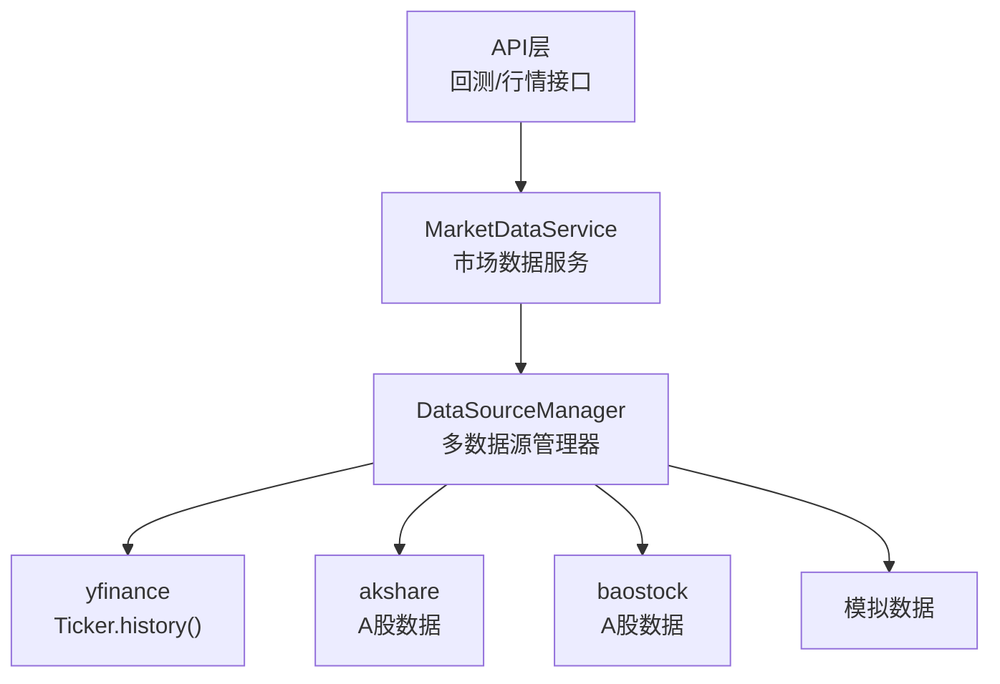
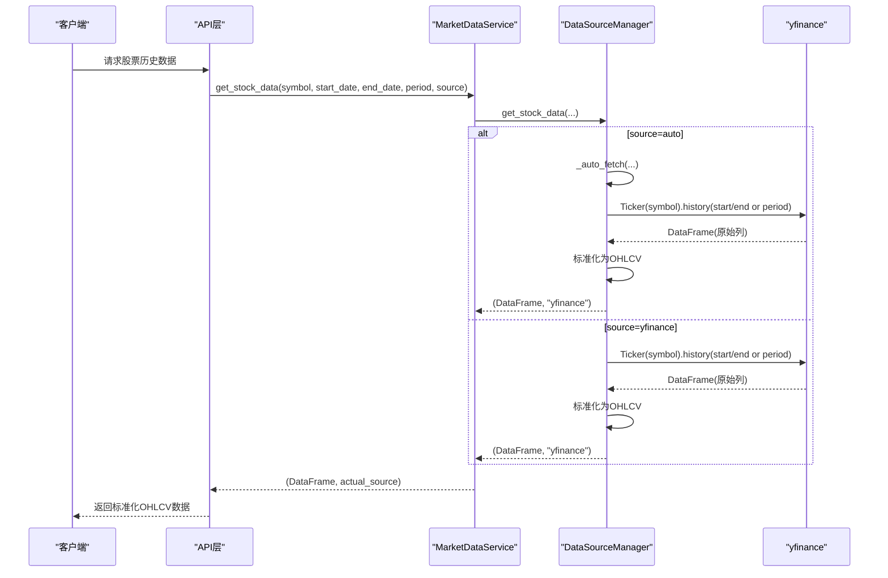
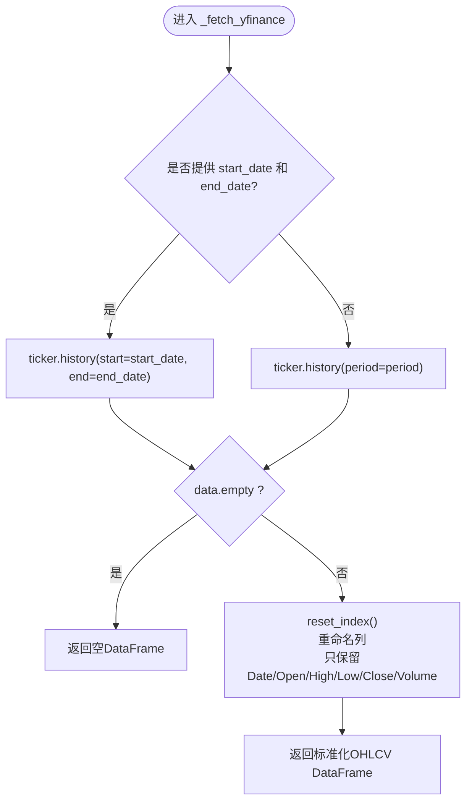
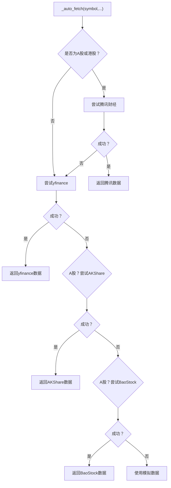
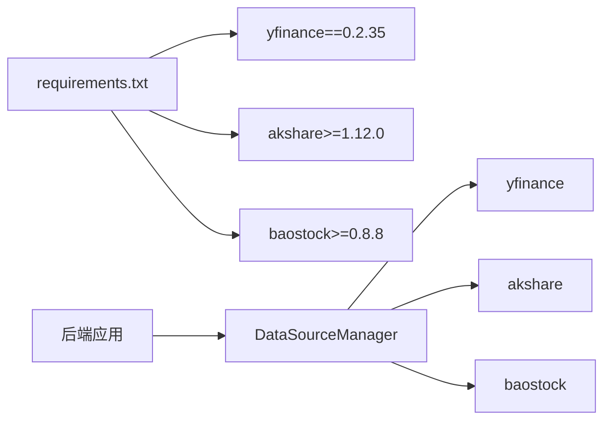

# YFinance数据源

<cite>
**本文引用的文件**   
- [DATA_SOURCES.md](../../../DATA_SOURCES.md)
- [data_source_manager.py](../../../backend/app/services/data_source_manager.py)
- [market_data.py](../../../backend/app/services/market_data.py)
- [requirements.txt](../../../backend/requirements.txt)
</cite>

## 目录
1. [简介](#简介)
2. [项目结构](#项目结构)
3. [核心组件](#核心组件)
4. [架构总览](#架构总览)
5. [详细组件分析](#详细组件分析)
6. [依赖关系分析](#依赖关系分析)
7. [性能与网络优化](#性能与网络优化)
8. [故障排查指南](#故障排查指南)
9. [结论](#结论)
10. [附录：使用示例](#附录使用示例)

## 简介
本文件面向“YFinance数据源”的实现与使用，聚焦以下目标：
- 讲解如何在项目中通过 yfinance 获取历史行情（Ticker 对象创建、history 调用）。
- 说明全球市场支持能力：美股、港股、指数等资产类别。
- 解释日期范围与周期参数的处理逻辑：start/end 与 period 字符串的优先级与默认行为。
- 描述数据格式标准化流程：将 yfinance 返回的数据统一为 OHLCV 格式。
- 总结该数据源的特点：覆盖广、易用，但可能需要额外安装依赖，且网络请求存在超时风险。
- 提供完整的使用示例与最佳实践，包括不同市场和周期的数据获取方式。
- 给出性能优化建议与网络超时处理方案。

## 项目结构
本项目在后端服务中通过“多数据源管理器”统一接入 yfinance、AKShare、BaoStock 以及模拟数据。YFinance 作为其中一种数据源，在自动选择策略中承担美股、港股等全球市场的职责。

图表来源
- [market_data.py:11-41](../../../backend/app/services/market_data.py#L11-L41)
- [data_source_manager.py:14-54](../../../backend/app/services/data_source_manager.py#L14-L54)
- [data_source_manager.py:250-274](../../../backend/app/services/data_source_manager.py#L250-L274)

章节来源
- [market_data.py:1-41](../../../backend/app/services/market_data.py#L1-L41)
- [data_source_manager.py:1-54](../../../backend/app/services/data_source_manager.py#L1-L54)

## 核心组件
- DataSourceManager：多数据源调度器，负责根据股票代码与市场类型自动选择数据源，或按指定 source 参数直接调用对应实现。
- MarketDataService：对外暴露的统一服务接口，封装了 get_stock_data 与 get_stock_info 等方法。
- YFinance 集成：通过 yf.Ticker(symbol).history(...) 获取历史数据，并标准化为 OHLCV。

章节来源
- [data_source_manager.py:14-54](../../../backend/app/services/data_source_manager.py#L14-L54)
- [market_data.py:11-41](../../../backend/app/services/market_data.py#L11-L41)

## 架构总览
下图展示了从 API 到数据源的调用链，以及 YFinance 在其中的位置。

图表来源
- [market_data.py:14-41](../../../backend/app/services/market_data.py#L14-L41)
- [data_source_manager.py:17-54](../../../backend/app/services/data_source_manager.py#L17-L54)
- [data_source_manager.py:250-274](../../../backend/app/services/data_source_manager.py#L250-L274)

## 详细组件分析

### YFinance 数据获取与标准化
- Ticker 创建：yf.Ticker(symbol)
- 历史数据获取：
  - 若同时提供 start_date 与 end_date，则调用 history(start=start_date, end=end_date)。
  - 否则调用 history(period=period)，支持如 "1mo", "3mo", "6mo", "1y", "2y", "5y" 等字符串。
- 数据标准化：
  - 重置索引并将时间列统一命名为 Date。
  - 仅保留 Date, Open, High, Low, Close, Volume 五列，形成统一的 OHLCV 格式。
  - 若返回为空，直接返回空 DataFrame。

图表来源
- [data_source_manager.py:250-274](../../../backend/app/services/data_source_manager.py#L250-L274)

章节来源
- [data_source_manager.py:250-274](../../../backend/app/services/data_source_manager.py#L250-L274)

### 自动数据源选择与降级策略
- 当 source="auto" 时，系统优先尝试腾讯财经（内置），随后尝试 yfinance，再尝试 AKShare/BaoStock（A股），最后兜底为模拟数据。
- 对于 A股/.SS/.SZ/.BJ 与港股/.HK，优先使用腾讯财经；若失败则回退至 yfinance。
- 对于美股与其他国际标的，主要依赖 yfinance。

图表来源
- [data_source_manager.py:56-109](../../../backend/app/services/data_source_manager.py#L56-L109)

章节来源
- [data_source_manager.py:56-109](../../../backend/app/services/data_source_manager.py#L56-L109)

### 全球市场支持与资产类别
- 美股：通过 yfinance 直接以 ticker 名称（如 AAPL、MSFT）获取。
- 港股：可通过 .HK 后缀（如 00700.HK）识别，系统会优先尝试腾讯财经，失败后回退 yfinance。
- 指数与ETF：yfinance 通常支持主流指数与ETF代码。
- A股：更推荐使用 AKShare/BaoStock，但也可通过 yfinance 获取（稳定性与速度不如专用库）。

章节来源
- [DATA_SOURCES.md:17-20](../../../DATA_SOURCES.md#L17-L20)
- [data_source_manager.py:64-87](../../../backend/app/services/data_source_manager.py#L64-L87)

### 日期范围与周期参数处理
- 当同时提供 start_date 与 end_date：
  - yfinance 使用 history(start=start_date, end=end_date)。
  - 其他数据源也会基于这两个日期计算所需条数或起止时间。
- 当未提供 start/end：
  - 使用 period 字符串（如 "1mo", "3mo", "6mo", "1y", "2y", "5y"）计算天数范围。
  - 内部映射：1mo→30天，3mo→90天，6mo→180天，1y→365天，2y→730天，5y→1825天。
- 最终返回的 DataFrame 均包含 Date 列，便于后续分析与可视化。

章节来源
- [data_source_manager.py:131-142](../../../backend/app/services/data_source_manager.py#L131-L142)
- [data_source_manager.py:250-274](../../../backend/app/services/data_source_manager.py#L250-L274)

### 数据格式转换与标准化
- yfinance 返回的原始列名可能包含 Date、Open、High、Low、Close、Volume 等。
- 标准化步骤：
  - reset_index() 将时间戳转为普通列。
  - rename(columns={'Date': 'Date'}) 确保列名一致。
  - 仅保留 ['Date', 'Open', 'High', 'Low', 'Close', 'Volume'] 五列。
- 输出始终为统一的 OHLCV 格式，便于上层回测引擎与前端展示。

章节来源
- [data_source_manager.py:270-273](../../../backend/app/services/data_source_manager.py#L270-L273)

## 依赖关系分析
- yfinance 作为可选依赖，已在 requirements.txt 中声明。
- 项目还引入了 akshare 与 baostock，用于增强 A股数据质量与稳定性。
- 运行时若未安装 yfinance，_fetch_yfinance 会在导入阶段抛出异常，从而触发自动降级策略。

图表来源
- [requirements.txt:1-16](../../../backend/requirements.txt#L1-L16)
- [data_source_manager.py:1-11](../../../backend/app/services/data_source_manager.py#L1-L11)

章节来源
- [requirements.txt:1-16](../../../backend/requirements.txt#L1-L16)
- [data_source_manager.py:1-11](../../../backend/app/services/data_source_manager.py#L1-L11)

## 性能与网络优化
- 缓存与复用：
  - 对热门 ticker 可引入内存缓存（如 LRU），避免重复网络请求。
  - 对相同 symbol+start+end 的请求结果进行缓存。
- 并发与批处理：
  - 批量拉取多个 ticker 时，建议使用线程池或异步任务，减少串行等待。
- 重试与退避：
  - 对网络错误（超时、连接失败）实施指数退避重试。
- 超时控制：
  - 建议在调用 yfinance 底层 HTTP 请求时设置合理的 timeout（例如 10-30 秒），并在业务层捕获异常后降级。
- 数据量控制：
  - 合理设置 period 或 start/end，避免一次性拉取过长历史导致响应缓慢。
- 本地化与离线：
  - 对常用数据落盘（CSV/Parquet），首次拉取后本地读取，提升性能与稳定性。

[本节为通用指导，不直接分析具体文件]

## 故障排查指南
- 常见错误与定位：
  - 未安装 yfinance：导入 yf 时报错。解决方案：pip install yfinance。
  - 网络超时或连接失败：检查网络连通性与代理设置，增加超时与重试。
  - 返回空数据：确认 symbol 是否正确（美股用 ticker，港股带 .HK，A股建议用 .SS/.SZ）。
  - 数据列缺失：检查 yfinance 版本与返回字段，必要时做容错处理。
- 日志与调试：
  - 在 _auto_fetch 与 _fetch_yfinance 中添加详细日志，记录 symbol、参数、耗时与异常信息。
- 降级策略验证：
  - 手动指定 source="mock" 验证下游链路是否正常。
  - 切换 source="yfinance" 单独测试 YFinance 路径。

章节来源
- [data_source_manager.py:56-109](../../../backend/app/services/data_source_manager.py#L56-L109)
- [data_source_manager.py:250-274](../../../backend/app/services/data_source_manager.py#L250-L274)

## 结论
- YFinance 在本项目中作为全球市场数据的重要补充，尤其适用于美股与港股。
- 通过 DataSourceManager 的统一抽象，YFinance 与 AKShare、BaoStock、模拟数据无缝协作，具备自动选择与降级能力。
- 数据标准化为 OHLCV 格式，便于回测与可视化。
- 建议在生产环境做好缓存、重试与超时控制，以提升稳定性与性能。

[本节为总结性内容，不直接分析具体文件]

## 附录：使用示例
以下为在不同市场与周期下获取数据的示例说明（不展示具体代码，仅提供调用思路与参数）：

- 美股（yfinance）
  - 参数：symbol="AAPL", period="1y"
  - 说明：使用 yfinance 获取苹果近一年的日K数据，标准化为 OHLCV。
- 港股（yfinance）
  - 参数：symbol="00700.HK", period="6mo"
  - 说明：优先尝试腾讯财经，失败后回退 yfinance。
- 指数（yfinance）
  - 参数：symbol="^GSPC", period="1y"
  - 说明：获取标普500指数近一年数据。
- A股（推荐 AKShare/BaoStock）
  - 参数：symbol="600519.SS", period="1y"
  - 说明：系统优先使用腾讯财经/AKShare/BaoStock，失败后回退 yfinance。

章节来源
- [DATA_SOURCES.md:60-79](../../../DATA_SOURCES.md#L60-L79)
- [data_source_manager.py:64-87](../../../backend/app/services/data_source_manager.py#L64-L87)