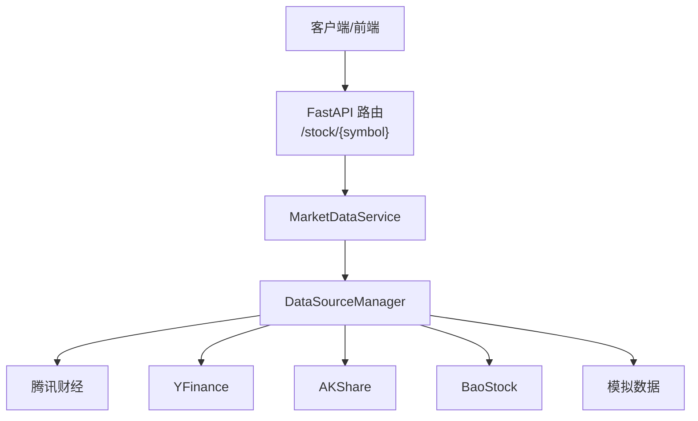
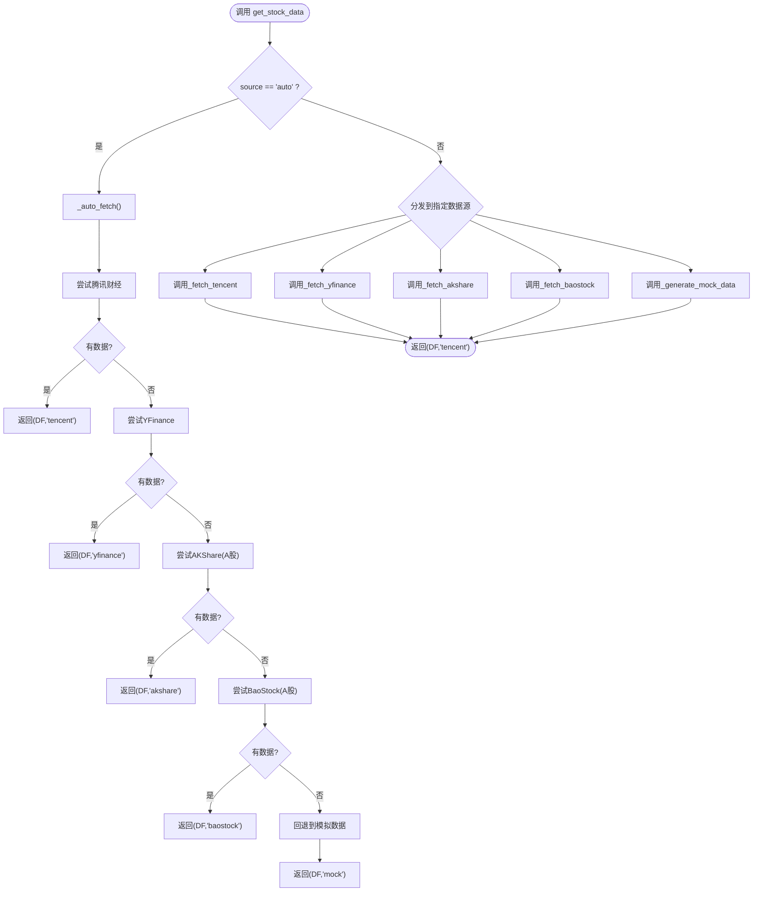
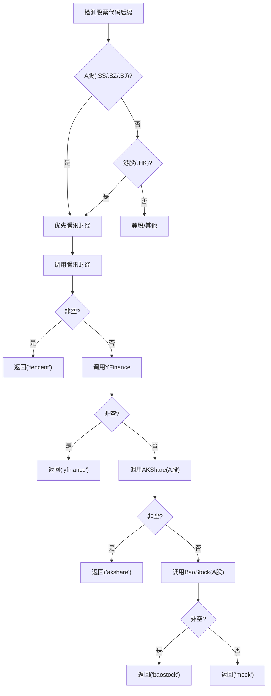
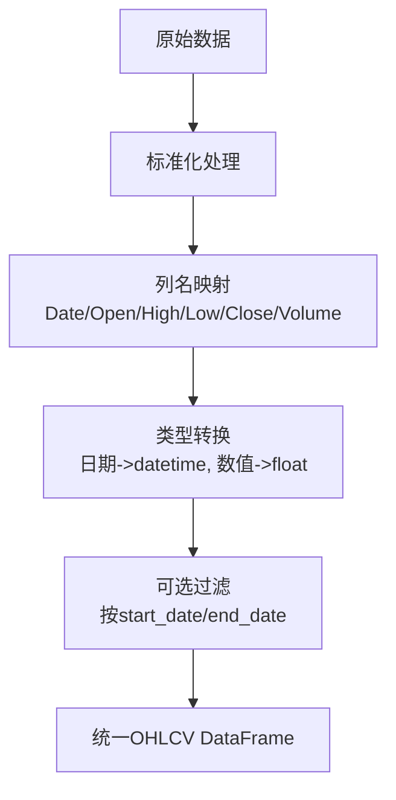
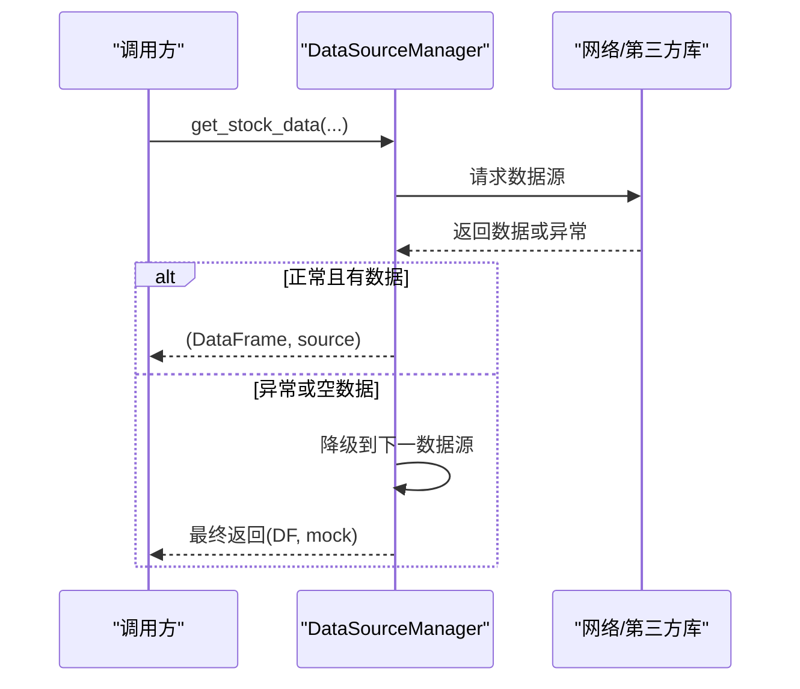
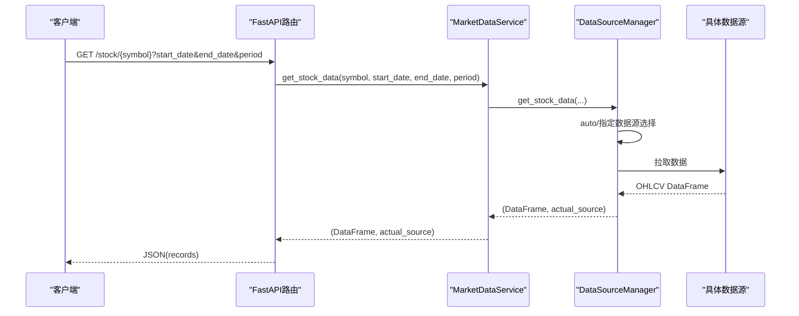
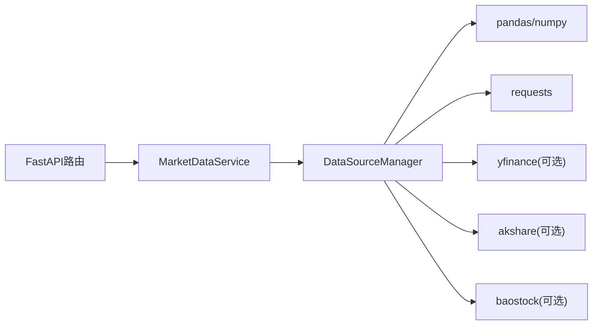

# 数据源架构设计

<cite>
**本文引用的文件**   
- [data_source_manager.py](../../../backend/app/services/data_source_manager.py)
- [market_data.py](../../../backend/app/services/market_data.py)
- [market.py](../../../backend/app/api/market.py)
- [DATA_SOURCES.md](../../../DATA_SOURCES.md)
</cite>

## 目录
1. [引言](#引言)
2. [项目结构](#项目结构)
3. [核心组件](#核心组件)
4. [架构总览](#架构总览)
5. [详细组件分析](#详细组件分析)
6. [依赖关系分析](#依赖关系分析)
7. [性能与可扩展性](#性能与可扩展性)
8. [故障排查指南](#故障排查指南)
9. [结论](#结论)
10. [附录：统一接口规范与示例](#附录统一接口规范与示例)

## 引言
本文件面向“多数据源股票数据获取”子系统，围绕 DataSourceManager 类展开，系统性阐述其设计理念、架构模式、统一接口规范、数据格式标准化机制、错误处理策略、优先级排序与自动选择逻辑，并给出架构图与数据流图。目标是让读者既能理解整体架构，也能快速上手使用统一接口获取 OHLCV 数据。

## 项目结构
该子系统位于后端服务中，采用分层组织：
- API 层：FastAPI 路由对外暴露市场数据接口
- 服务层：MarketDataService 作为业务门面，封装对数据源的调用
- 数据源管理层：DataSourceManager 负责多数据源调度、优先级选择与结果标准化



图表来源
- [market.py:11-27](../../../backend/app/api/market.py#L11-L27)
- [market_data.py:14-41](../../../backend/app/services/market_data.py#L14-L41)
- [data_source_manager.py:17-54](../../../backend/app/services/data_source_manager.py#L17-L54)

章节来源
- [market.py:1-47](../../../backend/app/api/market.py#L1-L47)
- [market_data.py:1-106](../../../backend/app/services/market_data.py#L1-L106)
- [data_source_manager.py:1-469](../../../backend/app/services/data_source_manager.py#L1-L469)

## 核心组件
- DataSourceManager：统一数据获取入口，提供 get_stock_data 静态方法；内部实现多数据源适配与自动选择；输出标准化的 OHLCV DataFrame。
- MarketDataService：面向上层（API）的简化门面，透传参数到 DataSourceManager。
- FastAPI 路由：对外暴露 /stock/{symbol} 等接口，将 DataFrame 序列化为 JSON 返回。

关键职责划分
- API 层：请求解析、异常包装为 HTTP 响应
- 服务层：参数透传、简单业务编排
- 数据源管理层：数据源发现、优先级排序、网络请求、数据清洗与标准化

章节来源
- [data_source_manager.py:14-54](../../../backend/app/services/data_source_manager.py#L14-L54)
- [market_data.py:11-41](../../../backend/app/services/market_data.py#L11-L41)
- [market.py:11-27](../../../backend/app/api/market.py#L11-L27)

## 架构总览
系统采用“适配器 + 工厂 + 降级策略”的组合模式：
- 适配器：各数据源的具体实现以私有方法形式存在，对外统一暴露标准接口
- 工厂：根据 source 参数或自动检测规则，动态选择具体数据源
- 降级策略：当首选数据源失败或无数据时，按优先级尝试备选数据源，最终回退到模拟数据

```mermaid
classDiagram
class DataSourceManager {
+get_stock_data(symbol, start_date, end_date, period, source) tuple
-_auto_fetch(symbol, start_date, end_date, period) tuple
-_fetch_tencent(symbol, start_date, end_date, period) DataFrame
-_convert_to_tencent_symbol(symbol) string
-_fetch_yfinance(symbol, start_date, end_date, period) DataFrame
-_fetch_akshare(symbol, start_date, end_date, period) DataFrame
-_fetch_baostock(symbol, start_date, end_date, period) DataFrame
-_generate_mock_data(symbol, period) DataFrame
}
class MarketDataService {
+get_stock_data(symbol, start_date, end_date, period, source) tuple
+get_stock_info(symbol) dict
+search_symbol(keyword) list
}
class FastAPI_Router {
+GET /stock/{symbol}
+GET /stock/{symbol}/info
+GET /search
}
FastAPI_Router --> MarketDataService : "调用"
MarketDataService --> DataSourceManager : "委托"
```

图表来源
- [data_source_manager.py:14-469](../../../backend/app/services/data_source_manager.py#L14-L469)
- [market_data.py:11-106](../../../backend/app/services/market_data.py#L11-L106)
- [market.py:11-46](../../../backend/app/api/market.py#L11-L46)

## 详细组件分析

### DataSourceManager：统一数据获取接口
- 统一入口：get_stock_data 接收 symbol、start_date、end_date、period、source 五个参数，返回 (DataFrame, actual_source)。
- 自动选择：当 source="auto" 时，进入 _auto_fetch，按市场类型与可用性进行优先级排序与降级。
- 指定数据源：支持 tencent、yfinance、akshare、baostock、mock 五种数据源。
- 数据标准化：所有数据源均输出包含 Date、Open、High、Low、Close、Volume 六列的 DataFrame，便于下游统一处理。



图表来源
- [data_source_manager.py:17-109](../../../backend/app/services/data_source_manager.py#L17-L109)

章节来源
- [data_source_manager.py:17-109](../../../backend/app/services/data_source_manager.py#L17-L109)

### 数据源抽象层与优先级排序算法
- 优先级策略（自动模式）：
  - A股/港股优先腾讯财经（内置、无需额外安装），若成功则直接返回
  - 其次尝试 YFinance（美股/港股）
  - 再次尝试 AKShare（仅A股）
  - 然后尝试 BaoStock（仅A股）
  - 最后兜底模拟数据
- 判断依据：
  - 股票代码后缀 .SS/.SZ/.BJ 判定为A股
  - 后缀 .HK 判定为港股
- 降级条件：
  - 任一数据源抛出异常或返回空 DataFrame，即视为失败，继续下一个



图表来源
- [data_source_manager.py:56-109](../../../backend/app/services/data_source_manager.py#L56-L109)

章节来源
- [data_source_manager.py:56-109](../../../backend/app/services/data_source_manager.py#L56-L109)

### 数据格式标准化机制（OHLCV）
- 统一字段名：Date、Open、High、Low、Close、Volume
- 数据类型：
  - Date：datetime
  - Open/High/Low/Close/Volume：数值型（float/int）
- 各数据源在内部完成列重命名与类型转换，确保对外一致：
  - 腾讯财经：解析原始数组为记录字典后构造 DataFrame
  - YFinance：重置索引并重命名列
  - AKShare：中文列名映射为标准英文列名
  - BaoStock：登录查询后转换类型并重命名列
  - 模拟数据：按周期生成随机价格序列并构造 OHLCV



图表来源
- [data_source_manager.py:181-208](../../../backend/app/services/data_source_manager.py#L181-L208)
- [data_source_manager.py:270-274](../../../backend/app/services/data_source_manager.py#L270-L274)
- [data_source_manager.py:315-331](../../../backend/app/services/data_source_manager.py#L315-L331)
- [data_source_manager.py:391-412](../../../backend/app/services/data_source_manager.py#L391-L412)
- [data_source_manager.py:450-468](../../../backend/app/services/data_source_manager.py#L450-L468)

章节来源
- [data_source_manager.py:181-208](../../../backend/app/services/data_source_manager.py#L181-L208)
- [data_source_manager.py:270-274](../../../backend/app/services/data_source_manager.py#L270-L274)
- [data_source_manager.py:315-331](../../../backend/app/services/data_source_manager.py#L315-L331)
- [data_source_manager.py:391-412](../../../backend/app/services/data_source_manager.py#L391-L412)
- [data_source_manager.py:450-468](../../../backend/app/services/data_source_manager.py#L450-L468)

### 错误处理与异常管理
- 网络异常：
  - 腾讯财经：requests.get 超时或HTTP状态码异常会触发 raise_for_status 抛错
  - YFinance/AKShare/BaoStock：外部库调用异常被捕获并打印日志，随后降级
- 数据格式异常：
  - 腾讯财经：API返回code不为0时抛出异常
  - 各数据源：若返回空 DataFrame，视为无数据，继续尝试下一数据源
- 兜底策略：
  - 所有数据源失败时，返回模拟数据，保证流程不中断



图表来源
- [data_source_manager.py:152-164](../../../backend/app/services/data_source_manager.py#L152-L164)
- [data_source_manager.py:257-274](../../../backend/app/services/data_source_manager.py#L257-L274)
- [data_source_manager.py:303-335](../../../backend/app/services/data_source_manager.py#L303-L335)
- [data_source_manager.py:347-416](../../../backend/app/services/data_source_manager.py#L347-L416)

章节来源
- [data_source_manager.py:152-164](../../../backend/app/services/data_source_manager.py#L152-L164)
- [data_source_manager.py:257-274](../../../backend/app/services/data_source_manager.py#L257-L274)
- [data_source_manager.py:303-335](../../../backend/app/services/data_source_manager.py#L303-L335)
- [data_source_manager.py:347-416](../../../backend/app/services/data_source_manager.py#L347-L416)

### 代码级交互时序（从API到数据源）


图表来源
- [market.py:11-27](../../../backend/app/api/market.py#L11-L27)
- [market_data.py:14-41](../../../backend/app/services/market_data.py#L14-L41)
- [data_source_manager.py:17-54](../../../backend/app/services/data_source_manager.py#L17-L54)

## 依赖关系分析
- 模块耦合：
  - API 层仅依赖 MarketDataService，保持简洁
  - MarketDataService 仅依赖 DataSourceManager，职责单一
  - DataSourceManager 依赖 pandas、numpy、requests 以及可选的 yfinance、akshare、baostock
- 外部依赖：
  - 腾讯财经：通过 HTTP 接口访问
  - YFinance/AKShare/BaoStock：第三方库，按需安装
  - 模拟数据：纯本地生成，零依赖



图表来源
- [market.py:1-47](../../../backend/app/api/market.py#L1-L47)
- [market_data.py:1-106](../../../backend/app/services/market_data.py#L1-L106)
- [data_source_manager.py:1-11](../../../backend/app/services/data_source_manager.py#L1-L11)

章节来源
- [market.py:1-47](../../../backend/app/api/market.py#L1-L47)
- [market_data.py:1-106](../../../backend/app/services/market_data.py#L1-L106)
- [data_source_manager.py:1-11](../../../backend/app/services/data_source_manager.py#L1-L11)

## 性能与可扩展性
- 性能特性：
  - 腾讯财经：轻量HTTP请求，适合A股/港股快速拉取
  - YFinance：跨市场但速度较慢
  - AKShare/BaoStock：A股专业数据，稳定性高
  - 模拟数据：本地生成，极快且稳定
- 可扩展性：
  - 新增数据源：在 DataSourceManager 中添加新的私有方法与分支逻辑，并在自动选择策略中配置优先级
  - 标准化层：新增数据源需遵循统一的 OHLCV 字段与类型约定

优化建议
- 缓存：对热门标的与时间窗口做短期缓存，减少重复请求
- 并发：批量拉取时可考虑并发请求多个数据源，择优返回
- 重试与熔断：对不稳定数据源增加重试次数与熔断保护

[本节为通用指导，不涉及具体文件分析]

## 故障排查指南
常见问题与定位要点
- 无法连接腾讯财经：
  - 检查网络连通性与User-Agent/Referer头设置
  - 查看API返回码与消息
- YFinance/AKShare/BaoStock 导入失败：
  - 确认已安装对应包
  - 检查版本兼容性与网络代理
- 返回空 DataFrame：
  - 检查日期范围是否有效
  - 确认股票代码格式是否正确（如 .SS/.SZ/.HK）
- 数据列缺失或类型不一致：
  - 核对标准化步骤是否执行
  - 检查各数据源返回字段映射

章节来源
- [data_source_manager.py:152-164](../../../backend/app/services/data_source_manager.py#L152-L164)
- [data_source_manager.py:257-274](../../../backend/app/services/data_source_manager.py#L257-L274)
- [data_source_manager.py:303-335](../../../backend/app/services/data_source_manager.py#L303-L335)
- [data_source_manager.py:347-416](../../../backend/app/services/data_source_manager.py#L347-L416)

## 结论
DataSourceManager 通过统一接口屏蔽了多数据源的复杂性，实现了稳定的 OHLCV 数据输出与智能降级策略。配合 MarketDataService 与 FastAPI 路由，形成清晰的分层架构，具备良好的可维护性与扩展性。建议在后续迭代中引入缓存、并发与熔断机制，进一步提升系统的可用性与性能。

[本节为总结性内容，不涉及具体文件分析]

## 附录：统一接口规范与示例

### 统一接口定义
- 方法签名：DataSourceManager.get_stock_data(symbol, start_date=None, end_date=None, period="1y", source="auto")
- 参数说明：
  - symbol：股票代码（支持 .SS/.SZ/.HK 等后缀）
  - start_date：开始日期（YYYY-MM-DD）
  - end_date：结束日期（YYYY-MM-DD）
  - period：数据周期（如 1mo/3mo/6mo/1y/2y/5y）
  - source：数据源（auto/tencent/yfinance/akshare/baostock/mock）
- 返回值：
  - tuple：(DataFrame, actual_source)
  - DataFrame 字段：Date、Open、High、Low、Close、Volume

章节来源
- [data_source_manager.py:17-54](../../../backend/app/services/data_source_manager.py#L17-L54)

### 使用示例（概念性）
- 自动选择数据源：
  - 调用 get_stock_data("600519.SS", period="1y", source="auto")
  - 返回 (DataFrame, "tencent"/"yfinance"/"akshare"/"baostock"/"mock")
- 指定数据源：
  - 调用 get_stock_data("AAPL", start_date="2023-01-01", end_date="2023-12-31", source="yfinance")
  - 返回 (DataFrame, "yfinance")

章节来源
- [DATA_SOURCES.md:81-93](../../../DATA_SOURCES.md#L81-L93)