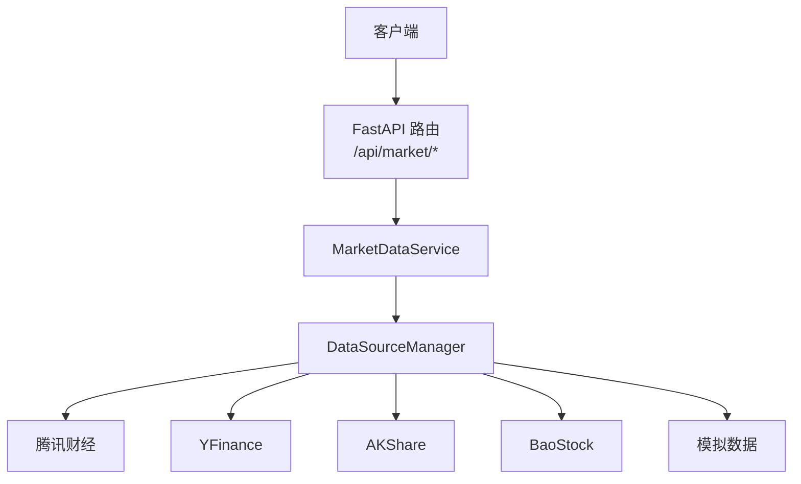
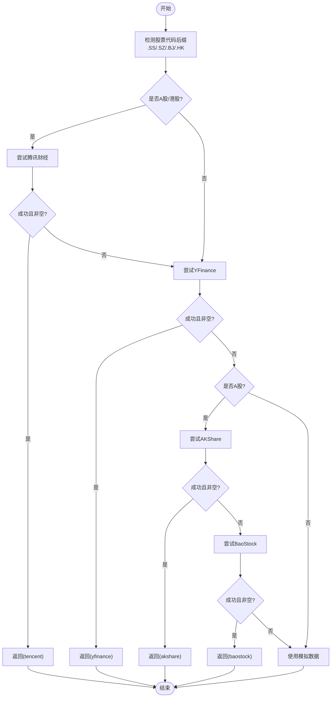
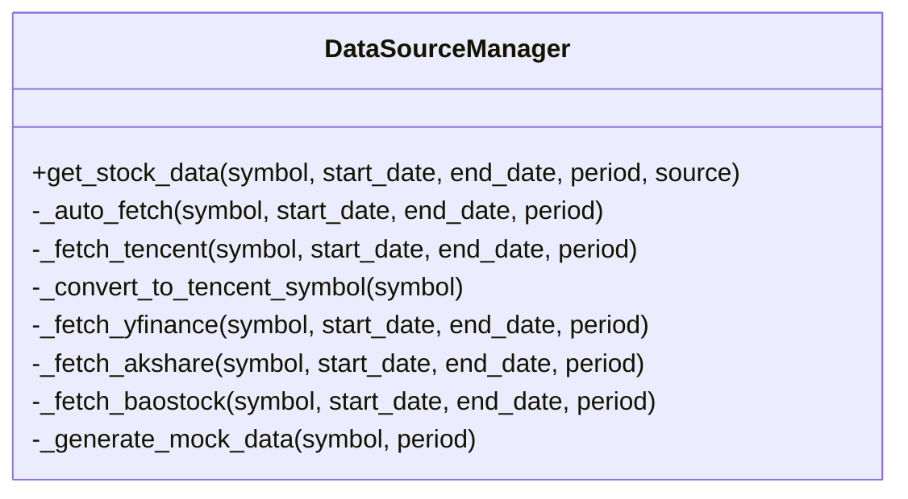
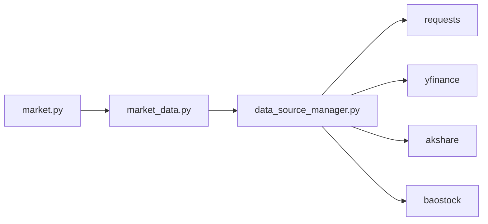
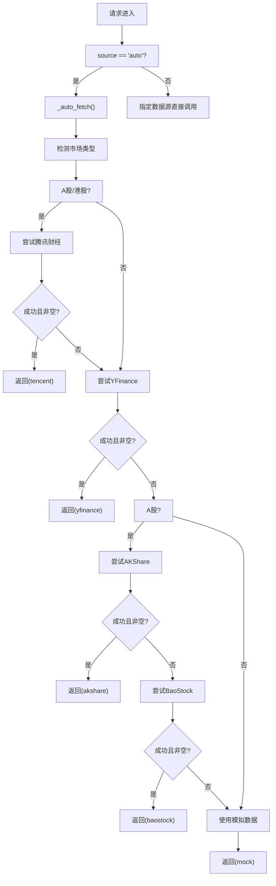

# 智能降级机制

<cite>
**本文引用的文件**   
- [backend/app/services/data_source_manager.py](../../../backend/app/services/data_source_manager.py)
- [backend/app/services/market_data.py](../../../backend/app/services/market_data.py)
- [backend/app/api/market.py](../../../backend/app/api/market.py)
- [backend/main.py](../../../backend/main.py)
- [AGENTS.md](../../../AGENTS.md)
</cite>

## 目录
1. [引言](#引言)
2. [项目结构](#项目结构)
3. [核心组件](#核心组件)
4. [架构总览](#架构总览)
5. [详细组件分析](#详细组件分析)
6. [依赖关系分析](#依赖关系分析)
7. [性能与可观测性](#性能与可观测性)
8. [故障排查指南](#故障排查指南)
9. [结论](#结论)
10. [附录：降级流程图与决策树](#附录降级流程图与决策树)

## 引言
本技术文档聚焦于系统的“智能降级机制”，重点解析自动选择算法 `_auto_fetch`、股票市场检测与优先级排序、降级触发条件（数据源失败、空数据、异常捕获）、重试策略与回退路径（腾讯财经 → YFinance → AKShare/BaoStock → 模拟数据），以及兜底机制、性能监控与日志记录。目标是帮助开发者快速定位问题、优化稳定性，并确保系统在任何情况下都能返回有效数据。

## 项目结构
后端采用 FastAPI 路由层 + 服务层 + 数据源管理器的分层架构：
- API 路由层：暴露市场数据接口，统一错误处理。
- 服务层：封装业务逻辑，如获取股票数据、基本信息、搜索。
- 数据源管理器：实现多数据源接入与智能降级。



图表来源
- [backend/app/api/market.py:11-27](../../../backend/app/api/market.py#L11-L27)
- [backend/app/services/market_data.py:14-41](../../../backend/app/services/market_data.py#L14-L41)
- [backend/app/services/data_source_manager.py:17-54](../../../backend/app/services/data_source_manager.py#L17-L54)

章节来源
- [backend/main.py:1-35](../../../backend/main.py#L1-L35)
- [backend/app/api/market.py:1-47](../../../backend/app/api/market.py#L1-L47)
- [backend/app/services/market_data.py:1-106](../../../backend/app/services/market_data.py#L1-L106)
- [backend/app/services/data_source_manager.py:1-469](../../../backend/app/services/data_source_manager.py#L1-L469)

## 核心组件
- DataSourceManager：多数据源管理与智能降级核心，负责自动选择数据源、调用具体数据源方法、判断空数据与异常、最终回退到模拟数据。
- MarketDataService：面向上层服务的简化入口，委托 DataSourceManager 完成实际数据获取。
- API 路由层：提供 REST 接口，统一异常包装为 HTTP 400。

关键职责划分：
- 自动选择算法：_auto_fetch
- 数据源适配：_fetch_tencent/_fetch_yfinance/_fetch_akshare/_fetch_baostock
- 兜底生成：_generate_mock_data

章节来源
- [backend/app/services/data_source_manager.py:14-109](../../../backend/app/services/data_source_manager.py#L14-L109)
- [backend/app/services/market_data.py:11-41](../../../backend/app/services/market_data.py#L11-L41)
- [backend/app/api/market.py:11-27](../../../backend/app/api/market.py#L11-L27)

## 架构总览
下图展示从请求进入 API 到数据源选择的完整流程，突出自动降级路径。

```mermaid
sequenceDiagram
participant C as "客户端"
participant R as "FastAPI 路由"
participant S as "MarketDataService"
participant M as "DataSourceManager"
participant T as "腾讯财经"
participant Y as "YFinance"
participant A as "AKShare"
participant B as "BaoStock"
participant K as "模拟数据"
C->>R : GET /api/market/stock/{symbol}
R->>S : get_stock_data(symbol, start_date, end_date, period)
S->>M : get_stock_data(... source="auto")
alt 自动选择
M->>M : _auto_fetch()
opt A股/港股
M->>T : _fetch_tencent(...)
alt 成功且非空
T-->>M : DataFrame
M-->>S : (DataFrame, "tencent")
else 失败或空
M->>Y : _fetch_yfinance(...)
alt 成功且非空
Y-->>M : DataFrame
M-->>S : (DataFrame, "yfinance")
else 失败或空
opt A股
M->>A : _fetch_akshare(...)
alt 成功且非空
A-->>M : DataFrame
M-->>S : (DataFrame, "akshare")
else 失败或空
M->>B : _fetch_baostock(...)
alt 成功且非空
B-->>M : DataFrame
M-->>S : (DataFrame, "baostock")
else 失败或空
M->>K : _generate_mock_data(...)
K-->>M : DataFrame
M-->>S : (DataFrame, "mock")
end
end
else 非A股
M->>K : _generate_mock_data(...)
K-->>M : DataFrame
M-->>S : (DataFrame, "mock")
end
end
end
else 非A股/港股
M->>Y : _fetch_yfinance(...)
alt 成功且非空
Y-->>M : DataFrame
M-->>S : (DataFrame, "yfinance")
else 失败或空
M->>K : _generate_mock_data(...)
K-->>M : DataFrame
M-->>S : (DataFrame, "mock")
end
end
end
S-->>R : DataFrame
R-->>C : JSON records
```

图表来源
- [backend/app/api/market.py:11-27](../../../backend/app/api/market.py#L11-L27)
- [backend/app/services/market_data.py:14-41](../../../backend/app/services/market_data.py#L14-L41)
- [backend/app/services/data_source_manager.py:17-109](../../../backend/app/services/data_source_manager.py#L17-L109)

## 详细组件分析

### 自动选择算法 _auto_fetch
- 股票市场检测：
  - A股：后缀 .SS/.SZ/.BJ
  - 港股：后缀 .HK
  - 其他：美股/全球市场
- 优先级排序：
  - A股/港股：腾讯财经 → YFinance → AKShare（仅A股）→ BaoStock（仅A股）→ 模拟数据
  - 美股/其他：YFinance → 模拟数据
- 降级触发条件：
  - 数据源失败：网络异常、HTTP 状态码非 2xx、第三方库异常等
  - 空数据：返回空 DataFrame（无记录）
  - 异常捕获：每个数据源调用均包裹 try/except，打印失败信息并继续下一个数据源
- 返回值：(DataFrame, actual_source)，用于上层识别实际数据源



图表来源
- [backend/app/services/data_source_manager.py:56-109](../../../backend/app/services/data_source_manager.py#L56-L109)

章节来源
- [backend/app/services/data_source_manager.py:56-109](../../../backend/app/services/data_source_manager.py#L56-L109)

### 数据源适配层
- 腾讯财经（内置 HTTP）：
  - 支持 A 股（上证/深证/北交所）与港股
  - 将标准代码转换为内部格式（sh/sz/bj/hk 前缀）
  - 通过 HTTP 请求获取 K 线数据，解析为 OHLCV 表格
  - 若接口返回错误或无数据，抛出异常或返回空表
- YFinance：
  - 适用于美股/港股/全球市场
  - 根据日期范围或周期拉取历史行情
  - 列名标准化为 Date/Open/High/Low/Close/Volume
- AKShare：
  - 仅 A 股
  - 使用前复权日 K 线，列名映射为标准字段
- BaoStock：
  - 仅 A 股
  - 登录/登出生命周期管理，查询历史 K 线，类型转换与列名映射



图表来源
- [backend/app/services/data_source_manager.py:14-469](../../../backend/app/services/data_source_manager.py#L14-L469)

章节来源
- [backend/app/services/data_source_manager.py:111-248](../../../backend/app/services/data_source_manager.py#L111-L248)
- [backend/app/services/data_source_manager.py:250-274](../../../backend/app/services/data_source_manager.py#L250-L274)
- [backend/app/services/data_source_manager.py:276-335](../../../backend/app/services/data_source_manager.py#L276-L335)
- [backend/app/services/data_source_manager.py:337-416](../../../backend/app/services/data_source_manager.py#L337-L416)

### 兜底机制：模拟数据
- 当所有真实数据源失败或返回空数据时，系统自动生成 OHLCV 模拟数据，确保接口始终可用。
- 模拟数据基于随机游走模型生成，按周期长度计算交易日序列，基础价格根据股票代码映射。
- 上层可通过返回的 actual_source 字段识别是否为模拟数据，并在前端进行提示。

章节来源
- [backend/app/services/data_source_manager.py:418-468](../../../backend/app/services/data_source_manager.py#L418-L468)
- [AGENTS.md:61-80](../../../AGENTS.md#L61-L80)

## 依赖关系分析
- 外部依赖：
  - requests：用于腾讯财经 HTTP 请求
  - yfinance：美股/全球市场数据
  - akshare：A 股数据
  - baostock：A 股数据
- 内部耦合：
  - MarketDataService 仅作为薄封装，核心逻辑集中在 DataSourceManager
  - API 路由层对异常进行统一包装，避免直接暴露底层异常



图表来源
- [backend/app/api/market.py:1-47](../../../backend/app/api/market.py#L1-L47)
- [backend/app/services/market_data.py:1-106](../../../backend/app/services/market_data.py#L1-L106)
- [backend/app/services/data_source_manager.py:1-469](../../../backend/app/services/data_source_manager.py#L1-L469)

章节来源
- [backend/app/services/data_source_manager.py:1-10](../../../backend/app/services/data_source_manager.py#L1-L10)

## 性能与可观测性
- 性能特征：
  - 腾讯财经为纯 HTTP 调用，无需额外安装依赖，延迟较低，适合 A 股/港股首选
  - YFinance/AKShare/BaoStock 涉及第三方库初始化与网络请求，可能引入额外开销
  - 模拟数据本地生成，延迟极低，但数据非真实
- 可观测性：
  - 当前实现使用 print 输出调试信息，便于控制台观察降级过程
  - 建议在生产环境替换为结构化日志框架（如 logging），记录每次降级的原因、耗时、数据源名称与行数
- 建议优化：
  - 增加指标采集（请求耗时、成功率、各数据源命中率）
  - 对频繁失败的第三方库进行熔断/缓存，减少雪崩风险
  - 对模拟数据添加标识字段，便于前端展示与审计

[本节为通用指导，不直接分析具体文件]

## 故障排查指南
常见问题与定位步骤：
- 腾讯财经失败：
  - 检查网络连通性与代理设置
  - 确认股票代码后缀是否正确（.SS/.SZ/.BJ/.HK）
  - 查看控制台输出中的“腾讯财经获取失败”日志
- YFinance 失败：
  - 检查 yfinance 版本与网络访问限制
  - 查看控制台输出中的“YFinance 获取失败”日志
- AKShare/BaoStock 失败：
  - 确认已安装对应库并具备权限
  - 检查日期格式与参数传递是否符合要求
  - 查看控制台输出中的“AKShare error”或“BaoStock login failed”日志
- 始终返回模拟数据：
  - 检查是否所有真实数据源均失败或返回空数据
  - 确认返回的 actual_source 是否为 "mock"
  - 在前端显示“模拟数据”提示，避免误导用户

章节来源
- [backend/app/services/data_source_manager.py:72-109](../../../backend/app/services/data_source_manager.py#L72-L109)
- [backend/app/services/data_source_manager.py:158-164](../../../backend/app/services/data_source_manager.py#L158-L164)
- [backend/app/services/data_source_manager.py:333-335](../../../backend/app/services/data_source_manager.py#L333-L335)
- [backend/app/services/data_source_manager.py:347-350](../../../backend/app/services/data_source_manager.py#L347-L350)

## 结论
本系统的智能降级机制通过自动检测股票市场与优先级排序，结合失败检测、空数据处理与异常捕获，实现了从腾讯财经到 YFinance 再到 AKShare/BaoStock 的稳定回退路径，并以模拟数据作为最终兜底，确保系统在任何情况下均可用。建议在现有 print 日志基础上引入结构化日志与指标采集，进一步提升可观测性与运维效率。

[本节为总结性内容，不直接分析具体文件]

## 附录：降级流程图与决策树

### 降级流程图


图表来源
- [backend/app/services/data_source_manager.py:56-109](../../../backend/app/services/data_source_manager.py#L56-L109)

### 决策树（按市场分类）
- A 股（.SS/.SZ/.BJ）：
  - 优先：腾讯财经
  - 次优：YFinance
  - 备选：AKShare
  - 最后：BaoStock
  - 兜底：模拟数据
- 港股（.HK）：
  - 优先：腾讯财经
  - 次优：YFinance
  - 兜底：模拟数据
- 美股/其他：
  - 优先：YFinance
  - 兜底：模拟数据

章节来源
- [AGENTS.md:61-73](../../../AGENTS.md#L61-L73)
- [backend/app/services/data_source_manager.py:56-109](../../../backend/app/services/data_source_manager.py#L56-L109)