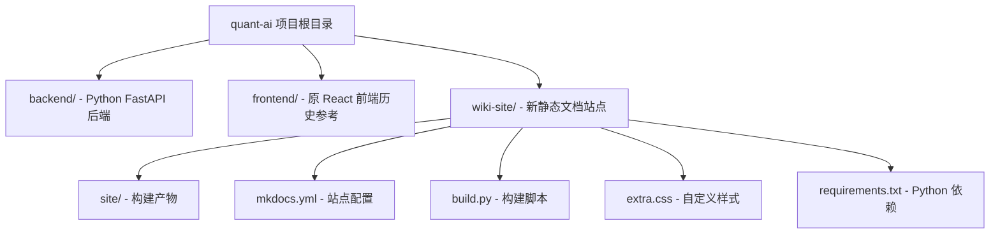
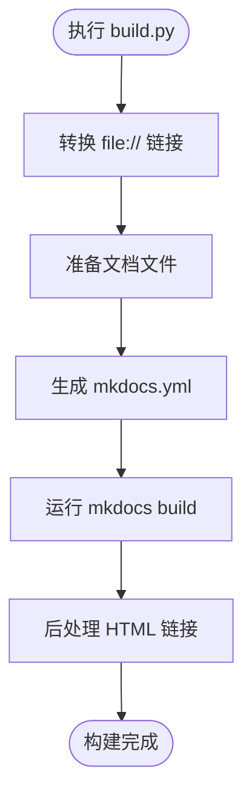

# 前端架构设计

<cite>
**本文引用的文件**   
- [frontend/src/App.tsx](../../../frontend/src/App.tsx)
- [frontend/src/main.tsx](../../../frontend/src/main.tsx)
- [frontend/vite.config.ts](../../../frontend/vite.config.ts)
- [frontend/package.json](../../../frontend/package.json)
- [frontend/tsconfig.json](../../../frontend/tsconfig.json)
- [frontend/src/components/StrategyList.tsx](../../../frontend/src/components/StrategyList.tsx)
- [frontend/src/components/BacktestForm.tsx](../../../frontend/src/components/BacktestForm.tsx)
- [frontend/src/components/BacktestResult.tsx](../../../frontend/src/components/BacktestResult.tsx)
- [wiki-site/mkdocs.yml](../../mkdocs.yml)
- [wiki-site/build.py](../../build.py)
- [wiki-site/requirements.txt](../../requirements.txt)
</cite>

## 更新摘要
**变更内容**   
- 完全移除了 React 前端代码，项目架构从交互式 Web 应用转变为静态文档站点
- 新增 wiki-site 目录，基于 MkDocs Material 主题构建技术文档站
- 更新了所有相关章节以反映新的静态文档架构
- 保留了原有的前端架构分析作为历史参考

## 目录
1. [引言](#引言)
2. [项目结构变更](#项目结构变更)
3. [静态文档站点架构](#静态文档站点架构)
4. [MkDocs 配置与构建流程](#mkdocs-配置与构建流程)
5. [原 React 前端架构回顾](#原-react-前端架构回顾)
6. [文档生成与部署](#文档生成与部署)
7. [开发工作流](#开发工作流)
8. [结论](#结论)

## 引言
本项目已完成从交互式 React 前端到静态文档站点的架构转型。新的架构采用 MkDocs + Material 主题构建技术文档站，提供完整的量化策略系统文档、API 参考和开发指南。原 React 前端代码已保留在 frontend 目录中作为历史参考，但不再作为生产环境使用。

## 项目结构变更
项目结构发生了重大变化，新增了 wiki-site 目录用于管理静态文档站点：



**图表来源**
- [wiki-site/mkdocs.yml:1-153](../../mkdocs.yml#L1-L153)
- [wiki-site/build.py:1-287](../../build.py#L1-L287)

**章节来源**
- [wiki-site/mkdocs.yml:1-153](../../mkdocs.yml#L1-L153)
- [wiki-site/build.py:1-287](../../build.py#L1-L287)

## 静态文档站点架构
新的静态文档站点基于 MkDocs Material 主题构建，提供现代化的文档体验：

### 核心特性
- **Material Design 主题**：支持深色/浅色模式切换
- **响应式设计**：适配桌面和移动设备
- **全文搜索**：内置 Lunr.js 搜索引擎
- **Mermaid 图表**：支持流程图和架构图展示
- **代码高亮**：多语言语法高亮显示
- **导航索引**：自动生成的多级导航结构

### 文档组织结构
站点文档按照功能模块组织，包含以下主要部分：
- 项目概述与快速开始
- 回测系统详解
- API 参考文档
- 前端开发指南（含原 React 架构）
- 后端开发文档
- 数据源管理
- 系统架构设计
- 部署运维指南

**章节来源**
- [wiki-site/mkdocs.yml:57-153](../../mkdocs.yml#L57-L153)

## MkDocs 配置与构建流程
MkDocs 配置文件定义了站点的主题、扩展和功能：

### 主题配置
```yaml
theme:
  name: material
  language: zh
  features:
    - navigation.indexes
    - navigation.top
    - navigation.sections
    - content.code.copy
  palette:
    - media: "(prefers-color-scheme: light)"
      scheme: default
      primary: indigo
      accent: indigo
    - media: "(prefers-color-scheme: dark)"
      scheme: slate
      primary: indigo
      accent: indigo
```

### Markdown 扩展
启用丰富的 Markdown 扩展功能：
- admonition：提示框和警告框
- pymdownx.details：可折叠详情块
- pymdownx.superfences：代码块和 Mermaid 图表
- pymdownx.highlight：代码高亮
- tables：表格支持
- toc：自动生成目录

### 构建脚本
build.py 提供了完整的构建流程：



**图表来源**
- [wiki-site/build.py:269-287](../../build.py#L269-L287)

**章节来源**
- [wiki-site/mkdocs.yml:6-56](../../mkdocs.yml#L6-L56)
- [wiki-site/build.py:53-287](../../build.py#L53-L287)

## 原 React 前端架构回顾
虽然 React 前端已被移除，但其架构设计仍具有参考价值：

### 组件架构
原前端采用清晰的组件化架构：
- **App.tsx**：顶层容器组件，管理全局状态
- **StrategyList.tsx**：策略列表组件，负责策略选择和展示
- **BacktestForm.tsx**：回测表单组件，动态参数收集
- **BacktestResult.tsx**：结果可视化组件，图表和数据展示

### 状态管理模式
采用 React Hooks 进行状态管理：
- useState 管理组件内部状态
- useEffect 处理副作用和数据获取
- 父组件持有状态，子组件通过 props 接收

### 前后端通信
- 使用原生 fetch API 进行 HTTP 请求
- Vite 代理配置转发 /api 请求到后端服务
- 统一的错误处理和加载状态管理

**章节来源**
- [frontend/src/App.tsx:1-100](../../../frontend/src/App.tsx#L1-L100)
- [frontend/src/components/StrategyList.tsx:1-69](../../../frontend/src/components/StrategyList.tsx#L1-L69)
- [frontend/src/components/BacktestForm.tsx:1-200](../../../frontend/src/components/BacktestForm.tsx#L1-L200)
- [frontend/src/components/BacktestResult.tsx:1-200](../../../frontend/src/components/BacktestResult.tsx#L1-L200)

## 文档生成与部署
### 构建流程
文档站点的构建过程自动化程度很高：

1. **链接转换**：将 `file://` 引用转换为相对路径
2. **文件准备**：生成首页和自定义样式文件
3. **配置生成**：根据目录结构自动生成导航配置
4. **站点构建**：调用 MkDocs 生成静态 HTML
5. **后处理**：重写源码链接为 GitCode 浏览地址

### 部署选项
静态站点可以部署到任何支持静态文件的平台：
- GitHub Pages
- GitLab Pages
- Netlify
- Vercel
- 传统 Web 服务器

**章节来源**
- [wiki-site/build.py:66-287](../../build.py#L66-L287)

## 开发工作流
### 文档开发
1. 在 `.qoder/repowiki/zh/content` 目录下编写 Markdown 文档
2. 使用 `python wiki-site/build.py all` 构建完整站点
3. 本地预览：`mkdocs serve`
4. 提交文档变更并触发 CI/CD 构建

### 前端开发（历史参考）
原 React 前端的开发流程：
1. 安装依赖：`npm install`
2. 启动开发服务器：`npm run dev`
3. 类型检查：`npm run typecheck`
4. 构建生产版本：`npm run build`

**章节来源**
- [wiki-site/build.py:269-287](../../build.py#L269-L287)
- [frontend/package.json:6-11](../../../frontend/package.json#L6-L11)

## 结论
项目已成功从交互式 React 前端转型为静态文档站点架构。新的架构提供了更好的文档体验和维护性，同时保留了原前端代码作为历史参考。MkDocs Material 主题提供了现代化的文档界面，支持丰富的功能和良好的用户体验。

这一转变使项目更加专注于技术文档的组织和传播，便于团队成员和用户快速获取系统信息。静态站点的部署简单可靠，适合长期维护和版本管理。