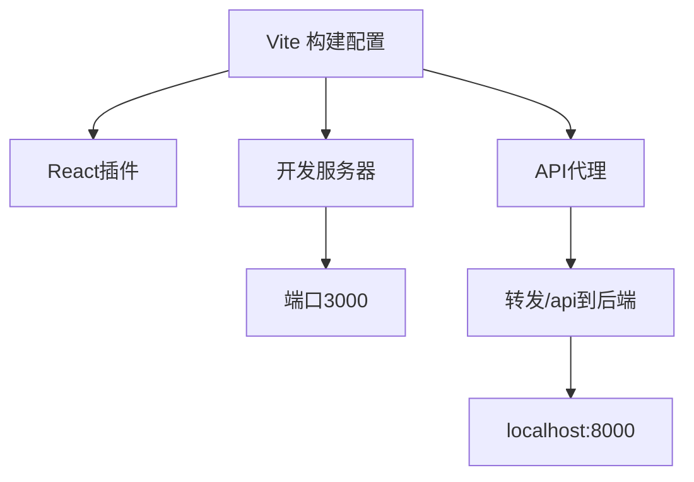
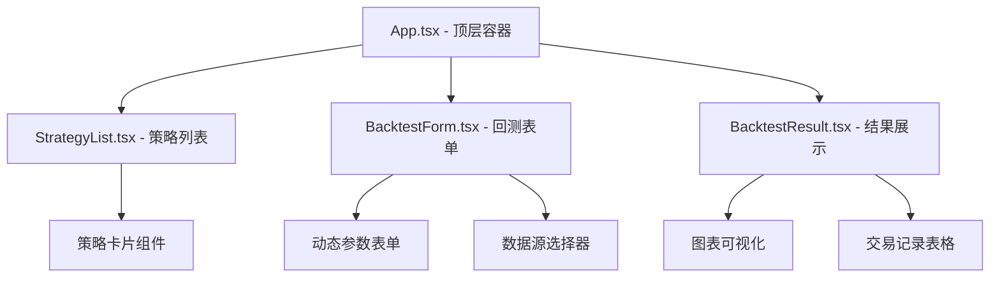
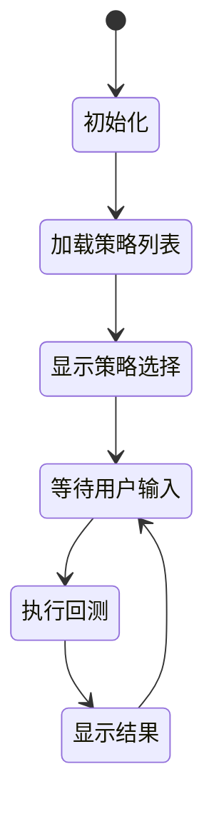
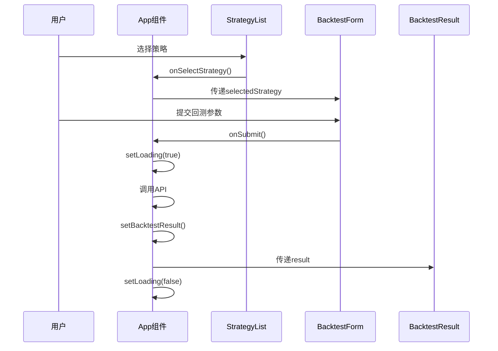
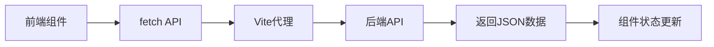
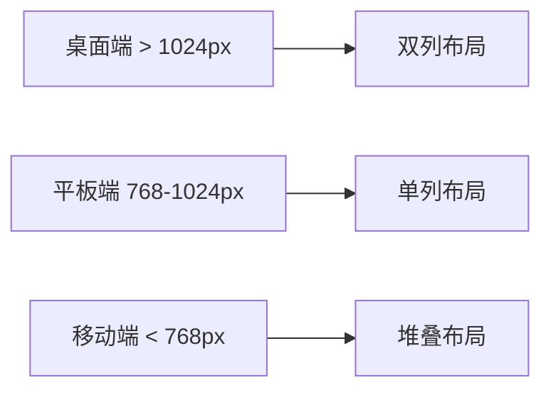
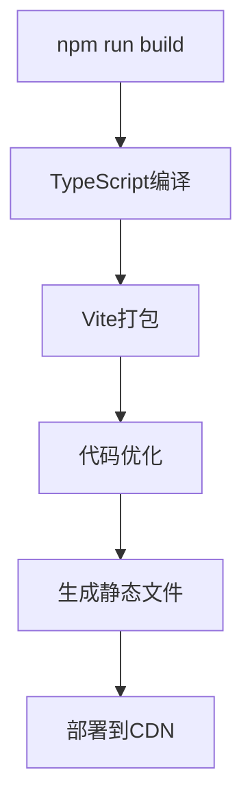

# 前端架构设计

<cite>
**本文引用的文件**   
- [frontend/src/App.tsx](../../../frontend/src/App.tsx)
- [frontend/src/main.tsx](../../../frontend/src/main.tsx)
- [frontend/vite.config.ts](../../../frontend/vite.config.ts)
- [frontend/package.json](../../../frontend/package.json)
- [frontend/tsconfig.json](../../../frontend/tsconfig.json)
- [frontend/src/components/StrategyList.tsx](../../../frontend/src/components/StrategyList.tsx)
- [frontend/src/components/BacktestForm.tsx](../../../frontend/src/components/BacktestForm.tsx)
- [frontend/src/components/BacktestResult.tsx](../../../frontend/src/components/BacktestResult.tsx)
- [frontend/src/App.css](../../../frontend/src/App.css)
- [frontend/src/index.css](../../../frontend/src/index.css)
</cite>

## 更新摘要
**变更内容**   
- 完整分析了React前端应用的组件化架构和状态管理模式
- 详细说明了Vite构建工具的配置优化和TypeScript类型系统
- 描述了主应用组件App.tsx的组件树结构和全局状态管理
- 解释了前后端通信机制，包括HTTP请求封装和错误处理
- 提供了组件间数据传递模式和性能优化策略
- 包含具体的组件开发规范和最佳实践指导

## 目录
1. [引言](#引言)
2. [技术栈与构建配置](#技术栈与构建配置)
3. [应用架构概览](#应用架构概览)
4. [核心组件设计](#核心组件设计)
5. [状态管理模式](#状态管理模式)
6. [前后端通信机制](#前后端通信机制)
7. [样式系统与主题](#样式系统与主题)
8. [性能优化策略](#性能优化策略)
9. [开发规范与最佳实践](#开发规范与最佳实践)
10. [部署与生产环境](#部署与生产环境)

## 引言
本项目采用现代化的React + TypeScript + Vite技术栈构建量化策略回测系统的前端界面。应用采用组件化架构设计，实现了策略选择、参数配置、回测执行和结果可视化的完整功能流程。通过清晰的组件分层和状态管理，提供了优秀的用户体验和可维护性。

## 技术栈与构建配置

### 核心技术栈
- **React 18.2.0**: 现代前端框架，支持Hooks和并发特性
- **TypeScript 5.3.3**: 类型安全的JavaScript超集
- **Vite 5.0.11**: 下一代前端构建工具，提供极速的开发体验
- **Recharts 2.10.4**: 基于D3的数据可视化图表库
- **Lucide React 0.312.0**: 轻量级图标库

### Vite构建配置


**图表来源**
- [frontend/vite.config.ts:4-15](../../../frontend/vite.config.ts#L4-L15)

### TypeScript配置
TypeScript配置采用了现代化设置：
- **目标版本**: ES2020，确保现代浏览器兼容性
- **模块解析**: bundler模式，优化构建性能
- **严格模式**: 启用所有类型检查规则
- **JSX支持**: react-jsx模式，提升渲染性能

**章节来源**
- [frontend/tsconfig.json:1-26](../../../frontend/tsconfig.json#L1-L26)

## 应用架构概览

### 组件层次结构
应用采用清晰的三层组件架构：



**图表来源**
- [frontend/src/App.tsx:3-5](../../../frontend/src/App.tsx#L3-L5)
- [frontend/src/components/StrategyList.tsx:16-69](../../../frontend/src/components/StrategyList.tsx#L16-L69)
- [frontend/src/components/BacktestForm.tsx:21-522](../../../frontend/src/components/BacktestForm.tsx#L21-L522)
- [frontend/src/components/BacktestResult.tsx:9-221](../../../frontend/src/components/BacktestResult.tsx#L9-L221)

### 应用入口点
应用从`main.tsx`启动，使用React 18的createRoot API进行挂载：

```typescript
ReactDOM.createRoot(document.getElementById('root')!).render(
  <React.StrictMode>
    <App />
  </React.StrictMode>,
)
```

**章节来源**
- [frontend/src/main.tsx:1-11](../../../frontend/src/main.tsx#L1-L11)

## 核心组件设计

### App组件 - 应用容器
App组件作为顶层容器，负责：
- 全局状态管理（选中的策略、回测结果、加载状态）
- 子组件协调和数据流控制
- 用户交互事件处理



**图表来源**
- [frontend/src/App.tsx:8-96](../../../frontend/src/App.tsx#L8-L96)

### StrategyList组件 - 策略列表
负责策略的获取、展示和选择：
- 从后端API获取可用策略列表
- 实现策略卡片的视觉反馈
- 处理策略选择逻辑

**章节来源**
- [frontend/src/components/StrategyList.tsx:1-69](../../../frontend/src/components/StrategyList.tsx#L1-L69)

### BacktestForm组件 - 动态表单
最复杂的组件，实现了动态参数表单：
- 支持多种策略类型的参数配置
- 实时验证和用户输入处理
- 数据源选择和配置

**章节来源**
- [frontend/src/components/BacktestForm.tsx:1-522](../../../frontend/src/components/BacktestForm.tsx#L1-L522)

### BacktestResult组件 - 结果可视化
专业的数据可视化组件：
- 使用Recharts绘制资金曲线和股价走势
- 展示关键绩效指标
- 交易记录表格展示

**章节来源**
- [frontend/src/components/BacktestResult.tsx:1-221](../../../frontend/src/components/BacktestResult.tsx#L1-L221)

## 状态管理模式

### 状态结构设计
应用采用集中式状态管理，所有状态集中在App组件中：

```typescript
interface AppState {
  selectedStrategy: string | null;
  backtestResult: any;
  loading: boolean;
}
```

### 状态更新流程


**图表来源**
- [frontend/src/App.tsx:13-36](../../../frontend/src/App.tsx#L13-L36)

### 状态提升原则
- 父组件持有共享状态
- 子组件通过props接收数据和回调函数
- 避免在子组件中维护需要跨组件同步的状态

**章节来源**
- [frontend/src/App.tsx:8-11](../../../frontend/src/App.tsx#L8-L11)
- [frontend/src/components/StrategyList.tsx:11-14](../../../frontend/src/components/StrategyList.tsx#L11-L14)
- [frontend/src/components/BacktestForm.tsx:5-9](../../../frontend/src/components/BacktestForm.tsx#L5-L9)

## 前后端通信机制

### HTTP请求封装
应用使用原生fetch API进行HTTP通信：



**图表来源**
- [frontend/src/App.tsx:16-22](../../../frontend/src/App.tsx#L16-L22)
- [frontend/vite.config.ts:8-13](../../../frontend/vite.config.ts#L8-L13)

### API接口设计
- **GET /api/strategies/**: 获取策略列表
- **POST /api/backtest/run**: 执行回测

### 错误处理机制
- 网络请求失败的用户友好提示
- 数据格式验证和容错处理
- 加载状态的统一管理

**章节来源**
- [frontend/src/App.tsx:24-35](../../../frontend/src/App.tsx#L24-L35)
- [frontend/src/components/StrategyList.tsx:31-41](../../../frontend/src/components/StrategyList.tsx#L31-L41)

## 样式系统与主题

### CSS架构
应用采用模块化CSS架构：
- **index.css**: 全局样式重置和基础样式
- **App.css**: 应用级布局和组件样式
- **组件CSS**: 每个组件独立的样式文件

### 响应式设计


**图表来源**
- [frontend/src/App.css:112-141](../../../frontend/src/App.css#L112-L141)

### 主题特性
- 渐变色头部设计
- 卡片式布局
- 动画效果（脉冲动画）
- 深色/浅色模式支持

**章节来源**
- [frontend/src/App.css:1-142](../../../frontend/src/App.css#L1-L142)
- [frontend/src/index.css:1-24](../../../frontend/src/index.css#L1-L24)

## 性能优化策略

### 组件优化
- **懒加载**: 按需加载大型组件
- **记忆化**: 使用useMemo和useCallback优化重渲染
- **虚拟滚动**: 大数据列表的性能优化

### 构建优化
- **Tree Shaking**: 移除未使用的代码
- **代码分割**: 按路由和组件分割代码
- **资源压缩**: 图片和静态资源的自动压缩

### 运行时优化
- **React.memo**: 防止不必要的组件重渲染
- **事件委托**: 减少事件监听器数量
- **防抖节流**: 高频事件的优化处理

## 开发规范与最佳实践

### 组件开发规范
1. **单一职责原则**: 每个组件只负责一个功能
2. **Props接口定义**: 使用TypeScript接口明确定义组件属性
3. **状态管理**: 优先使用useState和useContext
4. **副作用处理**: 使用useEffect统一管理副作用

### 代码组织规范
1. **文件命名**: 组件使用PascalCase，工具函数使用camelCase
2. **导入顺序**: React -> 第三方库 -> 本地模块
3. **注释规范**: 复杂逻辑必须添加JSDoc注释

### 测试策略
1. **单元测试**: 使用React Testing Library测试组件行为
2. **集成测试**: 测试组件间的交互
3. **端到端测试**: 使用Playwright或Cypress测试完整流程

## 部署与生产环境

### 构建流程


### 环境变量配置
- 开发环境: 本地后端API地址
- 生产环境: 配置的API网关地址

### 监控与分析
- 错误日志收集
- 用户行为分析
- 性能指标监控

**章节来源**
- [frontend/package.json:6-11](../../../frontend/package.json#L6-L11)

---

本前端架构设计文档详细描述了量化策略回测系统的React应用架构，包括组件设计、状态管理、前后端通信、样式系统和性能优化等各个方面。通过遵循这些架构原则和开发规范，可以确保应用的可维护性、可扩展性和良好的用户体验。