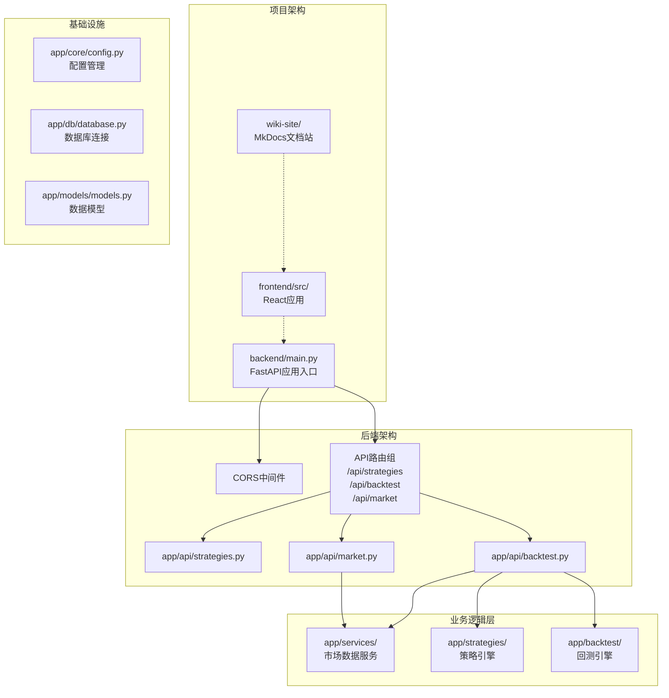
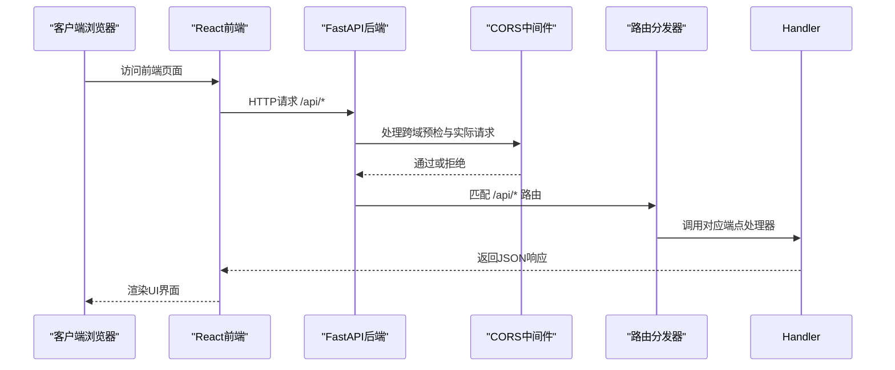
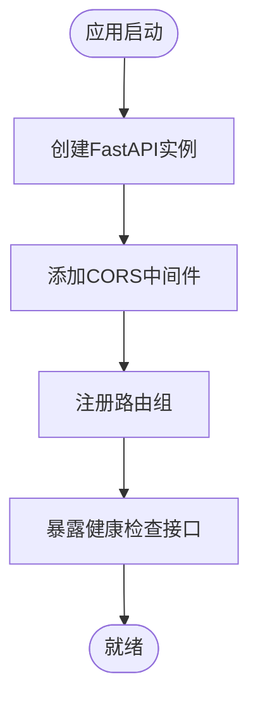
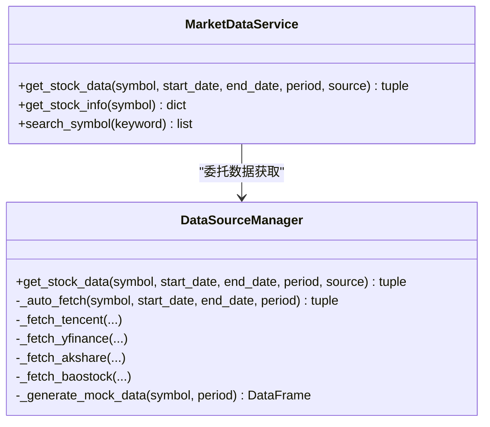
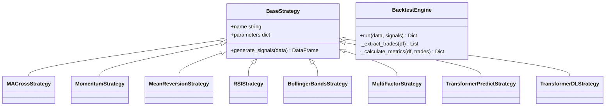
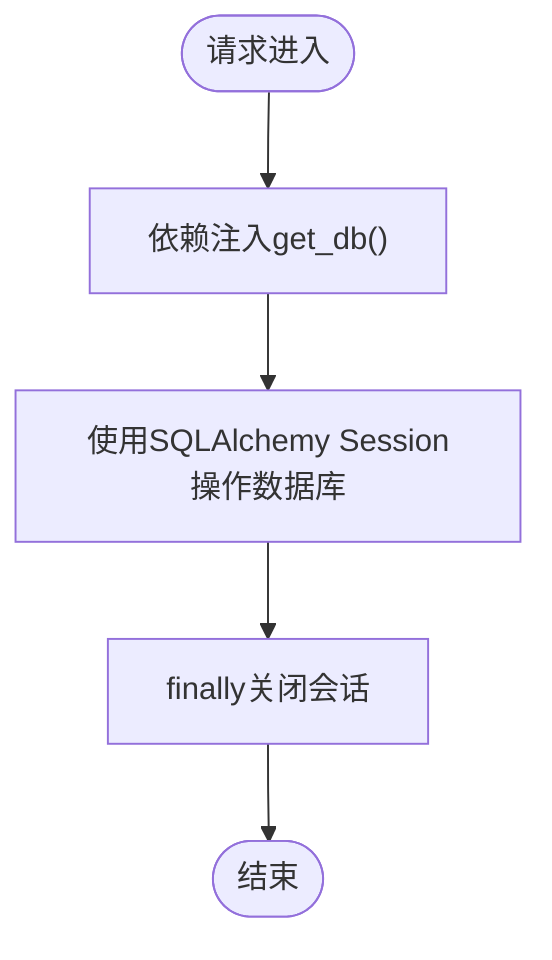
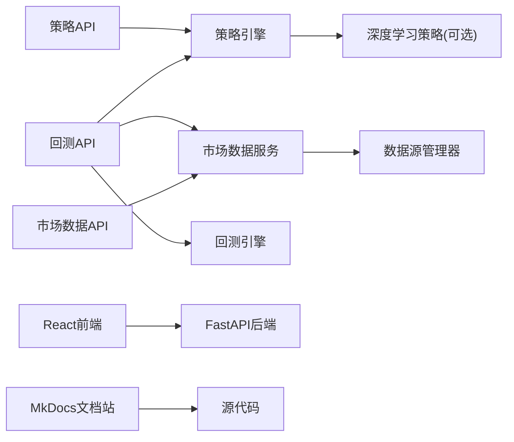

# 后端架构设计

<cite>
**本文引用的文件**   
- [main.py](../../../backend/main.py)
- [AGENTS.md](../../../AGENTS.md)
- [README.md](../../../README.md)
- [mkdocs.yml](../../mkdocs.yml)
</cite>

## 更新摘要
**变更内容**   
- 根据代码库现状，FastAPI后端实际上仍然存在且完整
- 文档重点调整为反映MkDocs文档架构与FastAPI后端的结合使用
- 更新了项目结构说明以体现当前双端分离架构
- 强调了文档站点基础设施的重要性

## 目录
1. [引言](#引言)
2. [项目结构](#项目结构)
3. [核心组件](#核心组件)
4. [架构总览](#架构总览)
5. [详细组件分析](#详细组件分析)
6. [依赖关系分析](#依赖关系分析)
7. [性能与可扩展性](#性能与可扩展性)
8. [故障排查指南](#故障排查指南)
9. [结论](#结论)
10. [附录：扩展新API端点示例](#附录扩展新api端点示例)

## 引言
本文件面向量化策略查看系统的后端架构，聚焦 FastAPI 应用的组织方式、初始化流程、跨域配置、路由注册、中间件使用，以及分层架构中 API 层的职责边界。文档同时说明策略管理、回测执行与市场数据三大核心模块的设计思路，覆盖应用生命周期、依赖注入与配置管理，并提供扩展新 API 端点的实践指引。系统采用前后端分离架构，后端提供RESTful API，前端通过React构建用户界面，并通过MkDocs生成完整的文档站点。

## 项目结构
项目采用前后端分离的模块化组织方式：
- **后端（FastAPI）**：提供策略管理、回测执行、市场数据API
- **前端（React + TypeScript）**：提供可视化交互界面
- **文档站点（MkDocs）**：基于Material主题生成静态文档站

**图表来源**
- [main.py:9-27](../../../backend/main.py#L9-L27)
- [AGENTS.md:7-26](../../../AGENTS.md#L7-L26)

**章节来源**
- [main.py:1-36](../../../backend/main.py#L1-L36)
- [AGENTS.md:7-26](../../../AGENTS.md#L7-L26)

## 核心组件
- **应用入口与中间件**：FastAPI实例创建、CORS跨域配置、健康检查与根路径返回
- **配置系统**：基于pydantic-settings的Settings，支持环境变量与.env文件
- **数据库层**：SQLAlchemy Engine、SessionLocal、Base元数据与get_db依赖注入函数
- **数据模型**：策略与回测结果表结构
- **市场数据服务**：统一封装多数据源获取逻辑，提供股票信息与搜索能力
- **策略引擎**：多种经典策略与Transformer深度学习策略的信号生成实现
- **回测引擎**：将信号与价格序列结合，计算收益曲线与绩效指标
- **文档站点**：基于MkDocs Material主题的静态文档生成系统

**章节来源**
- [main.py:9-35](../../../backend/main.py#L9-L35)
- [AGENTS.md:7-26](../../../AGENTS.md#L7-L26)
- [mkdocs.yml:1-153](../../mkdocs.yml#L1-L153)

## 架构总览
FastAPI应用启动后，依次完成以下关键步骤：
- 创建FastAPI实例并设置标题、描述与版本
- 挂载CORS中间件，允许所有来源与方法
- 注册三个业务路由组：策略、回测、市场数据
- 暴露根路径与健康检查接口
- 前端通过Vite代理与后端API通信
- MkDocs构建静态文档站点

**图表来源**
- [main.py:9-35](../../../backend/main.py#L9-L35)
- [README.md:75-108](../../../README.md#L75-L108)

**章节来源**
- [main.py:9-35](../../../backend/main.py#L9-L35)
- [README.md:75-108](../../../README.md#L75-L108)

## 详细组件分析

### 应用初始化与生命周期
- **应用初始化**：在main.py中创建FastAPI实例，设置元信息
- **中间件**：添加CORSMiddleware，允许所有来源、方法与头，启用凭据
- **路由注册**：include_router将策略、回测、市场数据路由分组挂载到/api/strategies、/api/backtest、/api/market
- **生命周期钩子**：当前未显式定义lifespan事件；如需数据库初始化可在startup事件中调用init_db

**图表来源**
- [main.py:9-35](../../../backend/main.py#L9-L35)

**章节来源**
- [main.py:9-35](../../../backend/main.py#L9-L35)

### CORS跨域配置
- **允许来源**：*
- **允许方法**：*
- **允许头**：*
- **允许凭据**：True

该配置适合前后端分离开发环境，生产环境建议收紧allow_origins为前端域名白名单。

**章节来源**
- [main.py:15-22](../../../backend/main.py#L15-L22)

### 路由注册机制
- **策略路由**：/api/strategies
- **回测路由**：/api/backtest
- **市场数据路由**：/api/market

每个路由组内部定义具体的RESTful端点，遵循资源命名与动词语义规范。

**章节来源**
- [main.py:24-27](../../../backend/main.py#L24-L27)
- [AGENTS.md:48-57](../../../AGENTS.md#L48-L57)

### API层职责与RESTful设计规范
- **职责边界**：API层仅负责接收请求、参数校验、调用服务层、格式化响应与错误转换
- **请求体与查询参数**：使用Pydantic BaseModel进行结构化校验
- **响应格式**：统一返回包含业务数据的字典，必要时附加元信息（如数据源标识）
- **错误处理**：捕获异常并转换为HTTPException，保持状态码与消息一致

#### 策略管理API
- GET /api/strategies：列出可用策略
- GET /api/strategies/{strategy_id}：获取策略详情

#### 回测执行API
- POST /api/backtest/run：运行策略回测
- GET /api/backtest/history：获取历史回测结果（待实现）

#### 市场数据API
- GET /api/market/stock/{symbol}：获取股票行情数据
- GET /api/market/stock/{symbol}/info：获取股票基本信息
- GET /api/market/search：搜索股票代码

**章节来源**
- [AGENTS.md:15-18](../../../AGENTS.md#L15-L18)

### 服务层：市场数据与多数据源管理
- **MarketDataService**：对外暴露统一的股票数据获取、信息查询与搜索接口
- **DataSourceManager**：根据source参数选择具体数据源（腾讯财经、yfinance、AKShare、BaoStock、模拟数据），并在auto模式下自动回退

**图表来源**
- [AGENTS.md:24-26](../../../AGENTS.md#L24-L26)

**章节来源**
- [AGENTS.md:24-26](../../../AGENTS.md#L24-L26)

### 领域引擎：策略与回测
- **策略引擎**：定义BaseStrategy及多种策略实现（均线交叉、动量、均值回归、RSI、布林带、多因子、Transformer预测、Transformer深度学习）
- **回测引擎**：合并数据与信号，计算策略收益、资金曲线、交易记录与绩效指标

**图表来源**
- [AGENTS.md:19-23](../../../AGENTS.md#L19-L23)

**章节来源**
- [AGENTS.md:19-23](../../../AGENTS.md#L19-L23)

### 依赖注入与数据库会话
- **数据库会话**：通过get_db提供SessionLocal的上下文管理器，便于在FastAPI依赖注入中使用
- **模型定义**：Strategy与BacktestResult表结构已定义，但当前API尚未持久化回测结果

**图表来源**
- [AGENTS.md:12-14](../../../AGENTS.md#L12-L14)

**章节来源**
- [AGENTS.md:12-14](../../../AGENTS.md#L12-L14)

### 配置管理系统
- **Settings类**：集中管理应用名称、版本、调试开关、数据库URL、默认市场等配置项
- **支持从.env加载环境变量**：便于不同环境切换

**章节来源**
- [AGENTS.md:12](../../../AGENTS.md#L12)

## 依赖关系分析
- **API层依赖服务层**：策略与回测API调用MarketDataService与策略/回测引擎
- **服务层依赖数据源管理器**：MarketDataService委托DataSourceManager进行多数据源调度
- **策略引擎可依赖深度学习模块**：当PyTorch可用时启用Transformer深度学习策略
- **数据库层独立于API层**：当前API未直接使用数据库，但提供了完整的ORM模型与会话管理
- **前端依赖后端API**：React前端通过HTTP请求与FastAPI后端通信
- **文档站点依赖源代码**：MkDocs基于源代码生成技术文档

**图表来源**
- [AGENTS.md:7-26](../../../AGENTS.md#L7-L26)
- [README.md:53-68](../../../README.md#L53-L68)

**章节来源**
- [AGENTS.md:7-26](../../../AGENTS.md#L7-L26)
- [README.md:53-68](../../../README.md#L53-L68)

## 性能与可扩展性
- **数据源自动回退**：DataSourceManager在auto模式下优先尝试本地可用的数据源，失败则回退至yfinance/AKShare/BaoStock，最终使用模拟数据，保证可用性
- **向量化计算**：策略与回测引擎大量使用pandas/numpy的向量化运算，避免逐行循环，提升性能
- **可扩展策略**：新增策略只需继承BaseStrategy并在工厂函数中注册，即可被API层直接调用
- **可扩展数据源**：在DataSourceManager中添加新的_fetch_xxx方法并接入get_stock_data分支，即可扩展数据源
- **异步I/O**：当前API使用async def，但底层数据获取多为同步阻塞调用；若引入aiohttp/httpx可实现真正的异步数据拉取
- **文档自动生成**：MkDocs支持Markdown语法和Mermaid图表，便于维护技术文档

## 故障排查指南
- **数据源不可用**：检查网络连通性与第三方库安装情况（yfinance、akshare、baostock、torch）
- **日期与周期参数**：确保start_date/end_date符合YYYY-MM-DD格式，period取值在支持的范围内
- **模拟数据**：当所有真实数据源失败时，系统将返回模拟数据，is_mock字段可用于前端提示
- **回测历史**：GET /api/backtest/history目前返回占位响应，需后续实现数据库持久化与查询
- **前端无法访问后端**：检查CORS配置和端口设置，确认Vite代理配置正确
- **文档构建失败**：检查MkDocs配置和Markdown语法，确保依赖包安装完整

**章节来源**
- [AGENTS.md:61-73](../../../AGENTS.md#L61-L73)
- [README.md:189-195](../../../README.md#L189-L195)

## 结论
本后端以FastAPI为核心，采用清晰的分层架构：API层专注接口契约与服务编排，服务层抽象数据源差异，领域引擎封装策略与回测逻辑，基础设施提供配置与数据库能力。整体具备良好的可扩展性与容错性，适合持续迭代更多策略与数据源。配合React前端和MkDocs文档系统，形成了完整的全栈解决方案。

## 附录：扩展新API端点示例
以下以"新增策略列表过滤"为例，展示如何在现有架构下扩展一个端点：

- **在app/api/strategies.py中新增路由**：
  - 定义GET /api/strategies/filter?tags=...用于按标签或类型筛选策略
  - 复用get_available_strategies获取策略清单，并进行过滤
- **在app/strategies/engine.py中扩展策略元数据**：
  - 在get_available_strategies返回的策略字典中加入tags字段
- **在app/api/strategies.py中实现过滤逻辑**：
  - 解析Query参数，对策略列表进行过滤并返回

参考路径
- [AGENTS.md:15-20](../../../AGENTS.md#L15-L20)