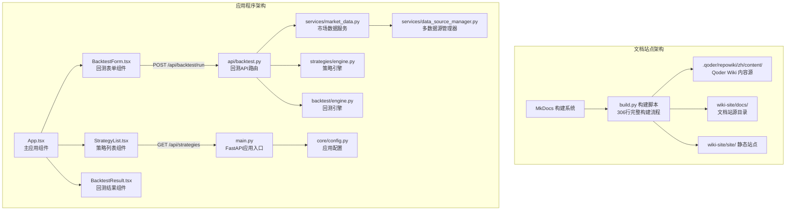
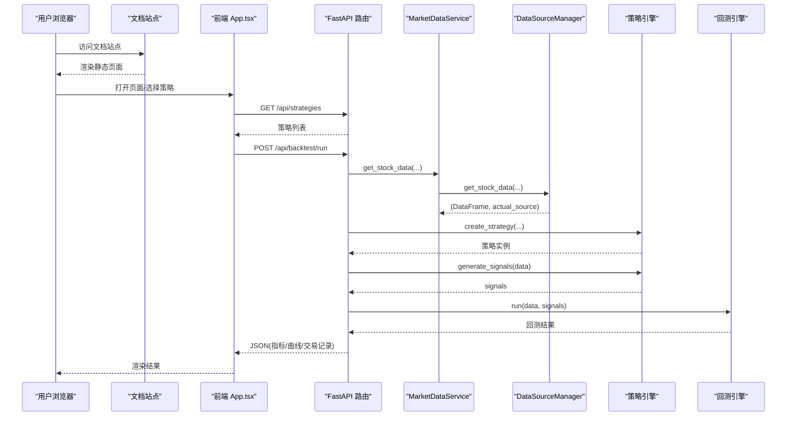
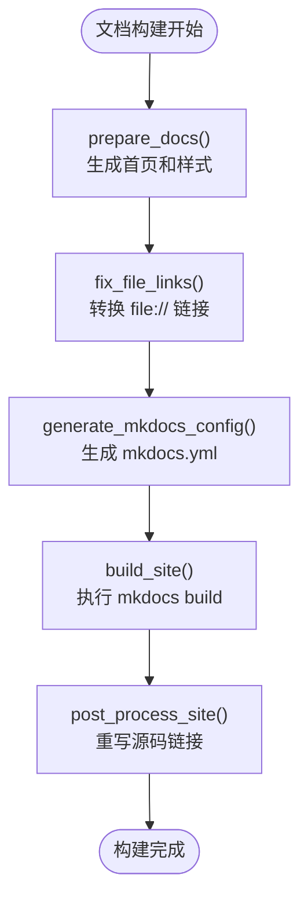
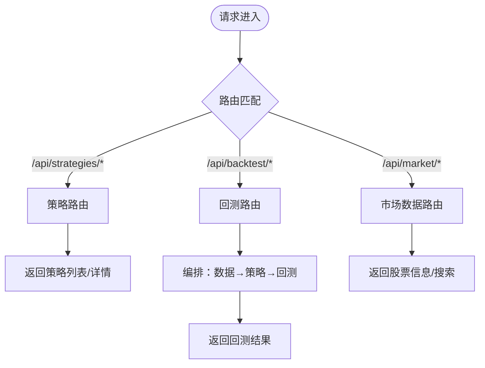
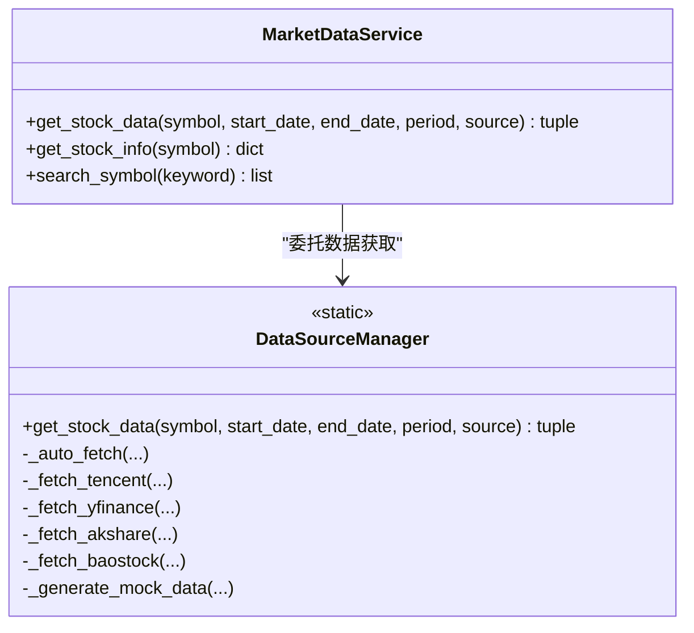
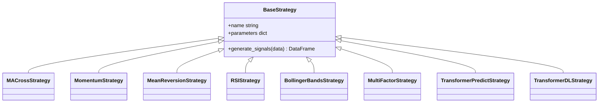
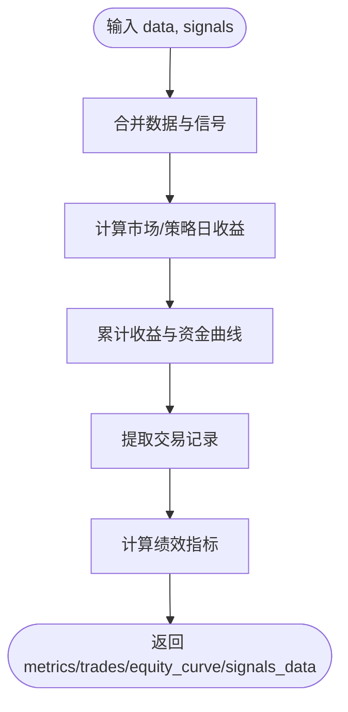
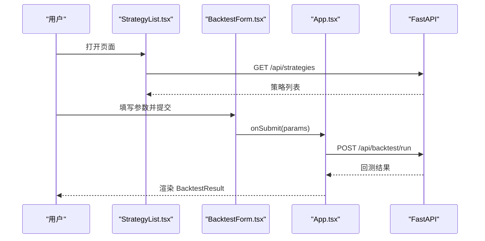
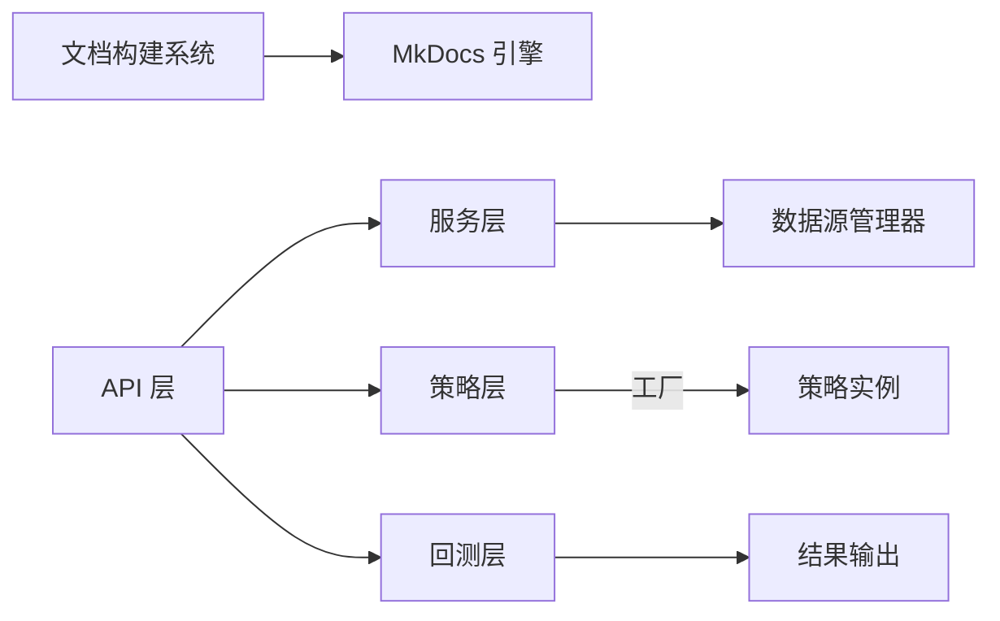

# 系统架构

<cite>
**本文引用的文件**   
- [wiki-site/build.py](../../build.py)
- [wiki-site/mkdocs.yml](../../mkdocs.yml)
- [wiki-site/extra.css](../../extra.css)
- [backend/main.py](../../../backend/main.py)
- [backend/app/api/backtest.py](../../../backend/app/api/backtest.py)
- [backend/app/services/data_source_manager.py](../../../backend/app/services/data_source_manager.py)
- [backend/app/strategies/engine.py](../../../backend/app/strategies/engine.py)
- [backend/app/backtest/engine.py](../../../backend/app/backtest/engine.py)
- [backend/app/core/config.py](../../../backend/app/core/config.py)
- [frontend/src/App.tsx](../../../frontend/src/App.tsx)
- [frontend/src/components/StrategyList.tsx](../../../frontend/src/components/StrategyList.tsx)
</cite>

## 更新摘要
**变更内容**
- 完全迁移到 MkDocs 静态站点生成器架构，新增437行文档构建代码
- 实现文档驱动开发流程，支持自动化构建、链接转换和源码浏览
- 增强部署拓扑以反映新的文档站点基础设施
- 保留并优化原有的 FastAPI + React 应用架构描述
- 新增智能链接处理和 GitCode 源码集成

## 目录
1. [简介](#简介)
2. [项目结构](#项目结构)
3. [核心组件](#核心组件)
4. [架构总览](#架构总览)
5. [详细组件分析](#详细组件分析)
6. [依赖关系分析](#依赖关系分析)
7. [性能与扩展性](#性能与扩展性)
8. [部署与环境配置](#部署与环境配置)
9. [故障排查指南](#故障排查指南)
10. [结论](#结论)

## 简介
本文件为量化交易平台的高层设计与技术架构文档。系统经历了从传统的 FastAPI+React 应用架构到文档驱动的现代开发模式的完整转型。现在采用双轨架构：一方面提供高性能的量化交易回测平台（FastAPI + React），另一方面构建了完整的 MkDocs 静态文档站点，支持自动化的构建流程、智能链接转换和源码浏览功能。

系统的设计理念是"文档即代码"，通过 MkDocs Material 主题提供高质量的文档体验，同时保持应用程序的灵活性和可扩展性。这种架构设计使得团队协作更加高效，知识沉淀更加系统化。

## 项目结构
系统现在包含两个主要部分：
- **文档站点**：基于 MkDocs 的静态文档生成系统，提供完整的系统文档和技术参考
- **应用程序**：FastAPI + React 的量化交易回测平台

**图表来源**
- [wiki-site/build.py:30-38](../../build.py#L30-L38)
- [wiki-site/build.py:60-80](../../build.py#L60-L80)
- [backend/main.py:9-27](../../../backend/main.py#L9-L27)
- [frontend/src/App.tsx:8-36](../../../frontend/src/App.tsx#L8-L36)

## 核心组件
- **文档构建系统**：MkDocs 静态站点生成器，Material 主题，自动化构建流程，支持 Mermaid 图表和中文化
- **构建脚本**：build.py 提供完整的构建流程，包括链接转换、配置生成、站点构建和后处理（306行代码）
- **API 层**：FastAPI 路由暴露 RESTful 接口，统一处理请求校验、错误返回与跨域配置
- **服务层**：MarketDataService 封装市场数据获取逻辑，委托 DataSourceManager 进行多数据源调度与降级
- **策略层**：BaseStrategy 及其子类实现不同交易策略的信号生成；Engine 提供策略工厂与可用策略清单
- **回测层**：BacktestEngine 基于信号与行情计算收益曲线、交易明细与绩效指标
- **配置层**：Settings 通过 pydantic-settings 加载环境变量与默认值

## 架构总览
系统采用分层架构与前后端分离设计，并新增了文档驱动开发模式：
- **文档层**：MkDocs 静态站点，提供完整的系统文档和技术参考，支持自动构建和智能链接
- **前端 React** 负责交互与可视化，通过 fetch 调用后端 RESTful API
- **后端 FastAPI** 作为网关，将请求分发至服务层与领域引擎
- **数据层**通过 DataSourceManager 抽象多种数据源，支持自动选择与降级

**图表来源**
- [wiki-site/build.py:286-301](../../build.py#L286-L301)
- [frontend/src/App.tsx:13-36](../../../frontend/src/App.tsx#L13-L36)
- [backend/main.py:24-27](../../../backend/main.py#L24-L27)
- [backend/app/api/backtest.py:28-69](../../../backend/app/api/backtest.py#L28-L69)

## 详细组件分析

### 文档构建系统（MkDocs）
- **构建脚本**：build.py 提供完整的构建流程，包括链接转换、配置生成、站点构建和后处理
- **配置管理**：mkdocs.yml 自动生成导航结构，支持 Material 主题和中文化
- **链接处理**：自动将 file:// 引用转换为相对路径，支持 GitCode 源码浏览链接重写
- **样式定制**：extra.css 提供自定义样式，支持引用区块和代码高亮

**图表来源**
- [wiki-site/build.py:74-80](../../build.py#L74-L80)
- [wiki-site/build.py:83-107](../../build.py#L83-L107)
- [wiki-site/build.py:126-205](../../build.py#L126-L205)
- [wiki-site/build.py:208-215](../../build.py#L208-L215)
- [wiki-site/build.py:218-283](../../build.py#L218-L283)

**章节来源**
- [wiki-site/build.py:1-306](../../build.py#L1-L306)
- [wiki-site/mkdocs.yml:1-153](../../mkdocs.yml#L1-L153)
- [wiki-site/extra.css:1-21](../../extra.css#L1-L21)

### API 层（FastAPI）
- 路由注册与跨域：在应用入口集中注册策略、回测、市场数据路由，并启用 CORS
- 健康检查与根路径：提供基础健康探测与欢迎信息
- 路由职责：
  - 策略路由：列出策略与详情
  - 回测路由：接收回测参数，编排数据获取、信号生成与回测执行
  - 市场数据路由：查询股票信息与搜索代码

**图表来源**
- [backend/main.py:15-35](../../../backend/main.py#L15-L35)
- [backend/app/api/backtest.py:28-76](../../../backend/app/api/backtest.py#L28-L76)

**章节来源**
- [backend/main.py:1-36](../../../backend/main.py#L1-L36)
- [backend/app/api/backtest.py:1-77](../../../backend/app/api/backtest.py#L1-L77)

### 服务层（市场数据与多数据源）
- MarketDataService：对外暴露统一的股票数据获取方法，内部委托 DataSourceManager
- DataSourceManager：实现多数据源适配与自动选择/降级策略，包括腾讯财经、YFinance、AKShare、BaoStock 与模拟数据
- 自动选择逻辑：根据股票代码后缀判断市场（A股/港股/美股），优先尝试最优数据源，失败则逐级降级，最终使用模拟数据兜底

**图表来源**
- [backend/app/services/data_source_manager.py:14-109](../../../backend/app/services/data_source_manager.py#L14-L109)

**章节来源**
- [backend/app/services/data_source_manager.py:1-200](../../../backend/app/services/data_source_manager.py#L1-L200)

### 策略层（策略引擎与插件机制）
- BaseStrategy：定义策略基类与信号生成接口
- 具体策略：均线交叉、动量、均值回归、RSI、布林带、多因子选股、Transformer 预测、Transformer 深度学习等
- 工厂函数：create_strategy 根据 strategy_id 创建对应策略实例；get_available_strategies 返回策略元数据（含参数定义）
- 扩展点：新增策略需继承 BaseStrategy，并在工厂与清单中注册

**图表来源**
- [backend/app/strategies/engine.py:17-200](../../../backend/app/strategies/engine.py#L17-L200)

**章节来源**
- [backend/app/strategies/engine.py:1-200](../../../backend/app/strategies/engine.py#L1-L200)

### 回测层（回测引擎）
- BacktestEngine：合并数据与信号，计算日收益率、累计收益、资金曲线，提取交易记录，计算综合绩效指标（总收益、年化收益、最大回撤、夏普比率、胜率、盈亏比等）
- 输出：metrics、trades、equity_curve、signals_data，便于前端可视化

**图表来源**
- [backend/app/backtest/engine.py:15-70](../../../backend/app/backtest/engine.py#L15-L70)
- [backend/app/backtest/engine.py:72-163](../../../backend/app/backtest/engine.py#L72-L163)

**章节来源**
- [backend/app/backtest/engine.py:1-163](../../../backend/app/backtest/engine.py#L1-L163)

### 前端（React 组件）
- App.tsx：组合子组件，发起回测请求，管理加载状态与结果展示
- StrategyList.tsx：拉取策略列表，支持选中与默认选中首个策略
- BacktestForm.tsx：表单收集回测参数（股票代码、周期、初始资金、数据源、策略参数），提交到后端
- BacktestResult.tsx：渲染指标卡片、资金曲线、股价走势与交易明细，标注是否使用模拟数据

**图表来源**
- [frontend/src/components/StrategyList.tsx:20-41](../../../frontend/src/components/StrategyList.tsx#L20-L41)
- [frontend/src/App.tsx:13-36](../../../frontend/src/App.tsx#L13-L36)

**章节来源**
- [frontend/src/App.tsx:1-100](../../../frontend/src/App.tsx#L1-L100)
- [frontend/src/components/StrategyList.tsx:1-69](../../../frontend/src/components/StrategyList.tsx#L1-L69)

## 依赖关系分析
- **模块耦合**：
  - API 层对服务层与引擎层存在强依赖，但通过清晰的接口边界降低耦合度
  - 服务层通过 DataSourceManager 解耦具体数据源实现，提升可替换性与健壮性
  - 策略层通过 BaseStrategy 与工厂函数实现插件式扩展
  - 文档构建系统与应用程序相互独立，通过静态文件关联
- **外部依赖**：
  - yfinance、akshare、baostock、requests、pandas、numpy 等用于数据获取与计算
  - FastAPI、pydantic、pydantic-settings 用于 API 框架与配置管理
  - MkDocs、Material 主题用于文档生成
- **潜在循环依赖**：当前结构未发现明显循环导入；策略与回测引擎相互独立，由 API 层编排

**图表来源**
- [wiki-site/build.py:286-301](../../build.py#L286-L301)
- [backend/main.py:24-27](../../../backend/main.py#L24-L27)
- [backend/app/api/backtest.py:9-11](../../../backend/app/api/backtest.py#L9-L11)

**章节来源**
- [backend/main.py:1-36](../../../backend/main.py#L1-L36)
- [backend/app/api/backtest.py:1-77](../../../backend/app/api/backtest.py#L1-L77)

## 性能与扩展性
- **性能特性**：
  - FastAPI 基于异步 I/O 与 Pydantic 校验，具备高吞吐与低延迟优势
  - 数据计算主要依赖 pandas/numpy，适合向量化运算；回测引擎避免复杂对象操作，利于序列化传输
  - 多数据源自动降级减少网络失败对整体流程的影响
  - MkDocs 静态站点提供高性能文档访问，无需运行时开销
- **扩展点设计**：
  - 策略插件机制：新增策略仅需继承 BaseStrategy，并在工厂与清单中注册，前端按参数元数据动态渲染表单
  - 数据源适配器模式：新增数据源只需实现获取方法并在自动选择逻辑中注册，不影响上层调用
  - 文档扩展：新增文档页面自动纳入导航结构，支持 Markdown 格式和 Mermaid 图表
- **优化建议**：
  - 对高频数据获取增加缓存（如本地 SQLite/Redis）
  - 对长耗时回测引入任务队列（Celery/RQ）与进度回调
  - 对大数据集回测考虑分块计算与增量更新
  - 文档站点可考虑 CDN 加速和缓存策略

## 部署与环境配置
- **部署拓扑**：
  - **文档站点**：MkDocs 生成的静态 HTML 文件，可由任何 Web 服务器托管（Nginx、Apache、GitHub Pages 等）
  - **前端静态资源**：由 Vite 开发服务器或 Nginx 托管
  - **后端 FastAPI**：通过 uvicorn 运行，监听 8000 端口
  - **可选反向代理**（Nginx/Traefik）统一入口，转发 /api 到后端，静态资源到前端
- **环境变量与配置**：
  - Settings 通过 pydantic-settings 从 .env 加载配置项（如数据库 URL、默认市场等）
  - 生产环境建议显式设置 DATABASE_URL、DEBUG 等，关闭调试模式
  - MkDocs 配置通过 mkdocs.yml 管理，支持主题、语言和扩展配置
- **启动方式**：
  - 文档站点：`python wiki-site/build.py all` 构建完整站点
  - 一键脚本或手动分别启动前后端服务
  - 前端默认 3000 端口，后端默认 8000 端口

**章节来源**
- [backend/app/core/config.py:1-25](../../../backend/app/core/config.py#L1-L25)
- [wiki-site/mkdocs.yml:1-153](../../mkdocs.yml#L1-L153)

## 故障排查指南
- **常见症状与定位**：
  - 文档构建失败：检查 Python 环境和依赖安装，确认 wiki-site/requirements.txt 中的包已安装
  - 链接失效：build.py 会自动转换 file:// 链接，检查目标文件是否存在
  - 回测结果显示"模拟数据"：可能因网络不可达或数据源失败，系统已自动降级至模拟数据；可在前端查看数据来源标签与警告提示
  - 后端报错 400：通常来自数据获取异常或参数校验失败，检查股票代码格式与数据源兼容性
  - 策略不可用：深度学习策略需要额外依赖（PyTorch/scikit-learn），安装后重启后端
- **排查步骤**：
  - 确认网络连接与数据源可用性（腾讯财经/YFinance/AKShare/BaoStock）
  - 检查后端日志与 API 文档（/docs）验证接口行为
  - 在前端切换数据源为"模拟数据"以验证流程完整性
  - 验证文档构建流程：`python wiki-site/build.py links && python wiki-site/build.py config && python wiki-site/build.py build`
- **参考文档**：
  - DATA_SOURCES.md 提供了数据源安装与工作原理说明
  - QUICKSTART.md 提供了常见问题与解决方案
  - wiki-site/README.md（如有）提供文档站点使用说明

**章节来源**
- [backend/app/api/backtest.py:68-69](../../../backend/app/api/backtest.py#L68-L69)
- [backend/app/services/data_source_manager.py:56-109](../../../backend/app/services/data_source_manager.py#L56-L109)
- [wiki-site/build.py:83-107](../../build.py#L83-L107)

## 结论
本系统通过完整的架构转型，从传统的 FastAPI + React 应用架构演进为文档驱动的现代开发模式。新的 MkDocs 静态站点生成器提供了高质量的文档体验，同时保留了原有应用的强大功能。系统结合了清晰的分层设计、可扩展的策略/数据源机制、现代化的文档基础设施，实现了灵活、稳健且易扩展的量化回测平台。

关键的架构改进包括：
- **文档驱动开发**：通过 MkDocs 实现文档即代码，支持自动化构建和智能链接管理
- **多数据源抽象**：DataSourceManager 提供统一的数据访问接口，支持自动选择和降级
- **策略插件化**：BaseStrategy 基类和工厂模式实现策略的动态扩展
- **前后端分离**：FastAPI 提供高性能 API，React 提供现代化用户界面

在生产环境中，建议配合缓存、任务队列、反向代理和 CDN，进一步提升性能与可运维性。文档站点的自动化构建流程和智能链接管理为团队协作和知识沉淀提供了坚实基础。