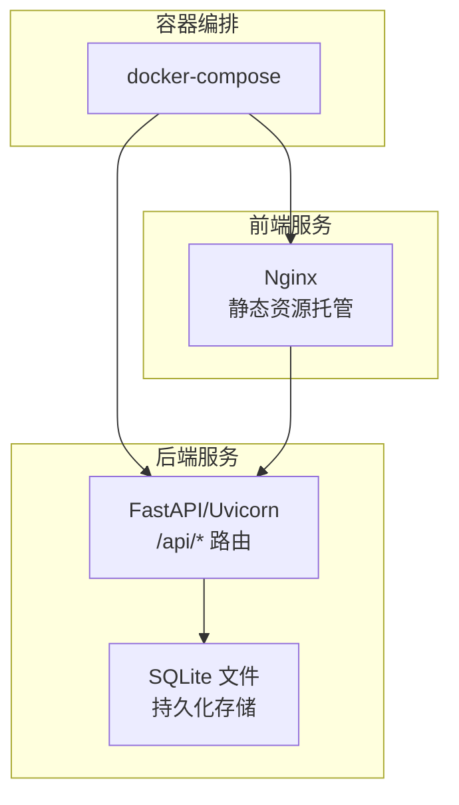
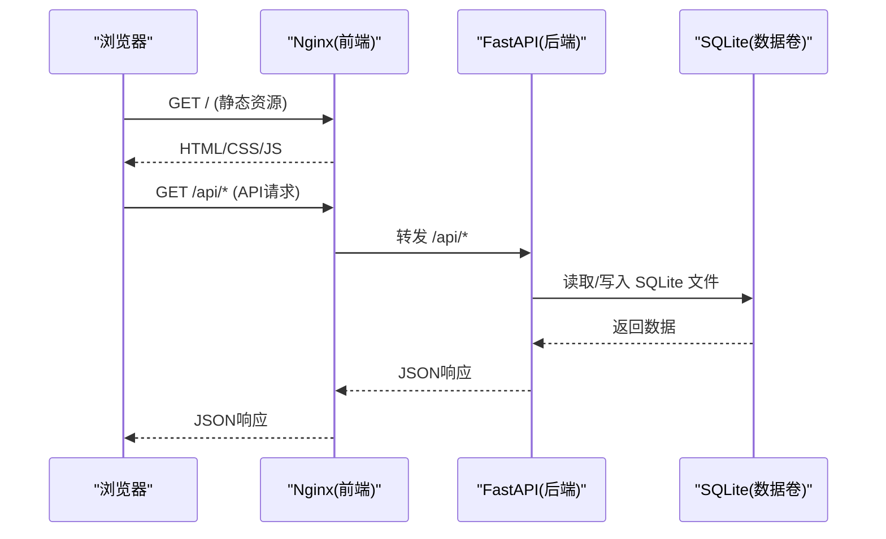
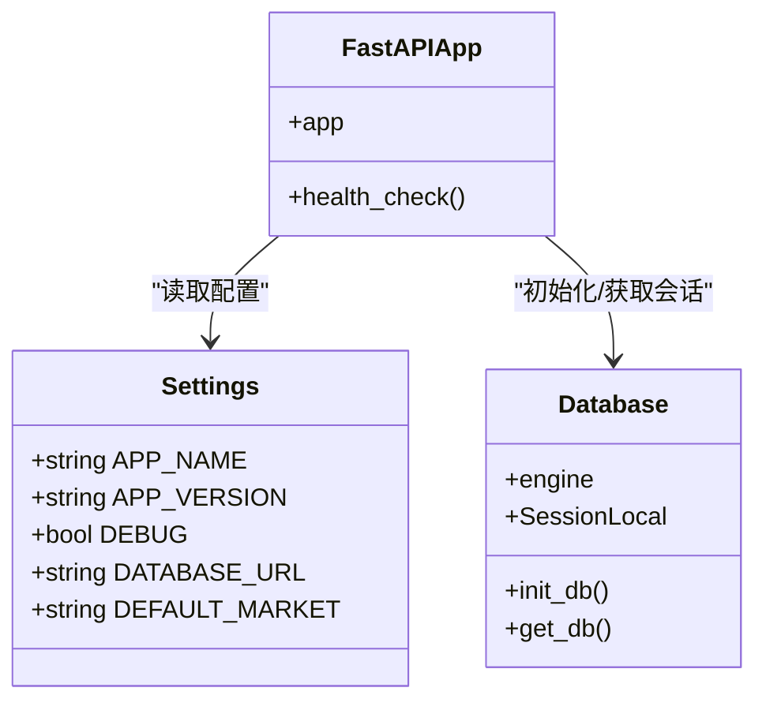
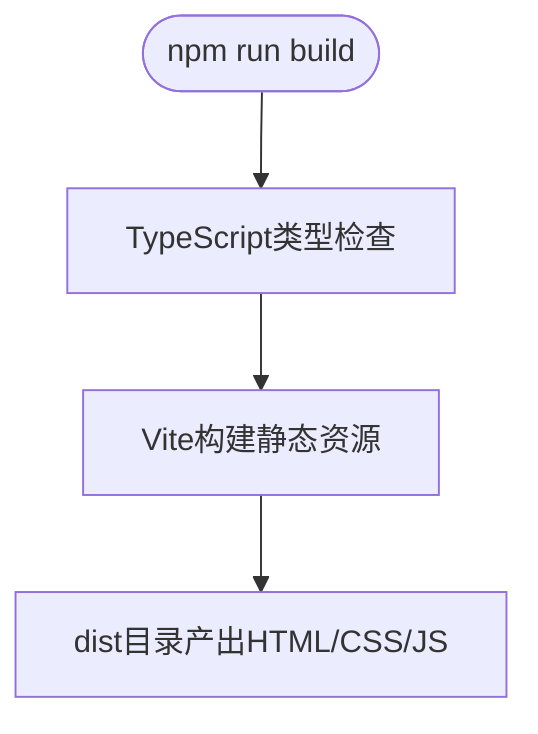
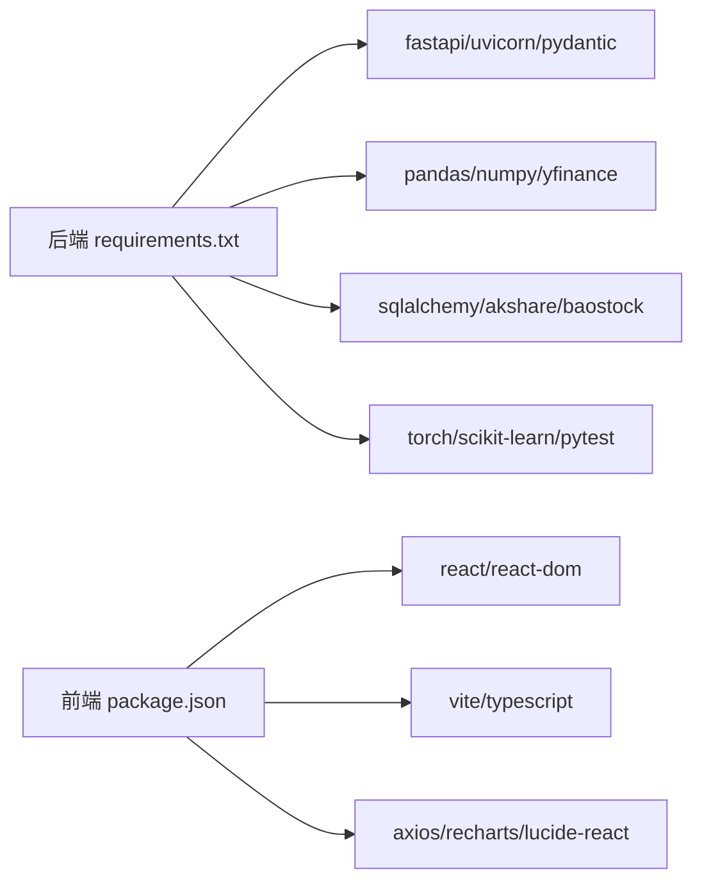

# Docker容器化部署

<cite>
**本文引用的文件**   
- [backend/main.py](../../../../backend/main.py)
- [backend/requirements.txt](../../../../backend/requirements.txt)
- [backend/app/core/config.py](../../../../backend/app/core/config.py)
- [backend/app/db/database.py](../../../../backend/app/db/database.py)
- [frontend/package.json](../../../../frontend/package.json)
- [frontend/vite.config.ts](../../../../frontend/vite.config.ts)
- [Makefile](../../../../Makefile)
- [QUICKSTART.md](../../../../QUICKSTART.md)
</cite>

## 目录
1. [简介](#简介)
2. [项目结构](#项目结构)
3. [核心组件](#核心组件)
4. [架构总览](#架构总览)
5. [详细组件分析](#详细组件分析)
6. [依赖关系分析](#依赖关系分析)
7. [性能与镜像优化](#性能与镜像优化)
8. [故障排查指南](#故障排查指南)
9. [结论](#结论)
10. [附录：Dockerfile与docker-compose示例](#附录dockerfile与docker-compose示例)

## 简介
本文件面向生产环境，提供该量化策略查看系统的完整Docker容器化部署方案。内容覆盖后端FastAPI应用的镜像构建、前端React静态资源打包与Nginx托管、多阶段构建策略、环境变量配置、端口映射、数据卷挂载、容器间通信、网络配置、健康检查、日志收集、资源限制等最佳实践，并给出可落地的Dockerfile与docker-compose示例路径说明。

## 项目结构
仓库采用前后端分离结构：
- 后端：FastAPI + Uvicorn，提供REST API与健康检查接口，使用SQLite作为默认数据库，支持通过环境变量注入配置。
- 前端：React + Vite，开发时通过Vite代理转发到后端；生产环境将静态资源由Nginx托管。

**图表来源**
- [backend/main.py:9-35](../../../../backend/main.py#L9-L35)
- [backend/app/db/database.py:9-19](../../../../backend/app/db/database.py#L9-L19)
- [frontend/vite.config.ts:6-14](../../../../frontend/vite.config.ts#L6-L14)

**章节来源**
- [backend/main.py:1-36](../../../../backend/main.py#L1-L36)
- [backend/app/core/config.py:8-24](../../../../backend/app/core/config.py#L8-L24)
- [backend/app/db/database.py:1-29](../../../../backend/app/db/database.py#L1-L29)
- [frontend/package.json:6-12](../../../../frontend/package.json#L6-L12)
- [frontend/vite.config.ts:1-16](../../../../frontend/vite.config.ts#L1-L16)

## 核心组件
- 后端FastAPI应用
  - 入口与路由注册、CORS中间件、健康检查端点。
  - 配置中心基于pydantic-settings，支持从.env与环境变量加载。
  - 数据库层使用SQLAlchemy+SQLite，提供会话管理。
- 前端React应用
  - 使用Vite进行开发与构建，开发模式通过代理访问后端API。
  - 生产构建输出静态资源，可由Nginx托管。

**章节来源**
- [backend/main.py:9-35](../../../../backend/main.py#L9-L35)
- [backend/app/core/config.py:8-24](../../../../backend/app/core/config.py#L8-L24)
- [backend/app/db/database.py:9-28](../../../../backend/app/db/database.py#L9-L28)
- [frontend/package.json:6-12](../../../../frontend/package.json#L6-L12)
- [frontend/vite.config.ts:6-14](../../../../frontend/vite.config.ts#L6-L14)

## 架构总览
下图展示容器化后的系统交互：浏览器访问Nginx（前端静态资源），Nginx反向代理API请求至FastAPI；FastAPI读写SQLite数据库文件。

**图表来源**
- [backend/main.py:24-35](../../../../backend/main.py#L24-L35)
- [backend/app/db/database.py:9-19](../../../../backend/app/db/database.py#L9-L19)
- [frontend/vite.config.ts:6-14](../../../../frontend/vite.config.ts#L6-L14)

## 详细组件分析

### 后端FastAPI应用
- 启动与路由
  - 创建FastAPI实例，注册CORS中间件，挂载策略、回测、市场数据三个路由模块，并提供根路径与健康检查端点。
- 配置与环境变量
  - 通过Settings类定义APP_NAME、APP_VERSION、DEBUG、DATABASE_URL、DEFAULT_MARKET等配置项，支持从.env与环境变量注入。
- 数据库
  - 使用SQLAlchemy创建引擎与会话，默认SQLite文件路径由DATABASE_URL决定，提供init_db与get_db工具函数。

**图表来源**
- [backend/app/core/config.py:8-24](../../../../backend/app/core/config.py#L8-L24)
- [backend/app/db/database.py:9-28](../../../../backend/app/db/database.py#L9-L28)
- [backend/main.py:9-35](../../../../backend/main.py#L9-L35)

**章节来源**
- [backend/main.py:9-35](../../../../backend/main.py#L9-L35)
- [backend/app/core/config.py:8-24](../../../../backend/app/core/config.py#L8-L24)
- [backend/app/db/database.py:9-28](../../../../backend/app/db/database.py#L9-L28)

### 前端React应用
- 开发模式
  - Vite在本地3000端口运行，并将/api路径代理到http://localhost:8000，便于本地联调。
- 构建产物
  - npm run build会执行TypeScript类型检查与Vite构建，输出静态资源供Nginx托管。

**图表来源**
- [frontend/package.json:6-12](../../../../frontend/package.json#L6-L12)
- [frontend/vite.config.ts:6-14](../../../../frontend/vite.config.ts#L6-L14)

**章节来源**
- [frontend/package.json:6-12](../../../../frontend/package.json#L6-L12)
- [frontend/vite.config.ts:1-16](../../../../frontend/vite.config.ts#L1-L16)

## 依赖关系分析
- 后端依赖
  - fastapi、uvicorn、pydantic、pandas、numpy、yfinance、plotly、sqlalchemy、akshare、baostock、torch、scikit-learn、pytest等。
- 前端依赖
  - React生态、Vite、TypeScript、recharts、axios、lucide-react等。

**图表来源**
- [backend/requirements.txt:1-16](../../../../backend/requirements.txt#L1-L16)
- [frontend/package.json:13-26](../../../../frontend/package.json#L13-L26)

**章节来源**
- [backend/requirements.txt:1-16](../../../../backend/requirements.txt#L1-L16)
- [frontend/package.json:13-26](../../../../frontend/package.json#L13-L26)

## 性能与镜像优化
- 多阶段构建
  - 后端：第一阶段安装Python依赖，第二阶段仅拷贝运行时所需代码与依赖，减小镜像体积。
  - 前端：第一阶段Node构建静态资源，第二阶段Nginx托管，避免在运行时引入Node/npm。
- 依赖管理与缓存
  - 先复制requirements.txt与package.json，再复制源码，利用Docker层缓存加速重复构建。
  - 固定依赖版本，确保构建可重现。
- 启动时间优化
  - 后端使用Uvicorn单进程或gunicorn+workers按需配置；关闭不必要的调试功能。
  - 前端静态资源启用Gzip/Brotli压缩（Nginx）。
- 资源限制
  - 在docker-compose中为每个服务设置CPU与内存上限，防止资源争用。
- 健康检查
  - 后端暴露/api/health，容器健康检查定期调用。
- 日志收集
  - 使用Docker默认json-file驱动，结合外部日志采集器（如Fluent Bit）统一收集。
- 数据持久化
  - SQLite文件通过数据卷挂载，保证数据不随容器销毁而丢失。

[本节为通用指导，无需特定文件引用]

## 故障排查指南
- 后端启动失败：模块未找到
  - 确认已安装requirements.txt中的依赖，且镜像构建阶段正确复制了依赖。
- 前端启动失败：Cannot find module
  - 清理node_modules后重新安装依赖，确保TypeScript与Vite版本兼容。
- 端口被占用
  - 释放8000与3000端口，或在compose中调整端口映射。
- 获取股票数据失败
  - 检查网络连接与数据源可用性；必要时切换为模拟数据。
- Transformer深度学习策略不可用
  - 安装PyTorch CPU精简版与scikit-learn。

**章节来源**
- [QUICKSTART.md:236-291](../../../../QUICKSTART.md#L236-L291)

## 结论
通过多阶段构建、环境变量注入、端口映射与数据卷挂载，配合健康检查、日志收集与资源限制，可将该量化策略查看系统稳定地部署到生产环境。建议在生产环境中使用外部数据库替代SQLite，并根据业务规模调整Uvicorn workers数量与Nginx并发参数。

[本节为总结性内容，无需特定文件引用]

## 附录：Dockerfile与docker-compose示例

### 后端Dockerfile（多阶段构建）
- 构建阶段
  - 基础镜像：python:3.11-slim
  - 安装系统依赖与Python依赖（requirements.txt）
  - 复制后端源码
- 运行阶段
  - 仅包含运行时依赖与源码
  - 以非root用户运行
  - 暴露8000端口
  - 启动命令：uvicorn main:app --host 0.0.0.0 --port 8000

参考实现位置：[backend/Dockerfile.backend](../../../../backend/Dockerfile.backend)

**章节来源**
- [backend/main.py:9-35](../../../../backend/main.py#L9-L35)
- [backend/requirements.txt:1-16](../../../../backend/requirements.txt#L1-L16)

### 前端Dockerfile（多阶段构建）
- 构建阶段
  - 基础镜像：node:18-alpine
  - 安装依赖（package.json）
  - 执行npm run build生成静态资源
- 运行阶段
  - 基础镜像：nginx:alpine
  - 复制构建产物到/usr/share/nginx/html
  - 暴露80端口
  - 可选：配置Nginx反向代理到后端API（当后端不在同一容器时）

参考实现位置：[frontend/Dockerfile.frontend](../../../../frontend/Dockerfile.frontend)

**章节来源**
- [frontend/package.json:6-12](../../../../frontend/package.json#L6-L12)
- [frontend/vite.config.ts:6-14](../../../../frontend/vite.config.ts#L6-L14)

### docker-compose.yml（容器编排）
- 服务定义
  - backend：构建后端镜像，挂载SQLite数据卷，暴露8000端口，设置环境变量（DATABASE_URL、DEFAULT_MARKET等），添加健康检查。
  - frontend：构建前端镜像，暴露80端口，可选反向代理到backend。
- 网络
  - 默认bridge网络，容器间通过服务名通信（例如frontend访问backend:8000）。
- 数据卷
  - 为SQLite文件创建命名卷，避免数据丢失。
- 资源限制
  - 为各服务设置CPU与内存上限。

参考实现位置：[docker-compose.yml](../../../../docker-compose.yml)

**章节来源**
- [backend/app/core/config.py:8-24](../../../../backend/app/core/config.py#L8-L24)
- [backend/app/db/database.py:9-19](../../../../backend/app/db/database.py#L9-L19)
- [backend/main.py:33-35](../../../../backend/main.py#L33-L35)

### 环境变量与配置清单
- 后端环境变量
  - DATABASE_URL：数据库连接字符串（默认SQLite文件路径）
  - DEFAULT_MARKET：默认市场（CN/US/HK）
  - DEBUG：是否开启调试模式
- 前端环境变量
  - 生产环境可通过构建时注入API_BASE_URL，或通过Nginx反向代理统一处理

参考实现位置：
- [backend/app/core/config.py:8-24](../../../../backend/app/core/config.py#L8-L24)
- [frontend/vite.config.ts:6-14](../../../../frontend/vite.config.ts#L6-L14)

**章节来源**
- [backend/app/core/config.py:8-24](../../../../backend/app/core/config.py#L8-L24)
- [frontend/vite.config.ts:6-14](../../../../frontend/vite.config.ts#L6-L14)

### 健康检查与日志
- 健康检查
  - 后端/api/health返回{"status":"healthy"}，用于容器健康探测。
- 日志
  - 使用Docker默认json-file驱动，可在docker-compose中配置日志轮转与大小限制。

参考实现位置：
- [backend/main.py:33-35](../../../../backend/main.py#L33-L35)

**章节来源**
- [backend/main.py:33-35](../../../../backend/main.py#L33-L35)

### 端口映射与数据卷挂载
- 端口映射
  - 前端：宿主机80 -> 容器80
  - 后端：宿主机8000 -> 容器8000
- 数据卷挂载
  - SQLite数据文件挂载到宿主机的持久化目录，避免容器重建导致数据丢失。

参考实现位置：
- [docker-compose.yml](../../../../docker-compose.yml)

**章节来源**
- [docker-compose.yml](../../../../docker-compose.yml)

### 依赖管理与版本控制
- 后端依赖锁定
  - 使用requirements.txt固定版本，确保构建可重现。
- 前端依赖锁定
  - 使用package-lock.json锁定依赖版本。
- 构建缓存优化
  - 先复制依赖清单文件，再复制源码，充分利用Docker层缓存。

参考实现位置：
- [backend/requirements.txt:1-16](../../../../backend/requirements.txt#L1-L16)
- [frontend/package.json:1-28](../../../../frontend/package.json#L1-L28)

**章节来源**
- [backend/requirements.txt:1-16](../../../../backend/requirements.txt#L1-L16)
- [frontend/package.json:1-28](../../../../frontend/package.json#L1-L28)