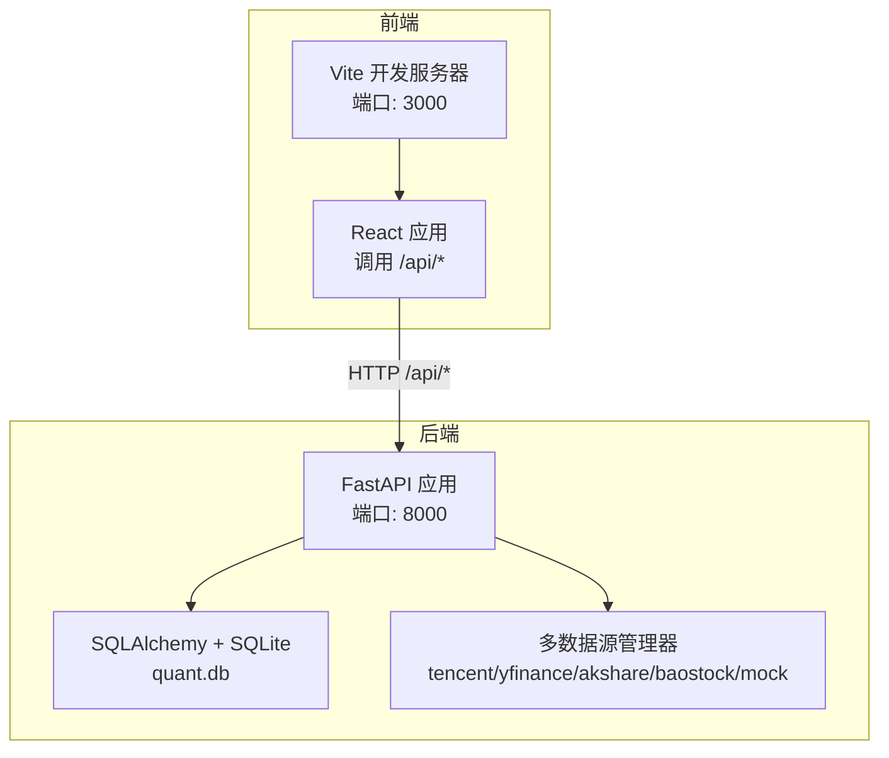
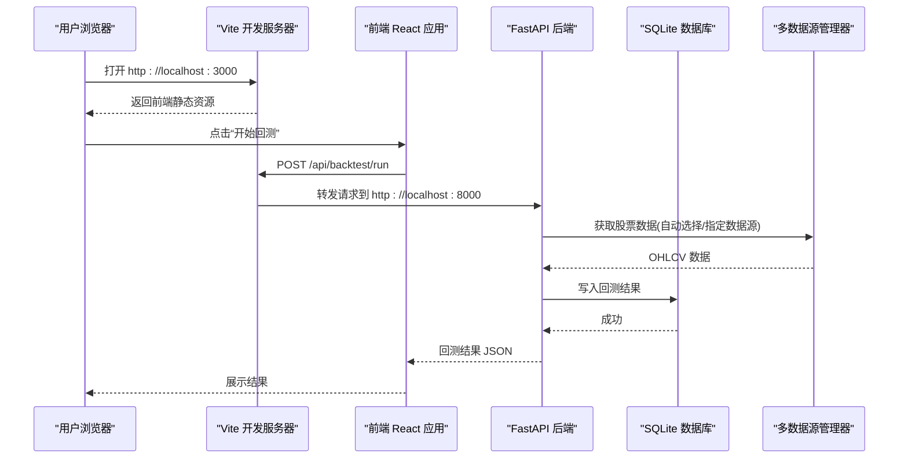
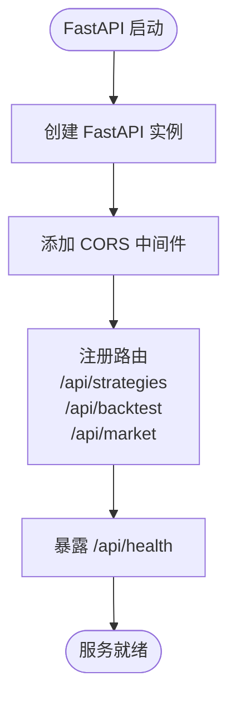
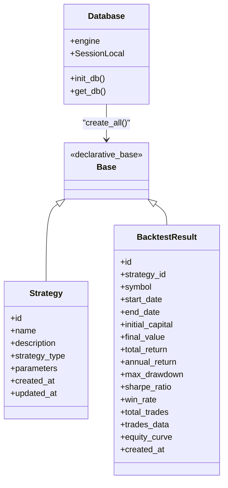
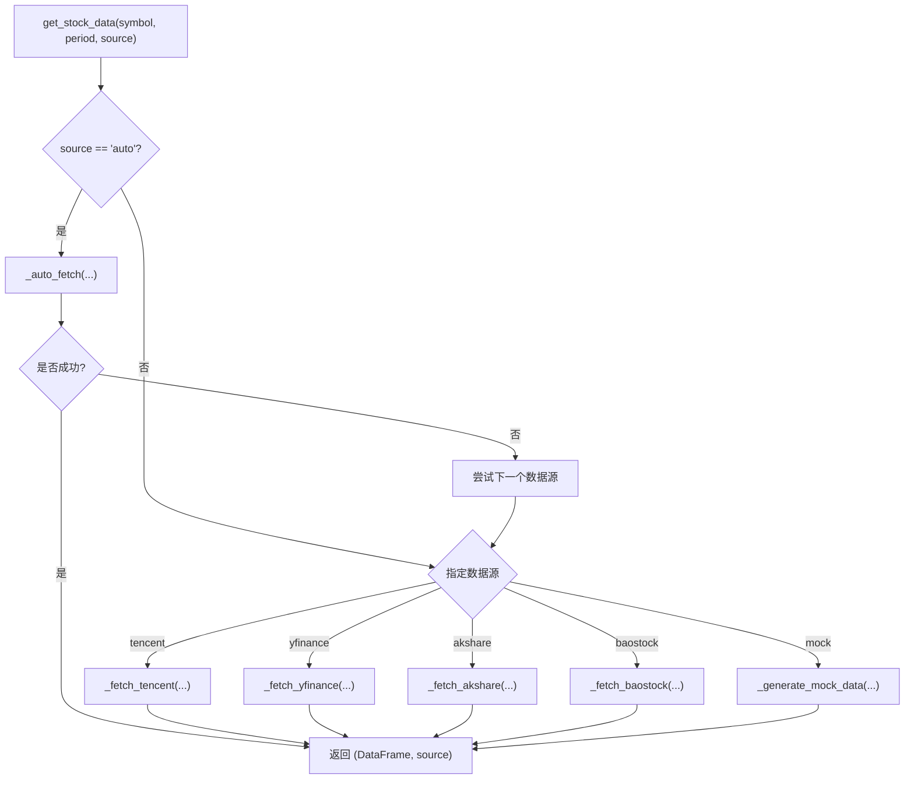
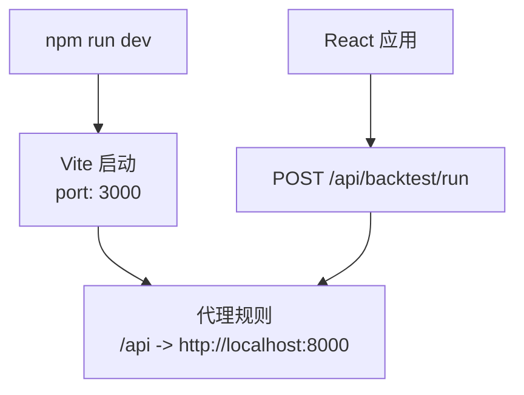
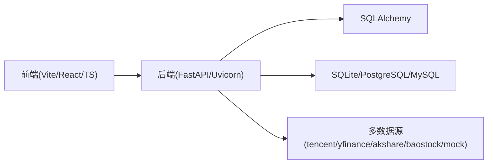
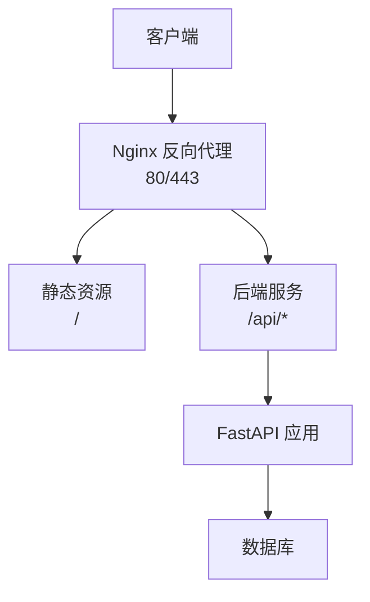
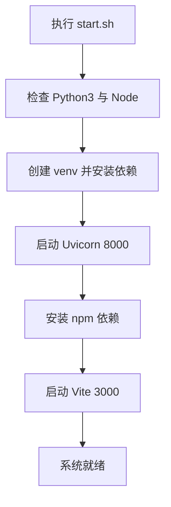

# 部署运维

<cite>
**本文引用的文件**   
- [backend/main.py](../../../backend/main.py)
- [backend/app/core/config.py](../../../backend/app/core/config.py)
- [backend/app/db/database.py](../../../backend/app/db/database.py)
- [backend/app/models/models.py](../../../backend/app/models/models.py)
- [backend/app/services/data_source_manager.py](../../../backend/app/services/data_source_manager.py)
- [frontend/vite.config.ts](../../../frontend/vite.config.ts)
- [frontend/src/App.tsx](../../../frontend/src/App.tsx)
- [Makefile](../../../Makefile)
- [start.sh](../../../start.sh)
- [QUICKSTART.md](../../../QUICKSTART.md)
</cite>

## 目录
1. [简介](#简介)
2. [项目结构](#项目结构)
3. [核心组件](#核心组件)
4. [架构总览](#架构总览)
5. [详细组件分析](#详细组件分析)
6. [依赖关系分析](#依赖关系分析)
7. [性能与容量规划](#性能与容量规划)
8. [监控、日志与可观测性](#监控日志与可观测性)
9. [安全加固与访问控制](#安全加固与访问控制)
10. [备份恢复与灾难恢复](#备份恢复与灾难恢复)
11. [容器化与反向代理](#容器化与反向代理)
12. [自动化部署与运维脚本](#自动化部署与运维脚本)
13. [故障排查手册](#故障排查手册)
14. [结论](#结论)

## 简介
本文件面向生产环境，提供量化交易平台的部署与运维指南。内容覆盖开发环境搭建、生产部署、容器化（Docker）、环境变量配置、后端服务（FastAPI）与数据库连接、前端构建优化（Vite）、反向代理（Nginx）、监控告警、日志收集、性能监控、错误追踪、备份恢复、灾备方案、扩缩容指导、安全加固、访问控制、数据加密与隐私保护，以及自动化部署流程与运维脚本。

## 项目结构
仓库采用前后端分离：
- 后端：FastAPI + SQLAlchemy + SQLite（默认），支持多数据源获取行情数据
- 前端：React + Vite，开发时通过代理转发到后端 API
- 根目录提供一键启动脚本与通用 Makefile 任务

图表来源
- [frontend/vite.config.ts:4-15](../../../frontend/vite.config.ts#L4-L15)
- [frontend/src/App.tsx:13-36](../../../frontend/src/App.tsx#L13-L36)
- [backend/main.py:9-27](../../../backend/main.py#L9-L27)
- [backend/app/db/database.py:9-14](../../../backend/app/db/database.py#L9-L14)
- [backend/app/services/data_source_manager.py:14-54](../../../backend/app/services/data_source_manager.py#L14-L54)

章节来源
- [backend/main.py:1-36](../../../backend/main.py#L1-L36)
- [frontend/vite.config.ts:1-16](../../../frontend/vite.config.ts#L1-L16)
- [frontend/src/App.tsx:1-100](../../../frontend/src/App.tsx#L1-L100)
- [backend/app/db/database.py:1-29](../../../backend/app/db/database.py#L1-L29)
- [backend/app/services/data_source_manager.py:1-54](../../../backend/app/services/data_source_manager.py#L1-L54)

## 核心组件
- FastAPI 应用入口：定义路由、CORS、健康检查
- 配置中心：基于 pydantic-settings 的环境变量加载
- 数据库层：SQLAlchemy 引擎与会话管理，SQLite 默认
- 数据源管理器：统一的多数据源接入与自动降级
- 前端构建：Vite 开发服务器与 API 代理

章节来源
- [backend/main.py:9-35](../../../backend/main.py#L9-L35)
- [backend/app/core/config.py:8-24](../../../backend/app/core/config.py#L8-L24)
- [backend/app/db/database.py:9-28](../../../backend/app/db/database.py#L9-L28)
- [backend/app/services/data_source_manager.py:14-54](../../../backend/app/services/data_source_manager.py#L14-L54)
- [frontend/vite.config.ts:4-15](../../../frontend/vite.config.ts#L4-L15)

## 架构总览
系统由前端页面发起回测请求，经 Vite 代理转发至 FastAPI 后端；后端根据策略与参数执行回测，读取或生成行情数据，持久化结果到数据库。

图表来源
- [frontend/src/App.tsx:13-36](../../../frontend/src/App.tsx#L13-L36)
- [frontend/vite.config.ts:8-12](../../../frontend/vite.config.ts#L8-L12)
- [backend/main.py:24-27](../../../backend/main.py#L24-L27)
- [backend/app/services/data_source_manager.py:17-54](../../../backend/app/services/data_source_manager.py#L17-L54)
- [backend/app/db/database.py:17-28](../../../backend/app/db/database.py#L17-L28)

## 详细组件分析

### 后端服务（FastAPI）
- 应用初始化：标题、描述、版本
- CORS 中间件：允许跨域（开发阶段宽放开）
- 路由注册：策略、回测、市场数据
- 健康检查：/api/health

图表来源
- [backend/main.py:9-35](../../../backend/main.py#L9-L35)

章节来源
- [backend/main.py:1-36](../../../backend/main.py#L1-L36)

### 配置与环境变量
- Settings 类集中管理 APP_NAME、APP_VERSION、DEBUG、DATABASE_URL、DEFAULT_MARKET
- 从 .env 文件加载环境变量（pydantic-settings）

建议的生产环境变量
- DATABASE_URL：指向生产数据库（如 PostgreSQL/MySQL）
- DEFAULT_MARKET：CN/US/HK
- DEBUG：False
- 其他可选：LOG_LEVEL、RATE_LIMIT、CORS_ORIGINS（按需扩展）

章节来源
- [backend/app/core/config.py:8-24](../../../backend/app/core/config.py#L8-L24)

### 数据库连接与模型
- 使用 SQLAlchemy 创建引擎与会话
- 默认 SQLite，connect_args 针对 SQLite 线程安全
- 提供 init_db 与 get_db 依赖注入函数

图表来源
- [backend/app/db/database.py:9-28](../../../backend/app/db/database.py#L9-L28)
- [backend/app/models/models.py:8-44](../../../backend/app/models/models.py#L8-L44)

章节来源
- [backend/app/db/database.py:1-29](../../../backend/app/db/database.py#L1-L29)
- [backend/app/models/models.py:1-44](../../../backend/app/models/models.py#L1-L44)

### 多数据源管理器
- 统一接口 get_stock_data，支持 auto/tencent/yfinance/akshare/baostock/mock
- 自动选择逻辑：A股/港股优先腾讯财经，其次 yfinance，再 AKShare/BaoStock，最后模拟数据
- 各数据源实现独立方法，统一输出 OHLCV DataFrame

图表来源
- [backend/app/services/data_source_manager.py:17-109](../../../backend/app/services/data_source_manager.py#L17-L109)

章节来源
- [backend/app/services/data_source_manager.py:1-469](../../../backend/app/services/data_source_manager.py#L1-L469)

### 前端构建与代理
- Vite 开发服务器端口 3000
- 将 /api 请求代理到后端 http://localhost:8000
- React 应用发起回测请求到 /api/backtest/run

图表来源
- [frontend/vite.config.ts:4-15](../../../frontend/vite.config.ts#L4-L15)
- [frontend/src/App.tsx:13-36](../../../frontend/src/App.tsx#L13-L36)

章节来源
- [frontend/vite.config.ts:1-16](../../../frontend/vite.config.ts#L1-L16)
- [frontend/src/App.tsx:1-100](../../../frontend/src/App.tsx#L1-L100)

## 依赖关系分析
- 后端依赖：FastAPI、Uvicorn、SQLAlchemy、Pydantic Settings、pandas/numpy、requests、可选 yfinance/akshare/baostock/pytorch/scikit-learn
- 前端依赖：React、Vite、TypeScript、lucide-react
- 运行时依赖：Python 3.8+、Node.js 16+

图表来源
- [backend/main.py:4-7](../../../backend/main.py#L4-L7)
- [backend/app/db/database.py:4-7](../../../backend/app/db/database.py#L4-L7)
- [backend/app/services/data_source_manager.py:5-8](../../../backend/app/services/data_source_manager.py#L5-L8)
- [frontend/vite.config.ts:1-2](../../../frontend/vite.config.ts#L1-L2)

章节来源
- [backend/main.py:1-36](../../../backend/main.py#L1-L36)
- [backend/app/db/database.py:1-29](../../../backend/app/db/database.py#L1-L29)
- [backend/app/services/data_source_manager.py:1-54](../../../backend/app/services/data_source_manager.py#L1-L54)
- [frontend/vite.config.ts:1-16](../../../frontend/vite.config.ts#L1-L16)

## 性能与容量规划
- 后端
  - 使用 Uvicorn 多 worker 进程提升并发能力
  - 将 SQLite 替换为 PostgreSQL/MySQL 以支撑高并发与大数据量
  - 对热点数据引入缓存（Redis/Memcached），减少重复计算
- 前端
  - 生产构建启用代码分割与压缩（Vite 默认已优化）
  - 静态资源 CDN 加速
- 数据源
  - 对第三方数据源增加重试与超时控制
  - 本地缓存历史数据，降低网络抖动影响

[本节为通用指导，不直接分析具体文件]

## 监控、日志与错误追踪
- 健康检查：/api/health 用于探针与负载均衡器探测
- 结构化日志：在 FastAPI 中集成 logging，按模块与级别输出
- 指标采集：暴露 /metrics（Prometheus），或使用 APM（Sentry、OpenTelemetry）
- 告警：基于日志关键字与指标阈值设置告警规则（CPU、内存、错误率、延迟）
- 错误追踪：捕获异常并上报到错误追踪平台，附带上下文信息

章节来源
- [backend/main.py:33-35](../../../backend/main.py#L33-L35)

## 安全加固与访问控制
- CORS 收紧：生产环境限制 allow_origins 为可信域名
- 认证鉴权：为 API 增加 JWT/OAuth2 认证与角色权限控制
- 输入校验：使用 Pydantic 严格校验请求体与路径参数
- 速率限制：对高频接口实施限流（IP/用户维度）
- HTTPS：通过 Nginx 终止 TLS，强制 HTTP->HTTPS 跳转
- 敏感信息：数据库密码、密钥等通过环境变量注入，禁止硬编码
- 数据安全：传输加密（TLS），存储敏感字段加密（AES），最小权限原则

章节来源
- [backend/main.py:15-22](../../../backend/main.py#L15-L22)
- [backend/app/core/config.py:8-24](../../../backend/app/core/config.py#L8-L24)

## 备份恢复与灾难恢复
- 数据库备份
  - SQLite：定期拷贝 quant.db，注意一致性（停机或 WAL 模式）
  - PostgreSQL/MySQL：使用原生工具（pg_dump、mysqldump）定时备份
- 增量与快照：结合云盘快照或对象存储（S3/OSS）进行增量备份
- 恢复演练：定期验证备份可用性与恢复时间目标（RTO/RPO）
- 灾备方案：异地多活或主从复制，故障自动切换

章节来源
- [backend/app/db/database.py:9-14](../../../backend/app/db/database.py#L9-L14)
- [backend/app/models/models.py:11-44](../../../backend/app/models/models.py#L11-L44)

## 容器化与反向代理
- Docker 镜像
  - 后端：基于 Python 基础镜像，安装依赖，运行 Uvicorn
  - 前端：基于 Node 镜像构建静态资源，再由 Nginx 托管
- 环境变量
  - 通过 .env 或编排平台（K8s ConfigMap/Secret）注入
- 反向代理（Nginx）
  - 监听 80/443，静态资源由 Nginx 直接返回
  - /api 转发到后端服务
  - 开启 gzip、缓存头、HSTS、安全头

[本节为通用指导，不直接分析具体文件]

## 自动化部署与运维脚本
- 一键启动脚本 start.sh
  - 检查 Python3 与 Node 环境
  - 创建虚拟环境并安装后端依赖
  - 启动 Uvicorn（开发模式）
  - 安装前端依赖并启动 Vite 开发服务器
- Makefile 任务
  - check-backend：运行 pytest
  - check-frontend：TypeScript 类型检查
  - install-deps：安装前后端依赖

图表来源
- [start.sh:8-69](../../../start.sh#L8-L69)

章节来源
- [start.sh:1-69](../../../start.sh#L1-L69)
- [Makefile:1-21](../../../Makefile#L1-L21)
- [QUICKSTART.md:1-317](../../../QUICKSTART.md#L1-L317)

## 故障排查手册
- 后端启动失败
  - 现象：ModuleNotFoundError
  - 处理：确认虚拟环境激活，重新 pip install -r requirements.txt
- 前端启动失败
  - 现象：Cannot find module
  - 处理：删除 node_modules 与 package-lock.json，重新 npm install
- 端口被占用
  - 现象：Address already in use
  - 处理：释放 8000/3000 端口后重启
- 获取股票数据失败
  - 现象：回测结果显示“模拟数据”
  - 处理：检查网络、切换数据源、核对股票代码格式；必要时使用模拟数据测试
- Transformer 深度学习策略不可用
  - 现象：提示需要安装 PyTorch
  - 处理：安装 CPU 精简版 torch 与 scikit-learn

章节来源
- [QUICKSTART.md:236-291](../../../QUICKSTART.md#L236-L291)

## 结论
本运维文档围绕量化交易平台的前后端架构，提供了从开发到生产的完整部署与运维实践。通过标准化环境变量、容器化与反向代理、完善的监控与日志体系、严格的与安全加固措施，以及规范的备份与灾备策略，确保系统在复杂环境下稳定、安全、可扩展地运行。建议在生产环境中逐步替换 SQLite 为关系型数据库，引入缓存与消息队列，完善可观测性与自动化运维流水线，持续提升系统的可靠性与可维护性。