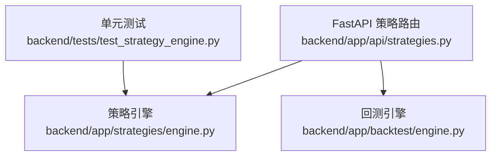
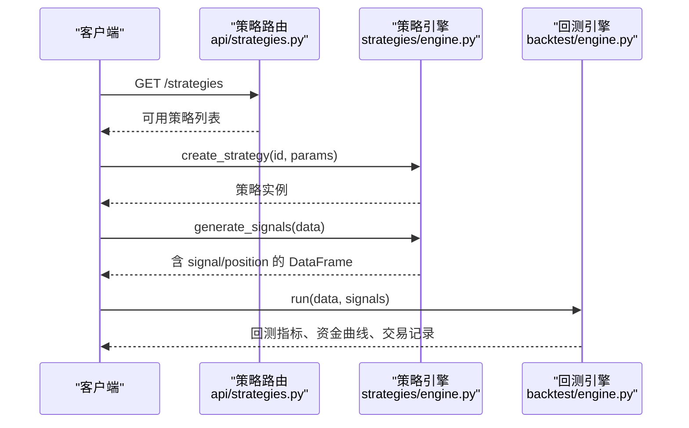
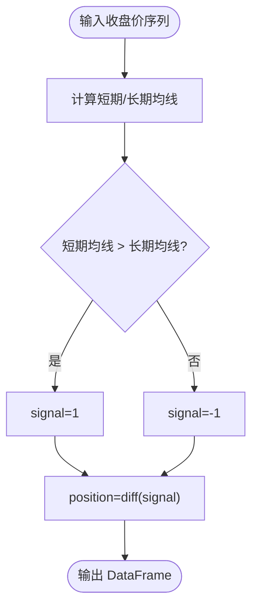
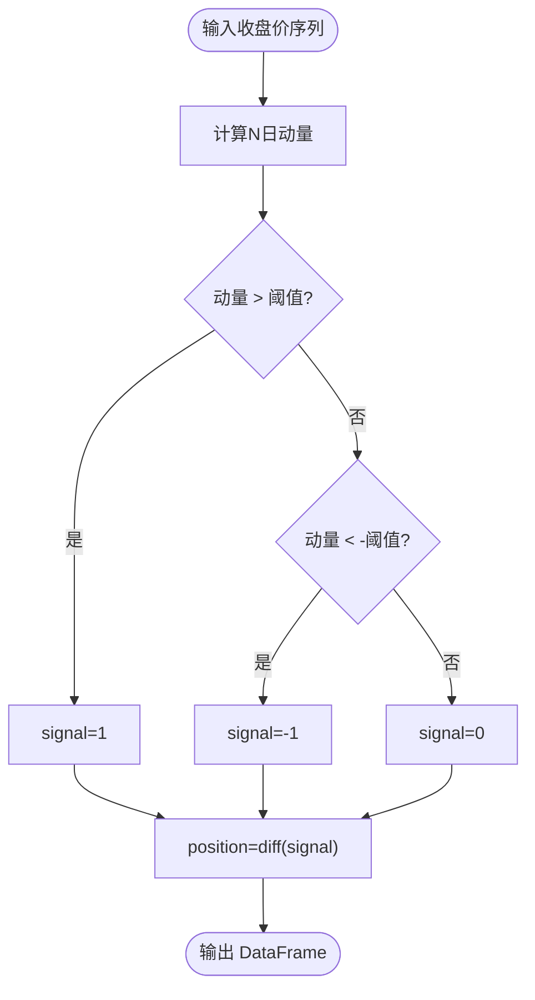
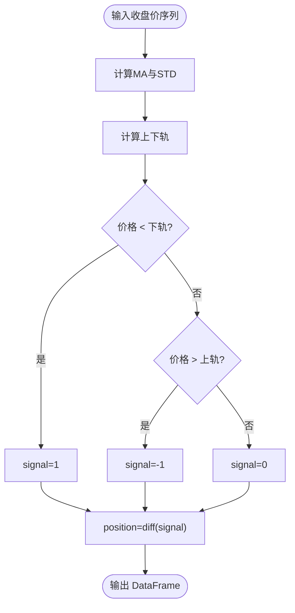
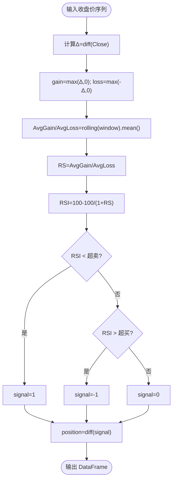
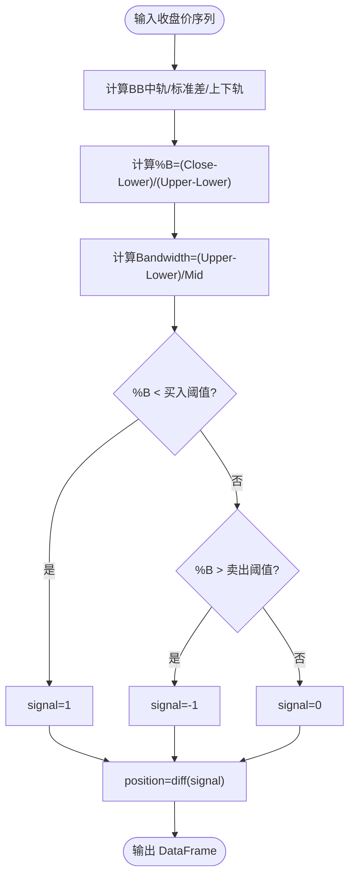
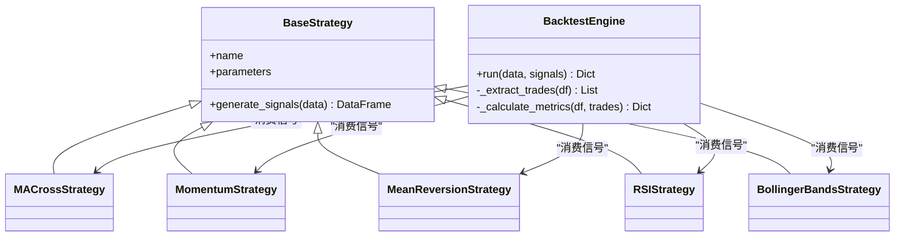
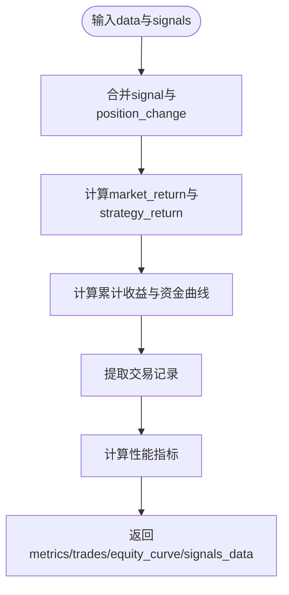

# 传统技术指标策略

<cite>
**本文引用的文件**   
- [backend/app/strategies/engine.py](../../../../backend/app/strategies/engine.py)
- [backend/app/backtest/engine.py](../../../../backend/app/backtest/engine.py)
- [backend/app/api/strategies.py](../../../../backend/app/api/strategies.py)
- [backend/tests/test_strategy_engine.py](../../../../backend/tests/test_strategy_engine.py)
</cite>

## 目录
1. [引言](#引言)
2. [项目结构](#项目结构)
3. [核心组件](#核心组件)
4. [架构总览](#架构总览)
5. [详细组件分析](#详细组件分析)
6. [依赖关系分析](#依赖关系分析)
7. [性能与回测指标解读](#性能与回测指标解读)
8. [参数调优建议](#参数调优建议)
9. [常见问题与排错](#常见问题与排错)
10. [结论](#结论)

## 引言
本文件面向量化交易初学者与进阶用户，系统讲解五种传统技术指标策略的实现原理与应用方法：均线交叉、动量、均值回归、RSI、布林带。文档从数学公式、信号生成逻辑、参数含义、适用场景出发，结合仓库中的具体实现，说明如何使用 pandas 计算技术指标、如何生成交易信号（1买入、-1卖出、0持有），以及 position 列的作用。同时给出参数调优建议、回测结果解读方法与实盘注意事项，帮助读者将策略从研究环境迁移到生产环境。

## 项目结构
本项目后端采用 FastAPI 暴露策略列表接口，策略引擎集中定义在 strategies/engine.py，回测引擎位于 backtest/engine.py。测试用例覆盖各策略的信号结构与关键属性校验。

图表来源
- [backend/app/api/strategies.py:1-25](../../../../backend/app/api/strategies.py#L1-L25)
- [backend/app/strategies/engine.py:1-656](../../../../backend/app/strategies/engine.py#L1-L656)
- [backend/app/backtest/engine.py:1-163](../../../../backend/app/backtest/engine.py#L1-L163)
- [backend/tests/test_strategy_engine.py:98-131](../../../../backend/tests/test_strategy_engine.py#L98-L131)

章节来源
- [backend/app/api/strategies.py:1-25](../../../../backend/app/api/strategies.py#L1-L25)
- [backend/app/strategies/engine.py:1-656](../../../../backend/app/strategies/engine.py#L1-L656)
- [backend/app/backtest/engine.py:1-163](../../../../backend/app/backtest/engine.py#L1-L163)
- [backend/tests/test_strategy_engine.py:98-131](../../../../backend/tests/test_strategy_engine.py#L98-L131)

## 核心组件
- BaseStrategy：策略基类，统一 generate_signals 接口，返回包含 signal 与 position 的 DataFrame。
- MACrossStrategy：均线交叉策略，短均线上穿长均线买入，下穿卖出。
- MomentumStrategy：动量策略，基于过去 N 日收益率超过阈值买入、低于负阈值卖出。
- MeanReversionStrategy：均值回归策略，价格偏离均值±标准差时反向交易。
- RSIStrategy：RSI 超买超卖策略，低于超卖线买入，高于超买线卖出。
- BollingerBandsStrategy：布林带策略，基于 %B 指标接近上下轨时交易。
- BacktestEngine：回测引擎，计算策略收益、资金曲线、回撤、夏普比率、胜率等指标。

章节来源
- [backend/app/strategies/engine.py:17-206](../../../../backend/app/strategies/engine.py#L17-L206)
- [backend/app/backtest/engine.py:10-163](../../../../backend/app/backtest/engine.py#L10-L163)

## 架构总览
策略通过 FastAPI 暴露可用策略清单；调用方传入策略 ID 与参数，由 create_strategy 构造具体策略实例并生成信号；BacktestEngine 接收 OHLCV 数据与信号，计算回测指标与交易记录。

图表来源
- [backend/app/api/strategies.py:11-24](../../../../backend/app/api/strategies.py#L11-L24)
- [backend/app/strategies/engine.py:506-656](../../../../backend/app/strategies/engine.py#L506-L656)
- [backend/app/backtest/engine.py:15-70](../../../../backend/app/backtest/engine.py#L15-L70)

## 详细组件分析

### 均线交叉策略（MACrossStrategy）
- 数学基础
  - 短期均线：MA_short = rolling(Close, short_window).mean()
  - 长期均线：MA_long = rolling(Close, long_window).mean()
  - 金叉：MA_short > MA_long → 买入信号
  - 死叉：MA_short < MA_long → 卖出信号
- 信号生成逻辑
  - signal ∈ {1, -1, 0}：根据均线相对位置赋值
  - position = diff(signal)：仅在信号变化时产生实际仓位变动
- 参数含义
  - short_window：短期窗口长度，越短越敏感
  - long_window：长期窗口长度，越长越平滑
- 适用场景
  - 趋势行情中捕捉方向性机会；震荡市中易出现频繁假信号
- pandas 计算要点
  - 使用 rolling().mean() 计算均线
  - 使用 diff() 生成仅变化的 position
- 代码路径参考
  - [backend/app/strategies/engine.py:28-54](../../../../backend/app/strategies/engine.py#L28-L54)

图表来源
- [backend/app/strategies/engine.py:38-54](../../../../backend/app/strategies/engine.py#L38-L54)

章节来源
- [backend/app/strategies/engine.py:28-54](../../../../backend/app/strategies/engine.py#L28-L54)

### 动量策略（MomentumStrategy）
- 数学基础
  - 动量：Momentum_t = (Close_t / Close_{t-n}) - 1，等价于 pct_change(periods=n)
- 信号生成逻辑
  - 当 Momentum > threshold → 买入
  - 当 Momentum < -threshold → 卖出
  - 否则持有
  - position = diff(signal)
- 参数含义
  - lookback_period：动量回溯期
  - threshold：动量阈值，过滤噪音
- 适用场景
  - 趋势延续阶段；对横盘震荡不友好
- pandas 计算要点
  - 使用 pct_change(periods=n) 计算动量
- 代码路径参考
  - [backend/app/strategies/engine.py:57-81](../../../../backend/app/strategies/engine.py#L57-L81)

图表来源
- [backend/app/strategies/engine.py:67-81](../../../../backend/app/strategies/engine.py#L67-L81)

章节来源
- [backend/app/strategies/engine.py:57-81](../../../../backend/app/strategies/engine.py#L57-L81)

### 均值回归策略（MeanReversionStrategy）
- 数学基础
  - 均值：MA = rolling(Close, window).mean()
  - 标准差：STD = rolling(Close, window).std()
  - 上轨：Upper = MA + num_std * STD
  - 下轨：Lower = MA - num_std * STD
- 信号生成逻辑
  - 价格低于下轨 → 买入
  - 价格高于上轨 → 卖出
  - position = diff(signal)
- 参数含义
  - window：滚动窗口长度
  - num_std：标准差倍数，控制通道宽度
- 适用场景
  - 震荡市；趋势市可能持续突破通道导致亏损
- pandas 计算要点
  - rolling().mean() 与 rolling().std() 组合构建通道
- 代码路径参考
  - [backend/app/strategies/engine.py:84-111](../../../../backend/app/strategies/engine.py#L84-L111)

图表来源
- [backend/app/strategies/engine.py:94-111](../../../../backend/app/strategies/engine.py#L94-L111)

章节来源
- [backend/app/strategies/engine.py:84-111](../../../../backend/app/strategies/engine.py#L84-L111)

### RSI策略（RSIStrategy）
- 数学基础
  - 涨跌分段：gain = max(Δ, 0), loss = max(-Δ, 0)
  - 平均涨跌：AvgGain = rolling(gain, period).mean()
  - 平均跌幅：AvgLoss = rolling(loss, period).mean()
  - RS = AvgGain / AvgLoss
  - RSI = 100 - 100 / (1 + RS)
- 信号生成逻辑
  - RSI < oversold → 买入
  - RSI > overbought → 卖出
  - position = diff(signal)
- 参数含义
  - period：RSI周期
  - oversold：超卖阈值
  - overbought：超买阈值
- 适用场景
  - 震荡或反转行情；单边趋势中可能出现长时间超买/超卖
- pandas 计算要点
  - 使用 diff() 与 where() 构造 gain/loss，再 rolling().mean()
- 代码路径参考
  - [backend/app/strategies/engine.py:114-150](../../../../backend/app/strategies/engine.py#L114-L150)

图表来源
- [backend/app/strategies/engine.py:126-150](../../../../backend/app/strategies/engine.py#L126-L150)

章节来源
- [backend/app/strategies/engine.py:114-150](../../../../backend/app/strategies/engine.py#L114-L150)

### 布林带策略（BollingerBandsStrategy）
- 数学基础
  - 中轨：BB_mid = rolling(Close, window).mean()
  - 标准差：BB_std = rolling(Close, window).std()
  - 上轨：BB_upper = BB_mid + num_std * BB_std
  - 下轨：BB_lower = BB_mid - num_std * BB_std
  - %B = (Close - BB_lower) / (BB_upper - BB_lower)
  - Bandwidth = (BB_upper - BB_lower) / BB_mid
- 信号生成逻辑
  - %B < buy_threshold → 买入（接近下轨）
  - %B > sell_threshold → 卖出（接近上轨）
  - position = diff(signal)
- 参数含义
  - window：滚动窗口
  - num_std：标准差倍数
  - buy_threshold：买入阈值（%B接近0）
  - sell_threshold：卖出阈值（%B接近1）
- 适用场景
  - 震荡市；带宽收窄后突破常伴随波动放大
- pandas 计算要点
  - 使用 rolling().mean() 与 rolling().std() 构建通道
  - 注意分母为0时的填充处理
- 代码路径参考
  - [backend/app/strategies/engine.py:153-205](../../../../backend/app/strategies/engine.py#L153-L205)

图表来源
- [backend/app/strategies/engine.py:174-205](../../../../backend/app/strategies/engine.py#L174-L205)

章节来源
- [backend/app/strategies/engine.py:153-205](../../../../backend/app/strategies/engine.py#L153-L205)

## 依赖关系分析
- 策略层
  - 所有策略继承 BaseStrategy，统一 generate_signals 接口
  - 策略内部依赖 pandas/numpy 进行向量化计算
- 回测层
  - BacktestEngine 依赖策略输出的 signal 与 position
  - 计算策略收益：strategy_return = market_return * signal.shift(1)
  - 提取交易记录：根据 position_change 判断买卖点
- API层
  - 提供 get_available_strategies 接口，返回策略元信息与参数范围

图表来源
- [backend/app/strategies/engine.py:17-206](../../../../backend/app/strategies/engine.py#L17-L206)
- [backend/app/backtest/engine.py:10-163](../../../../backend/app/backtest/engine.py#L10-L163)

章节来源
- [backend/app/strategies/engine.py:17-206](../../../../backend/app/strategies/engine.py#L17-L206)
- [backend/app/backtest/engine.py:10-163](../../../../backend/app/backtest/engine.py#L10-L163)

## 性能与回测指标解读
- 回测流程
  - 合并数据与信号，计算市场收益率与策略收益率
  - 累计收益与资金曲线
  - 提取交易记录（入场价、出场价、盈亏百分比）
- 关键指标
  - 总收益率、年化收益率
  - 最大回撤
  - 夏普比率（无风险利率默认3%，按日频率折算）
  - 胜率、盈亏比、总交易次数
- 信号与持仓
  - signal：当日目标仓位方向（1/-1/0）
  - position：当日仓位变动（diff(signal)），用于识别真实交易点
- 代码路径参考
  - [backend/app/backtest/engine.py:15-70](../../../../backend/app/backtest/engine.py#L15-L70)
  - [backend/app/backtest/engine.py:72-103](../../../../backend/app/backtest/engine.py#L72-L103)
  - [backend/app/backtest/engine.py:105-163](../../../../backend/app/backtest/engine.py#L105-L163)

图表来源
- [backend/app/backtest/engine.py:15-70](../../../../backend/app/backtest/engine.py#L15-L70)
- [backend/app/backtest/engine.py:72-163](../../../../backend/app/backtest/engine.py#L72-L163)

章节来源
- [backend/app/backtest/engine.py:15-163](../../../../backend/app/backtest/engine.py#L15-L163)

## 参数调优建议
- 均线交叉
  - 短窗与长窗比例建议至少 1:3~1:5，避免过于接近导致频繁交叉
  - 在趋势明显品种上表现更好；可结合波动率过滤
- 动量
  - lookback_period 与资产波动特性匹配；高波动品种可适当拉长周期
  - threshold 需根据历史分布设定，避免过紧导致过多交易
- 均值回归
  - window 与 num_std 共同决定通道宽度；num_std 越大越保守
  - 适合震荡品种；趋势市需谨慎
- RSI
  - period 常用 14；oversold/overbought 可在 20/80 或 30/70 间调整
  - 在强趋势中可能出现长时间超买/超卖，需配合趋势过滤
- 布林带
  - window 与 num_std 决定通道宽度；buy_threshold/sell_threshold 控制触发灵敏度
  - 结合 Bandwidth 收窄信号可提高质量

通用建议
- 使用滚动时间窗口验证（walk-forward）避免未来函数
- 多品种、多时段稳健性检验
- 考虑滑点与手续费对高频信号的侵蚀

章节来源
- [backend/app/strategies/engine.py:28-205](../../../../backend/app/strategies/engine.py#L28-L205)

## 常见问题与排错
- 信号为空或全零
  - 检查参数是否合理（如阈值过大、窗口过小）
  - 确认输入数据包含 Close 列且无缺失
- RSI 值不在 0-100
  - 检查 gain/loss 计算与 rolling 均值是否正确
  - 确保 period ≥ 1
- 布林带 %B 异常
  - 检查分母为0的处理（band_width=0 时填充 NaN）
  - 确认 upper/lower 计算顺序正确
- 回测收益异常
  - 检查 signal.shift(1) 的使用，避免未来函数
  - 确认 position_change 与交易记录提取逻辑一致
- 测试断言失败
  - 参考测试中对信号结构与列名的断言，确保输出符合预期

章节来源
- [backend/tests/test_strategy_engine.py:98-131](../../../../backend/tests/test_strategy_engine.py#L98-L131)
- [backend/app/backtest/engine.py:31-35](../../../../backend/app/backtest/engine.py#L31-L35)
- [backend/app/strategies/engine.py:126-150](../../../../backend/app/strategies/engine.py#L126-L150)
- [backend/app/strategies/engine.py:174-205](../../../../backend/app/strategies/engine.py#L174-L205)

## 结论
本仓库提供了完整的传统技术指标策略实现与回测框架。通过统一的策略接口与清晰的 pandas 向量化计算，读者可以快速复现均线交叉、动量、均值回归、RSI、布林带等经典策略，并结合回测引擎评估其表现。建议在研究中重视参数稳健性与样本外验证，在实盘中加入风控与成本模型，逐步过渡到更复杂的因子与机器学习策略。