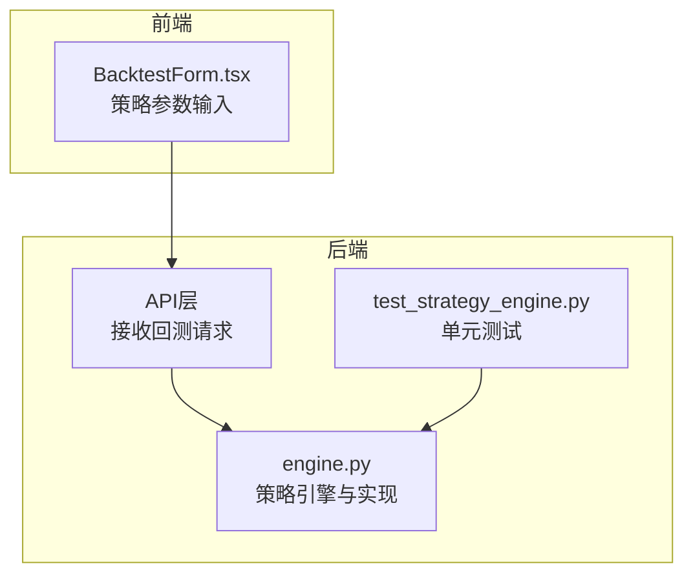
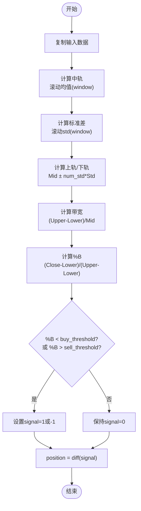
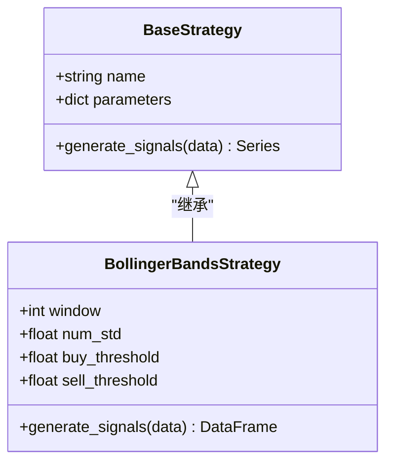
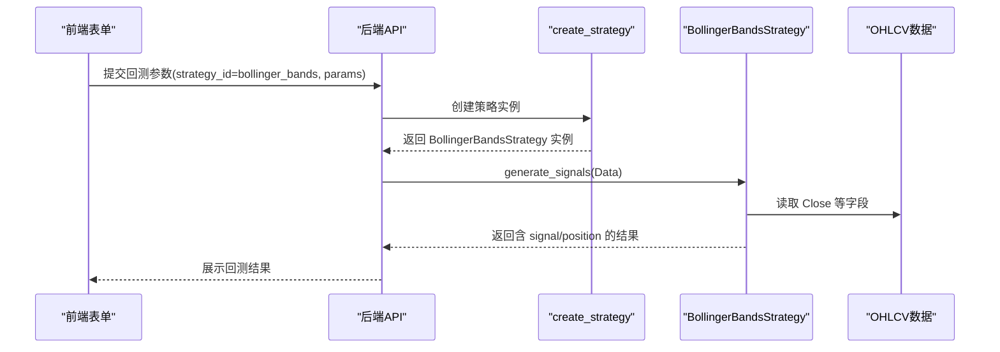
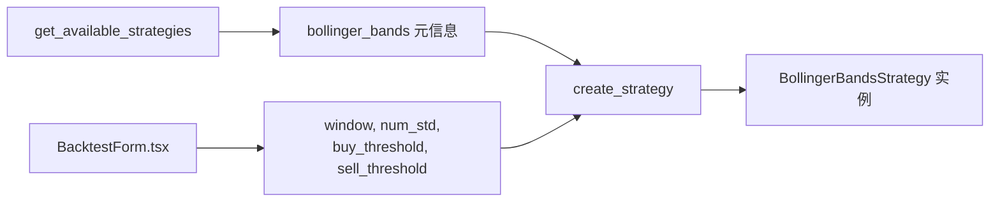

# 布林带策略

<cite>
**本文引用的文件**   
- [backend/app/strategies/engine.py](../../../../backend/app/strategies/engine.py)
- [frontend/src/components/BacktestForm.tsx](../../../../frontend/src/components/BacktestForm.tsx)
- [backend/tests/test_strategy_engine.py](../../../../backend/tests/test_strategy_engine.py)
</cite>

## 目录
1. [简介](#简介)
2. [项目结构](#项目结构)
3. [核心组件](#核心组件)
4. [架构总览](#架构总览)
5. [详细组件分析](#详细组件分析)
6. [依赖关系分析](#依赖关系分析)
7. [性能与实现特性](#性能与实现特性)
8. [参数优化与使用建议](#参数优化与使用建议)
9. [故障排查](#故障排查)
10. [结论](#结论)

## 简介
本文件面向量化交易使用者与技术读者，系统化讲解本项目中的布林带策略实现。文档重点包括：
- 布林带三轨结构（上轨、中轨、下轨）与带宽概念
- %B 指标的计算公式与含义
- 四个关键参数 window、num_std、buy_threshold、sell_threshold 的作用机制
- 结合 %B 与带宽收窄过滤假信号的先进思路
- 代码级实现路径与数据流图
- 不同波动率环境下的参数优化建议
- 突破行情与震荡行情的应用特点
- 带宽收窄作为变盘信号的技术意义

## 项目结构
本项目后端在策略引擎中实现了多种技术型策略，其中包含布林带策略；前端提供回测表单，支持对布林带策略进行参数配置。测试用例覆盖了策略注册、工厂创建以及信号列的完整性校验。

图表来源
- [frontend/src/components/BacktestForm.tsx:227-271](../../../../frontend/src/components/BacktestForm.tsx#L227-L271)
- [backend/app/strategies/engine.py:506-597](../../../../backend/app/strategies/engine.py#L506-L597)
- [backend/tests/test_strategy_engine.py:123-131](../../../../backend/tests/test_strategy_engine.py#L123-L131)

章节来源
- [backend/app/strategies/engine.py:1-15](../../../../backend/app/strategies/engine.py#L1-L15)
- [frontend/src/components/BacktestForm.tsx:1-48](../../../../frontend/src/components/BacktestForm.tsx#L1-L48)

## 核心组件
- 布林带策略类 BollingerBandsStrategy：负责计算布林带三轨、%B 指标、带宽，并基于阈值生成交易信号。
- 前端参数面板 BacktestForm：暴露 window、num_std、buy_threshold、sell_threshold 四个参数供用户调整。
- 测试用例 test_strategy_engine：验证策略输出包含 percent_b 等必要列，确保实现稳定可用。

章节来源
- [backend/app/strategies/engine.py:153-205](../../../../backend/app/strategies/engine.py#L153-L205)
- [frontend/src/components/BacktestForm.tsx:227-271](../../../../frontend/src/components/BacktestForm.tsx#L227-L271)
- [backend/tests/test_strategy_engine.py:123-131](../../../../backend/tests/test_strategy_engine.py#L123-L131)

## 架构总览
布林带策略的数据处理流程如下：
- 输入 OHLCV 数据（至少包含 Close）
- 计算中轨（移动平均）、标准差、上轨和下轨
- 计算带宽 Bandwidth = (Upper - Lower) / Mid
- 计算 %B = (Close - Lower) / (Upper - Lower)
- 根据 buy_threshold 与 sell_threshold 生成信号
- 输出 signal 与 position 列

图表来源
- [backend/app/strategies/engine.py:174-205](../../../../backend/app/strategies/engine.py#L174-L205)

## 详细组件分析

### 布林带三轨结构与带宽
- 中轨（bb_mid）：Close 的滚动均值，窗口为 window
- 标准差（bb_std）：Close 的滚动标准差，窗口为 window
- 上轨（bb_upper）：bb_mid + num_std * bb_std
- 下轨（bb_lower）：bb_mid - num_std * bb_std
- 带宽（bandwidth）：(bb_upper - bb_lower) / bb_mid，用于衡量波动率水平

上述计算均在 generate_signals 方法内完成，并通过 DataFrame 列的方式输出中间结果，便于分析与可视化。

章节来源
- [backend/app/strategies/engine.py:183-196](../../../../backend/app/strategies/engine.py#L183-L196)

### %B 指标计算公式与实现
- 公式：%B = (Close - Lower) / (Upper - Lower)
- 实现细节：
  - 先计算 band_width = Upper - Lower
  - 将 band_width 中的 0 替换为 NaN，避免除零错误
  - 计算 %B 后，用 0.5 填充缺失值，保证后续逻辑稳定

该实现确保了在极端窄带或价格等于上下轨时不会崩溃，同时保持 %B 处于合理区间附近。

章节来源
- [backend/app/strategies/engine.py:189-192](../../../../backend/app/strategies/engine.py#L189-L192)

### 参数说明与作用机制
- window：布林带计算的回看周期，控制中轨与标准差的平滑程度
- num_std：标准差倍数，决定上轨与下轨的宽度，影响超买超卖区域的敏感度
- buy_threshold：%B 的下限阈值，当 %B 低于此值视为接近下轨，触发买入信号
- sell_threshold：%B 的上限阈值，当 %B 高于此值视为接近上轨，触发卖出信号

这些参数在前端可配置，并在后端通过工厂函数 create_strategy 注入到 BollingerBandsStrategy 实例中。

章节来源
- [backend/app/strategies/engine.py:161-172](../../../../backend/app/strategies/engine.py#L161-L172)
- [frontend/src/components/BacktestForm.tsx:227-271](../../../../frontend/src/components/BacktestForm.tsx#L227-L271)
- [backend/app/strategies/engine.py:623-629](../../../../backend/app/strategies/engine.py#L623-L629)

### 信号生成逻辑与双重过滤思想
- 基础逻辑：
  - 当 %B < buy_threshold 时，signal = 1（买入）
  - 当 %B > sell_threshold 时，signal = -1（卖出）
  - 否则 signal = 0（持有）
- 位置变化：
  - position = diff(signal)，仅在信号发生变化时产生交易动作

关于“带宽收窄”过滤假信号的先进思想：
- 当前实现已计算 bandwidth 列，可用于事后分析或扩展增强逻辑
- 进阶用法：在 %B 接近下轨且 bandwidth 处于历史低位（收窄）时买入；在 %B 接近上轨且 bandwidth 收窄时卖出
- 这种双重过滤能有效降低震荡市中的假突破风险，提高信号质量

章节来源
- [backend/app/strategies/engine.py:198-205](../../../../backend/app/strategies/engine.py#L198-L205)
- [backend/app/strategies/engine.py:194-196](../../../../backend/app/strategies/engine.py#L194-L196)

### 类图（代码结构）

图表来源
- [backend/app/strategies/engine.py:17-25](../../../../backend/app/strategies/engine.py#L17-L25)
- [backend/app/strategies/engine.py:153-205](../../../../backend/app/strategies/engine.py#L153-L205)

### 序列图（回测调用链）

图表来源
- [backend/app/strategies/engine.py:600-629](../../../../backend/app/strategies/engine.py#L600-L629)
- [backend/app/strategies/engine.py:174-205](../../../../backend/app/strategies/engine.py#L174-L205)

## 依赖关系分析
- 策略注册表 get_available_strategies 提供 bollinger_bands 的策略元信息，包括参数类型与默认值
- 工厂函数 create_strategy 根据 strategy_id 构造具体策略实例
- 前端 BacktestForm 渲染 bollinger_bands 的参数输入控件，并将参数传递给后端

图表来源
- [backend/app/strategies/engine.py:506-597](../../../../backend/app/strategies/engine.py#L506-L597)
- [frontend/src/components/BacktestForm.tsx:227-271](../../../../frontend/src/components/BacktestForm.tsx#L227-L271)
- [backend/app/strategies/engine.py:623-629](../../../../backend/app/strategies/engine.py#L623-L629)

章节来源
- [backend/app/strategies/engine.py:506-597](../../../../backend/app/strategies/engine.py#L506-L597)
- [frontend/src/components/BacktestForm.tsx:227-271](../../../../frontend/src/components/BacktestForm.tsx#L227-L271)

## 性能与实现特性
- 向量化计算：使用 pandas rolling 计算均值与标准差，提升性能
- 防除零保护：在计算 %B 时将分母为 0 的位置替换为 NaN，再填充默认值
- 缺失值处理：bandwidth 和 percent_b 的缺失值被填充为 0 或 0.5，保证后续逻辑不中断
- 信号差分：position 由 signal.diff() 得到，减少重复交易

章节来源
- [backend/app/strategies/engine.py:183-196](../../../../backend/app/strategies/engine.py#L183-L196)
- [backend/app/strategies/engine.py:198-205](../../../../backend/app/strategies/engine.py#L198-L205)

## 参数优化与使用建议
- 波动率较低的市场（窄幅震荡）：
  - 适当减小 window（如 10-20），提高灵敏度
  - 适度增大 num_std（如 2.0-2.5），避免频繁穿越上下轨
  - buy_threshold 可设为 0.05-0.1，sell_threshold 设为 0.9-0.95
- 波动率较高的市场（宽幅震荡或趋势初期）：
  - 增大 window（如 20-40），平滑噪声
  - 降低 num_std（如 1.5-2.0），扩大通道范围
  - 放宽 buy_threshold（如 0.1-0.2），收紧 sell_threshold（如 0.85-0.95）
- 突破行情：
  - 关注带宽收窄后的放量突破，配合 %B 快速越过阈值
  - 可在带宽收窄阶段提前布局，等待方向确认
- 震荡行情：
  - 以 %B 接近下轨买入、接近上轨卖出为主
  - 结合带宽收窄过滤假信号，减少无效交易

带宽收窄作为变盘信号的技术意义：
- 带宽收窄意味着波动率下降，市场进入蓄势阶段
- 随后若出现放量突破，往往伴随趋势启动
- 因此，带宽收窄可作为变盘预警，配合 %B 的方向性信号提高胜率

章节来源
- [backend/app/strategies/engine.py:183-196](../../../../backend/app/strategies/engine.py#L183-L196)
- [backend/app/strategies/engine.py:198-205](../../../../backend/app/strategies/engine.py#L198-L205)

## 故障排查
- 现象：percent_b 列为空或异常
  - 检查输入数据是否包含 Close 列
  - 检查是否存在大量缺失值导致 rolling 计算失败
- 现象：信号过多或过少
  - 调整 buy_threshold 与 sell_threshold，缩小或扩大触发区间
  - 调整 num_std，改变通道宽度
- 现象：带宽为 0 或 NaN
  - 这是正常边界情况，代码已做填充处理
  - 如需进一步分析，可观察历史带宽分布，设定动态阈值

章节来源
- [backend/tests/test_strategy_engine.py:123-131](../../../../backend/tests/test_strategy_engine.py#L123-L131)
- [backend/app/strategies/engine.py:189-196](../../../../backend/app/strategies/engine.py#L189-L196)

## 结论
本项目的布林带策略实现了经典的三轨结构与 %B 指标，并通过可配置的 window、num_std、buy_threshold、sell_threshold 参数适应不同市场环境。虽然当前信号生成未直接内置带宽收窄过滤逻辑，但已计算 bandwidth 列，便于扩展与增强。建议在实战中结合带宽收窄与 %B 的双重过滤，以提升信号质量与稳定性。在不同波动率环境下，合理调参并结合市场形态（突破或震荡）选择适用策略，能显著提升回测与实盘表现。