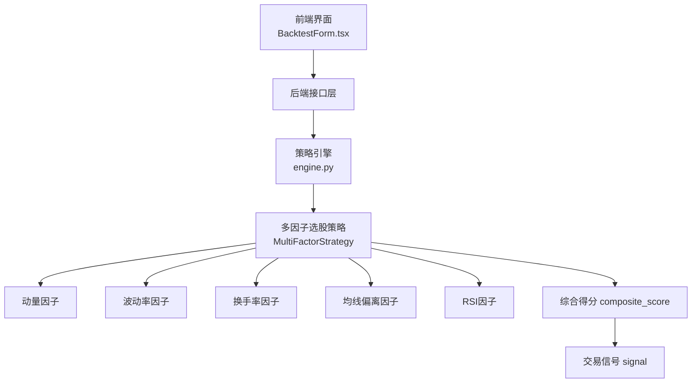
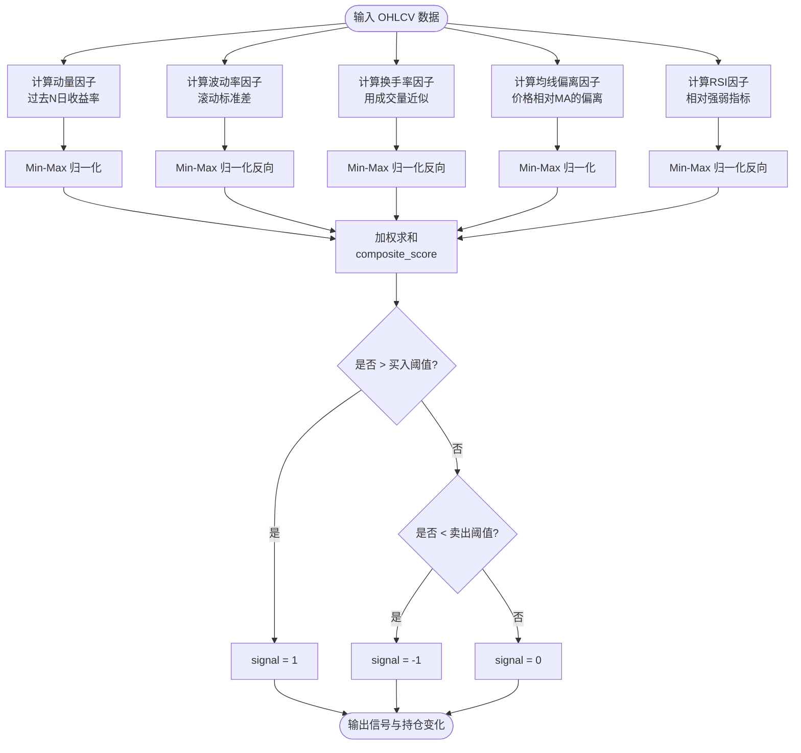
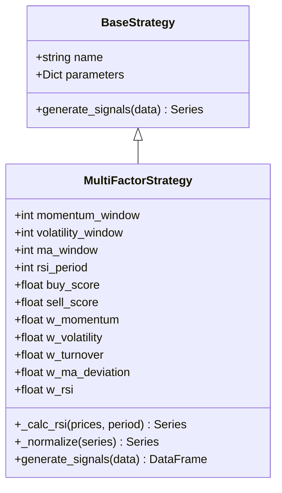
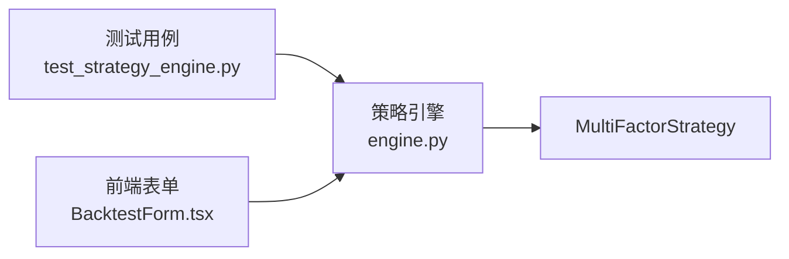

# 多因子选股策略

<cite>
**本文引用的文件**   
- [backend/app/strategies/engine.py](../../../../backend/app/strategies/engine.py)
- [frontend/src/components/BacktestForm.tsx](../../../../frontend/src/components/BacktestForm.tsx)
- [backend/tests/test_strategy_engine.py](../../../../backend/tests/test_strategy_engine.py)
</cite>

## 目录
1. [简介](#简介)
2. [项目结构](#项目结构)
3. [核心组件](#核心组件)
4. [架构总览](#架构总览)
5. [详细组件分析](#详细组件分析)
6. [依赖关系分析](#依赖关系分析)
7. [性能与实现要点](#性能与实现要点)
8. [参数配置指南](#参数配置指南)
9. [故障排查](#故障排查)
10. [结论](#结论)
11. [附录：代码片段路径索引](#附录代码片段路径索引)

## 简介
本文件面向“多因子选股策略”的完整技术说明，聚焦五大核心因子的计算、归一化、加权打分与信号生成逻辑。该策略在工程上由后端策略引擎实现，前端提供参数表单以调整关键阈值和周期。文档将帮助读者理解：
- 动量因子（过去N日收益率）
- 波动率因子（低波动率偏好）
- 换手率因子（低换手率偏好，以成交量近似）
- 均线偏离因子（价格相对均线的偏离程度）
- RSI因子（相对强弱）
并解释 Min-Max 归一化的应用、综合得分的计算方式以及买入/卖出信号的判定规则。同时给出在不同市场环境下的使用建议与调参思路。

## 项目结构
本项目采用前后端分离架构：
- 后端：FastAPI 服务 + 策略引擎（Python），包含多种策略实现，其中“多因子选股策略”位于策略引擎中。
- 前端：React/Vite 应用，提供回测表单，支持对多因子策略的关键参数进行可视化配置。

图表来源
- [backend/app/strategies/engine.py:208-324](../../../../backend/app/strategies/engine.py#L208-L324)
- [frontend/src/components/BacktestForm.tsx:275-346](../../../../frontend/src/components/BacktestForm.tsx#L275-L346)

章节来源
- [backend/app/strategies/engine.py:208-324](../../../../backend/app/strategies/engine.py#L208-L324)
- [frontend/src/components/BacktestForm.tsx:275-346](../../../../frontend/src/components/BacktestForm.tsx#L275-L346)

## 核心组件
- BaseStrategy：所有策略的基类，定义统一的 generate_signals 接口。
- MultiFactorStrategy：多因子选股策略的核心实现，负责五大因子计算、归一化、加权打分与信号生成。
- 前端 BacktestForm：为 multi_factor 策略暴露可调节的参数控件（动量周期、波动率周期、均线周期、RSI周期、买入阈值、卖出阈值）。

章节来源
- [backend/app/strategies/engine.py:17-26](../../../../backend/app/strategies/engine.py#L17-L26)
- [backend/app/strategies/engine.py:208-324](../../../../backend/app/strategies/engine.py#L208-L324)
- [frontend/src/components/BacktestForm.tsx:275-346](../../../../frontend/src/components/BacktestForm.tsx#L275-L346)

## 架构总览
下图展示多因子策略从输入数据到输出信号的端到端流程。

图表来源
- [backend/app/strategies/engine.py:267-324](../../../../backend/app/strategies/engine.py#L267-L324)

## 详细组件分析

### 多因子选股策略（MultiFactorStrategy）
该类实现了五因子框架：
- 动量因子：取 Close 的过去N日收益率，越高越好。
- 波动率因子：取收益率的滚动标准差，越低越好（因此对波动率取负号后再归一化）。
- 换手率因子：若存在 Volume 列，则以成交量的负值作为代理（越低越好），否则默认中性分 0.5。
- 均线偏离因子：(MA - Close)/MA，价格低于均线时得分更高（均值回归机会）。
- RSI因子：RSI 越低得分越高（超卖反弹机会），因此对 RSI 取负号再归一化。

所有因子经 Min-Max 归一化后，按权重线性加权得到 composite_score；当 composite_score 高于 buy_score 时产生买入信号，低于 sell_score 时产生卖出信号。

图表来源
- [backend/app/strategies/engine.py:17-26](../../../../backend/app/strategies/engine.py#L17-L26)
- [backend/app/strategies/engine.py:208-324](../../../../backend/app/strategies/engine.py#L208-L324)

#### 因子计算方法与方向性
- 动量因子 f_momentum：Close.pct_change(N)，越大越好；归一化后取值范围约[0,1]。
- 波动率因子 f_volatility：pct_change().rolling(std)，越小越好；实现中对波动率取负号再归一化，使低波对应高分。
- 换手率因子 f_turnover：若无 Volume，则赋值为 0.5；若有 Volume，则对 -Volume 做归一化，体现“低换手率偏好”。
- 均线偏离因子 f_ma_deviation：(MA - Close)/MA，正值表示价格低于均线，得分更高；归一化后用于加权。
- RSI因子 f_rsi：RSI 越低得分越高；实现中对 RSI 取负号再归一化。

章节来源
- [backend/app/strategies/engine.py:252-301](../../../../backend/app/strategies/engine.py#L252-L301)

#### 归一化方法（Min-Max）
_normalize 函数将序列映射至 [0,1]：
- 先 dropna，若为空或全相等则返回常数 0.5（避免除零与无意义缩放）。
- 否则执行 (x - min)/(max - min)。

注意：当前实现基于整列统计 min/max，未采用滚动窗口归一化。这在横截面场景下更合理，但在单标的时间序列场景中可能引入未来信息偏差。实际使用中建议根据数据形态选择滚动归一化或横截面归一化。

章节来源
- [backend/app/strategies/engine.py:260-265](../../../../backend/app/strategies/engine.py#L260-L265)

#### 加权打分与信号生成
- 各因子缺失值填充为 0.5（中性）。
- composite_score = Σ(权重 × 因子得分)。
- 信号规则：
  - composite_score > buy_score → signal=1（买入）
  - composite_score < sell_score → signal=-1（卖出）
  - 其他 → signal=0（持有）
- position = signal.diff() 用于标记买卖点变化。

章节来源
- [backend/app/strategies/engine.py:303-324](../../../../backend/app/strategies/engine.py#L303-L324)

#### RSI 计算细节
_calc_rsi 使用经典的 Wilder RSI 算法：
- 计算每日涨跌 delta
- gain/loss 分别取正收益与负损失的滚动均值
- RS = gain / loss
- RSI = 100 - 100/(1+RS)

章节来源
- [backend/app/strategies/engine.py:252-258](../../../../backend/app/strategies/engine.py#L252-L258)

### 前端参数表单（BacktestForm）
针对 multi_factor 策略，前端暴露以下可调参数：
- 动量周期 momentum_window
- 波动率周期 volatility_window
- 均线周期 ma_window
- RSI周期 rsi_period
- 买入阈值 buy_score
- 卖出阈值 sell_score

这些参数直接映射到后端 MultiFactorStrategy 的构造参数，便于用户在 UI 上进行回测对比。

章节来源
- [frontend/src/components/BacktestForm.tsx:275-346](../../../../frontend/src/components/BacktestForm.tsx#L275-L346)

## 依赖关系分析
- 策略引擎 engine.py 定义了 BaseStrategy 抽象类与多个具体策略，MultiFactorStrategy 继承自 BaseStrategy。
- 测试用例 test_strategy_engine.py 验证了 multi_factor 策略的信号结构与 composite_score 字段存在性。
- 前端 BacktestForm.tsx 通过表单控件驱动后端策略参数。

图表来源
- [backend/tests/test_strategy_engine.py:134-142](../../../../backend/tests/test_strategy_engine.py#L134-L142)
- [backend/app/strategies/engine.py:208-324](../../../../backend/app/strategies/engine.py#L208-L324)
- [frontend/src/components/BacktestForm.tsx:275-346](../../../../frontend/src/components/BacktestForm.tsx#L275-L346)

章节来源
- [backend/tests/test_strategy_engine.py:134-142](../../../../backend/tests/test_strategy_engine.py#L134-L142)
- [backend/app/strategies/engine.py:208-324](../../../../backend/app/strategies/engine.py#L208-L324)
- [frontend/src/components/BacktestForm.tsx:275-346](../../../../frontend/src/components/BacktestForm.tsx#L275-L346)

## 性能与实现要点
- 向量化计算：策略主要依赖 pandas/numpy 的滚动窗口与向量化运算，整体计算效率较高。
- 缺失值处理：因子缺失值统一填充为 0.5，避免 NaN 传播影响加权求和。
- 归一化边界：当序列全等或缺失时，_normalize 返回 0.5，保证数值稳定。
- 可扩展性：新增因子只需遵循“计算→归一化→加权”的流程，并在 composite_score 中累加。

[本节为通用指导，不直接分析具体文件]

## 参数配置指南
以下为 multi_factor 策略的关键参数与推荐用法：

- 周期类参数
  - momentum_window：动量回看天数，常用 10~60。趋势行情可适当拉长，震荡行情缩短。
  - volatility_window：波动率滚动窗口，常用 10~60。较短窗口更敏感，较长窗口更平滑。
  - ma_window：均线周期，常用 10~60。短周期更灵敏，长周期更稳健。
  - rsi_period：RSI 周期，常用 7~21。较短周期更敏感，较长周期更稳定。

- 阈值类参数
  - buy_score：买入阈值，默认 0.6，范围 0.5~0.9。提高阈值可减少买入频率，降低假突破风险。
  - sell_score：卖出阈值，默认 0.4，范围 0.1~0.5。降低阈值可延长持仓，提升捕捉趋势的能力。

- 权重类参数（构造函数内部）
  - w_momentum、w_volatility、w_turnover、w_ma_deviation、w_rsi：默认分别为 0.25、0.2、0.15、0.2、0.2。可根据市场风格微调，例如趋势市提高动量权重，震荡市提高均值回归（均线偏离）与 RSI 权重。

- 使用建议
  - 趋势市：提高动量与均线偏离权重，适度放宽买入阈值，收紧卖出阈值以锁定利润。
  - 震荡市：提高波动率与 RSI 权重，适当提高卖出阈值以更早止盈，降低买入阈值以避免追高。
  - 高波动环境：提高波动率因子权重，降低动量权重，避免被短期噪音误导。
  - 流动性不足：谨慎使用换手率因子，必要时将其权重降至接近 0，避免误判。

章节来源
- [backend/app/strategies/engine.py:220-250](../../../../backend/app/strategies/engine.py#L220-L250)
- [backend/app/strategies/engine.py:558-568](../../../../backend/app/strategies/engine.py#L558-L568)
- [frontend/src/components/BacktestForm.tsx:275-346](../../../../frontend/src/components/BacktestForm.tsx#L275-L346)

## 故障排查
- 现象：composite_score 始终为 0.5 或信号极少
  - 检查是否存在 Volume 列；若无，换手率因子恒为 0.5，可能削弱信号区分度。
  - 检查 _normalize 的输入是否为空或全相等；若是，会返回 0.5，导致因子失效。
- 现象：信号频繁反转
  - 调高 buy_score 与调低 sell_score，扩大“持有区间”，减少噪声交易。
  - 增大波动率与均线周期，平滑因子曲线。
- 现象：RSI 异常或 NaN
  - 检查价格序列是否存在极小值或零值导致除零；_calc_rsi 已对 loss 中的 0 替换为 NaN，但需确保输入数据质量。
- 现象：前端参数未生效
  - 确认前端表单参数键名与后端 create_strategy 映射一致（如 momentum_window、buy_score 等）。

章节来源
- [backend/app/strategies/engine.py:260-324](../../../../backend/app/strategies/engine.py#L260-L324)
- [backend/tests/test_strategy_engine.py:134-142](../../../../backend/tests/test_strategy_engine.py#L134-L142)

## 结论
多因子选股策略通过五个互补的量价维度构建综合评分，结合 Min-Max 归一化与线性加权，形成稳定的信号生成机制。其优势在于：
- 多维度分散单一指标的脆弱性
- 参数直观、易于在前端交互调优
- 实现简洁、易于扩展新因子

在实际应用中，建议结合市场风格动态调整权重与阈值，并通过历史回测与样本外检验持续优化。对于单标的时间序列场景，可考虑将归一化改为滚动窗口或横截面归一化，以降低潜在的未来信息泄露风险。

[本节为总结性内容，不直接分析具体文件]

## 附录：代码片段路径索引
- 多因子策略主实现与信号生成
  - [backend/app/strategies/engine.py:208-324](../../../../backend/app/strategies/engine.py#L208-L324)
- Min-Max 归一化实现
  - [backend/app/strategies/engine.py:260-265](../../../../backend/app/strategies/engine.py#L260-L265)
- RSI 计算实现
  - [backend/app/strategies/engine.py:252-258](../../../../backend/app/strategies/engine.py#L252-L258)
- 前端 multi_factor 参数表单
  - [frontend/src/components/BacktestForm.tsx:275-346](../../../../frontend/src/components/BacktestForm.tsx#L275-L346)
- 测试用例（信号结构与 composite_score 校验）
  - [backend/tests/test_strategy_engine.py:134-142](../../../../backend/tests/test_strategy_engine.py#L134-L142)