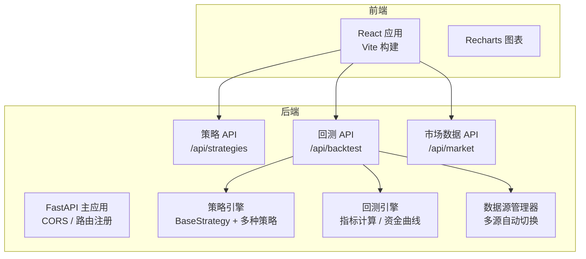
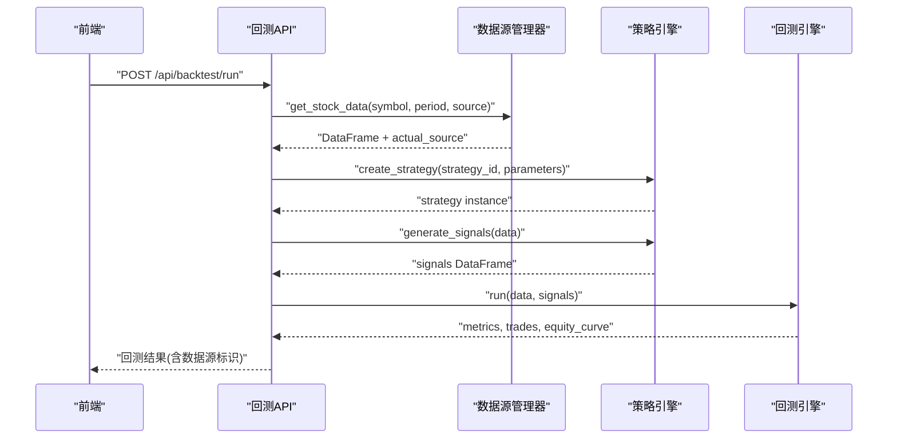
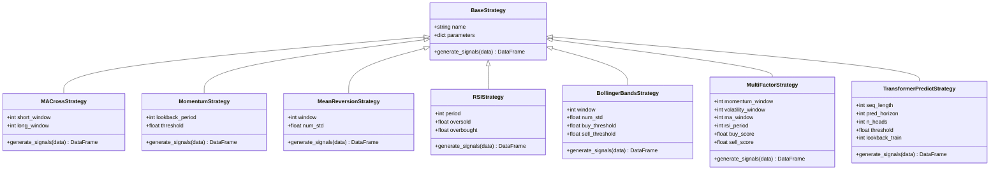
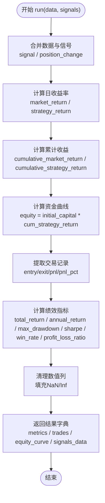
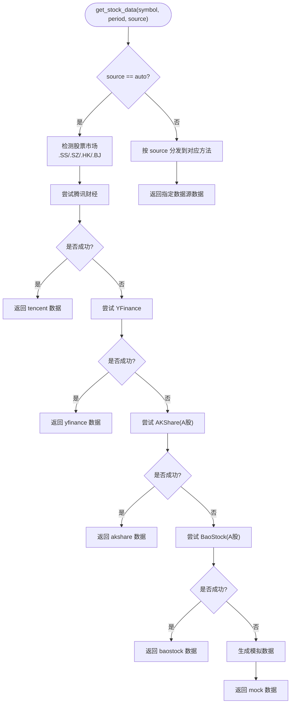
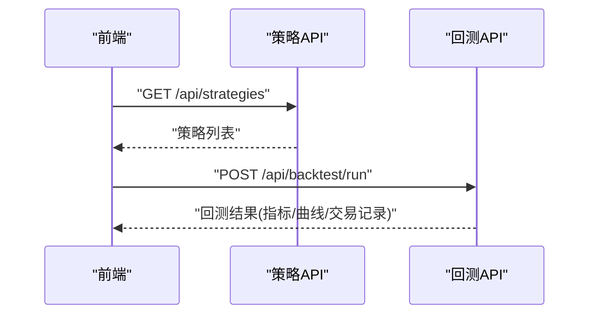
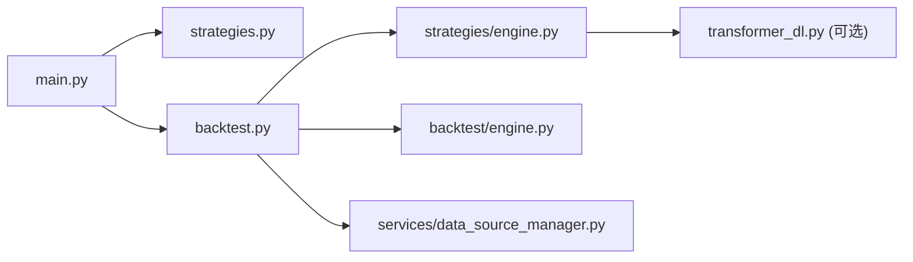

# 项目概述

<cite>
**本文引用的文件**   
- [README.md](../../README.md)
- [QUICKSTART.md](../../QUICKSTART.md)
- [DATA_SOURCES.md](../../DATA_SOURCES.md)
- [backend/main.py](../../backend/main.py)
- [backend/app/api/backtest.py](../../backend/app/api/backtest.py)
- [backend/app/api/strategies.py](../../backend/app/api/strategies.py)
- [backend/app/backtest/engine.py](../../backend/app/backtest/engine.py)
- [backend/app/strategies/engine.py](../../backend/app/strategies/engine.py)
- [backend/app/services/data_source_manager.py](../../backend/app/services/data_source_manager.py)
- [frontend/package.json](../../frontend/package.json)
</cite>

## 目录
1. [引言](#引言)
2. [项目结构](#项目结构)
3. [核心组件](#核心组件)
4. [架构总览](#架构总览)
5. [详细组件分析](#详细组件分析)
6. [依赖关系分析](#依赖关系分析)
7. [性能与可扩展性](#性能与可扩展性)
8. [故障排查指南](#故障排查指南)
9. [结论](#结论)

## 引言
本项目是一个本地运行的股票量化策略查看与回测系统，目标是帮助开发者快速实现、配置和测试量化交易策略。系统提供多类经典策略（趋势跟踪、均值回归、超买超卖、通道突破、多因子模型）以及深度学习相关策略，支持多数据源智能切换与自动降级，并提供完整的回测指标计算与可视化展示。

量化交易的基本概念是通过数学模型与规则在历史或实时市场中生成买卖信号，并通过回测评估策略的长期表现。回测的意义在于：在不投入真实资金的前提下，验证策略逻辑、参数敏感性与风险收益特征，从而降低实盘试错成本。

本项目的核心价值包括：
- 策略开发友好：统一策略接口，前端可动态调整参数并即时回测。
- 数据获取稳健：多数据源自动选择与降级，失败时兜底模拟数据，保证可用性。
- 回测指标完整：收益率、夏普比率、最大回撤、胜率、盈亏比等关键指标。
- 可视化直观：资金曲线、股价走势、交易记录一目了然。
- 技术栈现代：FastAPI 后端 + React 前端，前后端分离，易于扩展与维护。

**章节来源**
- [README.md:1-20](../../README.md#L1-L20)
- [QUICKSTART.md:1-20](../../QUICKSTART.md#L1-L20)

## 项目结构
项目采用前后端分离架构：
- 后端使用 FastAPI 提供 REST API，包含策略列表、回测执行与市场数据接口；内置策略引擎与回测引擎，支持多数据源管理。
- 前端使用 React + TypeScript + Vite，提供策略选择、参数表单、结果图表与交易记录展示。

**图示来源**
- [backend/main.py:9-27](../../backend/main.py#L9-L27)
- [backend/app/api/strategies.py:11-24](../../backend/app/api/strategies.py#L11-L24)
- [backend/app/api/backtest.py:28-66](../../backend/app/api/backtest.py#L28-L66)
- [backend/app/strategies/engine.py:17-25](../../backend/app/strategies/engine.py#L17-L25)
- [backend/app/backtest/engine.py:10-70](../../backend/app/backtest/engine.py#L10-L70)
- [backend/app/services/data_source_manager.py:14-54](../../backend/app/services/data_source_manager.py#L14-L54)

**章节来源**
- [README.md:148-187](../../README.md#L148-L187)
- [frontend/package.json:1-28](../../frontend/package.json#L1-L28)

## 核心组件
- 策略引擎：定义统一的 BaseStrategy 接口，提供均线交叉、动量、均值回归、RSI、布林带、多因子选股、Transformer 价格预测与 Transformer 深度学习策略等多种实现。
- 回测引擎：接收策略信号与行情数据，计算收益序列、资金曲线、交易记录及关键绩效指标。
- 数据源管理器：封装腾讯财经、YFinance、AKShare、BaoStock 与模拟数据的获取逻辑，支持自动选择与智能降级。
- API 层：暴露策略列表、回测执行与市场数据查询接口，串联前端请求到后端业务逻辑。
- 前端界面：提供策略选择、参数配置、回测触发与结果可视化（资金曲线、股价走势、交易记录）。

**章节来源**
- [backend/app/strategies/engine.py:17-25](../../backend/app/strategies/engine.py#L17-L25)
- [backend/app/backtest/engine.py:10-70](../../backend/app/backtest/engine.py#L10-L70)
- [backend/app/services/data_source_manager.py:14-54](../../backend/app/services/data_source_manager.py#L14-L54)
- [backend/app/api/strategies.py:11-24](../../backend/app/api/strategies.py#L11-L24)
- [backend/app/api/backtest.py:28-66](../../backend/app/api/backtest.py#L28-L66)

## 架构总览
系统整体流程如下：
- 前端用户选择策略与参数，发起回测请求。
- 后端回测 API 调用数据源管理器获取行情数据。
- 根据策略 ID 创建具体策略实例，生成交易信号。
- 将信号与行情数据输入回测引擎，计算指标与资金曲线。
- 返回结构化结果给前端进行可视化展示。

**图示来源**
- [backend/app/api/backtest.py:28-66](../../backend/app/api/backtest.py#L28-L66)
- [backend/app/services/data_source_manager.py:18-54](../../backend/app/services/data_source_manager.py#L18-L54)
- [backend/app/strategies/engine.py:600-656](../../backend/app/strategies/engine.py#L600-L656)
- [backend/app/backtest/engine.py:15-70](../../backend/app/backtest/engine.py#L15-L70)

## 详细组件分析

### 策略引擎与策略类
策略引擎通过 BaseStrategy 抽象出统一的 generate_signals 接口，各策略继承该基类实现各自的信号生成逻辑。可用策略列表由 get_available_strategies 提供，create_strategy 根据 strategy_id 创建对应实例。

**图示来源**
- [backend/app/strategies/engine.py:17-25](../../backend/app/strategies/engine.py#L17-L25)
- [backend/app/strategies/engine.py:28-54](../../backend/app/strategies/engine.py#L28-L54)
- [backend/app/strategies/engine.py:57-81](../../backend/app/strategies/engine.py#L57-L81)
- [backend/app/strategies/engine.py:84-111](../../backend/app/strategies/engine.py#L84-L111)
- [backend/app/strategies/engine.py:114-150](../../backend/app/strategies/engine.py#L114-L150)
- [backend/app/strategies/engine.py:153-205](../../backend/app/strategies/engine.py#L153-L205)
- [backend/app/strategies/engine.py:208-324](../../backend/app/strategies/engine.py#L208-L324)
- [backend/app/strategies/engine.py:327-503](../../backend/app/strategies/engine.py#L327-L503)

**章节来源**
- [backend/app/strategies/engine.py:17-25](../../backend/app/strategies/engine.py#L17-L25)
- [backend/app/strategies/engine.py:506-597](../../backend/app/strategies/engine.py#L506-L597)
- [backend/app/strategies/engine.py:600-656](../../backend/app/strategies/engine.py#L600-L656)

### 回测引擎与指标计算
回测引擎负责合并数据与信号、计算策略收益、累计收益与资金曲线，提取交易记录，并输出关键绩效指标（总收益率、年化收益率、最大回撤、夏普比率、胜率、盈亏比等）。

**图示来源**
- [backend/app/backtest/engine.py:15-70](../../backend/app/backtest/engine.py#L15-L70)
- [backend/app/backtest/engine.py:72-103](../../backend/app/backtest/engine.py#L72-L103)
- [backend/app/backtest/engine.py:105-162](../../backend/app/backtest/engine.py#L105-L162)

**章节来源**
- [backend/app/backtest/engine.py:10-163](../../backend/app/backtest/engine.py#L10-L163)

### 数据源管理与智能降级
数据源管理器统一封装多数据源获取逻辑，支持自动选择与指定数据源。对于 A 股/港股优先尝试腾讯财经，随后依次尝试 YFinance、AKShare、BaoStock，最终兜底为模拟数据。

**图示来源**
- [backend/app/services/data_source_manager.py:18-54](../../backend/app/services/data_source_manager.py#L18-L54)
- [backend/app/services/data_source_manager.py:56-109](../../backend/app/services/data_source_manager.py#L56-L109)
- [backend/app/services/data_source_manager.py:112-208](../../backend/app/services/data_source_manager.py#L112-L208)
- [backend/app/services/data_source_manager.py:250-274](../../backend/app/services/data_source_manager.py#L250-L274)
- [backend/app/services/data_source_manager.py:276-335](../../backend/app/services/data_source_manager.py#L276-L335)
- [backend/app/services/data_source_manager.py:337-417](../../backend/app/services/data_source_manager.py#L337-L417)
- [backend/app/services/data_source_manager.py:418-468](../../backend/app/services/data_source_manager.py#L418-L468)

**章节来源**
- [backend/app/services/data_source_manager.py:14-469](../../backend/app/services/data_source_manager.py#L14-L469)
- [DATA_SOURCES.md:45-58](../../DATA_SOURCES.md#L45-L58)

### API 层与前端交互
- 策略 API：提供策略列表与详情查询。
- 回测 API：接收回测请求，串联数据源、策略与回测引擎，返回结构化结果。
- 前端：基于 React + TypeScript + Vite，使用 Recharts 展示图表，Axios 调用后端 API。

**图示来源**
- [backend/app/api/strategies.py:11-24](../../backend/app/api/strategies.py#L11-L24)
- [backend/app/api/backtest.py:28-66](../../backend/app/api/backtest.py#L28-L66)
- [frontend/package.json:13-19](../../frontend/package.json#L13-L19)

**章节来源**
- [backend/app/api/strategies.py:1-25](../../backend/app/api/strategies.py#L1-L25)
- [backend/app/api/backtest.py:1-77](../../backend/app/api/backtest.py#L1-L77)
- [frontend/package.json:1-28](../../frontend/package.json#L1-L28)

## 依赖关系分析
- 后端入口 main.py 注册 CORS 中间件与路由，挂载策略、回测与市场数据三个子路由。
- 回测 API 依赖策略引擎（create_strategy）、回测引擎（BacktestEngine）与市场数据服务（MarketDataService）。
- 策略引擎依赖 pandas/numpy 进行数据处理，可选依赖 PyTorch/scikit-learn 以启用深度学习策略。
- 数据源管理器依赖 requests/yfinance/akshare/baostock，并在失败时回退到模拟数据。

**图示来源**
- [backend/main.py:9-27](../../backend/main.py#L9-L27)
- [backend/app/api/backtest.py:9-11](../../backend/app/api/backtest.py#L9-L11)
- [backend/app/strategies/engine.py:9-14](../../backend/app/strategies/engine.py#L9-L14)
- [backend/app/services/data_source_manager.py:5-11](../../backend/app/services/data_source_manager.py#L5-L11)

**章节来源**
- [backend/main.py:1-36](../../backend/main.py#L1-L36)
- [backend/app/api/backtest.py:1-77](../../backend/app/api/backtest.py#L1-L77)
- [backend/app/strategies/engine.py:1-14](../../backend/app/strategies/engine.py#L1-L14)
- [backend/app/services/data_source_manager.py:1-11](../../backend/app/services/data_source_manager.py#L1-L11)

## 性能与可扩展性
- 回测引擎对每日收益率与累计收益的计算采用向量化操作，时间复杂度近似 O(n)，适合中等规模历史数据。
- 多因子策略涉及多个技术指标计算与归一化，存在额外内存与计算开销，建议合理设置窗口长度与权重。
- Transformer 价格预测策略包含注意力机制与滚动训练窗口，计算复杂度较高，需权衡序列长度、头数与训练窗口大小。
- 数据源管理器在自动降级过程中可能多次网络请求，建议在高频回测场景缓存常用数据或限制重试次数。
- 前端图表渲染基于 Recharts，大数据量时建议分页或采样以降低渲染压力。

[本节为通用指导，不直接分析具体文件]

## 故障排查指南
- 后端启动失败（模块未找到）：检查 Python 虚拟环境与依赖安装。
- 前端启动失败（Cannot find module）：清理 node_modules 后重新安装依赖。
- 端口被占用：释放 8000/3000 端口。
- 获取股票数据失败：检查网络连接与股票代码格式；若自动降级为模拟数据，结果会标注“模拟数据”。
- Transformer 深度学习策略不可用：安装 PyTorch 与 scikit-learn。

**章节来源**
- [QUICKSTART.md:236-291](../../QUICKSTART.md#L236-L291)
- [README.md:189-195](../../README.md#L189-L195)

## 结论
本项目通过统一的策略接口、稳健的多数据源管理与完善的回测指标体系，为量化交易策略开发与回测提供了端到端的解决方案。其差异化优势体现在：
- 策略丰富且可扩展：从经典技术指标到深度学习策略，便于研究与实验。
- 数据获取鲁棒：智能降级与模拟数据兜底，确保系统稳定可用。
- 回测指标全面：覆盖收益、风险与交易统计，辅助策略评估与优化。
- 技术栈现代：FastAPI + React/Vite，前后端解耦，利于持续迭代与团队协作。

对于初学者，系统提供了友好的 UI 与清晰的策略说明；对于有经验的开发者，系统提供了可扩展的策略框架与灵活的参数配置，便于深入研究与策略定制。

[本节为总结性内容，不直接分析具体文件]